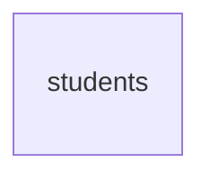

# Cadastro de alunos

## Problem

O sistema tem login, perfis e trilha de auditoria, e não tem a quem atender: não existe aluno. A
recepção de uma academia de bairro continua onde o PRD a encontrou - "cadastros em planilhas ou
sistemas legados (...) sem controle de quem acessa dados pessoais e sem rastreabilidade" (§1.2) -, e
as observações de saúde de cada aluno ficam nessa planilha em texto aberto, ao alcance de quem abrir
o arquivo. Quem paga é a academia, que responde pela exposição, e o aluno, dono do dado. As
features 5, 6, 9, 11 e 13 do roadmap (consentimento, foto, matrícula, check-in e privacidade)
dependem de existir um aluno para apontar.

O PRD não traz número de volume de hoje. O que ele fixa: RF-05 (os campos), RF-07 ("busca por nome,
CPF, telefone e status, com paginação e filtros"), RF-08 ("inativação (soft delete) preservando
histórico"), RF-31 ("campos sensíveis (saúde) criptografados em nível de aplicação"), a matriz de
perfis do §2 (Recepção cadastra e edita; Instrutor consulta "nome, foto, status; sem dados
sensíveis"), `students` com `cpf (único)` no §6 e o alvo "listagens < 500 ms (p95) até 20 mil
alunos" do §4.

Quando isto entrar: a recepção cadastra um aluno, acha-o por nome, CPF ou telefone num campo só,
corrige os dados, suspende, inativa e reativa; RH/Financeiro consulta sem ver saúde; o Instrutor vê
só nome e situação; as observações de saúde ficam cifradas no banco; e cada criação, edição e
inativação aparece na tela de Auditoria com autor, IP e o que mudou, sem nenhum dado pessoal na
trilha.

## Flow

Reutiliza a guarda por perfil (`apps/api/src/access.ts`), o `ValidationInterceptor` com `@Input` e
`@QueryInput`, o `ProblemFilter`, o gravador `audit.record` com `diffOf` e `@Actor`
(`apps/api/src/audit/audit.ts`), a extensão `pg_trgm` que a migração `0000` já habilitou, e no web
o `Shell`, o `fetchApi`, o `proxy.ts` e o padrão de formulário e de página renderizada no servidor
de `/users` e `/audit`: nenhuma rota nova ganha guarda, erro, validação, auditoria ou layout
próprio.

**Escrita (criar, editar, inativar)**

1. `POST /api/students`, `PATCH|DELETE /api/students/:id` -> `apps/web` (exists) repassa -> checagem de origem (exists) -> `AccessGuard` (exists) com os perfis `admin` e `reception`
2. `ValidationInterceptor` (exists) - valida o corpo pelo schema de `packages/contracts` (exists) e normaliza CPF e telefones para só dígitos
3. módulo de alunos em `apps/api` (new, no door - placement per conventions) - abre a transação, trava a linha do aluno, cifra as observações de saúde (door 2) e grava em `students` (door 1); o índice único do CPF (door 1) é quem decide a corrida entre dois cadastros
4. `audit.record(tx, ...)` (exists) - grava a linha com a ação da door 3 na mesma transação; se o insert falha, a transação desfaz
5. out: `201`/`200`/`204`, ou `409` com `cpf_taken`, ou `500` sem nada gravado

**Leitura (lista e ficha)**

1. `GET /api/students` e `GET /api/students/:id` -> `AccessGuard` (exists) com os quatro perfis -> `ValidationInterceptor` (exists) valida a query (AD-029)
2. módulo de alunos (new, no door - placement per conventions) - lê `students` (door 1) pelo Drizzle (exists); decifra as observações de saúde (door 2) só quando o perfil as vê; corta os campos pelo perfil (door 4)
3. out: `200` com o aluno ou com `items` e `nextCursor`; nenhuma linha de auditoria

**Telas**

1. navegador `GET /students*` -> `proxy.ts` (exists) exige sessão -> página renderizada no servidor chama a API por `fetchApi` (exists) e monta dentro do `Shell` (exists)
2. formulários e botões de situação -> `POST|PATCH|DELETE /api/students*` pelo repasse de `/api/*` (exists), e voltam ao caminho de escrita acima
3. `/audit` (exists) - passa a nomear as três ações novas e a levar do "Alvo" à ficha do aluno

## Impact

| Front | What changes |
| --- | --- |
| domain | novo termo: `student` - a pessoa matriculável; entidade da trilha (`entity` igual a `student`) e alvo das features 5, 6, 9, 11 e 13 |
| domain | novo termo: `status` do aluno - `active`, `inactive`, `suspended`. `inactive` é o soft delete da RF-08. `suspended` aqui é só um valor que a recepção marca; o que ele bloqueia é decisão do `check-in`. Vão ramificar nele: `check-in`, `dashboard`, `planos-matriculas`, `privacidade` |
| domain | termo do PRD que muda: `students.deleted_at` (§6) não é criado - a situação tem uma fonte só, `status` (door 1). `guardian_id` também não entra agora: é da `consentimento` (lacuna do roadmap) |
| domain | termo do PRD que muda: `health_notes_enc` (§6) passa a ter formato fixo e versão (door 2) |
| contrato | primeiro payload cujo conjunto de campos depende do perfil de quem pede (door 4); `funcionarios` e `foto-pipeline` copiam |
| contrato | código de erro novo: `cpf_taken` (`409`), ao lado de `email_taken` e `last_admin` |
| contrato | `AUDIT_ACTIONS` ganha três valores (door 3). `ACTION_LABELS` de `apps/web/src/lib/audit.ts` é um `Record<AuditAction, string>`: o typecheck falha até a tela ter o rótulo de cada um; o filtro "Ação" de `/audit` passa a listá-los |
| ambiente | chave obrigatória nova, `DATA_ENCRYPTION_KEY` (door 2): todo `.env` existente, o `compose.yaml` e os suportes de teste (`apps/api/test/support/app.ts`, `tests/stack`) precisam dela, ou a API não sobe (AD-015) |
| web | o menu do `Shell` ganha "Alunos" para os quatro perfis; `apps/web/e2e/shell.spec.ts` confere o menu por perfil |
| web | `/audit` resolve o "Alvo" só para `entity` igual a `user`; para `student` passa a exibir um link para a ficha (AC 55) |
| `auditoria` | a linha "Auditoria de cadastros de aluno (...)" do Out of scope de lá começa a ser paga aqui, pela parte de aluno |
| portão | as rotas novas entram na regra de `paths` do OpenAPI e nos 70% de cobertura de `apps/api/src`, sem mudança no portão |
| stored data | nothing to migrate - a migração `0003` só cria `students`. Não há importação de planilha: a academia começa com zero alunos |
| stored data | perder `DATA_ENCRYPTION_KEY` torna ilegível toda observação de saúde já gravada; trocar a chave sem recifrar tem o mesmo efeito (Open question 1) |
| `.specs` | aprovado o plano, as doors 1 (CPF único entre todas as situações), 2, 3 (parte dos campos registráveis de `student`) e 4 viram AD-030 em diante em `STATE.md` |

## Relations

`students` nasce sem relação com outra tabela. O autor de cada mudança está em `audit_logs`, que
aponta para o aluno por `entity_id`, sem chave estrangeira (door 1 da `auditoria`). As features 5,
6, 9 e 11 é que vão apontar para `students`.

One-way constraints: o CPF é único entre alunos de qualquer situação, inclusive inativos (door 1);
a situação só aceita os três valores da door 1; o id segue a regra da door 3 da `auth-rbac`, gerado
pelo banco; as observações de saúde só existem cifradas (door 2). Nomes de coluna, tipos comuns e
índices de busca ficam para o diff.

## Surface

Só rotas novas. Toda rota também pode responder com a linha de erro comum da `auth-rbac`.

| Route | In | Out | Status |
| --- | --- | --- | --- |
| `GET /api/students` | query, todos opcionais: `q`, `status`, `cursor` | `items[]`: `id` · `name` · `status` · `cpf` · `phone` (os dois últimos ausentes para `instructor`); e `nextCursor` | `200`, `401`, `403`, `422` |
| `POST /api/students` | `name`, `cpf`, `birthDate`, `phone`; opcionais: `sex`, `email`, `address`, `emergencyContactName`, `emergencyContactPhone`, `healthNotes` | o aluno, como em `GET /api/students/:id` | `201`, `401`, `403`, `409`, `422` |
| `GET /api/students/:id` | nada | `id` · `name` · `status` · `cpf` · `birthDate` · `sex` · `email` · `phone` · `address` · `emergencyContactName` · `emergencyContactPhone` · `healthNotes`, cortado pelo perfil (door 4) | `200`, `401`, `403`, `404` |
| `PATCH /api/students/:id` | os campos do `POST`, todos opcionais, mais `status` (`active` ou `suspended`); `null` limpa um campo opcional | o aluno | `200`, `401`, `403`, `404`, `409`, `422` |
| `DELETE /api/students/:id` | nada | nada | `204`, `401`, `403`, `404` |

## Landing

| One-way door | Literal shape | Alternative rejected |
| --- | --- | --- |
| 1. tabela `students` | migração `0003` (AD-008); `id uuid DEFAULT uuidv7()`; `cpf` guardado como 11 dígitos, sem máscara, com `UNIQUE` sobre a tabela inteira; `status` com `CHECK (status in ('active', 'inactive', 'suspended'))` e padrão `active`; sem `deleted_at`, sem `guardian_id`, sem `tenant_id` (AD-016). A API também devolve o CPF e os telefones só em dígitos; a máscara é do web | índice único parcial, só entre não inativos - quem volta à academia viraria um segundo cadastro, com matrículas, presenças e consentimentos divididos entre duas fichas, e reativar a antiga passaria a colidir. `deleted_at` ao lado de `status` (PRD §6) - duas fontes para a mesma pergunta, que discordam na primeira reativação. Fecha: ex-aluno que volta é reativado, nunca recadastrado; a exclusão definitiva (`privacidade`) é o que libera um CPF |
| 2. cifra das observações de saúde | AES-256-GCM pelo `node:crypto`, chave em `DATA_ENCRYPTION_KEY` (32 bytes em base64, obrigatória pela AD-015), IV aleatório de 12 bytes por gravação; valor guardado: `v1.<iv>.<texto cifrado>.<tag>`, cada parte em base64url; sem observação, a coluna fica nula | `pgp_sym_encrypt` do `pgcrypto` - a chave viaja como parâmetro da consulta até o banco, e parâmetro de consulta é exatamente o que o erro do Drizzle carrega para o log (`log-safe.ts` existe por isso); e a RF-31 pede nível de aplicação. Derivar a chave de `AUTH_SECRET` - trocar uma passaria a exigir trocar a outra. Sem prefixo de versão - não haveria como trocar de chave ou de algoritmo lendo linhas antigas. Fecha: toda coluna cifrada futura copia este formato e esta chave; rotação é uma `v2` com recifragem, fora desta feature |
| 3. ações e campos registráveis de `student` | em `AUDIT_ACTIONS` (AD-025), depois das existentes: `student.created`, `student.updated`, `student.inactivated`; `entity` igual a `student`. Campo registrável (AD-026): só `status`. De `name`, `cpf`, `birthDate`, `sex`, `email`, `phone`, `address`, `emergencyContactName`, `emergencyContactPhone` e `healthNotes` a trilha guarda só o nome do campo | registrar `from` e `to` de mais campos (CPF, telefone) - ficariam para sempre numa tabela que não apaga, fora do alcance da anonimização (RF-29, AD-024). Inativação como `student.updated` com `status` no diff, como `active` em `user` - RF-24 lista "exclusão de cadastros" como categoria própria, e o filtro "Ação" da tela não a acharia |
| 4. campo por perfil | o campo que o perfil não pode ver sai da resposta: a chave não existe no JSON, nunca `null` nem valor mascarado; no schema de `packages/contracts` esses campos são opcionais. `instructor`: `id`, `name`, `status`. `hr_finance`: tudo menos `healthNotes`. `admin` e `reception`: tudo | `null` no campo oculto - igual a "não preenchido", e a tela mostraria "—" para um telefone que existe. Rotas separadas por perfil (`/students/basic`) - dobra cada rota aqui, em `funcionarios` e nas fotos, e a guarda passa a depender de o front chamar a rota certa |

- Nothing else in this change is hard to reverse

## Criteria

### S1: Cadastrar um aluno (P1)

A recepção cria um aluno com os campos da RF-05, e um CPF nunca vira dois cadastros.

**Acceptance Criteria**

1. WHEN um usuário de perfil `admin` ou `reception` chama `POST /api/students` com `name`, `cpf`, `birthDate` e `phone` válidos THEN the system SHALL responder `201` com `id`, os campos enviados, `status` igual a `active` e `null` em cada campo opcional não enviado
2. WHEN `POST /api/students` recebe `cpf` igual a `529.982.247-25` e `phone` igual a `(11) 91234-5678` THEN the system SHALL guardar e devolver `cpf` igual a `52998224725` e `phone` igual a `11912345678`
3. IF `cpf`, retirados pontos e hífen, não tem 11 dígitos, tem os 11 dígitos iguais ou tem dígito verificador errado THEN the system SHALL responder `422` com um item em `errors` cujo `path` é `cpf`
4. IF `POST /api/students` recebe um CPF que já pertence a um aluno de qualquer situação THEN the system SHALL responder `409` com `code` igual a `cpf_taken` sem criar aluno
5. IF dois `POST /api/students` com o mesmo CPF chegam ao mesmo tempo THEN the system SHALL responder `201` a exatamente um e `409` com `cpf_taken` ao outro
6. IF `birthDate` não é uma data real no formato `aaaa-mm-dd`, é posterior ao dia corrente em `America/Sao_Paulo` ou é anterior a `1900-01-01` THEN the system SHALL responder `422` com um item em `errors` cujo `path` é `birthDate`
7. IF `phone` ou `emergencyContactPhone`, retirados espaços, parênteses e hífen, não tem 10 ou 11 dígitos THEN the system SHALL responder `422` com um item em `errors` cujo `path` é o campo enviado
8. IF `name` falta, fica vazio depois de aparado ou passa de 120 caracteres, `email` não é um e-mail ou passa de 254, `sex` não é um de `female`, `male` e `other`, `address` passa de 200, `emergencyContactName` passa de 120 ou `healthNotes` passa de 2000 THEN the system SHALL responder `422` com um item em `errors` cujo `path` é aquele campo
9. IF só um de `emergencyContactName` e `emergencyContactPhone` fica preenchido THEN the system SHALL responder `422` com um item em `errors` cujo `path` é o campo que falta
10. IF um usuário de perfil `hr_finance` ou `instructor` chama `POST /api/students`, `PATCH /api/students/:id` ou `DELETE /api/students/:id` THEN the system SHALL responder `403` com `code` igual a `forbidden` sem criar nem alterar aluno
11. IF qualquer rota `/api/students*` é chamada sem sessão THEN the system SHALL responder `401` com `code` igual a `unauthorized`

**Independent test:** entrar como recepção, criar um aluno por `curl` com CPF mascarado, repetir o mesmo CPF e receber `409`.

### S2: Observações de saúde cifradas (P1)

O texto de saúde nunca toca o banco nem o log em claro (RF-31).

**Acceptance Criteria**

12. WHEN um aluno é criado ou editado com `healthNotes` THEN the system SHALL guardar em `students` um valor que começa por `v1.` e não contém o texto enviado
13. WHEN dois alunos são gravados com o mesmo texto em `healthNotes` THEN the system SHALL guardar valores diferentes para os dois
14. WHEN um usuário de perfil `admin` ou `reception` chama `GET /api/students/:id` THEN the system SHALL devolver em `healthNotes` exatamente o texto que foi enviado
15. IF o valor guardado não decifra com a chave configurada, por ter sido alterado ou cifrado com outra chave THEN the system SHALL responder `500` a `GET /api/students/:id` de `admin` e `reception`, sem nenhum campo do aluno no corpo
16. IF `DATA_ENCRYPTION_KEY` está ausente ou não é o base64 de exatamente 32 bytes THEN the system SHALL encerrar a API com código 1 imprimindo o nome da variável e nenhum valor
17. The system SHALL manter fora de toda linha de log o texto das observações de saúde, o valor cifrado, a chave, o CPF e o valor de `q`

**Independent test:** criar um aluno com observação de saúde, ler a linha pelo `psql` e procurar o texto; ler a ficha pela API e encontrá-lo.

### S3: A ficha mostra a cada perfil só o que ele pode ver (P1)

O mesmo endereço devolve conjuntos de campos diferentes, decididos no backend.

**Acceptance Criteria**

18. WHEN um usuário de perfil `admin` ou `reception` chama `GET /api/students/:id` THEN the system SHALL responder `200` com `id`, `name`, `status`, `cpf`, `birthDate`, `sex`, `email`, `phone`, `address`, `emergencyContactName`, `emergencyContactPhone` e `healthNotes`
19. WHEN um usuário de perfil `hr_finance` chama `GET /api/students/:id` THEN the system SHALL responder `200` com os campos da AC 18 sem a chave `healthNotes`
20. WHEN um usuário de perfil `instructor` chama `GET /api/students/:id` THEN the system SHALL responder `200` só com as chaves `id`, `name` e `status`
21. IF `:id` não é um `uuid` ou não pertence a aluno nenhum THEN the system SHALL responder `404` com `code` igual a `not_found`
22. WHEN `GET /api/students` ou `GET /api/students/:id` responde `200` THEN the system SHALL não gravar linha em `audit_logs`

**Independent test:** ler a mesma ficha com quatro cookies, um por perfil, e comparar as chaves do JSON.

### S4: Buscar por nome, CPF, telefone e situação (P1)

Um campo só de busca, um filtro de situação e página de 50 (RF-07).

**Acceptance Criteria**

23. WHEN `GET /api/students` é chamado sem parâmetros THEN the system SHALL responder `200` com no máximo 50 itens de qualquer situação, em ordem de `name` sem diferenciar maiúsculas nem acentos e, no empate, de `id`, cada um com `id`, `name`, `status`, `cpf` e `phone`
24. WHEN um usuário de perfil `instructor` chama `GET /api/students` THEN the system SHALL devolver cada item só com as chaves `id`, `name` e `status`
25. WHEN `q` tem alguma letra THEN the system SHALL devolver só os alunos cujo `name` contém cada termo de `q` separado por espaço, sem diferenciar maiúsculas nem acentos, de modo que `q=joao silva` devolve "João da Silva"
26. WHEN `q`, retirados espaços, pontos, hífens e parênteses, só tem dígitos THEN the system SHALL devolver só os alunos cujo `cpf` é igual a esses dígitos ou cujo `phone` os contém
27. IF um usuário de perfil `instructor` envia `q` só com dígitos THEN the system SHALL responder `200` com `items` vazio, sem comparar `q` com `cpf` nem com `phone`
28. WHEN `status` é enviado THEN the system SHALL devolver só os alunos daquela situação, somando o filtro ao de `q`
29. WHEN existem mais alunos além dos devolvidos THEN the system SHALL devolver `nextCursor` não nulo, e a chamada seguinte com `cursor` igual a esse valor e os mesmos filtros SHALL devolver os alunos seguintes na mesma ordem, sem repetir nem pular nenhum
30. WHEN não existem alunos além dos devolvidos THEN the system SHALL devolver `nextCursor` igual a `null`
31. IF `status` não é um de `active`, `inactive` e `suspended`, `q` é vazio ou passa de 100 caracteres, ou `cursor` não é um valor que a API emitiu THEN the system SHALL responder `422` com `code` igual a `validation_failed` e um item em `errors` cujo `path` é o nome do parâmetro

**Independent test:** criar "João da Silva" e "Joana Souza", buscar `q=joao silva`, depois o CPF mascarado de um deles, depois `status=inactive`.

### S5: Editar, suspender, inativar e reativar (P1)

Corrigir qualquer campo e mudar a situação sem nunca apagar a linha (RF-08).

**Acceptance Criteria**

32. WHEN um usuário de perfil `admin` ou `reception` chama `PATCH /api/students/:id` com um ou mais campos válidos THEN the system SHALL responder `200` com o aluno atualizado, mantendo como estavam os campos não enviados
33. WHEN `PATCH /api/students/:id` recebe `null` em `sex`, `email`, `address`, `healthNotes` ou no par `emergencyContactName` e `emergencyContactPhone` THEN the system SHALL limpar aquele campo e devolvê-lo como `null`
34. IF `PATCH /api/students/:id` recebe `null` em `name`, `cpf`, `birthDate`, `phone` ou `status`, ou um valor que as AC 3, 6, 7 e 8 reprovam THEN the system SHALL responder `422` com um item em `errors` cujo `path` é aquele campo, sem alterar o aluno
35. IF a edição deixaria só um de `emergencyContactName` e `emergencyContactPhone` preenchido, contando o que já está gravado THEN the system SHALL responder `422` com um item em `errors` cujo `path` é o campo que falta
36. IF `PATCH /api/students/:id` recebe um CPF que pertence a outro aluno THEN the system SHALL responder `409` com `code` igual a `cpf_taken` sem alterar o aluno
37. WHEN `PATCH /api/students/:id` recebe `status` igual a `suspended` ou `active` THEN the system SHALL gravar aquela situação, qualquer que seja a atual
38. IF `PATCH /api/students/:id` recebe `status` igual a `inactive` THEN the system SHALL responder `422` com um item em `errors` cujo `path` é `status`
39. WHEN um usuário de perfil `admin` ou `reception` chama `DELETE /api/students/:id` THEN the system SHALL responder `204`, passar `status` para `inactive` e manter a linha, de modo que `GET /api/students/:id` continua devolvendo todos os outros campos como estavam
40. IF `DELETE /api/students/:id` atinge um aluno já inativo THEN the system SHALL responder `204` sem alterar nada
41. IF dois `PATCH /api/students/:id` simultâneos mudam campos diferentes do mesmo aluno THEN the system SHALL responder `200` aos dois e deixar o aluno com as duas mudanças
42. IF `:id` de `PATCH` ou `DELETE` não é um `uuid` ou não pertence a aluno nenhum THEN the system SHALL responder `404` com `code` igual a `not_found`

**Independent test:** corrigir o telefone de um aluno, suspendê-lo, inativá-lo, conferir pelo `psql` que a linha continua lá e reativá-lo.

### S6: Cada mudança deixa rastro, na mesma transação (P1)

Uma linha por ação que mudou algo, sem dado pessoal na trilha (AD-025 a AD-027).

**Acceptance Criteria**

43. WHEN `POST /api/students` responde `201` THEN the system SHALL ter gravado exatamente uma linha em `audit_logs` com `action` igual a `student.created`, `user_id` igual ao id do autor, `entity` igual a `student` e `entity_id` igual ao id do aluno criado
44. WHEN `POST /api/students` cria um aluno só com `name`, `cpf`, `birthDate` e `phone` THEN the system SHALL gravar `diff` igual a `{"fields":["name","cpf","birthDate","phone","status"],"values":{"status":{"from":null,"to":"active"}}}`
45. WHEN `PATCH /api/students/:id` responde `200` tendo mudado ao menos um campo THEN the system SHALL ter gravado exatamente uma linha com `action` igual a `student.updated`, `user_id` do autor, `entity` igual a `student` e `entity_id` igual a `:id`
46. WHEN `PATCH /api/students/:id` muda `phone`, muda `healthNotes` e muda `status` de `active` para `suspended` THEN the system SHALL gravar `diff` igual a `{"fields":["phone","healthNotes","status"],"values":{"status":{"from":"active","to":"suspended"}}}`
47. IF `PATCH /api/students/:id` recebe só valores iguais aos atuais, ou corpo vazio THEN the system SHALL responder `200` sem gravar linha em `audit_logs`
48. WHEN `DELETE /api/students/:id` inativa um aluno de situação `active` THEN the system SHALL ter gravado exatamente uma linha com `action` igual a `student.inactivated`, `user_id` do autor, `entity` igual a `student`, `entity_id` igual a `:id` e `diff` igual a `{"fields":["status"],"values":{"status":{"from":"active","to":"inactive"}}}`
49. IF uma requisição a `/api/students*` termina com `401`, `403`, `404`, `409` ou `422`, ou é o `DELETE` da AC 40 THEN the system SHALL deixar `audit_logs` com o mesmo número de linhas de antes
50. IF o insert em `audit_logs` falha durante `POST /api/students`, `PATCH /api/students/:id` ou `DELETE /api/students/:id` THEN the system SHALL responder `500` e deixar `students` como estava antes da requisição
51. The system SHALL manter fora de toda coluna de `audit_logs` o nome, o CPF, a data de nascimento, o e-mail, os telefones, o endereço, o nome do contato de emergência e as observações de saúde de qualquer aluno, em claro ou cifradas
52. WHEN uma ação de aluno é gravada THEN the system SHALL preencher `ip` e `user_agent` da linha pelas mesmas regras das AC 29 a 32 da `auditoria`

**Independent test:** criar, editar e inativar um aluno; ler `audit_logs` e encontrar três linhas com o id da recepcionista, procurando o CPF e o nome do aluno no texto delas.

### S7: A trilha de aluno na tela de Auditoria (P2)

O Administrador lê as ações novas por extenso e chega à ficha.

**Acceptance Criteria**

53. The system SHALL exibir em `/audit` as ações novas por extenso: "Aluno criado", "Aluno editado" e "Aluno inativado", e oferecê-las no filtro "Ação" depois das dez existentes
54. WHEN a linha tem `diff` com `status` de `active` para `suspended` e `phone` em `fields` THEN the system SHALL exibir em "Detalhes" o texto "Situação: Ativo → Suspenso" e o texto "Telefone alterado"
55. WHEN a linha tem `entity` igual a `student` THEN the system SHALL exibir em "Alvo" o link "Ver aluno", que leva a `/students/<entityId>`

**Independent test:** suspender um aluno como recepção, abrir "Auditoria" como administrador, filtrar por "Aluno editado" e seguir o link.

### S8: Telas de alunos (P1)

Lista com busca, ficha e formulário, em pt-BR, com o que cada perfil pode fazer.

**Acceptance Criteria**

56. The system SHALL exibir o link "Alunos" no menu para os quatro perfis
57. WHEN alguém sem sessão abre `/students`, `/students/new`, `/students/<id>` ou `/students/<id>/edit` THEN the system SHALL redirecionar para `/login`
58. WHEN um usuário de perfil `admin`, `reception` ou `hr_finance` abre `/students` THEN the system SHALL exibir o título "Alunos" e uma tabela com as colunas "Nome", "CPF", "Telefone" e "Situação", na ordem que a API devolve, com o nome de cada linha levando à ficha
59. WHEN um usuário de perfil `instructor` abre `/students` THEN the system SHALL exibir a tabela só com as colunas "Nome" e "Situação"
60. The system SHALL exibir o CPF como `000.000.000-00`, o telefone como `(00) 00000-0000` ou `(00) 0000-0000`, a data de nascimento como `dd/MM/aaaa` e a situação como "Ativo", "Inativo" ou "Suspenso"
61. The system SHALL oferecer acima da tabela o campo "Buscar por nome, CPF ou telefone", o filtro "Situação" com "Todas", "Ativo", "Inativo" e "Suspenso", e os botões "Buscar" e "Limpar"
62. WHEN o usuário aciona "Buscar" THEN the system SHALL enviar a busca e a situação sem pôr o texto buscado no endereço da página, e exibir só os alunos que a API devolve
63. WHEN a resposta da API traz `nextCursor` não nulo THEN the system SHALL exibir "Próxima página", que mantém a busca e a situação e exibe os alunos seguintes
64. IF nenhum aluno corresponde à busca THEN the system SHALL exibir "Nenhum aluno encontrado." no lugar da tabela
65. IF não há busca nem filtro e não existe aluno nenhum THEN the system SHALL exibir "Nenhum aluno cadastrado." no lugar da tabela
66. IF a lista ou a ficha não carrega THEN the system SHALL exibir "Não foi possível carregar os alunos." e o botão "Tentar novamente"
67. The system SHALL exibir o botão "Novo aluno" em `/students` e os botões "Editar", "Suspender", "Inativar" e "Reativar" na ficha apenas para os perfis `admin` e `reception`
68. IF um usuário de perfil `hr_finance` ou `instructor` abre `/students/new` ou `/students/<id>/edit` THEN the system SHALL exibir "Você não tem permissão para acessar esta página." sem formulário
69. The system SHALL exibir no formulário os campos "Nome completo", "CPF", "Data de nascimento", "Sexo" ("Feminino", "Masculino", "Outro" ou em branco), "E-mail", "Telefone", "Endereço", "Contato de emergência (nome)", "Contato de emergência (telefone)" e "Observações de saúde", e o botão "Salvar"
70. WHEN o formulário de `/students/new` é salvo THEN the system SHALL navegar para a ficha do aluno criado
71. IF a API responde `409` com `cpf_taken` THEN the system SHALL exibir "Já existe um aluno com este CPF." junto do campo "CPF", mantendo os demais campos preenchidos
72. WHEN alguém abre `/students/<id>` THEN the system SHALL exibir o nome, a situação e cada campo que a API devolveu para aquele perfil, com "—" no campo `null` e sem rótulo para a chave ausente
73. The system SHALL exibir na ficha "Suspender" e "Inativar" para o aluno ativo, "Reativar" e "Inativar" para o suspenso e só "Reativar" para o inativo
74. WHEN o usuário aciona "Inativar" ou "Suspender" THEN the system SHALL pedir confirmação num diálogo que nomeia o aluno antes de enviar a requisição
75. WHEN a mudança de situação termina THEN the system SHALL exibir a ficha com a situação nova
76. IF `/students/<id>` ou `/students/<id>/edit` aponta para um aluno que não existe THEN the system SHALL exibir "Aluno não encontrado."

**Independent test:** subir a stack, entrar como recepção, cadastrar um aluno, achá-lo pelo telefone, suspender e inativar; entrar como instrutor e ver só nome e situação.

## Out of scope

| Excluded | Why |
| --- | --- |
| Responsável legal e consentimento de menores | RF-06 e RF-27 são a feature `consentimento`; até ela entrar, um menor é cadastrado sem responsável |
| Foto, miniatura na lista e placeholder com iniciais | RF-11 a RF-18, features `foto-pipeline` e `foto-captura` |
| Matrícula, pagamentos, presença e consentimentos na ficha (PRD §8, tela 4) | features 5, 9, 10 e 11; cada uma acrescenta o seu bloco |
| Exclusão definitiva, anonimização, exportação do titular e retenção de inativos | RF-08 (segunda parte) e RF-28 a RF-30, feature `privacidade` |
| Importar alunos de planilha | o PRD não pede; a academia começa do zero |
| Registrar na trilha quem visualizou a ficha ou as observações de saúde | RF-24 lista visualização só para dados de funcionários; ver Assumptions |
| Rotação da chave de cifra e recifragem | a door 2 deixa o prefixo de versão; trocar a chave é operação, não cadastro |
| Total de resultados e salto para uma página qualquer | RF-07 pede paginação; a página seguinte basta para uma busca que quase sempre cabe na primeira |
| Busca por e-mail, por data de nascimento ou por endereço | RF-07 lista nome, CPF, telefone e status |
| Histórico de versões dos dados do aluno | "preservando histórico" da RF-08 é a linha continuar existindo, mais a trilha; valores antigos não ficam guardados (door 3) |

## Assumptions

| Assumption | Chosen default | Rationale | Confirmed? |
| --- | --- | --- | --- |
| Quem cria, edita, suspende, inativa e reativa | `admin` e `reception` | PRD §2: Recepção "cadastrar/editar alunos"; inativar é o desfecho normal de um cancelamento no balcão, e a exclusão definitiva é que fica só com o Administrador (RF-08) | y |
| O que `hr_finance` vê | tudo menos `healthNotes`, só leitura | precisa do cadastro para matrícula e pagamento (PRD §2); saúde não serve a nenhum dos dois | y |
| O que `instructor` vê | `id`, `name` e `status`, e busca só por nome | PRD §2: "nome, foto, status; sem dados sensíveis". Busca por CPF ou telefone confirmaria a existência de um dado que ele não pode ver (AC 27) | y |
| Quem vê as observações de saúde | `admin` e `reception` | é a recepção que as registra. Custo: o Instrutor, quem mais usaria a informação em aula, não a vê - é o que o PRD §2 diz | y |
| Leitura da ficha e das observações de saúde na trilha | não grava linha (AC 22) | RF-24 enumera visualização só para funcionários, e a recepção abre fichas o dia inteiro. O §1.3 fala em "visualização" de forma genérica: se a leitura de saúde tiver de ser auditada, é uma ação `student.health_notes_viewed` e um `GET` que escreve | y |
| CPF obrigatório | sim, para todo aluno | RF-05 "CPF (validado)" e §6 "cpf (único)". Custo: estrangeiro sem CPF e criança sem CPF próprio não são cadastráveis | y |
| CPF único entre inativos | sim (door 1) | quem volta é reativado; a tela lista todas as situações por padrão para que a recepção o encontre antes de bater no `409` | y |
| Campos obrigatórios | `name`, `cpf`, `birthDate`, `phone`; os demais opcionais | objetivo 1 do PRD: cadastrar "em poucos segundos"; RF-05 só marca saúde como opcional, sem dizer que o resto é obrigatório | y |
| Endereço | um campo de texto de até 200 caracteres | o §6 lista `address` como uma coluna; campos separados com CEP só servem a correspondência e nota fiscal, que o MVP não tem | y |
| Sexo | `female`, `male`, `other`, ou não informado | RF-05 só diz "sexo" | y |
| `suspended` | valor marcado à mão pela recepção, sem efeito nesta feature | RF-05 lista a situação; o que ela bloqueia é do `check-in`, e suspensão automática por atraso é de `pagamentos` | y |
| Inativar é só pelo `DELETE` | `PATCH` recusa `status: inactive` (AC 38) | PRD §7 dá ao `DELETE /students/:id` o sentido de inativar; um caminho só, uma ação só na trilha | y |
| Edição concorrente | sem trava otimista: cada `PATCH` trava a linha e aplica só os campos que enviou (AC 41); no mesmo campo vale o último | duas recepcionistas no mesmo aluno é raro, e a trilha registra as duas edições | y |
| CPF e telefone na query de `GET /api/students` | `q` vai na query string da API; a página de alunos não o põe no próprio endereço (AC 62) | o log da API grava o caminho sem a query (`request-context.ts`). O log de acesso do proxy de borda precisa fazer o mesmo: fica para `operacao` | y |
| Tamanho da página | 50, fixo, com cursor opaco | o da `auditoria`; o cursor aqui codifica nome e id, porque a ordem é por nome | y |
| Alvo "aluno" na tela de Auditoria | link "Ver aluno", sem o nome | a trilha não guarda nome (AC 51), e buscar o nome de até 50 alunos por página pediria uma rota de lote | y |
| Meta de desempenho (PRD §4) | não é critério: nenhum check mede p95 | um percentil não se prova numa execução. A busca por nome usa índice trigram sobre o nome sem acentos, e a por CPF o índice único; medir é de `operacao` | y |
| Itens sem dono do Handoff que entram aqui | três, como forma dos critérios: toda AC de auditoria fixa `user_id`, `entity` e `entity_id` (observação sobre C19 e C23); o `422` de cursor não emitido tem critério próprio (AC 31); a tela reativa quem foi inativado (AC 73), o que `/users` não faz | os demais seguem sem dono: a Open question 1 da `auditoria`, C39, C62, o login que deixa linha em `sessions`, o `ECONNRESET`, O2, `502`/`504`, N4, a reativação em `/users`, a limpeza de linhas vencidas e as pendências da `fundacao` | y |
| Menor de 18 anos antes da `consentimento` | cadastrado como qualquer aluno | RF-06 é da feature 5; bloquear aqui exigiria os dados do responsável, que ainda não têm tabela | y |

**Open questions:** uma, que não bloqueia o Build.

| # | Kind | Question | Until answered |
| --- | --- | --- | --- |
| 1 | blocks go-live | Quem guarda a cópia de `DATA_ENCRYPTION_KEY` fora do servidor, e ela entra no backup junto do banco ou separada? | sem a chave, um backup restaurado traz toda observação de saúde ilegível (AC 15). Não bloqueia o Build nem os checks; é da `operacao` |

## Observable

| Surface | Decision | Landing |
| --- | --- | --- |
| screen `/students` | empty state | AC 64, AC 65 |
| screen `/students` | loading state | n/a - página renderizada no servidor, como `/users` e `/audit`: só sai com os dados ou com a AC 66 |
| screen `/students` | error state | AC 66 |
| screen `/students` | unauthorised state | AC 57, AC 59 - todo perfil entra; o Instrutor vê menos colunas |
| screen `/students` | density and ordering | AC 58, AC 63 - 50 por página, por nome |
| screen `/students` | destructive action confirms | n/a - a lista não tem ação sobre a linha; inativar é na ficha |
| screen `/students/<id>` | empty state | AC 72 - campo sem valor aparece como "—" |
| screen `/students/<id>` | loading state | n/a - página renderizada no servidor |
| screen `/students/<id>` | error state | AC 66, AC 76 |
| screen `/students/<id>` | unauthorised state | AC 57, AC 67, AC 72 |
| screen `/students/<id>` | destructive action confirms | AC 74 |
| screen `/students/new` e `/students/<id>/edit` | empty state | n/a - formulário, não lista coleção |
| screen `/students/new` e `/students/<id>/edit` | loading state | existing - o botão de envio desabilitado enquanto aguarda, AC 56 da `auth-rbac`, pelo padrão de `apps/web/src/components` |
| screen `/students/new` e `/students/<id>/edit` | error state | AC 71, AC 76; `422` por campo e `5xx` são existing - AC 54 e AC 55 da `auth-rbac` |
| screen `/students/new` e `/students/<id>/edit` | unauthorised state | AC 57, AC 68 |
| screen `/students/new` e `/students/<id>/edit` | destructive action confirms | n/a - salvar não destrói; os campos são corrigíveis por outra edição |
| screen `/audit` | naming of the new actions, target | AC 53, AC 54, AC 55 |
| screen `/` e demais, menu | unauthorised state | AC 56 |
| API, todas as novas `/api/students*` | response shape | AC 1, AC 18, AC 19, AC 20, AC 23, AC 24, AC 29 |
| API, todas as novas `/api/students*` | error shape and codes | AC 3, AC 4, AC 10, AC 11, AC 21, AC 31, AC 36, AC 42 |
| API, todas as novas `/api/students*` | who may call it | AC 10, AC 11, AC 19, AC 20, AC 27 |
| API, todas as novas `/api/students*` | versioning | n/a - o único consumidor é `apps/web`, versionado e implantado junto |
| API, todas as novas `/api/students*` | rate limit | n/a - rotas só de usuário autenticado; limite por IP fica no proxy, em `operacao` |
| document `.env.example` | structure, what the reader does next | existing - o teste de `tests/repo` falha se uma chave do schema faltar (AD-015); entra `DATA_ENCRYPTION_KEY`, com o comando que gera uma |
| collection `students` | grouping criterion | n/a - a lista não é agrupada; é filtrada por situação (AC 28) |
| collection `students` | naming | AC 60 - situação e formatos em pt-BR |
| collection `students` | ordering | AC 23, AC 29 |
| collection `students` | duplicates | AC 4, AC 5, AC 36 - o CPF decide; homônimos são permitidos e desempatam por `id` |
| collection `students` | the exception that does not fit | AC 39, AC 73 - o inativo continua na lista e na ficha, e volta por "Reativar" |

## Sources

- `PRD — Sistema de Gestão de Academia.md` §2, §3.2 (RF-05, RF-07, RF-08), §3.8 (RF-31), §4, §6 (`students`), §7 (`/students`, `/students/:id`), §8 telas 3 e 4 - os campos, a busca, a inativação, a cifra e quem vê o quê
- `.specs/STATE.md` AD-021, AD-022, AD-025 a AD-027, AD-029 e o Handoff - o que a feature herda e os itens sem dono considerados
- `.specs/features/auditoria/plan.md` (Landing 3 a 5 e 7) e `.specs/features/auth-rbac/plan.md` (Landing 9 e 10) - a forma de `action`, `diff`, `audit.record`, do `422` e da guarda que as rotas novas copiam
