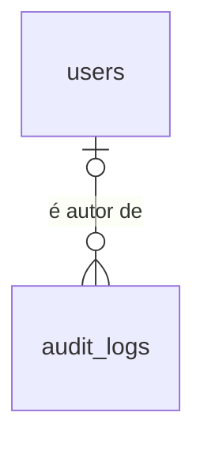

# Trilha de auditoria

## Problem

Quem cria, edita ou desativa um usuário, redefine a senha de alguém ou zera um 2FA não deixa rastro
consultável: o que existe é uma linha de log em stdout por desfecho de login
(`auth.login_succeeded`, `auth.login_failed`, `auth.login_blocked`), sem IP, sem user-agent, que
some com o container e que o Administrador não tem como ler. A gestão de usuários não escreve nem
isso. Quem paga é a academia: diante de um acesso indevido ela não consegue dizer quem fez o quê,
e as 11 features seguintes guardam dado pessoal de aluno e de funcionário sobre essa mesma falta.

O PRD não traz número para esta etapa. O que ele fixa: "Registrar toda ação sensível (visualização,
edição, exclusão) em auditoria" (§1.3), RF-24 a RF-26, a tabela `audit_logs` com o índice
`audit_logs(created_at, user_id)` (§6), a rota `/audit-logs` (§7) e o critério de aceite do MVP
"Toda ação sensível aparece em `audit_logs`" (§14).

Quando isto entrar: toda entrada, saída, falha de login, troca de senha, mudança de 2FA e ação de
gestão de usuários grava uma linha que ninguém altera nem apaga; o Administrador abre "Auditoria",
filtra por período, usuário, ação e IP e lê quem fez o quê; e a próxima feature encontra pronto o
jeito de gravar a própria linha na mesma transação da ação.

## Flow

Reutiliza a guarda global e o `CurrentUser` (`apps/api/src/access.ts`), as transações que
`UsersService` já abre, o contrato de erro e o `ValidationInterceptor` da `auth-rbac`, e o `Shell`
e o padrão de página renderizada no servidor de `/users`: nenhuma rota ganha guarda, erro ou
layout próprio.

**Ação nossa, com transação (gestão de usuários, troca da própria senha, `users:create-admin`)**

1. `POST|PATCH|PUT|DELETE /api/users*` ou `PUT /api/auth/password` -> `apps/web` (exists) repassa com `X-Forwarded-For` e `User-Agent` -> `AccessGuard` (exists) resolve o autor
2. controller (exists) - entrega ao serviço o contexto da requisição: autor, IP (door 6) e user-agent
3. `UsersService` (exists) - dentro da transação que já abre, grava a mudança e chama o gravador de auditoria (door 5) com a ação (door 3) e o diff (door 4)
4. gravador de auditoria (door 5) - insere a linha em `audit_logs` (door 1) na mesma transação; se o insert falha, a transação inteira desfaz
5. out: a resposta de antes (`201`/`200`/`204`), ou `500` sem nada gravado

**Ação do Better Auth (login, segundo passo, logout, confirmar e desativar 2FA)**

1. `POST /api/auth/*` -> `AuthController` (exists) -> `LoginThrottle` (exists) e `auth.api.*` (exists), que abre as próprias transações
2. `AuthController` (exists) - conhecido o desfecho, chama o gravador de auditoria (door 5) fora de transação; no login, antes de repassar o cookie
3. out: a resposta de antes; `429` e `two_factor_required` não gravam; se o insert falha, `500` e, no login, nenhum `Set-Cookie`

**Consulta**

1. navegador `GET /audit?<filtros>` -> `proxy.ts` (exists) exige sessão -> página renderizada no servidor chama a API por `fetchApi` (exists)
2. `GET /api/audit-logs` -> `AccessGuard` (exists) com perfil `admin` -> validação da query pelo schema de `packages/contracts` (door 7)
3. leitura de `audit_logs` (door 1) pelo Drizzle (exists), mais recente primeiro, 50 por página, com o nome do autor vindo de `users` (exists)
4. out: `200` com `items` e `nextCursor`; a página monta a tabela e o link "Próxima página"

## Impact

| Front | What changes |
| --- | --- |
| domain | novo termo: `action` - nome estável do que aconteceu, no formato `<entidade>.<verbo_no_passado>` (door 3); vive em `packages/contracts` e toda feature seguinte acrescenta os seus |
| domain | novo termo: `entity` / `entity_id` - o alvo da ação (`user` nesta feature), sem chave estrangeira; o autor é `user_id` |
| domain | termo existente: `auth.login_succeeded` e `auth.login_failed` eram só `msg` de linha de log; agora são também valores de `action`. `auth.login_blocked` continua só no log. Quem ramifica hoje: `apps/api/test/auth-log.test.ts`; as linhas de log não mudam |
| `auth-rbac` | a linha "Registro de login e de falha de login em `audit_logs`, e consulta por IP" do Out of scope de lá entra aqui. A AC 74 de lá (nada de senha, código, cookie nem e-mail digitado no log) segue valendo e ganha a AC 13 daqui para `audit_logs` |
| `auth-rbac` | `UsersService.create`, `update`, `resetPassword`, `resetTwoFactor` e `changeOwnPassword` passam a receber o contexto do autor; `create-admin.ts` chama `create` sem autor |
| API | a aplicação Express passa a confiar em um salto de proxy (door 6), o que muda `req.ip`. Ninguém lê `req.ip` hoje; o Better Auth preenche `sessions.ip_address` lendo o cabeçalho por conta própria e não muda |
| web | `fetchApi` (`apps/web/src/lib/session.ts`) hoje repassa só o `Cookie`; passa a repassar `X-Forwarded-For` e `User-Agent` de quem pediu a página. O repasse de `/api/*` já leva os dois |
| web | o menu do `Shell` ganha "Auditoria" para o perfil `admin`; `apps/web/e2e/shell.spec.ts` confere o menu por perfil |
| contrato | AD-021 falava de corpo; parâmetro de query que não passa no schema responde o mesmo `422` (door 7). `GET /api/audit-logs` é a primeira rota com query, e o documento OpenAPI passa a descrever `parameters` |
| portão | a rota nova entra na regra de `paths` do OpenAPI e nos 70% de cobertura de `apps/api/src`, sem mudança no portão |
| stored data | nothing to migrate - a migração `0002` só cria `audit_logs` e os gatilhos. A trilha começa vazia: o que aconteceu antes dela não é reconstruído |
| stored data | um usuário com linha em `audit_logs` deixa de poder ser apagado por SQL (door 1). Nenhuma rota apaga usuário hoje - só desativa |
| testes | nenhum teste existente limpa tabela com `TRUNCATE` ou `DELETE` (cada suíte sobe o próprio banco), então os gatilhos da door 2 não quebram suíte nenhuma |
| `.specs` | aprovado o plano, as doors 2 a 7 viram AD-024 em diante em `STATE.md`: as próximas 11 features copiam todas elas |

## Relations

`audit_logs.entity_id` aponta para o alvo da ação sem chave estrangeira: o alvo muda de tabela
conforme `entity`, e nas features seguintes pode ser apagado ou anonimizado sem tocar na trilha.

One-way constraints: `audit_logs` não aceita `UPDATE`, `DELETE` nem `TRUNCATE` (door 2); o autor é
opcional e, quando existe, impede apagar aquele usuário (door 1); o id segue a regra da door 3 da
`auth-rbac`, gerado pelo banco. Nomes de coluna e tipos comuns ficam para o diff.

## Surface

Só a rota nova. As 13 rotas da `auth-rbac` mantêm a assinatura; o que muda nelas é efeito
colateral, e está nos critérios.

| Route | In | Out | Status |
| --- | --- | --- | --- |
| `GET /api/audit-logs` | query, todos opcionais: `from`, `to`, `userId`, `action`, `entity`, `entityId`, `ip`, `cursor` | `items[]`: `id` · `createdAt` · `user` (`id` · `name`, ou `null`) · `action` · `entity` · `entityId` · `ip` · `userAgent` · `diff`; e `nextCursor` | `200`, `401`, `403`, `422` |

O comando `pnpm users:create-admin` não muda de assinatura nem de saída; passa a gravar uma linha
(AC 8).

## Landing

| One-way door | Literal shape | Alternative rejected |
| --- | --- | --- |
| 1. tabela `audit_logs` | as colunas do PRD §6: `id`, `user_id`, `action`, `entity`, `entity_id`, `ip`, `user_agent`, `diff`, `created_at`. `id uuid DEFAULT uuidv7()`; `user_id` anulável com `REFERENCES users(id)` sem `ON DELETE`; `entity_id uuid` anulável, sem chave estrangeira; `diff jsonb` anulável; `created_at timestamptz NOT NULL DEFAULT now()`; índice `(created_at, user_id)`; migração `0002` (AD-008) | `user_id` com `ON DELETE SET NULL` ou `CASCADE` - os dois reescrevem ou apagam linha da trilha, que a door 2 proíbe. `entity_id` com chave estrangeira - o alvo é de tabela diferente a cada `entity`, e a exclusão definitiva de um aluno (RF-08, `privacidade`) ficaria impedida pela trilha. Fecha: apagar de verdade um usuário que já agiu no sistema exige decidir antes o que fazer com a trilha dele |
| 2. append-only pelo banco | na migração `0002`: função que faz `RAISE EXCEPTION 'audit_logs is append-only'`, ligada por `CREATE TRIGGER audit_logs_no_change BEFORE UPDATE OR DELETE ON audit_logs FOR EACH ROW` e por `CREATE TRIGGER audit_logs_no_truncate BEFORE TRUNCATE ON audit_logs FOR EACH STATEMENT` | (a) segundo papel no Postgres só com `INSERT` e `SELECT` (alternativa viva) - a aplicação conecta hoje com um papel só, que é o dono das tabelas (`compose.yaml`), e dono não perde privilégio por `REVOKE`; exige dois papéis, duas credenciais e duas conexões, numa hospedagem ainda não decidida (PRD §13.5). (b) só convenção no código - "imutável" sem mecanismo. Limite declarado: quem é dono da tabela ainda consegue remover o gatilho; a barreira é contra a aplicação e contra SQL avulso, não contra quem administra o banco. Fecha: expurgo por retenção ou anonimização de linhas da trilha (`privacidade`) só por migração que altere o gatilho; e, como linha antiga nunca é reescrita, o formato do `diff` (door 4) não tem backfill |
| 3. vocabulário de ações | `action` = `<entidade>.<verbo_no_passado>` em snake_case, um enum Zod único em `packages/contracts`; `entity` = nome da entidade no singular. Nesta feature, todas com `entity` igual a `user`: `auth.login_succeeded`, `auth.login_failed`, `auth.logout`, `auth.password_changed`, `auth.two_factor_enabled`, `auth.two_factor_disabled`, `user.created`, `user.updated`, `user.password_reset`, `user.two_factor_reset` | texto livre por chamada - o filtro da tela e qualquer relatório passam a depender de grafia. `CHECK` no banco com a lista - cada feature seguinte precisaria de migração só para acrescentar uma ação, e a lista já é verificada onde a linha nasce |
| 4. formato do `diff` | `{ "fields": ["name", "role"], "values": { "role": { "from": "reception", "to": "admin" } } }`: `fields` tem o nome de todo campo alterado; `values` só os campos que a entidade declara como registráveis, com `from` e `to` (`from` é `null` na criação). Em `user`: `role`, `active`, `twoFactorEnabled`. Ação sem mudança de campo grava `diff` nulo | antes e depois de todos os campos com máscara nos sensíveis - nome, e-mail e telefone ficariam para sempre numa tabela que não apaga, fora do alcance da anonimização da RF-29. Só nomes de campo - a trilha não diria que alguém virou `admin`. Decidido pelo usuário em 2026-10-04 |
| 5. linha na transação da ação | um gravador único, chamado como `audit.record(tx, { actor, action, entity, entityId, diff })`, que recebe a transação de quem altera o dado: mudança e linha entram juntas ou não entra nenhuma | interceptor que grava depois do handler - roda fora da transação (a ação fica sem linha se o insert falhar) e não enxerga o antes e o depois. Gatilho de banco por tabela - não sabe quem é o autor, nem o IP, nem o user-agent |
| 6. origem do IP | `app.set('trust proxy', 1)` na API e leitura de `req.ip`: vale o endereço mais à direita de `X-Forwarded-For`, o que o web (único salto, AD-019) recebeu | ler o primeiro valor de `X-Forwarded-For` - é o que o cliente escreve, forjável por qualquer um. Ler o endereço da conexão - é sempre o do container do web |
| 7. validação de query | parâmetro de query que não passa no schema de `packages/contracts`: `422` com `code: validation_failed` e `errors: [{ "path": "<parâmetro>", "message": "texto em pt-BR" }]`, o mesmo contrato do corpo (AD-021); o schema vai para o OpenAPI como `parameters` | `400` para query inválida - AD-021 já separou dado digitado errado de requisição malformada, e a busca de alunos (RF-07) copiaria a exceção. Ignorar o parâmetro inválido - um filtro com erro de digitação devolveria a trilha inteira como se fosse o resultado |

- Nothing else in this change is hard to reverse

## Criteria

### S1: Gestão de usuários deixa rastro, na mesma transação (P1)

Cada ação do Administrador sobre um usuário grava exatamente uma linha, ou não acontece.

**Acceptance Criteria**

1. WHEN `POST /api/users` responde `201` THEN the system SHALL ter gravado exatamente uma linha em `audit_logs` com `action` igual a `user.created`, `user_id` igual ao id do Administrador autor, `entity` igual a `user` e `entity_id` igual ao id do usuário criado
2. WHEN `PATCH /api/users/:id` responde `200` tendo mudado ao menos um de `name`, `role` e `active` THEN the system SHALL ter gravado exatamente uma linha com `action` igual a `user.updated`, `user_id` do autor e `entity_id` igual a `:id`
3. IF `PATCH /api/users/:id` recebe só valores iguais aos atuais THEN the system SHALL responder `200` sem gravar linha em `audit_logs`
4. WHEN `PUT /api/users/:id/password` responde `204` THEN the system SHALL ter gravado exatamente uma linha com `action` igual a `user.password_reset`, `entity_id` igual a `:id` e `diff` nulo
5. WHEN `DELETE /api/users/:id/two-factor` responde `204` THEN the system SHALL ter gravado exatamente uma linha com `action` igual a `user.two_factor_reset`, `entity_id` igual a `:id` e `diff` nulo
6. IF uma requisição a `/api/users*` termina com `401`, `403`, `404`, `409` ou `422` THEN the system SHALL deixar `audit_logs` com o mesmo número de linhas de antes
7. IF o insert em `audit_logs` falha durante `POST /api/users`, `PATCH /api/users/:id`, `PUT /api/users/:id/password`, `DELETE /api/users/:id/two-factor` ou `PUT /api/auth/password` THEN the system SHALL responder `500` e deixar `users`, `accounts`, `sessions` e `two_factors` como estavam antes da requisição
8. WHEN `pnpm users:create-admin` cria um usuário THEN the system SHALL gravar uma linha com `action` igual a `user.created`, `entity_id` igual ao id criado e `user_id`, `ip` e `user_agent` nulos
9. IF o insert em `audit_logs` falha durante `pnpm users:create-admin` THEN the system SHALL sair com código 1 sem criar usuário

**Independent test:** criar um usuário, mudar o perfil dele e redefinir a senha; ler `audit_logs` e encontrar três linhas com o id do Administrador em `user_id`.

### S2: O diff diz o que mudou sem guardar dado pessoal (P1)

Valor antes e depois só de campo declarado registrável; do resto, só o nome do campo.

**Acceptance Criteria**

10. WHEN `PATCH /api/users/:id` muda `name` e muda `role` de `reception` para `admin` THEN the system SHALL gravar `diff` igual a `{"fields":["name","role"],"values":{"role":{"from":"reception","to":"admin"}}}`
11. WHEN `PATCH /api/users/:id` muda `active` de `true` para `false` THEN the system SHALL gravar `diff` igual a `{"fields":["active"],"values":{"active":{"from":true,"to":false}}}`
12. WHEN `POST /api/users` cria um usuário de perfil `reception` THEN the system SHALL gravar `diff` igual a `{"fields":["name","email","role"],"values":{"role":{"from":null,"to":"reception"}}}`
13. The system SHALL manter fora de toda coluna de `audit_logs` a senha, o hash da senha, o segredo TOTP, o código TOTP, o código de recuperação, o valor do cookie de sessão, o nome e o e-mail de qualquer usuário e o e-mail digitado no login

**Independent test:** mudar nome e perfil de um usuário e procurar o nome novo, o nome antigo e o e-mail dele no texto de todas as linhas de `audit_logs`.

### S3: Entrada, saída, senha e 2FA deixam rastro (P1)

Cada desfecho de autenticação que não seja bloqueio grava uma linha.

**Acceptance Criteria**

14. WHEN `POST /api/auth/login` responde `200` com `status` igual a `authenticated` THEN the system SHALL ter gravado exatamente uma linha com `action` igual a `auth.login_succeeded` e `user_id` e `entity_id` iguais ao id do usuário
15. WHEN `POST /api/auth/login` responde `200` com `status` igual a `two_factor_required` THEN the system SHALL não gravar linha em `audit_logs`
16. WHEN `POST /api/auth/two-factor/verify` responde `200` THEN the system SHALL ter gravado exatamente uma linha com `action` igual a `auth.login_succeeded` e `user_id` e `entity_id` iguais ao id do usuário
17. IF `POST /api/auth/login` responde `401` para o e-mail de um usuário que existe, ativo ou inativo THEN the system SHALL gravar exatamente uma linha com `action` igual a `auth.login_failed` e `user_id` e `entity_id` iguais ao id daquele usuário
18. IF `POST /api/auth/login` responde `401` para um e-mail que não pertence a usuário nenhum THEN the system SHALL gravar exatamente uma linha com `action` igual a `auth.login_failed`, `user_id` e `entity_id` nulos e `diff` nulo
19. IF `POST /api/auth/two-factor/verify` responde `401` havendo um login pendente THEN the system SHALL gravar exatamente uma linha com `action` igual a `auth.login_failed` e `user_id` igual ao id do usuário do login pendente
20. IF `POST /api/auth/two-factor/verify` responde `401` sem login pendente THEN the system SHALL não gravar linha em `audit_logs`
21. IF `POST /api/auth/login` ou `POST /api/auth/two-factor/verify` responde `429` THEN the system SHALL não gravar linha em `audit_logs`
22. IF 10 logins com senha errada para o mesmo e-mail chegam ao mesmo tempo THEN the system SHALL gravar tantas linhas `auth.login_failed` quantas respostas `401` devolveu, e nenhuma pelas respostas `429`
23. WHEN `POST /api/auth/logout` responde `204` THEN the system SHALL ter gravado exatamente uma linha com `action` igual a `auth.logout` e `user_id` igual ao id de quem saiu
24. WHEN `PUT /api/auth/password` responde `204` THEN the system SHALL ter gravado exatamente uma linha com `action` igual a `auth.password_changed`, `user_id` e `entity_id` iguais ao id do próprio usuário e `diff` nulo
25. WHEN `POST /api/auth/two-factor/confirm` responde `204` THEN the system SHALL ter gravado exatamente uma linha com `action` igual a `auth.two_factor_enabled` e `user_id` e `entity_id` iguais ao id do próprio usuário
26. WHEN `POST /api/auth/two-factor/disable` responde `204` THEN the system SHALL ter gravado exatamente uma linha com `action` igual a `auth.two_factor_disabled` e `user_id` e `entity_id` iguais ao id do próprio usuário
27. IF `PUT /api/auth/password`, `two-factor/enable`, `two-factor/confirm` ou `two-factor/disable` responde `422`, ou `two-factor/enable` responde `200` THEN the system SHALL não gravar linha em `audit_logs`
28. IF o insert em `audit_logs` falha durante um login com credenciais certas THEN the system SHALL responder `500` sem `Set-Cookie` de sessão

**Independent test:** errar a senha uma vez, entrar, sair; ler `audit_logs` e encontrar `auth.login_failed`, `auth.login_succeeded` e `auth.logout`, nessa ordem.

### S4: Cada linha diz de onde e quando (P1)

IP, user-agent e instante vêm da requisição e do banco, nunca do corpo.

**Acceptance Criteria**

29. WHEN uma ação auditada chega à API com `X-Forwarded-For: 203.0.113.7` THEN the system SHALL gravar `ip` igual a `203.0.113.7`
30. IF uma ação auditada chega à API com `X-Forwarded-For: 198.51.100.1, 203.0.113.7` THEN the system SHALL gravar `ip` igual a `203.0.113.7`
31. WHEN uma ação auditada chega com o cabeçalho `User-Agent` THEN the system SHALL gravar em `user_agent` os primeiros 512 caracteres dele
32. IF uma ação auditada chega sem o cabeçalho `User-Agent` THEN the system SHALL gravar `user_agent` nulo
33. The system SHALL preencher `created_at` pelo relógio do banco no momento do insert, sem aceitar instante vindo da requisição
34. WHEN o servidor do web chama a API para renderizar uma página THEN the system SHALL enviar à API o `X-Forwarded-For` e o `User-Agent` da requisição do navegador

**Independent test:** entrar por `curl` pela origem do web com `-A "teste/1.0"` e ler o `ip` e o `user_agent` da linha gravada.

### S5: A trilha não se altera nem se apaga (P1)

O banco recusa qualquer mudança em linha existente, venha de onde vier.

**Acceptance Criteria**

35. IF um `UPDATE` em qualquer coluna de `audit_logs` é executado com o papel de banco da aplicação THEN the system SHALL falhar a instrução com a mensagem `audit_logs is append-only` e manter a linha idêntica
36. IF um `DELETE` em `audit_logs` é executado com o papel de banco da aplicação THEN the system SHALL falhar a instrução com a mensagem `audit_logs is append-only` e manter a linha
37. IF um `TRUNCATE audit_logs` é executado com o papel de banco da aplicação THEN the system SHALL falhar a instrução e manter todas as linhas
38. IF um `DELETE` em `users` atinge um usuário que é autor de alguma linha de `audit_logs` THEN the system SHALL falhar a instrução e manter o usuário e a linha
39. The system SHALL registrar sob `/api/audit-logs` apenas o método `GET`

**Independent test:** pelo `psql`, tentar `UPDATE audit_logs SET action = 'x'` e `DELETE FROM audit_logs`.

### S6: O Administrador consulta por API (P1)

Lista da mais recente para a mais antiga, com filtros que se somam e página de 50.

**Acceptance Criteria**

40. WHEN um administrador chama `GET /api/audit-logs` sem parâmetros THEN the system SHALL responder `200` com no máximo 50 itens em `items`, do `createdAt` mais recente para o mais antigo, cada um com `id`, `createdAt`, `user`, `action`, `entity`, `entityId`, `ip`, `userAgent` e `diff`
41. The system SHALL devolver em `user` o `id` e o `name` atual do autor, ou `null` quando a linha não tem autor
42. WHEN existem mais linhas além das devolvidas THEN the system SHALL devolver `nextCursor` não nulo, e a chamada seguinte com `cursor` igual a esse valor SHALL devolver as linhas imediatamente mais antigas, sem repetir nem pular nenhuma
43. WHEN não existem linhas além das devolvidas THEN the system SHALL devolver `nextCursor` igual a `null`
44. IF linhas novas são gravadas entre a chamada de uma página e a chamada da seguinte THEN the system SHALL devolver na página seguinte as mesmas linhas que devolveria sem elas
45. WHEN `GET /api/audit-logs` recebe um ou mais de `userId`, `action`, `entity`, `entityId` e `ip` THEN the system SHALL devolver só as linhas iguais ao valor informado em cada um deles
46. WHEN `GET /api/audit-logs` recebe `from`, `to` ou os dois THEN the system SHALL devolver só as linhas com `createdAt` maior ou igual a `from` e menor que `to`
47. IF `userId` ou `entityId` não é um `uuid`, `action` não está no vocabulário, `from` ou `to` não é um instante ISO 8601 com fuso, `ip` tem mais de 45 caracteres ou `cursor` não é um valor que a API emitiu THEN the system SHALL responder `422` com `code` igual a `validation_failed` e um item em `errors` cujo `path` é o nome do parâmetro
48. IF um usuário de perfil `reception`, `hr_finance` ou `instructor` chama `GET /api/audit-logs` THEN the system SHALL responder `403` com `code` igual a `forbidden`
49. IF `GET /api/audit-logs` é chamado sem sessão THEN the system SHALL responder `401` com `code` igual a `unauthorized`
50. WHEN `GET /api/audit-logs` responde `200` THEN the system SHALL não gravar linha em `audit_logs`

**Independent test:** gravar 60 ações, chamar a rota, seguir o `nextCursor` e contar 60 ids distintos; repetir com `action=auth.login_failed`.

### S7: Tela de auditoria (P1)

O Administrador abre "Auditoria", filtra e lê quem fez o quê, em pt-BR.

**Acceptance Criteria**

51. The system SHALL exibir o link "Auditoria" no menu apenas para o perfil `admin`
52. WHEN alguém sem sessão abre `/audit` THEN the system SHALL redirecionar para `/login`
53. IF um usuário que não é administrador abre `/audit` THEN the system SHALL exibir "Você não tem permissão para acessar esta página." sem nenhuma linha da trilha
54. WHEN um administrador abre `/audit` THEN the system SHALL exibir o título "Auditoria" e uma tabela com as colunas "Data e hora", "Usuário", "Ação", "Alvo", "IP", "Navegador" e "Detalhes", da linha mais recente para a mais antiga
55. The system SHALL exibir "Data e hora" no formato `dd/MM/aaaa HH:mm:ss`, no fuso `America/Sao_Paulo`
56. The system SHALL exibir cada `action` por extenso: "Login", "Falha de login", "Logout", "Troca da própria senha", "2FA ativado", "2FA desativado", "Usuário criado", "Usuário editado", "Senha redefinida" e "2FA zerado"
57. IF a linha não tem autor THEN the system SHALL exibir "—" na coluna "Usuário"
58. WHEN a linha tem `entity` igual a `user` e `entityId` de um usuário existente THEN the system SHALL exibir em "Alvo" o nome atual daquele usuário
59. WHEN a linha tem `diff` com `role` de `reception` para `admin` e `name` em `fields` THEN the system SHALL exibir em "Detalhes" o texto "Perfil: Recepção → Administrador" e o texto "Nome alterado"
60. The system SHALL oferecer acima da tabela os filtros "De", "Até", "Usuário", "Ação" e "IP" e os botões "Filtrar" e "Limpar filtros"
61. WHEN o administrador aciona "Filtrar" THEN the system SHALL levar os filtros para a query string de `/audit` e exibir só as linhas que a API devolve para eles, tratando "De" como o início daquele dia e "Até" como o fim daquele dia em `America/Sao_Paulo`
62. WHEN a resposta da API traz `nextCursor` não nulo THEN the system SHALL exibir o link "Próxima página", que mantém os filtros e exibe as linhas seguintes
63. IF nenhuma linha corresponde aos filtros THEN the system SHALL exibir "Nenhum registro encontrado." no lugar da tabela
64. IF a trilha não carrega THEN the system SHALL exibir "Não foi possível carregar a auditoria." e o botão "Tentar novamente"
65. IF a API responde `422` aos filtros THEN the system SHALL exibir cada `message` junto do filtro indicado em `path`
66. IF a linha tem `entityId` nulo THEN the system SHALL exibir "—" na coluna "Alvo"
67. WHEN o administrador aciona "Limpar filtros" THEN the system SHALL levar a `/audit` sem query string

**Independent test:** subir a stack, criar um usuário de recepção, entrar com ele errando a senha uma vez, voltar como administrador, abrir "Auditoria" e filtrar por "Falha de login".

## Out of scope

| Excluded | Why |
| --- | --- |
| Auditoria de cadastros de aluno e funcionário, de foto, de visualização de dados de funcionários e de exportações (o resto da RF-24) | essas ações ainda não existem; cada feature grava as suas pela door 5 e prova com um check próprio (`ROADMAP.md`, critérios de aceite do MVP) |
| Registro de acesso negado (`403`) e de tentativa barrada pelo bloqueio (`429`) | RF-24 não lista acesso negado; o `429` fica só no log de aplicação, por decisão do usuário em 2026-10-04 |
| Exportar a trilha (CSV, PDF) | RF-26 pede tela com filtros; "relatórios avançados" são fase 2 (PRD §10) |
| Retenção, expurgo e anonimização de linhas da trilha | RF-28 a RF-30 são a feature `privacidade`; a door 2 diz o que ela encontra fechado |
| Alerta ou notificação a partir da trilha (muitas falhas de login, por exemplo) | notificações são fase 2 (PRD §10); alertas de operação são `operacao` |
| Registrar quem consultou a trilha | RF-24 não lista a consulta da auditoria entre as ações auditadas |
| Busca por texto livre e filtro por "Alvo" na tela | a API já aceita `entity` e `entityId`; a tela que precisa deles é a ficha de cada cadastro, nas features seguintes |
| Limite de requisições por IP para falhas de login de e-mails variados | depende do proxy; feature `operacao` |

## Assumptions

| Assumption | Chosen default | Rationale | Confirmed? |
| --- | --- | --- | --- |
| Ações do Better Auth (login, segundo passo, logout, confirmar e desativar 2FA) | a linha é gravada logo depois do desfecho, fora de transação; se o insert falha a resposta é `500` (AC 28), mas um logout ou uma mudança de 2FA já feita pode ficar sem linha | o `auth.api.*` abre as próprias transações. Não conferi na documentação se ele aceita uma transação de fora: é a primeira coisa a conferir no Build, e se aceitar esses eventos passam a ser atômicos sem mudar critério. A janela é uma falha do mesmo banco entre duas instruções seguidas | y |
| Falhas de login com e-mails que não existem | gravam linha sem limite por IP | consequência da decisão de registrar toda falha: o bloqueio da `auth-rbac` limita a 5 por e-mail a cada 15 min, mas não a quantidade de e-mails. O limite por IP fica no proxy, em `operacao` | y |
| Como as próximas features ficam obrigadas a auditar | por um check de auditoria em cada uma, sem portão automático na subida | é o que o `ROADMAP.md` já registra; um portão do tipo "toda rota declara se audita" só provaria a declaração, não a linha gravada | y |
| Retenção da trilha | nenhuma: nada é apagado até a `privacidade` decidir | PRD §13.2 deixa os prazos em aberto, e a door 2 só abre por migração | y |
| Histórico anterior à feature | não é reconstruído | não há fonte: as linhas de log de login não têm IP e não sobrevivem ao container | y |
| Fuso das datas na tela | `America/Sao_Paulo`, fixo no web; a API só recebe e devolve instantes ISO com fuso | uma instalação por academia (AD-016) e o servidor roda em UTC; trocar depois é uma constante no web | y |
| Tamanho da página | 50, fixo, sem parâmetro | a tela é a única consumidora; um parâmetro a mais pede um limite a mais | y |
| Nome na tela | o nome atual do autor e do alvo, lido na consulta | a trilha não guarda nome (AC 13); um usuário renomeado aparece com o nome novo também nas linhas antigas | y |
| `twoFactorEnabled` entre os campos registráveis de `user` | declarado, mas nenhuma ação desta feature o põe num `diff` | as mudanças de 2FA têm ação própria (`auth.two_factor_enabled`, `auth.two_factor_disabled`, `user.two_factor_reset`) | y |
| Rota e tela | `/api/audit-logs` (PRD §7, sob `/api` pela AD-019) e `/audit`, com o rótulo "Auditoria" | identificadores em inglês, texto em pt-BR (AD-003) | y |

**Open questions:** uma, que não bloqueia o Build.

| # | Kind | Question | Until answered |
| --- | --- | --- | --- |
| 1 | blocks go-live | O proxy de borda (Caddy, em `operacao`) sobrescreve o `X-Forwarded-For` que o cliente manda? | AC 29 e AC 30 valem para o que chega à API. Sem um proxy na frente do web, o Next mantém o `X-Forwarded-For` que o cliente escreveu (`base-server.js`, `??=`), então o `ip` gravado é forjável em qualquer ambiente em que o navegador fale direto com o web. Não bloqueia o Build nem os checks |

## Observable

| Surface | Decision | Landing |
| --- | --- | --- |
| screen `/audit` | empty state | AC 63 |
| screen `/audit` | loading state | n/a - página renderizada no servidor, como `/users`: só sai com os dados ou com a AC 64 |
| screen `/audit` | error state | AC 64, AC 65 |
| screen `/audit` | unauthorised state | AC 52, AC 53 |
| screen `/audit` | density and ordering | AC 54, AC 62 - 50 por página, mais recente primeiro |
| screen `/audit` | destructive action confirms | n/a - a tela só lê; não existe ação sobre uma linha (AC 39) |
| screen `/` e demais, menu | unauthorised state | AC 51 |
| API `GET /api/audit-logs` | response shape | AC 40, AC 41, AC 42, AC 43 |
| API `GET /api/audit-logs` | error shape and codes | AC 47, AC 48, AC 49 |
| API `GET /api/audit-logs` | who may call it | AC 48, AC 49 |
| API `GET /api/audit-logs` | versioning | n/a - o único consumidor é `apps/web`, versionado e implantado junto |
| API `GET /api/audit-logs` | rate limit | n/a - rota só de administrador autenticado; limite por IP fica no proxy, em `operacao` |
| API, rotas da `auth-rbac` que passam a gravar | response shape, error shape | existing - status e corpo não mudam; o único desfecho novo é o `500` das AC 7 e AC 28, pelo `ProblemFilter` |
| command `pnpm users:create-admin` | output format, flags and defaults | existing - a AC 47 da `auth-rbac` segue valendo sem mudança |
| command `pnpm users:create-admin` | exit codes, failure halfway | AC 8, AC 9 - usuário e linha entram na mesma transação |
| collection `audit_logs` | grouping criterion | n/a - a trilha não é agrupada; é filtrada (AC 45, AC 46) |
| collection `audit_logs` | naming | AC 56 na tela; o vocabulário de `action` é a door 3 |
| collection `audit_logs` | ordering | AC 40, AC 44 |
| collection `audit_logs` | duplicates | n/a - cada linha é um acontecimento; repetir a ação gera outro acontecimento, e a AC 3 cobre a edição que não muda nada |
| collection `audit_logs` | the exception that does not fit | AC 8, AC 18, AC 57, AC 66 - linha sem autor (linha de comando e e-mail desconhecido) e linha sem alvo (e-mail desconhecido) |

## Sources

- `PRD — Sistema de Gestão de Academia.md` §1.3, §2, §3.7 (RF-24 a RF-26), §6 (`audit_logs` e o índice), §7 (`/audit-logs`), §14 - o que registrar, o que cada linha contém e quem consulta
- `.specs/features/auth-rbac/plan.md` (Surface, Landing e Out of scope) - as 13 rotas e o comando cujas ações passam a ser auditadas, e a linha que adiou `audit_logs` para cá
- Decisões do usuário em 2026-10-04, nesta sessão - o `diff` guarda valor só de campo declarado (door 4, AC 10 a AC 13); falha de login grava linha sem o e-mail digitado e o `429` não grava (AC 17 a AC 21)
