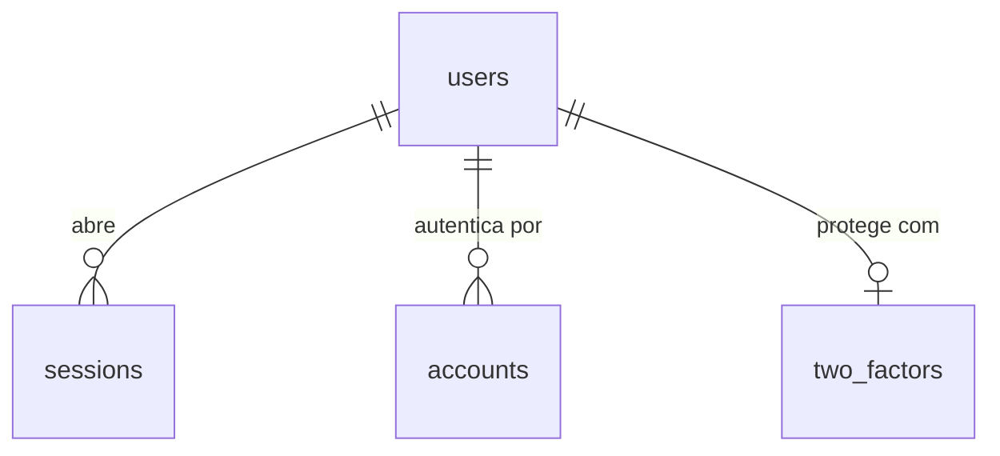

# Autenticação e controle de acesso por perfil

## Problem

A API responde a qualquer pessoa que a alcance e o web não sabe quem está do outro lado. Não existe
usuário, sessão nem perfil, então nenhuma das 12 features seguintes pode guardar dado pessoal: o
PRD exige que "fotos e dados pessoais só sejam acessados por quem tem permissão" (§1.3) e que a
permissão seja verificada "**no backend** em todo endpoint" (RF-03). Quem paga é a academia, que
hoje não tem como dar à recepção um acesso diferente do acesso do dono.

O PRD não traz número para esta etapa. O que ele fixa: RF-01 a RF-04, "proteção CSRF, validação de
entrada (Zod), senhas com Argon2id" e "cobertura de testes ≥ 70% no domínio" (§4), e a meta de
"Incidentes de acesso indevido a fotos: 0" (§9), que depende desta feature existir antes das fotos.

Três pendências herdadas fecham aqui: o status da resposta `validation_failed` (a `fundacao`
declarou o contrato e não tinha rota com entrada para prová-lo), OpenAPI e o limiar de cobertura
(ambos adiados para "a primeira feature com rotas reais"), e a página `/`, que era provisória.

Quando isto entrar: alguém abre o sistema e cai no login; entra com e-mail e senha (o Administrador
também com TOTP); cada perfil só alcança as rotas que pode; e o Administrador cria, edita e
desativa os usuários da academia.

## Flow

Reutiliza o request id, a linha de log e o filtro de erro da `fundacao` (`apps/api/src/request-context.ts`
e `problem.filter.ts`) e o schema de erro de `packages/contracts`: nenhuma rota nova escreve erro
ou log por conta própria.

**Login**

1. navegador `POST /api/auth/login` -> `apps/web` (exists) - repassa `/api/*` à API lendo `API_URL` em runtime, preservando `Origin`, `Cookie` e `Set-Cookie` (door 6)
2. `apps/api` (exists) - `requestContext` (exists), depois a checagem de origem (door 8), depois a validação do corpo pelo schema de `packages/contracts` (exists; status na door 9)
3. bloqueio por tentativas (door 11) - consulta e incrementa o contador do e-mail numa única instrução SQL
4. Better Auth como biblioteca (door 2) - confere a senha pelo hash Argon2id (door 4), cria a linha em `sessions` (door 3) e devolve o cookie
5. out: `200` com `status` igual a `authenticated` e o cookie de sessão (door 7), ou `two_factor_required` sem sessão; o segundo passo é `POST /api/auth/two-factor/verify` pelo mesmo caminho

**Requisição autenticada**

1. qualquer rota `/api/*` -> guarda global em `apps/api` (door 10) - lê a declaração de acesso da rota; sem declaração a API não sobe
2. Better Auth (door 2) - resolve a sessão pelo cookie e renova a expiração deslizante (door 7)
3. guarda (door 10) - compara `role` (door 5) com os perfis da rota; Administrador sem 2FA só passa nas rotas de cadastro do 2FA
4. out: o handler roda, ou `401`/`403` pelo `ProblemFilter` (exists)

**Gestão de usuários**

1. `POST|PATCH|PUT|DELETE /api/users*` -> guarda (door 10) com perfil `admin`
2. escrita em `users` (door 3) pelo Drizzle (exists), numa transação que trava as linhas dos administradores ativos antes de mudar `role` ou `active` - é o mecanismo que impede zero administradores
3. na mesma transação: apaga as linhas de `sessions` do usuário alterado
4. out: `200`/`201`/`204`, ou `409` com `last_admin` / `email_taken`

**Portão**

1. `pnpm verify` (exists) -> Vitest em `apps/api` (exists) com cobertura; abaixo de 70% o comando falha
2. out: `GET /api/openapi.json` (door 12) é montado dos mesmos schemas de `packages/contracts` (exists) que validam as rotas

## Impact

| Front | What changes |
| --- | --- |
| domain | novo termo: `role` - perfil único do usuário, um de `admin`, `reception`, `hr_finance`, `instructor` (door 5); as 12 features seguintes ramificam por ele |
| domain | termo existente: `users` do PRD §6 tinha `password_hash` e `two_factor_enabled` na própria tabela; agora o hash vive em `accounts` e o segredo TOTP em `two_factors` (door 3). Ninguém ramifica nisso hoje - não há código de domínio |
| contrato | PRD §7 lista `/auth/login`, `/students`...; toda rota de aplicação passa a viver sob `/api` (door 6). `/health` fica na raiz (AD-010) |
| contrato | AD-009 ganha status e códigos: `401`, `403`, `409`, `422`, `429` (door 9). `problem.filter.ts` hoje deriva `code` do título do status; os códigos novos são explícitos |
| `fundacao` | AC 15 e AC 16 (texto "API: operacional/indisponível" em `/`) deixam de valer: a página era provisória por decisão registrada lá. `apps/web/e2e/home.spec.ts` é substituído pelos testes do login; o estado "API fora" passa para a AC 55 |
| `fundacao` | o healthcheck do serviço `web` no `compose.yaml` chama `/`, que passa a redirecionar para `/login`; continua `200` porque o `fetch` segue o redirecionamento |
| `fundacao` | o leitor de corpo do Express não muda (o handler HTTP do Better Auth não é montado), então os testes de corpo rejeitado continuam como estão |
| ambiente | duas chaves obrigatórias novas, `AUTH_SECRET` e `WEB_ORIGIN`: todo `.env` existente precisa delas ou a API não sobe (AD-015) |
| portão | `pnpm verify` passa a falhar com cobertura abaixo de 70% em `apps/api/src` |
| stored data | nothing to migrate - a migração `0001` só cria tabelas. Banco novo tem zero usuários: ninguém entra até rodar `pnpm users:create-admin` |
| `.specs` | aprovado o plano, as doors 1, 2, 5, 6, 8, 9, 10 e 13 viram AD-016 em diante em `STATE.md`, e as linhas "uma academia ou várias" e "Better Auth ou Auth.js" do `ROADMAP.md` passam a resolvidas. Registrado em 2026-10-03, com a aprovação do plano: AD-016 a AD-023 |

## Relations

Fora do diagrama, sem relação com `users`: `verifications` (exigida pelo núcleo do Better Auth) e
`login_throttles` (door 11), cuja chave é o e-mail normalizado - que pode não pertencer a usuário
nenhum.

One-way constraints: nenhuma tabela tem `tenant_id` (door 1); todo id é `uuid` gerado pelo banco
(door 3); `users.email` é único e guardado em minúsculas (door 3); `users.role` só aceita os quatro
valores da door 5. Nomes de coluna e tipos comuns ficam para o diff.

## Surface

Só rotas novas. Toda rota `/api` também pode responder com a última linha.

| Route | In | Out | Status |
| --- | --- | --- | --- |
| `POST /api/auth/login` | `email`, `password` | `status` · cookie de sessão | `200`, `401`, `422`, `429` |
| `POST /api/auth/two-factor/verify` | `code` ou `backupCode` | `status` · cookie de sessão | `200`, `401`, `422`, `429` |
| `POST /api/auth/logout` | cookie | nada | `204`, `401` |
| `GET /api/auth/session` | cookie | `user.id` · `user.name` · `user.email` · `user.role` · `user.twoFactorEnabled` · `twoFactorEnrollmentRequired` | `200`, `401` |
| `PUT /api/auth/password` | `currentPassword`, `newPassword` | nada | `204`, `401`, `422` |
| `POST /api/auth/two-factor/enable` | `password` | `totpUri` · `backupCodes` | `200`, `401`, `422` |
| `POST /api/auth/two-factor/confirm` | `code` | nada | `204`, `401`, `422` |
| `POST /api/auth/two-factor/disable` | `password` | nada | `204`, `401`, `422` |
| `GET /api/users` | nada | `users[]`: `id` · `name` · `email` · `role` · `active` · `twoFactorEnabled` | `200`, `401`, `403` |
| `POST /api/users` | `name`, `email`, `role`, `password` | o usuário, sem senha | `201`, `401`, `403`, `409`, `422` |
| `PATCH /api/users/:id` | `name`, `role`, `active` (todos opcionais) | o usuário | `200`, `401`, `403`, `404`, `409`, `422` |
| `PUT /api/users/:id/password` | `password` | nada | `204`, `401`, `403`, `404`, `422` |
| `DELETE /api/users/:id/two-factor` | nada | nada | `204`, `401`, `403`, `404` |
| `GET /api/openapi.json` | cookie | documento OpenAPI 3.1 | `200`, `401` |
| qualquer rota `/api`, em erro (acréscimo à linha da `fundacao`) | a requisição como veio | `application/problem+json`, com `errors[]` no `422` | `401`, `403`, `422`, `429` |
| qualquer rota `/api`, pela origem do web, com a API fora do ar (acrescentada no Build) | a requisição como veio | `application/problem+json` escrito pelo próprio web, com `code` igual a `bad_gateway` ou `gateway_timeout` | `502`, `504` |

O comando `pnpm users:create-admin` também é superfície; as decisões dele estão em `Observable`.

## Landing

| One-way door | Literal shape | Alternative rejected |
| --- | --- | --- |
| 1. uma instalação por academia | nenhuma tabela tem `tenant_id`; o segmento `{tenant}` da chave de foto (PRD §5.1) fica com valor fixo | `tenant_id` em toda tabela desde já - multi-unidade é fase 3 (PRD §1.4), e até lá toda consulta e todo índice único carregam uma dimensão de um valor só. Fecha: virar multi-unidade exige migração com backfill em todas as tabelas |
| 2. Better Auth como biblioteca | `better-auth` 1.7 + `drizzleAdapter(db, { provider: 'pg', usePlural: true })` + plugin `twoFactor()`; chamado só por `auth.api.*` de dentro de controllers do Nest, repassando os `Set-Cookie` com `returnHeaders: true`; o handler HTTP dele não é montado, e `emailAndPassword.disableSignUp: true` | (a) montar o handler em `/api/auth/*` com `@thallesp/nestjs-better-auth` (alternativa viva) - os erros saem como `{code, message}` e não em `problem+json` (AD-009), as rotas ficam fora dos schemas de `packages/contracts` (AD-011) e do OpenAPI, o pacote é mantido pela comunidade e exige `bodyParser: false`. (b) Auth.js (PRD §13.6) - não traz TOTP, e o provedor de credenciais não usa sessão em banco |
| 3. tabelas de identidade | `users`, `sessions`, `accounts`, `verifications`, `two_factors`, em snake_case no plural; id `uuid` com `DEFAULT uuidv7()` e `advanced.database.generateId: false`; índice único em `users.email`; `role` e `active` como `additionalFields` com `input: false`; migração SQL `0001` gerada pelo drizzle-kit (AD-008) | nomes padrão do Better Auth (`user`, `account`, camelCase) - `user` é palavra reservada no Postgres e o PRD §6 já nomeia `users`; id base62 padrão dele - as demais tabelas do PRD referenciam `user_id` e a `fundacao` já apontou `uuidv7()` como candidato |
| 4. hash de senha | Argon2id via `@node-rs/argon2`, `m=19456, t=2, p=1`, passado em `emailAndPassword.password.hash/verify`; o valor guardado começa por `$argon2id$v=19$m=19456,t=2,p=1$` | scrypt, o padrão do Better Auth - o PRD §4 exige Argon2id |
| 5. perfis | `role` é um valor único por usuário: `admin`, `reception`, `hr_finance`, `instructor` | vários perfis por usuário (lista separada por vírgula, como no plugin `admin`) - o PRD §6 define `users.role` no singular e a matriz do §2 não tem caso que precise de dois. Fecha: funcionário com dois papéis recebe o mais amplo; mudar depois é migração de coluna para tabela |
| 6. origem única | o navegador só fala com a origem do web; `apps/web` repassa `/api/*` à API; na API toda rota de aplicação tem o prefixo `/api`, e `/health` fica na raiz | API em outra origem com CORS - o cookie precisaria de `Domain` ou `SameSite=None`, que dependem de uma hospedagem ainda não decidida (PRD §13.5). Fecha a lacuna do roadmap: o upload de foto também entra pela origem do web; se é o Next ou o proxy que o encaminha fica para `foto-pipeline` e `operacao` |
| 7. sessão | linha em `sessions` + cookie `HttpOnly; Secure; SameSite=Lax; Path=/`, sem `Domain`; `session.expiresIn: 1800` e `updateAge: 60` (expira com 30 min sem uso, renova a cada uso); sem `cookieCache` | sessão em JWT sem linha no banco - desativar um usuário ou trocar o perfil não derruba a sessão até o token vencer |
| 8. CSRF | toda requisição `/api` com método diferente de `GET`, `HEAD` e `OPTIONS` exige `Origin` igual a `WEB_ORIGIN`; sem `Origin`, exige `Sec-Fetch-Site: same-origin`; senão `403` com `code: csrf_rejected` | token sincronizado ou cookie duplo - pede uma rota de token e um campo em todo formulário, para o mesmo resultado numa aplicação de origem única; a checagem de origem do Better Auth - só cobre as rotas dele, e não roda em chamadas por `auth.api` |
| 9. erro de validação e códigos novos | corpo que não passa no schema: `422` com `code: validation_failed` e `errors: [{ "path": "campo.subcampo", "message": "texto em pt-BR" }]`; corpo ilegível continua `400 bad_request`. Códigos novos: `unauthorized`, `invalid_credentials`, `invalid_code` (`401`); `forbidden`, `csrf_rejected`, `two_factor_enrollment_required` (`403`); `email_taken`, `last_admin` (`409`); `too_many_attempts` (`429`) | `400` para validação - o leitor de corpo e o servidor HTTP já respondem `400 bad_request` para requisição malformada, e o mesmo status passaria a misturar defeito do cliente com dado digitado errado em qualquer métrica ou proxy que conte por status |
| 10. acesso negado por padrão | toda rota declara exatamente um de `@Public()`, `@Authenticated()` ou `@Roles('admin', ...)`; uma guarda global aplica; rota `/api` sem declaração encerra a subida da API com código 1 | guarda aplicada rota a rota - esquecer a guarda deixa a rota aberta, e nada acusa (RF-03, AD-004) |
| 11. bloqueio por tentativas | tabela `login_throttles`, chave = e-mail em minúsculas; 5 falhas em 15 min bloqueiam aquele e-mail por 15 min com `429`, `code: too_many_attempts` e `Retry-After` em segundos; contagem por um único `INSERT ... ON CONFLICT DO UPDATE` | `rateLimit` do Better Auth - conta requisições por IP e por rota, não falhas por conta, e não se aplica a chamadas por `auth.api`; contador em memória - some a cada reinício e o PRD §5 deixa o Redis como opcional (AD-002) |
| 12. OpenAPI | `GET /api/openapi.json`, OpenAPI 3.1 montado dos schemas Zod de `packages/contracts` com `z.toJSONSchema`; exige sessão | `@nestjs/swagger` com classes DTO - segunda definição de cada campo (AD-011); `nestjs-zod` 5.5 - o peer aceita Nest 10 e 11, e o projeto está no 12 |
| 13. base de interface | Tailwind CSS + shadcn/ui em `packages/ui`, formulários com React Hook Form + o schema Zod de `packages/contracts` (PRD §5) | CSS escrito por tela - cada uma das 9 telas do PRD §8 copiaria o padrão da primeira, e o PRD §5 já fixa a pilha |

- Nothing else in this change is hard to reverse

## Criteria

### S1: Entrar, permanecer e sair (P1)

Quem tem usuário ativo entra com e-mail e senha e recebe uma sessão que expira por inatividade.

**Acceptance Criteria**

1. WHEN `POST /api/auth/login` recebe e-mail e senha de um usuário ativo sem 2FA THEN the system SHALL responder `200` com `{"status":"authenticated"}` e um `Set-Cookie` de sessão com `HttpOnly`, `Secure`, `SameSite=Lax` e `Path=/`
2. IF o e-mail não existe, a senha não confere ou o usuário está inativo THEN the system SHALL responder `401` com `code` igual a `invalid_credentials`, sem `Set-Cookie`, com corpo idêntico nos três casos salvo o `requestId`
3. WHEN `GET /api/auth/session` chega com um cookie de sessão válido THEN the system SHALL responder `200` com `user.id`, `user.name`, `user.email`, `user.role`, `user.twoFactorEnabled` e `twoFactorEnrollmentRequired`
4. IF uma rota `/api` não pública é chamada sem cookie, com cookie adulterado ou com sessão expirada THEN the system SHALL responder `401` com `code` igual a `unauthorized`
5. WHEN `POST /api/auth/logout` é chamado com sessão válida THEN the system SHALL responder `204`, apagar a linha da sessão e responder `401` a qualquer uso posterior do mesmo cookie
6. IF uma sessão fica 30 minutos sem nenhuma requisição THEN the system SHALL responder `401` à requisição seguinte
7. WHILE uma sessão recebe requisições com intervalo menor que 30 minutos the system SHALL mantê-la válida, adiando a expiração para 30 minutos depois do último uso
8. The system SHALL guardar toda senha apenas como hash que começa por `$argon2id$v=19$m=19456,t=2,p=1$`
9. WHEN `PUT /api/auth/password` recebe a senha atual certa e uma nova senha válida THEN the system SHALL responder `204`, manter a sessão atual e encerrar as demais sessões do usuário
10. IF `PUT /api/auth/password` recebe a senha atual errada THEN the system SHALL responder `422` com um item em `errors` cujo `path` é `currentPassword`
11. IF uma senha nova tem menos de 12 ou mais de 128 caracteres THEN the system SHALL responder `422` com um item em `errors` cujo `path` é o campo da senha
12. WHEN o web recebe uma requisição em `/api/*` THEN the system SHALL repassá-la à API com o mesmo método, corpo, `Origin` e `Cookie`, e devolver ao navegador o status, o corpo, o `Set-Cookie` e o `X-Request-Id` da API
13. IF `AUTH_SECRET` está ausente ou tem menos de 32 caracteres, ou `WEB_ORIGIN` está ausente ou não é uma URL `http`/`https` THEN the system SHALL encerrar a API com código 1 imprimindo o nome da variável e nenhum valor

**Independent test:** criar um administrador pelo comando, entrar por `curl` guardando o cookie, chamar `/api/auth/session`, sair e chamar de novo.

### S2: Entrada inválida e origem estranha têm resposta fixa (P1)

A primeira rota com corpo prova o contrato de validação, e nenhuma escrita aceita origem de fora.

**Acceptance Criteria**

14. IF um corpo JSON legível não passa no schema da rota THEN the system SHALL responder `422` em `application/problem+json` com `code` igual a `validation_failed` e um item em `errors` por campo reprovado, cada um com `path` em notação de ponto e `message` não vazia em pt-BR
15. The system SHALL responder erros de validação sem repetir em `errors` nenhum valor enviado pelo cliente
16. IF uma requisição `/api` com método diferente de `GET`, `HEAD` e `OPTIONS` traz `Origin` diferente de `WEB_ORIGIN` THEN the system SHALL responder `403` com `code` igual a `csrf_rejected` sem executar o handler
17. IF uma requisição `/api` com método diferente de `GET`, `HEAD` e `OPTIONS` não traz `Origin` e não traz `Sec-Fetch-Site: same-origin` THEN the system SHALL responder `403` com `code` igual a `csrf_rejected` sem executar o handler

**Independent test:** mandar um login sem senha e conferir o `422`; repetir um login válido com `Origin: https://outro.example` e conferir o `403`.

### S3: Segundo fator (P1)

TOTP é opcional para todos e obrigatório para o Administrador.

**Acceptance Criteria**

18. WHEN `POST /api/auth/two-factor/enable` recebe a senha certa THEN the system SHALL responder `200` com `totpUri` começando por `otpauth://totp/` e uma lista não vazia em `backupCodes`, mantendo `twoFactorEnabled` em `false`
19. WHEN `POST /api/auth/two-factor/confirm` recebe um código TOTP válido para o segredo recém-gerado THEN the system SHALL responder `204` e passar `twoFactorEnabled` para `true`
20. WHEN `POST /api/auth/login` recebe credenciais certas de um usuário com `twoFactorEnabled` igual a `true` THEN the system SHALL responder `200` com `{"status":"two_factor_required"}` sem criar sessão
21. WHEN `POST /api/auth/two-factor/verify` recebe um código TOTP válido depois da AC 20 THEN the system SHALL responder `200` com `{"status":"authenticated"}` e o cookie de sessão
22. WHEN `POST /api/auth/two-factor/verify` recebe um código de recuperação ainda não usado THEN the system SHALL autenticar e invalidar aquele código para usos seguintes
23. IF `POST /api/auth/two-factor/verify` recebe um código inválido, ou é chamado sem um login pendente THEN the system SHALL responder `401` com `code` igual a `invalid_code` sem criar sessão
24. WHILE um usuário de perfil `admin` tem `twoFactorEnabled` igual a `false` the system SHALL responder `403` com `code` igual a `two_factor_enrollment_required` a toda rota `/api` exceto `GET /api/auth/session`, `POST /api/auth/logout`, `POST /api/auth/two-factor/enable` e `POST /api/auth/two-factor/confirm`
25. WHILE um usuário de perfil `admin` tem `twoFactorEnabled` igual a `false` the system SHALL devolver `twoFactorEnrollmentRequired` igual a `true` em `GET /api/auth/session`
26. WHEN `POST /api/auth/two-factor/disable` recebe a senha certa THEN the system SHALL responder `204`, passar `twoFactorEnabled` para `false` e apagar o segredo e os códigos de recuperação
27. IF `two-factor/enable` ou `two-factor/disable` recebe a senha errada, ou `two-factor/confirm` recebe um código inválido THEN the system SHALL responder `422` com um item em `errors` cujo `path` é o campo enviado

**Independent test:** entrar como administrador recém-criado, ver tudo responder `403` até cadastrar o TOTP, sair e entrar de novo em dois passos.

### S4: Bloqueio por tentativas (P1)

Adivinhar senha ou código custa 15 minutos a cada 5 erros.

**Acceptance Criteria**

28. IF houve 5 falhas de login para o mesmo e-mail (sem diferenciar maiúsculas) nos últimos 15 minutos THEN the system SHALL responder `429` com `code` igual a `too_many_attempts` e `Retry-After` em segundos a todo login daquele e-mail, inclusive com a senha certa, até 15 minutos depois da quinta falha
29. The system SHALL aplicar a AC 28 de forma idêntica a um e-mail que não pertence a usuário nenhum
30. WHEN um login termina autenticado antes da quinta falha THEN the system SHALL zerar o contador daquele e-mail
31. WHEN `POST /api/auth/two-factor/verify` recebe um código inválido THEN the system SHALL contar a falha no mesmo contador do e-mail do login pendente
32. IF 10 logins com senha errada para o mesmo e-mail chegam ao mesmo tempo THEN the system SHALL responder `401` a no máximo 5 deles e `429` aos demais

**Independent test:** errar a senha 5 vezes, tentar a certa e receber `429` com `Retry-After`.

### S5: Cada perfil só alcança o que pode (P1)

A permissão é decidida no backend, e uma rota sem declaração de acesso não chega a existir.

**Acceptance Criteria**

33. IF uma rota sob `/api` não declara acesso (pública, autenticada ou lista de perfis) THEN the system SHALL encerrar a subida da API com código 1 nomeando a rota
34. IF o perfil do usuário autenticado não está na lista de perfis da rota THEN the system SHALL responder `403` com `code` igual a `forbidden` sem executar o handler
35. IF um usuário de perfil `reception`, `hr_finance` ou `instructor` chama qualquer rota `/api/users*` THEN the system SHALL responder `403` com `code` igual a `forbidden`
36. The system SHALL aceitar sem sessão apenas `POST /api/auth/login`, `POST /api/auth/two-factor/verify` e `GET /health`

**Independent test:** entrar como recepção e chamar `GET /api/users`.

### S6: O Administrador gere os usuários (P1)

Criar, editar, desativar, trocar senha e zerar o 2FA de qualquer usuário, sem nunca ficar sem administrador.

**Acceptance Criteria**

37. WHEN um administrador chama `POST /api/users` com dados válidos THEN the system SHALL responder `201` com `id`, `name`, `email`, `role`, `active` igual a `true` e `twoFactorEnabled` igual a `false`, e aquele usuário SHALL conseguir entrar com a senha informada
38. IF `POST /api/users` recebe um e-mail já cadastrado, sem diferenciar maiúsculas THEN the system SHALL responder `409` com `code` igual a `email_taken` sem criar usuário
39. WHEN um administrador chama `GET /api/users` THEN the system SHALL responder `200` com todos os usuários em ordem alfabética de `name`, cada um só com `id`, `name`, `email`, `role`, `active` e `twoFactorEnabled`
40. WHEN `PATCH /api/users/:id` recebe `name`, `role` ou `active` válidos THEN the system SHALL responder `200` com o usuário atualizado
41. WHEN `PATCH /api/users/:id` muda `role` ou passa `active` para `false` THEN the system SHALL encerrar todas as sessões daquele usuário
42. IF uma alteração deixaria o sistema sem nenhum usuário ativo de perfil `admin` THEN the system SHALL responder `409` com `code` igual a `last_admin` sem alterar nada
43. IF duas requisições simultâneas tiram, cada uma, um dos dois últimos administradores ativos THEN the system SHALL responder `200` a exatamente uma e `409` com `last_admin` à outra
44. WHEN um administrador chama `PUT /api/users/:id/password` com uma senha válida THEN the system SHALL responder `204`, encerrar as sessões daquele usuário e aceitar a senha nova no login seguinte
45. WHEN um administrador chama `DELETE /api/users/:id/two-factor` THEN the system SHALL responder `204`, passar `twoFactorEnabled` para `false`, apagar o segredo e os códigos de recuperação e encerrar as sessões daquele usuário
46. IF `:id` não é um `uuid` ou não pertence a usuário nenhum THEN the system SHALL responder `404` com `code` igual a `not_found`
47. WHEN `pnpm users:create-admin --email <e-mail> --name <nome>` roda com a senha em `ADMIN_PASSWORD` THEN the system SHALL criar um usuário ativo de perfil `admin`, imprimir o `id` e o e-mail, não imprimir a senha e sair com código 0
48. IF `pnpm users:create-admin` recebe um e-mail já cadastrado, uma senha fora de 12 a 128 caracteres ou nenhuma `ADMIN_PASSWORD` THEN the system SHALL sair com código 1 nomeando o motivo, sem criar usuário

**Independent test:** criar um usuário de recepção, entrar com ele noutra janela, desativá-lo e ver a sessão dele cair.

### S7: Telas (P1)

Login no lugar da página provisória, cadastro do 2FA, conta e gestão de usuários, todas em pt-BR.

**Acceptance Criteria**

49. WHEN alguém sem sessão abre `/`, `/users`, `/account` ou `/two-factor/setup` THEN the system SHALL redirecionar para `/login`
50. The system SHALL exibir em `/login` o título "Entrar", os campos "E-mail" e "Senha" e o botão "Entrar", num documento com `lang="pt-BR"`
51. WHEN o login termina autenticado THEN the system SHALL navegar para `/` e exibir "Gestão de Academia", o nome do usuário, o perfil por extenso ("Administrador", "Recepção", "RH/Financeiro" ou "Instrutor") e o botão "Sair"
52. IF o login responde `401` THEN the system SHALL exibir "E-mail ou senha incorretos.", manter o e-mail preenchido e limpar a senha
53. IF o login responde `429` THEN the system SHALL exibir "Muitas tentativas. Tente novamente em N minutos.", com N igual a `Retry-After` dividido por 60 e arredondado para cima
54. IF uma resposta `422` traz `errors` THEN the system SHALL exibir cada `message` junto do campo indicado em `path`
55. IF a API não responde em 3 s ou responde `5xx` THEN the system SHALL exibir "Serviço indisponível. Tente novamente em instantes." na tela em que a ação foi feita
56. WHILE um formulário aguarda a resposta da API the system SHALL manter o botão de envio desabilitado
57. WHEN o login responde `two_factor_required` THEN the system SHALL exibir `/login/two-factor` com o campo "Código de 6 dígitos" e o link "Usar código de recuperação"
58. IF a verificação do segundo fator responde `401` THEN the system SHALL exibir "Código inválido."
59. WHILE `twoFactorEnrollmentRequired` é `true` the system SHALL redirecionar toda página para `/two-factor/setup`
60. The system SHALL exibir em `/two-factor/setup` o QR code do `totpUri`, o segredo em texto e o campo "Código de 6 dígitos"
61. WHEN o cadastro do 2FA é confirmado THEN the system SHALL exibir os códigos de recuperação uma única vez, com o aviso "Guarde estes códigos. Eles não serão exibidos novamente."
62. WHEN um administrador abre `/users` THEN the system SHALL exibir uma tabela com as colunas "Nome", "E-mail", "Perfil", "Situação" ("Ativo" ou "Inativo") e "2FA", em ordem alfabética de nome, e o botão "Novo usuário"
63. IF um usuário que não é administrador abre `/users` THEN the system SHALL exibir "Você não tem permissão para acessar esta página." sem nenhum dado de usuário
64. The system SHALL exibir o link "Usuários" em `/` apenas para o perfil `admin`
65. WHEN um administrador aciona "Desativar", "Redefinir senha" ou "Zerar 2FA" THEN the system SHALL pedir confirmação num diálogo que nomeia o usuário antes de enviar a requisição
66. IF a lista de usuários não carrega THEN the system SHALL exibir "Não foi possível carregar os usuários." e o botão "Tentar novamente"
67. The system SHALL oferecer em `/account` a troca da própria senha e, conforme `twoFactorEnabled`, a ação "Ativar verificação em duas etapas" ou "Desativar verificação em duas etapas"
68. WHEN o usuário aciona "Sair" THEN the system SHALL encerrar a sessão e navegar para `/login`
69. WHEN alguém com sessão válida abre `/login` THEN the system SHALL redirecionar para `/`

**Independent test:** subir a stack, criar o administrador, percorrer login, cadastro do TOTP, criação de um usuário de recepção e a tela de "sem permissão" com ele.

### S8: OpenAPI, cobertura e rastro (P2)

O contrato fica publicado, o portão passa a medir cobertura e o log conta o que aconteceu sem guardar segredo.

**Acceptance Criteria**

70. WHEN `GET /api/openapi.json` é chamado com sessão válida THEN the system SHALL responder `200` com um documento cujo campo `openapi` começa por `3.1`
71. The system SHALL listar em `paths` do documento OpenAPI toda rota e método registrados sob `/api`, e nenhuma rota que não exista
72. IF a cobertura de linhas ou de ramos de `apps/api/src` fica abaixo de 70% THEN the system SHALL sair de `pnpm verify` com código diferente de 0
73. WHEN um login é autenticado, falha ou é bloqueado THEN the system SHALL escrever uma linha de log em JSON com `msg` igual a `auth.login_succeeded`, `auth.login_failed` ou `auth.login_blocked`, o `requestId` e, quando o usuário existe, o `userId`
74. The system SHALL manter fora de toda linha de log a senha, o código TOTP, o código de recuperação, o valor do cookie de sessão, o `AUTH_SECRET` e o e-mail digitado no login

**Independent test:** baixar `/api/openapi.json` e comparar com as rotas; apagar um arquivo de teste da API e rodar `pnpm verify`.

## Out of scope

| Excluded | Why |
| --- | --- |
| "Esqueci minha senha" por e-mail, verificação de e-mail e convite por link | o sistema não envia e-mail; notificações são fase 2 (PRD §10). Quem redefine a senha é o Administrador (AC 44) |
| Cadastro aberto (sign-up) | só o Administrador cria usuário (PRD §2) |
| Perfil Aluno e portal do aluno | fase 2 (PRD §2) |
| Registro de login e de falha de login em `audit_logs`, e consulta por IP | RF-24 a RF-26 são a feature `auditoria`, a próxima; aqui fica só a linha de log (AC 73) |
| Vínculo entre usuário e funcionário (`staff.user_id`) | RF-09, feature `funcionarios` |
| Matriz de permissão das rotas de alunos, fotos, planos etc. | cada feature declara os perfis das próprias rotas pela door 10 |
| Limite de requisições por IP, HSTS, CSP e HTTPS | dependem do proxy e da hospedagem (PRD §13.5); feature `operacao`. A `fundacao` tinha apontado os cabeçalhos para cá - ver Assumptions |
| Troca de senha obrigatória no primeiro acesso, histórico de senhas e expiração periódica | o PRD não pede |
| "Lembrar este dispositivo" no 2FA e segundo fator por SMS ou e-mail | RF-01 pede TOTP |
| Tela de Swagger UI | o documento JSON basta para gerar cliente e conferir contrato; a tela é acréscimo reversível |
| Paginação e busca na lista de usuários | a lista é a equipe de uma academia de bairro, dezenas de linhas |

## Assumptions

| Assumption | Chosen default | Rationale | Confirmed? |
| --- | --- | --- | --- |
| Uma academia ou várias (PRD §13.1) | uma instalação por academia (door 1) | recomendação do roadmap, indicada como padrão no pedido deste plano | y |
| Better Auth ou Auth.js (PRD §13.6) | Better Auth (door 2) | recomendação do roadmap, indicada como padrão no pedido deste plano; conferido na documentação em 2026-10-03, versão 1.7.7 | y |
| Como o Better Auth é usado | como biblioteca, atrás de controllers próprios (door 2) | a documentação confirma sessão por cookie com linha no banco e TOTP com códigos de recuperação, mas os erros dele não seguem AD-009. Consequência: o limite de tentativas e o CSRF das rotas da aplicação são código nosso (doors 8 e 11) | y |
| O que a documentação não afirma | o plugin `twoFactor` funciona quando `signInEmail` e `verifyTOTP` são chamados por `auth.api` com `returnHeaders` | a página da API descreve `auth.api` e `returnHeaders` em geral, sem citar o plugin. É a primeira coisa a provar no Build; se falhar, a door 2 volta para revisão antes de qualquer outro código | y |
| "2FA opcional (TOTP) obrigatório para Administrador" (RF-01) | opcional para os demais perfis, obrigatório para `admin` | leitura registrada na lacuna do roadmap; o Better Auth não tem exigência de 2FA por perfil, então a regra é a guarda da AC 24 | y |
| Um perfil ou vários por usuário (lacuna do roadmap) | um (door 5) | PRD §6 define `users.role` no singular | y |
| Sentido de "bloqueio temporário após tentativas falhas" (RF-04) | por e-mail: 5 falhas em 15 min bloqueiam por 15 min | protege a conta mesmo com tentativas vindas de vários IPs. Custo aceito: quem sabe o e-mail do Administrador consegue mantê-lo bloqueado; limite por IP fica para o proxy em `operacao` | y |
| Prazo de inatividade (RF-02 não dá número) | 30 minutos, sem limite absoluto de duração | a recepção usa a tela o dia todo e a sessão se renova a cada uso; terminal largado fecha em meia hora | y |
| `Secure` em desenvolvimento local | o cookie sai sempre com `Secure` | RF-02 é literal; Chromium e Firefox aceitam cookie `Secure` em `http://localhost`. Safari em `http://localhost` não entra - homologação usa HTTPS | y |
| Tamanho da senha | 12 a 128 caracteres, sem regra de composição | o PRD não define; o padrão do Better Auth é 8 a 128 | y |
| O que conta como "domínio" nos 70% (PRD §4) | linhas e ramos de `apps/api/src` inteiro | uma fronteira só, sem lista de pastas para manter; o web é coberto por Playwright, que não mede cobertura | y |
| Quem lê `/api/openapi.json` | qualquer usuário autenticado | o documento só descreve formas, mas não precisa ser público | y |
| Administrador único que perde o TOTP e os códigos | cria-se outro administrador por `pnpm users:create-admin`, que zera o 2FA do primeiro | evita um comando de recuperação a mais; exige acesso ao servidor, que é a barreira certa | y |
| Cabeçalhos de segurança (CSP, HSTS) | saem desta feature e vão para `operacao` | o roadmap lista para `auth-rbac` só RF-01 a RF-04, gestão de usuários, CSRF e Argon2id; CSP depende de como o Next é servido atrás do proxy | y |
| Senha inicial de um usuário criado pelo Administrador | o Administrador digita e informa à pessoa, que troca em `/account` | sem envio de e-mail não há convite; troca obrigatória ficou fora de escopo | y |

**Open questions:** none - all resolved or logged above.

## Observable

| Surface | Decision | Landing |
| --- | --- | --- |
| screen `/login` | empty state | n/a - formulário, não lista coleção |
| screen `/login` | loading state | AC 56 |
| screen `/login` | error state | AC 52, AC 53, AC 54, AC 55 |
| screen `/login` | unauthorised state | AC 69 - é a única tela pública; com sessão, redireciona |
| screen `/login` | density, ordering, destructive action | n/a - dois campos e um botão |
| screen `/login/two-factor` | loading, error state | AC 56, AC 58, AC 55 |
| screen `/login/two-factor` | empty, unauthorised, destructive action | n/a - um campo; sem login pendente o envio cai na AC 58 |
| screen `/two-factor/setup` | loading, error state | AC 56, AC 54, AC 55 |
| screen `/two-factor/setup` | unauthorised state | AC 49 |
| screen `/two-factor/setup` | empty, density, destructive action | n/a - um QR code, um campo e a lista de códigos da AC 61 |
| screen `/` | unauthorised state | AC 49 |
| screen `/` | empty, loading, error, density | n/a - renderizada no servidor com nome, perfil e dois links; sem sessão resolvida não renderiza |
| screen `/users` | empty state | n/a - sempre existe ao menos o administrador que está olhando |
| screen `/users` | loading state | n/a - lista renderizada no servidor; a página só sai com os dados ou com a AC 66 |
| screen `/users` | error state | AC 66 |
| screen `/users` | unauthorised state | AC 49, AC 63 |
| screen `/users` | density and ordering | AC 62 |
| screen `/users` | destructive action confirms | AC 65 |
| screen `/users`, formulário de usuário | loading, error state | AC 56, AC 54, AC 55 |
| screen `/account` | loading, error state | AC 56, AC 54, AC 55 |
| screen `/account` | unauthorised state | AC 49 |
| screen `/account` | empty, density | n/a - dois blocos fixos (AC 67) |
| screen `/account` | destructive action confirms | n/a - desativar o próprio 2FA já exige digitar a senha (AC 26) |
| API, todas as novas `/api/*` | response shape | AC 1, AC 3, AC 18, AC 37, AC 39 |
| API, todas as novas `/api/*` | error shape and codes | AC 2, AC 4, AC 14, AC 16, AC 23, AC 28, AC 34, AC 38, AC 42, AC 46 |
| API, todas as novas `/api/*` | who may call it | AC 33, AC 35, AC 36 |
| API, todas as novas `/api/*` | versioning | n/a - o único consumidor é `apps/web`, versionado e implantado junto |
| API, todas as novas `/api/*` | rate limit | AC 28 para login e 2FA; nas demais n/a - limite por IP fica no proxy, em `operacao` |
| API `GET /api/openapi.json` | response shape, who may call it | AC 70, AC 71 |
| command `pnpm users:create-admin` | exit codes | AC 47, AC 48 |
| command `pnpm users:create-admin` | flags and defaults | AC 47 - `--email` e `--name` obrigatórios, sem padrão; a senha só por `ADMIN_PASSWORD`, nunca por argumento |
| command `pnpm users:create-admin` | output format | AC 47 |
| command `pnpm users:create-admin` | failure halfway | AC 48 - a criação é uma transação; ou o usuário existe inteiro ou não existe |
| command `pnpm verify` | exit codes | AC 72 |
| document `.env.example` | structure, what the reader does next | existing - o teste de `tests/repo` já falha se uma chave do schema faltar (AD-015); entram `AUTH_SECRET` e `WEB_ORIGIN` |

## Sources

- `PRD — Sistema de Gestão de Academia.md` §2, §3.1, §4, §6 - perfis, RF-01 a RF-04, CSRF, Argon2id e os 70% de cobertura
- `.specs/ROADMAP.md` - escopo da feature, decisões em aberto e as quatro lacunas atribuídas a `auth-rbac`
- Documentação do Better Auth 1.7.7, lida em 2026-10-03 (`better-auth.com/docs`: session-management, plugins/2fa, concepts/rate-limit, concepts/api, authentication/email-password, reference/security, adapters/drizzle, integrations/nestjs) - sustenta as doors 2, 3, 4, 7, 8 e 11
