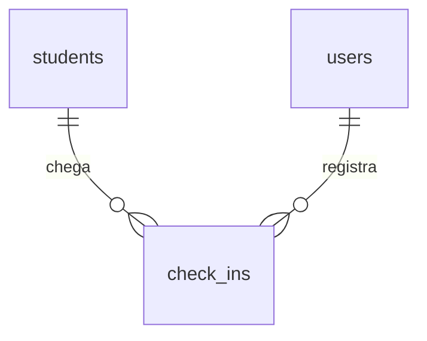

# Check-in

## Problem

Quando o aluno chega ao balcão, a recepção não tem como saber, numa olhada, se ele pode entrar. Para conferir hoje, ela abre a lista de alunos, procura o nome, entra na ficha e lê o bloco "Matrículas" para ver se há um período `active`. A foto fica no alto da ficha, numa variante pequena. O sistema também não guarda quem veio: não existe linha de presença, e por isso o dono não sabe quantos treinaram hoje nem quantas vezes um aluno veio no mês. O card "check-ins do dia" do painel ficou de fora da #12 por isso (`features/dashboard/plan.md`, Out of scope).

O PRD pede, no §3.6: "**RF-22** Check-in na recepção por busca de nome/CPF; a tela exibe **foto 3×4**, nome e situação da matrícula (liberado/bloqueado) para conferência visual" e "**RF-23** Histórico de presença por aluno e relatório por período". O §8 descreve a tela 7 como "Check-in rápido (campo único + cartão com foto grande e status)", e o §11 fixa como meta um "Tempo médio de check-in < 10 s". O PRD não diz o que bloqueia, se a recepção pode registrar alguém bloqueado, quantas presenças um aluno pode ter por dia nem quem lê o histórico. Na matriz do §2, "registrar presença" aparece só na Recepção; o Administrador tem "acesso total".

Com isto no ar, a recepção digita o nome ou o CPF num campo só e vê a foto grande do aluno, o nome e um "Liberado" ou "Bloqueado" com o motivo. Com um clique registra a presença, e um aluno bloqueado não entra no registro. A ficha do aluno ganha o histórico de presenças, o dono consulta as presenças de um período, e o painel ganha o card "Check-ins de hoje" para o Administrador e a Recepção.

## Flow

Reutiliza a busca de `GET /api/students?q=` (nome com `students_fold`, ou CPF e telefone em dígitos), `enrollmentStatus` e `saoPauloToday` de `packages/contracts/src/plans.ts`, a URL assinada de `PhotosService.photoUrls` (AD-043), a guarda por perfil de `apps/api/src/access.ts`, o `ValidationInterceptor` com `@Input`/`@QueryInput`/`@Output`, o `ProblemFilter`, o mapeamento de `23505` de `apps/api/src/db-errors.ts`, o cursor de página no molde de `GET /api/audit-logs` e, no painel, o `DashboardService` e o corte por perfil da AD-070. Nenhuma conta de situação de matrícula é escrita de novo, nem a busca de aluno. O que esta feature cria: a tabela de presenças, a regra de "liberado" e as rotas que a leem e gravam.

**Conferir e registrar no balcão**

1. navegador `GET /check-in` -> `proxy.ts` (exists) exige sessão -> a página de check-in (new, no door - placement per conventions) dentro do `Shell` (exists)
2. o campo único chama `GET /api/students?q=` (exists) e lista os resultados com a miniatura; um resultado só abre o cartão direto
3. o cartão chama `GET /api/students/:id/check-in-status` -> `AccessGuard` (exists): `admin` e `reception` -> módulo de check-in em `apps/api` (new, no door - placement per conventions): fixa `today = saoPauloToday()`, lê o aluno em `students` (exists), os períodos não cancelados em `enrollments` (exists) com `plans` (exists), chama `enrollmentStatus` (exists) com `today`, decide a liberação pela regra única de `packages/contracts` (door 2), lê a presença do dia em `check_ins` (door 1) e pede a URL `large` a `PhotosService` (exists)
4. "Registrar presença" chama `POST /api/students/:id/check-ins` -> `AccessGuard` (exists) -> o mesmo módulo: trava a linha do aluno, refaz a decisão da door 2 com `today` e insere em `check_ins` (door 1) com `day = today` e o autor; o `23505` do índice único vira `409` `already_checked_in`; não grava em `audit_logs` (door 3)
5. out: `201` com a presença, e o cartão passa a mostrar "Presença registrada às HH:mm."

**Histórico e relatório**

1. a ficha `/students/<id>` (exists) chama `GET /api/students/:id/check-ins` para `admin` e `reception` e monta o bloco "Presenças"
2. a página de presenças (new, no door - placement per conventions) chama `GET /api/check-ins?from=&to=&cursor=`; o módulo de check-in lê `check_ins` (door 1) com `students` (exists) e `users` (exists), filtrado por `day`

**Painel**

1. `GET /api/dashboard` -> `DashboardService` (exists): para `admin` e `reception`, conta as linhas de `check_ins` com `day` igual ao `today` que a resposta já fixou e devolve a chave nova `checkIns` (door 4, sobre a AD-070)
2. a página inicial (exists) mostra o card "Check-ins de hoje" quando a chave vem

## Impact

| Front | What changes |
| --- | --- |
| domain | novo termo: `check-in` (presença) - a chegada de um aluno num dia de `America/Sao_Paulo`, registrada por um usuário; tabela `check_ins`, rotas `check-ins`, tela "Check-in" e "Presenças". O PRD §6 a chama de `attendance`, e o §7 de `/attendance/check-in`: o código não usa esse nome (door 1) |
| domain | novo termo: liberação (`access`: `allowed` ou `blocked`, com `blockReasons`) - se o aluno pode entrar hoje. Mora numa definição só em `packages/contracts` (door 2). Não se confunde com `access.ts`, a guarda por perfil, que nada tem a ver com o aluno |
| domain | `enrollmentStatus` (AD-061) ganha um consumidor novo que ramifica em `active`; nenhum valor muda de sentido. `paymentStatus` (AD-068) não é lido nesta versão (Assumptions) |
| contrato | quatro rotas novas; `GET /api/dashboard` muda de assinatura: chave opcional nova `checkIns` no topo; dois códigos de erro novos, `check_in_blocked` e `already_checked_in`, ambos `409`; `AUDIT_ACTIONS` fica em 38 (door 3) |
| checks aprovados de outra feature | a `dashboard` está verificada com checks que afirmam o conjunto exato de chaves e de cards por perfil. Deixam de valer como estão: C2 e C3 (`admin` e `reception` passam a ter `checkIns`), C46 (o schema recusa `checkIns` no topo; passa a aceitá-la), C42 e C52 (a tela de `reception` e de `admin` ganha um card) e a parte de C58 que lista as chaves do `reception`. Nenhum desses checks é editado: os testes deles são alterados no Build desta feature, cada um coberto por um check novo daqui que o substitui, e `features/dashboard/checks.md` ganha uma nota apontando para eles, como a `auth-rbac` fez com C22 a C25 da `fundacao`. C4 (`instructor`) e o `hr_finance` de C2 seguem valendo sem mudança |
| comportamento existente | o menu do `Shell` ganha "Check-in" e "Presenças" para `admin` e `reception`; a ficha do aluno ganha o bloco "Presenças" para os mesmos perfis; `apps/web/e2e/shell.spec.ts` confere os itens do menu por perfil e muda junto |
| comportamento existente | `GET /api/students`, `GET /api/students/:id` e `GET /api/students/:id/photo` não mudam: a tela de check-in usa a busca que já existe |
| `privacidade` (#13) | `check_ins.student_id` aponta para o aluno sem `ON DELETE`: excluir ou anonimizar um titular passa a ter de tratar as presenças dele antes, como já trata `enrollments` e `photos` |
| stored data | tabela nova, vazia; nothing to migrate. Migração `0010` |
| ambiente | nenhuma variável nova, nenhuma extensão |
| `.specs` | aprovado o plano: as doors 1 a 4 viram AD-071 a AD-074 em `STATE.md`; a linha 11 do `ROADMAP.md` registra que perfil recebe `checkIns` |

## Relations

Restrições de mão única: uma presença por aluno por dia de `America/Sao_Paulo`, pelo índice único sobre `(student_id, day)` (door 1); `student_id` e `checked_in_by` obrigatórios, sem `ON DELETE` (door 1); nenhuma rota altera nem apaga uma linha (door 1). Sem colunas e sem tipos aqui.

## Surface

Rotas novas, e o painel, cuja assinatura muda. Todas também podem responder com a linha de erro comum da `auth-rbac` (`403 csrf_rejected` no `POST`, `403 two_factor_enrollment_required`).

| Route | In | Out | Status |
| --- | --- | --- | --- |
| `GET /api/students/:id/check-in-status` | `id` | `today` · `student` (`id` · `name` · `status`) · `photoUrl` (variante `large`, ou `null`) · `access` (`allowed` · `blocked`) · `blockReasons[]` (`student_inactive` · `student_suspended` · `no_active_enrollment`) · `enrollment` (`id` · `plan` (`id` · `name` · `period`) · `startsAt` · `endsAt`, ou `null`) · `checkedInAt` (instante, ou `null`) | `200`, `401`, `403`, `404` |
| `POST /api/students/:id/check-ins` | `id`, sem corpo | `id` · `day` · `checkedInAt` | `201`, `401`, `403`, `404`, `409` (`check_in_blocked`, `already_checked_in`) |
| `GET /api/students/:id/check-ins` | `id`, `cursor?` | `items[]`: `id` · `day` · `checkedInAt` · `checkedInBy` (`id` · `name`) · `nextCursor` | `200`, `401`, `403`, `404`, `422` |
| `GET /api/check-ins` | `from?`, `to?`, `cursor?` | `from` · `to` · `total` · `items[]`: `id` · `day` · `checkedInAt` · `student` (`id` · `name`) · `checkedInBy` (`id` · `name`) · `nextCursor` | `200`, `401`, `403`, `422` |
| `GET /api/dashboard` (muda) | nada | o que já devolvia (AD-070), mais `checkIns` (`count`) para `admin` e `reception` | `200`, `401`, `403` |

## Landing

| One-way door | Literal shape | Alternative rejected |
| --- | --- | --- |
| 1. `check_ins` guarda uma presença por linha, no máximo uma por aluno por dia | migração `0010`: `id uuid DEFAULT uuidv7()`; `student_id uuid NOT NULL REFERENCES students(id)` sem `ON DELETE`; `day date NOT NULL`, o dia em `America/Sao_Paulo` gravado pela API a partir de `saoPauloToday()`; `checked_in_at timestamptz DEFAULT now() NOT NULL`; `checked_in_by uuid NOT NULL REFERENCES users(id)` sem `ON DELETE`; `CREATE UNIQUE INDEX check_ins_one_per_day_idx ON check_ins (student_id, day)`; sem `status`, sem `voided_at` e sem `tenant_id` (AD-016); nenhuma rota edita ou apaga uma linha. Duas presenças no mesmo dia, se um dia forem precisas, é trocar o índice por migração; desfazer é coluna `voided_at` nova, no molde da AD-067 | `attendance` (PRD §6) como nome - a tela, a rota e o termo do roadmap dizem check-in, e seriam dois nomes para a mesma coisa; `day` gerado pelo banco (`(checked_in_at AT TIME ZONE 'America/Sao_Paulo')::date`) - é uma segunda definição de "hoje" ao lado de `saoPauloToday` (o motivo da AD-061), e os testes movem o relógio da API, não o do banco: o painel e o índice discordariam na virada; sem índice único - dois cliques no balcão ou duas recepcionistas gravariam duas presenças, e o relatório contaria o aluno duas vezes; só conferir antes do insert - não vale com duas requisições ao mesmo tempo |
| 2. a liberação é calculada, numa definição só em `packages/contracts`, ao lado de `enrollmentStatus` | `checkInAccess(student, periods, today)` devolve `{ access, blockReasons }`: `student_inactive` se `status` é `inactive`, `student_suspended` se é `suspended`, `no_active_enrollment` se nenhum período tem `enrollmentStatus(period, today) === 'active'`; `blockReasons` nessa ordem, sem repetição; `access` é `allowed` se e somente se `blockReasons` é `[]`. Nada é guardado. O `GET` de situação e o `POST` chamam a mesma conta com `today`; o `POST` com a linha do aluno travada em `FOR UPDATE`, a trava que inativar e matricular já usam. Bloqueio por pagamento, se entrar, é um motivo novo nesta conta, lendo `paymentStatus` (AD-068) | coluna `access` ou "bloqueado" guardada no aluno - envelheceria à meia-noite, o motivo da AD-061; a regra só na tela - o `POST` registraria um aluno bloqueado, e a AD-004 manda decidir no backend; bloquear também por `overdue` - a recepção não lê pagamentos hoje (AD-070, `readsPayments`), e o cartão mostraria um bloqueio de motivo que ela não pode ver (Assumptions, pergunta 1, respondida "não") |
| 3. o check-in não grava em `audit_logs` | `POST /api/students/:id/check-ins` insere só em `check_ins`; o autor e o instante ficam em `checked_in_by` e `checked_in_at`, que o histórico e o relatório mostram; nenhuma ação nova em `AUDIT_ACTIONS`. É a primeira escrita de um usuário que fica fora da trilha | `student.checked_in` na trilha - uma linha a cada entrada de cada aluno, todos os dias, numa tabela que não apaga (AD-024), para um fato que já é o próprio registro, com autor e instante; a RF-24 lista cadastros, fotos, visualização de funcionário e exportações, não presença. Se desfazer entrar um dia, o desfazimento é que vai à trilha, como em `student.payment_undone` (AD-069) |
| 4. o card de check-ins do painel é a chave `checkIns`, só para `admin` e `reception` | `dashboardResponseSchema` ganha `checkIns: z.strictObject({ count })` opcional; `count` é o número de linhas de `check_ins` com `day` igual ao `today` da mesma resposta; `admin`: `today`, `students`, `enrollments`, `payments`, `checkIns`; `reception`: `today`, `students`, `enrollments`, `checkIns`; `hr_finance` e `instructor` sem mudança. Quem recebe é quem lê as rotas de presença (`GET /api/students/:id/check-ins` e `GET /api/check-ins`), a regra da AD-070 | para os quatro perfis - `hr_finance` e `instructor` passariam a ler um número de presenças que nenhuma rota lhes mostra, e o PRD §2 não lhes dá presença; para `admin`, `reception` e `instructor` - o instrutor só consulta "nome, foto, status" (§2), e lhe dar o card obriga a lhe dar o relatório, ou o card fica sem link; `checkIns` como número solto (`checkIns: 12`) - o card de pagamentos já é objeto, e um número solto impede acrescentar "alunos distintos" ou "última hora" sem mudar a chave existente, o que a AD-070 proíbe |

- Nothing else in this change is hard to reverse

## Criteria

### S1: O balcão vê se o aluno pode entrar (P1)

Uma leitura que diz, para um aluno, se ele está liberado hoje, por quê, e se já entrou.

**Acceptance Criteria**

1. WHEN um usuário `admin` ou `reception` chama `GET /api/students/:id/check-in-status` de um aluno que existe THEN the system SHALL responder `200` com exatamente as chaves `today`, `student`, `photoUrl`, `access`, `blockReasons`, `enrollment` e `checkedInAt`, e `today` igual ao dia corrente em `America/Sao_Paulo`, no formato `aaaa-mm-dd`
2. WHEN o aluno tem `status` `active` e um período `active` em `today` THEN the system SHALL responder `access` igual a `allowed` e `blockReasons` igual a `[]`
3. IF o aluno tem `status` `inactive` THEN the system SHALL responder `access` igual a `blocked` com `student_inactive` em `blockReasons`, mesmo com um período `active`
4. IF o aluno tem `status` `suspended` THEN the system SHALL responder `access` igual a `blocked` com `student_suspended` em `blockReasons`, mesmo com um período `active`
5. IF nenhum período do aluno está `active` em `today` (sem período, só `scheduled`, só `expired` ou só `cancelled`) THEN the system SHALL responder `access` igual a `blocked` com `no_active_enrollment` em `blockReasons`
6. WHEN há um motivo de aluno e o motivo de matrícula ao mesmo tempo THEN the system SHALL devolver os dois em `blockReasons`, o de aluno primeiro
7. WHILE um período do aluno está `overdue` pela `paymentStatus` e `active` pela `enrollmentStatus` the system SHALL responder `access` igual a `allowed`
8. The system SHALL devolver em `enrollment` o período `active` em `today`, com `id`, `plan` (`id`, `name` atual, `period`), `startsAt` e `endsAt`, e `null` quando não há período `active`
9. The system SHALL devolver em `photoUrl` a URL assinada da variante `large` da foto corrente do aluno (AD-043), e `null` quando o aluno não tem foto
10. The system SHALL devolver em `checkedInAt` o instante da presença do aluno com `day` igual a `today`, e `null` quando não há
11. WHEN um período tem `endsAt` igual a D THEN the system SHALL responder `allowed` na chamada das `02:59:59Z` de D+1 e `blocked` com `no_active_enrollment` na das `03:00:00Z`; e WHEN um período tem `startsAt` igual a D+1 THEN the system SHALL responder `blocked` na primeira e `allowed` na segunda
12. WHEN o aluno tem presença com `day` igual a D THEN the system SHALL devolver `checkedInAt` preenchido na chamada das `02:59:59Z` de D+1 e `null` na das `03:00:00Z`
13. IF a rota é chamada por `hr_finance` ou `instructor` THEN the system SHALL responder `403` com `code` igual a `forbidden`
14. IF a rota é chamada sem sessão THEN the system SHALL responder `401` com `code` igual a `unauthorized`
15. IF o aluno não existe THEN the system SHALL responder `404` com `code` igual a `not_found`
16. WHEN a rota responde `200` THEN the system SHALL deixar `audit_logs` e `check_ins` com o mesmo número de linhas de antes

**Independent test:** com o relógio fixado, um aluno ativo com período vigente, um inativo com período vigente e um ativo só com período vencido; ler a situação dos três e achar `allowed`, `blocked` com `student_inactive` e `blocked` com `no_active_enrollment`.

### S2: Registrar a presença (P1)

Um clique grava a presença do dia, só para quem está liberado, e só uma vez.

**Acceptance Criteria**

17. WHEN um usuário `admin` ou `reception` chama `POST /api/students/:id/check-ins` para um aluno `allowed` sem presença em `today` THEN the system SHALL responder `201` com exatamente `id`, `day` igual a `today` e `checkedInAt`, e gravar uma linha em `check_ins` com o aluno, esse `day` e `checked_in_by` igual ao usuário da sessão
18. IF o aluno está `blocked` em `today` THEN the system SHALL responder `409` com `code` igual a `check_in_blocked` e deixar `check_ins` com o mesmo número de linhas
19. IF o aluno já tem presença com `day` igual a `today` THEN the system SHALL responder `409` com `code` igual a `already_checked_in` e deixar `check_ins` com o mesmo número de linhas
20. WHEN duas chamadas para o mesmo aluno liberado chegam ao mesmo tempo THEN the system SHALL responder `201` a exatamente uma e `409` com `already_checked_in` à outra, com uma linha só em `check_ins`
21. WHEN o aluno registrou presença em D THEN the system SHALL responder `409` `already_checked_in` na chamada das `02:59:59Z` de D+1 e `201` com `day` igual a D+1 na das `03:00:00Z`
22. WHEN o aluno está liberado às `02:59:59Z` de D+1 pelo período que termina em D THEN the system SHALL responder `201` nessa chamada e `409` `check_in_blocked` na das `03:00:00Z`
23. IF a rota é chamada por `hr_finance` ou `instructor` THEN the system SHALL responder `403` com `code` igual a `forbidden` e deixar `check_ins` com o mesmo número de linhas
24. IF a rota é chamada sem sessão THEN the system SHALL responder `401` com `code` igual a `unauthorized`
25. IF o aluno não existe THEN the system SHALL responder `404` com `code` igual a `not_found`
26. WHEN a rota responde `201` THEN the system SHALL deixar `audit_logs` com o mesmo número de linhas de antes

**Independent test:** registrar a presença de um aluno liberado e achar `201`; repetir e achar `409 already_checked_in`; tentar com um aluno inativo e achar `409 check_in_blocked`; contar duas linhas a menos do que três tentativas.

### S3: Histórico de presença do aluno (P1)

As presenças de um aluno, da mais recente para a mais antiga.

**Acceptance Criteria**

27. WHEN um usuário `admin` ou `reception` chama `GET /api/students/:id/check-ins` THEN the system SHALL responder `200` com `items` e `nextCursor`, cada item com exatamente `id`, `day`, `checkedInAt` e `checkedInBy` (`id`, `name` atual do usuário), só das presenças desse aluno
28. The system SHALL ordenar `items` por `checkedInAt` decrescente e, no empate, por `id` decrescente
29. The system SHALL devolver no máximo 50 itens por página, com `nextCursor` preenchido quando há mais e `null` na última página, e a página seguinte, pedida com `cursor`, SHALL começar no item depois do último da anterior, sem repetir nem pular nenhum
30. WHEN o aluno não tem presença THEN the system SHALL responder `items` igual a `[]` e `nextCursor` igual a `null`
31. IF `cursor` não é um cursor que a rota emitiria THEN the system SHALL responder `422` com `code` igual a `validation_failed` e um item em `errors` de `path` igual a `cursor`
32. IF a rota é chamada por `hr_finance` ou `instructor` THEN the system SHALL responder `403` com `code` igual a `forbidden`; sem sessão, `401`; com aluno que não existe, `404`

**Independent test:** com 51 presenças de um aluno e 2 de outro, ler a primeira página e achar 50 do aluno, em ordem decrescente, com `nextCursor`; ler a segunda e achar 1, com `nextCursor` `null`.

### S4: Relatório de presença por período (P1)

As presenças de todos os alunos entre dois dias, com o total.

**Acceptance Criteria**

33. WHEN um usuário `admin` ou `reception` chama `GET /api/check-ins?from=<dia>&to=<dia>` THEN the system SHALL responder `200` com `from`, `to`, `total`, `items` e `nextCursor`, `items` só com as presenças de `day` entre `from` e `to`, as duas pontas incluídas, cada uma com exatamente `id`, `day`, `checkedInAt`, `student` (`id`, `name`) e `checkedInBy` (`id`, `name`)
34. The system SHALL devolver em `total` o número de presenças do período inteiro, igual em todas as páginas
35. WHEN `to` não é informado THEN the system SHALL usar `today` em `America/Sao_Paulo`; WHEN `from` não é informado THEN the system SHALL usar o valor de `to`; e SHALL devolver os dois valores usados em `from` e `to`
36. The system SHALL ordenar `items` por `checkedInAt` decrescente e, no empate, por `id` decrescente, no máximo 50 por página, com o `nextCursor` da AC 29
37. IF `from` ou `to` não está no formato `aaaa-mm-dd` ou não é uma data que existe THEN the system SHALL responder `422` com `validation_failed` e um item em `errors` de `path` igual ao parâmetro
38. IF `from` é posterior a `to` THEN the system SHALL responder `422` com `validation_failed` e um item em `errors` de `path` igual a `to`
39. IF o período passa de 366 dias, as duas pontas contadas THEN the system SHALL responder `422` com `validation_failed` e um item em `errors` de `path` igual a `from`; com 366 dias exatos SHALL responder `200`
40. WHEN nenhuma presença cai no período THEN the system SHALL responder `total` igual a `0`, `items` igual a `[]` e `nextCursor` igual a `null`
41. IF a rota é chamada por `hr_finance` ou `instructor` THEN the system SHALL responder `403` com `code` igual a `forbidden`; sem sessão, `401`

**Independent test:** com presenças em D-1, D e D+1, pedir `from=D&to=D` e achar só as de D com `total` igual a elas; pedir sem parâmetro e achar o mesmo resultado com `from` e `to` iguais a `today`.

### S5: O card de check-ins no painel (P1)

`GET /api/dashboard` ganha a chave `checkIns` para quem lê presenças.

**Acceptance Criteria**

42. The system SHALL devolver a `admin` um objeto com exatamente as chaves `today`, `students`, `enrollments`, `payments` e `checkIns`
43. The system SHALL devolver a `reception` um objeto com exatamente as chaves `today`, `students`, `enrollments` e `checkIns`
44. The system SHALL devolver a `hr_finance` exatamente `today`, `students`, `enrollments` e `payments`, e a `instructor` exatamente `today` e `students`, sem a chave `checkIns`
45. The system SHALL devolver `checkIns` com exatamente a chave `count`, o número de presenças com `day` igual ao `today` da mesma resposta, e `0` quando não há
46. WHEN há uma presença com `day` igual a D THEN the system SHALL contá-la em `checkIns.count` na chamada das `02:59:59Z` de D+1 e não contá-la na das `03:00:00Z`
47. The system SHALL devolver, para os mesmos dados no mesmo instante, `checkIns.count` igual ao `total` de `GET /api/check-ins` sem parâmetros

**Independent test:** registrar duas presenças hoje e uma ontem; ler o painel como `admin` e `reception` e achar `checkIns` igual a `{ "count": 2 }`; como `hr_finance` e `instructor`, não achar a chave.

### S6: A tela de check-in (P1)

Campo único, cartão com foto grande e situação, um botão.

**Acceptance Criteria**

48. The system SHALL exibir o item "Check-in" no menu para `admin` e `reception`, e não para `hr_finance` e `instructor`
49. WHEN um usuário `hr_finance` ou `instructor` abre `/check-in` THEN the system SHALL exibir "Você não tem permissão para acessar esta página." sem chamar nenhuma rota de check-in
50. WHEN um usuário `admin` ou `reception` abre `/check-in` THEN the system SHALL exibir o título "Check-in" e o campo "Nome ou CPF" com o foco nele
51. WHEN a busca encontra mais de um aluno THEN the system SHALL listá-los com a miniatura, o nome e a situação do cadastro, na ordem da API, e abrir o cartão do aluno escolhido
52. WHEN a busca encontra exatamente um aluno THEN the system SHALL abrir o cartão dele sem pedir escolha
53. IF a busca não encontra aluno THEN the system SHALL exibir "Nenhum aluno encontrado."
54. The system SHALL exibir no cartão a foto pela `photoUrl` (ou o marcador com as iniciais, RF-18, quando é `null`), o nome, o selo "Liberado" ou "Bloqueado", e o plano como `<nome> · <periodicidade>` com "Vence em dd/MM/aaaa", ou "Sem matrícula vigente" quando `enrollment` é `null`
55. WHEN `access` é `blocked` THEN the system SHALL exibir cada motivo de `blockReasons` como "Aluno inativo", "Aluno suspenso" ou "Sem matrícula vigente", e não exibir o botão "Registrar presença"
56. WHEN `access` é `allowed` e `checkedInAt` é `null` THEN the system SHALL exibir o botão "Registrar presença"
57. WHEN `checkedInAt` está preenchido THEN the system SHALL exibir "Presença já registrada hoje às HH:mm." com a hora em `America/Sao_Paulo`, sem o botão
58. WHEN "Registrar presença" é clicado e a API responde `201` THEN the system SHALL exibir "Presença registrada às HH:mm.", limpar o campo de busca e devolver o foco a ele
59. IF o registro responde `409` com `already_checked_in` ou com `check_in_blocked` THEN the system SHALL recarregar o cartão e mostrar a situação nova (AC 55 ou AC 57)
60. IF a busca, o cartão ou o registro falha com outro status THEN the system SHALL exibir "Não foi possível carregar o aluno." ou "Não foi possível registrar a presença." e o botão "Tentar novamente", mantendo o campo de busca
61. The system SHALL exibir nome de aluno e nome de plano com marcação como texto literal, sem criar elemento

**Independent test:** subir a stack, entrar como recepção, buscar um aluno liberado pelo CPF, ver a foto grande e "Liberado", registrar e ver "Presença registrada às HH:mm."; buscar de novo e ver "Presença já registrada hoje"; buscar um inativo e ver "Bloqueado" sem botão.

### S7: Presenças na ficha do aluno (P2)

O bloco "Presenças" da ficha, para quem lê o histórico.

**Acceptance Criteria**

62. WHEN um usuário `admin` ou `reception` abre `/students/<id>` THEN the system SHALL exibir o bloco "Presenças" com uma tabela de colunas "Data" (`dd/MM/aaaa`), "Hora" (`HH:mm` em `America/Sao_Paulo`) e "Registrado por", na ordem da API
63. WHEN a resposta traz `nextCursor` THEN the system SHALL exibir o botão "Carregar mais", que acrescenta a página seguinte abaixo das linhas que já estão
64. IF o aluno não tem presença THEN the system SHALL exibir "Nenhuma presença registrada." no lugar da tabela
65. WHEN um usuário `hr_finance` ou `instructor` abre a ficha THEN the system SHALL não exibir o bloco "Presenças" nem chamar `GET /api/students/:id/check-ins`
66. IF `GET /api/students/:id/check-ins` não responde `200` THEN the system SHALL exibir "Não foi possível carregar as presenças." e o botão "Tentar novamente", sem esconder os outros blocos da ficha

**Independent test:** abrir a ficha de um aluno com presenças como recepção e ver a tabela; como instrutor, não ver o bloco.

### S8: A tela do relatório de presenças (P2)

`/check-ins`: as presenças entre duas datas, com o total.

**Acceptance Criteria**

67. The system SHALL exibir o item "Presenças" no menu para `admin` e `reception`, e não para `hr_finance` e `instructor`; aberto por eles, `/check-ins` SHALL exibir "Você não tem permissão para acessar esta página." sem chamar `GET /api/check-ins`
68. WHEN `admin` ou `reception` abre `/check-ins` THEN the system SHALL exibir o título "Presenças", os campos "De" e "Até" preenchidos com o `from` e o `to` da resposta, "Total no período: <total>" e uma tabela de colunas "Data", "Hora", "Aluno" (nome como link para `/students/<id>`) e "Registrado por", na ordem da API
69. WHEN "De" e "Até" são enviados THEN the system SHALL abrir `/check-ins?from=<De>&to=<Até>` e pedir `GET /api/check-ins` com esses dois valores
70. IF a API responde `422` THEN the system SHALL exibir a `message` de cada item de `errors` junto do campo do `path` dele
71. IF nenhuma presença cai no período THEN the system SHALL exibir "Total no período: 0" e "Nenhuma presença no período." no lugar da tabela
72. WHEN a resposta traz `nextCursor` THEN the system SHALL exibir o botão "Carregar mais", que acrescenta a página seguinte
73. IF `GET /api/check-ins` não responde `200` nem `422` THEN the system SHALL exibir "Não foi possível carregar as presenças." e o botão "Tentar novamente"

**Independent test:** abrir `/check-ins` como administrador e ver as presenças de hoje com o total; trocar "De" para sete dias atrás e ver a lista crescer.

### S9: O card no painel (P1)

"Check-ins de hoje" na página inicial de quem recebe a chave.

**Acceptance Criteria**

74. WHERE a resposta do painel traz `checkIns` the system SHALL exibir o card "Check-ins de hoje" com `count` e o link "Ver presenças de hoje" para `/check-ins`
75. The system SHALL exibir os cards nesta ordem: "Alunos", "Check-ins de hoje", "Matrículas", "Vencimentos nos próximos 7 dias", "Pagamentos", "Matrículas ativas por plano", cada um só quando a chave dele vem
76. WHEN `admin` abre `/` THEN the system SHALL exibir os seis cards; WHEN `reception` abre `/` THEN the system SHALL exibir cinco, sem "Pagamentos"; WHEN `hr_finance` abre `/` THEN the system SHALL exibir cinco, sem "Check-ins de hoje"; WHEN `instructor` abre `/` THEN the system SHALL exibir só "Alunos"

**Independent test:** entrar como recepção depois de registrar duas presenças e ver "Check-ins de hoje" com 2; seguir o link e ver as duas em `/check-ins`.

## Out of scope

Product capabilities only. Process and harness rules live in AGENTS.md or as Observable `n/a`.

| Excluded | Why |
| --- | --- |
| Desfazer ou apagar uma presença registrada por engano | não está no PRD; o cartão com foto grande é a conferência antes do clique. Entra depois como `voided_at` e uma ação de trilha, no molde das AD-067 e AD-069 (door 1, Assumptions) |
| Registrar presença de aluno bloqueado ("liberar mesmo assim") | o "bloqueado" do RF-22 perde o sentido se a recepção passa por cima; regularizar é matricular primeiro (door 2) |
| Bloqueio por pagamento atrasado | a recepção não lê pagamentos (AD-070); entra como motivo novo da door 2 se o usuário quiser (Assumptions, pergunta 1) |
| Mais de uma presença por aluno no mesmo dia; hora de saída | o PRD fala em presença, não em permanência; uma por dia é o que o relatório conta (door 1) |
| Catraca, QR Code, biometria, reconhecimento facial | fase 3 e não objetivo do MVP (PRD §1.4 e §10) |
| Check-in feito pelo próprio aluno | portal do aluno é fase 2 (PRD §10) |
| Frequência agregada (presenças por aluno no mês, gráfico por dia, alunos sumidos) e exportação em CSV ou PDF | relatórios avançados são fase 2 (PRD §10); o relatório desta versão é a lista do período com o total |
| Regras de acesso do plano aplicadas no check-in (horário, dias da semana) | `rules` é texto livre que o sistema não interpreta (AD-058); regra aplicada é coluna nova ao lado do texto, em outra feature |
| Card "Check-ins de hoje" para `hr_finance` e `instructor` | eles não leem presenças (door 4) |

## Assumptions

Defaults that are not already a numbered criterion. Drop a row once it is.

| Assumption | Chosen default | Rationale | Confirmed? |
| --- | --- | --- | --- |
| Perfil do card `checkIns` | `admin` e `reception` (door 4) | a regra da AD-070: o card vai a quem lê o mesmo dado pelas rotas, e as rotas de presença são de `admin` e `reception` (PRD §2: "registrar presença" é da Recepção; o Administrador tem acesso total) | y |
| Quem lê histórico e relatório | `admin` e `reception`, os mesmos que registram | o histórico é a tela 4 do §8 ("presença" na ficha) para quem atende; `hr_finance` lê matrícula e pagamento, não presença; o instrutor só "nome, foto, status" | y |
| Pagamento atrasado bloqueia? | não: só a situação do cadastro e a matrícula vigente decidem (AC 7) | o usuário respondeu "não" à pergunta 1 em 2026-10-16; RF-22 diz "situação da matrícula"; a recepção não lê pagamentos (AD-070), e um bloqueio por motivo que ela não vê não se explica no balcão | y |
| Bloqueado pode ser registrado? | não: `409 check_in_blocked` (AC 18) | a AD-004 manda a regra para o backend; uma presença de quem não podia entrar entraria no relatório como se pudesse | y |
| Presenças por dia | uma por aluno por dia em `America/Sao_Paulo` (door 1) | evita o clique duplo no balcão e mantém o total do relatório igual ao número de visitas; quem treina duas vezes no dia aparece uma | y |
| Desfazer presença | fora desta versão (Out of scope) | o usuário respondeu "não" à pergunta 2 em 2026-10-16; um erro fica no histórico com o autor; a coluna `voided_at` entra depois sem mexer nas linhas que existem | y |
| Trilha | o check-in não grava em `audit_logs` (door 3) | a própria linha tem autor e instante; uma linha de trilha por entrada de aluno seria a tabela que mais cresce, sem que a RF-24 a peça | y |
| Variante da foto no cartão | `large` (600×800) | "foto grande" do §8 para conferência visual; a lista de resultados continua com a `thumb` que a busca já devolve | y |
| `checkedInBy` com o nome do usuário para a Recepção | sim, o nome atual de `users`, como o menu já mostra o da sessão | o nome de quem usa o sistema não é ficha de funcionário (RF-10 fala de `staff`); sem ele, o histórico não diz quem registrou, e a trilha não tem a linha (door 3) | y |
| Período máximo do relatório | 366 dias, as duas pontas contadas (AC 39) | um ano cabe, inclusive o bissexto; um limite impede pedir a história inteira numa consulta | y |
| Meta "check-in < 10 s" (PRD §11) | não é critério | é média de operação humana, não se prova numa execução; a tela a favorece com o campo único, o foco e o cartão direto com um resultado (AC 50, 52, 58) | y |
| Pendências sem dono do Handoff | nenhuma entra aqui | são de outras features | y |

**Open questions:** none - all resolved or logged above. Pergunta 1 (pagamento `overdue` bloqueia?) e pergunta 2 (desfazer presença nesta versão?) respondidas "não" pelo usuário em 2026-10-16, os dois padrões do plano: a AC 7, a door 2 e o `Out of scope` ficam como estão.

## Observable

Worksheet, not the review. `n/a` needs its reason. One row may group the same decision across several routes.

| Surface | Decision | Landing |
| --- | --- | --- |
| screen `/check-in` | empty state | AC 50 (campo vazio, sem cartão), AC 53 (busca sem resultado) |
| screen `/check-in` | loading state | n/a - a busca e o cartão são pedidos do navegador; o botão fica desabilitado durante a chamada, no molde dos diálogos de `pagamentos`, e isso fica para o diff |
| screen `/check-in` | error state | AC 60 |
| screen `/check-in` | unauthorised state | AC 49 sem permissão; sem sessão, o `proxy.ts` que já existe manda para `/login` |
| screen `/check-in` | density and ordering | AC 51 (resultados na ordem da API), AC 54 (cartão) |
| screen `/check-in` | destructive action confirms | n/a - registrar presença não destrói nada, e confirmar custaria um clique a cada aluno; a conferência é a foto do cartão (AC 54) |
| screen ficha, bloco "Presenças" | empty, error, unauthorised, ordering | AC 64, AC 66, AC 65, AC 62 |
| screen ficha, bloco "Presenças" | loading state | n/a - renderizado com a ficha, como os blocos "Matrículas" e "Pagamentos" |
| screen ficha, bloco "Presenças" | destructive action confirms | n/a - só lê |
| screen `/check-ins` | empty, error, unauthorised, ordering | AC 71, AC 73 e AC 70, AC 67, AC 68 |
| screen `/check-ins` | loading state | n/a - página renderizada no servidor, como `/payments` |
| screen `/check-ins` | destructive action confirms | n/a - só lê |
| screen `/` | card novo, por perfil e ordem | AC 74 a AC 76 |
| API `GET /api/students/:id/check-in-status` | response shape | AC 1 a AC 10 |
| API `POST /api/students/:id/check-ins` | response shape | AC 17 |
| API `GET /api/students/:id/check-ins` e `GET /api/check-ins` | response shape | AC 27, AC 33, AC 34 |
| API `GET /api/dashboard` | response shape | AC 42 a AC 45 |
| all new `/api/students/:id/check-*` e `/api/check-ins` | error shape and codes | AC 13 a AC 15, AC 18, AC 19, AC 23 a AC 25, AC 31, AC 32, AC 37 a AC 39, AC 41 - `problem+json` da AD-009; códigos novos só `check_in_blocked` e `already_checked_in` |
| all new routes e `GET /api/dashboard` | who may call it | AC 1, AC 13, AC 17, AC 23, AC 27, AC 32, AC 33, AC 41, AC 42 a AC 44 |
| all new routes | versioning | n/a - o único consumidor é `apps/web`, versionado e implantado junto |
| all new routes | rate limit | n/a - rotas só de usuário autenticado; limite por IP fica no proxy, em `operacao` |
| collection `items` do histórico e do relatório | ordering | AC 28, AC 36 |
| collection `items` do histórico e do relatório | duplicates | AC 20 e door 1: uma presença por aluno por dia; a paginação não repete (AC 29) |
| collection `blockReasons` | ordering, duplicates | AC 6 - ordem fixa, sem repetição |
| collection `blockReasons` | the exception that does not fit | AC 7 - o atrasado no pagamento continua liberado |
| document `.env.example` | structure | n/a - nenhuma variável nova |
| scheduled task | output, flags, exit codes | n/a - nenhuma tarefa: "hoje" é calculado na leitura |

## Sources

- `PRD — Sistema de Gestão de Academia.md` §3.6 (RF-22, RF-23), §2 (Recepção: "registrar presença"), §8 telas 2, 4 e 7, §6 (`attendance`) e §11 (check-in < 10 s)
- `.specs/STATE.md` AD-004, AD-033, AD-061, AD-062, AD-067 a AD-070 - regra no backend, chave que o perfil não lê não existe, situação calculada, o painel com uma chave por card e o `check-in` decidindo quem recebe `checkIns`
- `.specs/ROADMAP.md` linha 11 - a feature acrescenta `checkIns` ao painel e decide que perfil a recebe
