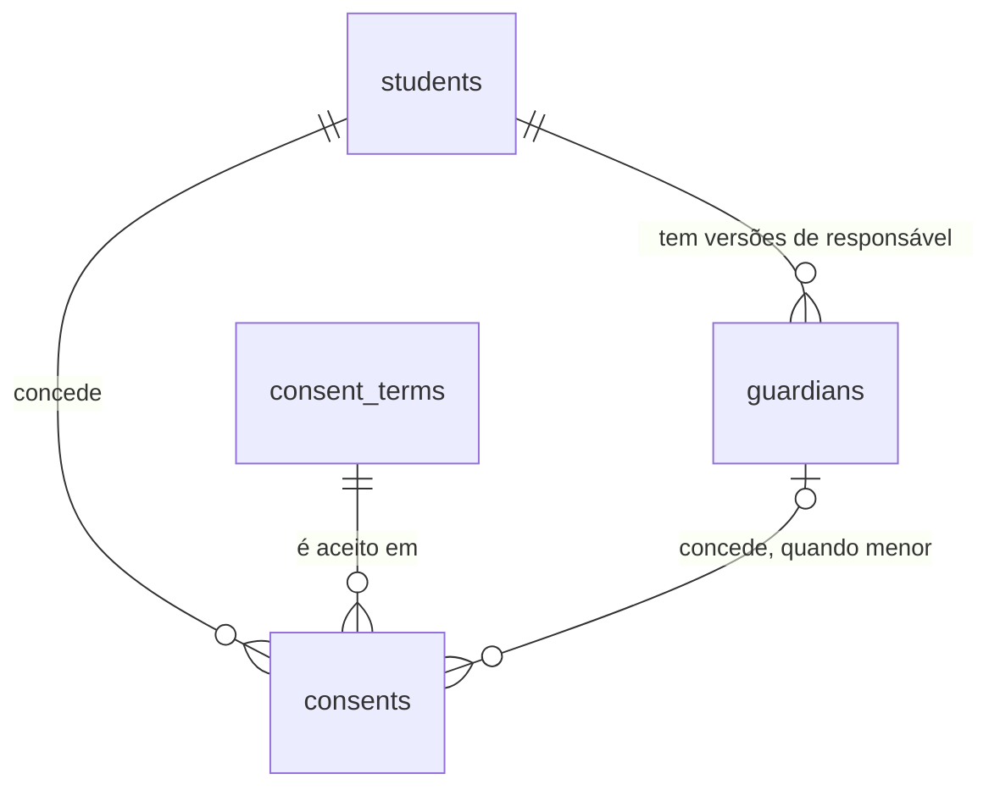

# Consentimento e responsável legal

## Problem

O sistema cadastra alunos e não sabe se tem o direito de guardar os dados deles. Um aluno menor de 18 anos entra na base igual a um adulto, sem ninguém que responda por ele, e nenhum aluno, menor ou não, tem registrado que aceitou o uso da imagem e dos dados. O PRD aponta isso como risco de impacto alto: "falta de consentimento válido para menores" (§11), com a mitigação "fluxo obrigatório com responsável legal e versão do termo". Quem paga é a academia, que responde perante a LGPD sem ter como provar o que foi aceito, em que texto e por quem, e o aluno (ou a família dele), cujo consentimento hoje não existe em lugar nenhum. A `alunos` deixou isso dito: "até ela entrar, um menor é cadastrado sem responsável" (Out of scope de `alunos`).

O PRD fixa: RF-06 ("menores de 18 anos exigem dados e consentimento do responsável legal"), RF-27 ("registro de consentimento para uso da imagem e dos dados (texto versionado, data, responsável)"), a tabela `consents` do §6 (`purpose`, `text_version`, `granted_at`, `revoked_at`, `granted_by`) e a tela 4 do §8 ("ficha do aluno: (...) consentimentos"). Não traz número de volume, nem quantos menores a academia atende, nem o texto do termo: o §12 deixa o texto "revisado por assessoria jurídica" como dependência externa.

Quando isto entrar: a recepção não consegue cadastrar um menor sem os dados do responsável legal; abre a ficha, mostra ao aluno (ou ao responsável) o texto vigente de cada finalidade e registra que ele aceitou, com a versão do texto, o instante e quem concedeu; consegue revogar; e o Administrador encontra cada um desses atos na tela de Auditoria, ligado ao aluno.

## Flow

Reutiliza a guarda por perfil (`access.ts`), o `ValidationInterceptor` com `@Input`, `@Output`, `@QueryInput`, o `ProblemFilter` e `validationProblem`, o gravador `audit.record` com `diffOf` e `@Actor`, o módulo de alunos (`StudentsService`, que já abre a transação e trava a linha do aluno), a regra de CPF e de telefone de `packages/contracts/src/students.ts`, o gatilho append-only da migração `0002`, e no web o `Shell`, `fetchApi`, `StatusActions` (diálogo de confirmação) e o formulário de aluno: nenhuma rota ganha guarda, erro, validação, auditoria ou layout próprio.

**Cadastro do responsável (dentro de `POST` e `PATCH` de alunos)**

1. `POST /api/students` e `PATCH /api/students/:id` -> `apps/web` (exists) repassa -> checagem de origem (exists) -> `AccessGuard` (exists), perfis `admin` e `reception`, sem mudança
2. `ValidationInterceptor` (exists) - valida o corpo pelo schema de `packages/contracts` (exists), que ganha o objeto opcional `guardian` e a função `isMinor(birthDate, today)`, uma definição só para a API e o web (AD-011)
3. módulo de alunos em `apps/api` (exists) - na transação que já cria ou trava o aluno: decide se o aluno é menor (`isMinor`), recusa o menor sem responsável, e havendo `guardian` com dados diferentes do atual, insere uma linha nova em `guardians` (door 1), sem tocar na anterior
4. `audit.record(tx, ...)` (exists) - além da linha de `student.created` ou `student.updated`, grava `student.guardian_saved` (door 4) quando entrou um responsável novo; tudo na mesma transação
5. out: as respostas de hoje de `POST` e `PATCH`, mais `422` com `path` `guardian` ou `guardian.<campo>`

**Termos, consentimentos e leitura**

1. `GET /api/consent-terms`, `GET|POST /api/students/:id/consents`, `DELETE /api/students/:id/consents/:consentId` -> repasse e checagem de origem (exists) -> `AccessGuard` (exists), perfis `admin` e `reception`
2. módulo de consentimento em `apps/api` (new, no door - placement per conventions) - lê `consent_terms` (door 2) para a versão vigente de cada finalidade; no `POST`, abre a transação, trava a linha do aluno (exists), confere menor e responsável, e insere em `consents` (door 3); o índice único parcial é quem decide a corrida entre duas concessões
3. `audit.record(tx, ...)` (exists) - `student.consent_granted` ou `student.consent_revoked`, na mesma transação
4. out: `201`, `204`, `200`, ou `409`/`422` com `code` estável; nada gravado se a linha de auditoria falha

**Telas**

1. navegador `GET /students/<id>` -> `proxy.ts` (exists) exige sessão -> a ficha (exists), renderizada no servidor, chama `GET /api/students/:id/consents` por `fetchApi` (exists) e monta o bloco "Responsável e consentimentos" abaixo da ficha, só para `admin` e `reception`
2. botões "Registrar consentimento" e "Revogar" -> diálogo de confirmação (padrão de `StatusActions`, exists) -> `POST|DELETE /api/students/:id/consents*` pelo repasse de `/api/*` (exists), e voltam ao caminho acima
3. formulário de `/students/new` e `/students/<id>/edit` (exists) - ganha o bloco "Responsável legal", exibido e obrigatório quando a data de nascimento informada é de menor (mesma `isMinor`), enviado dentro do `POST` ou `PATCH` de alunos
4. `/audit` (exists) - passa a nomear as três ações novas e os campos novos do `diff`; o "Alvo" já leva à ficha, porque `entity` é `student`

## Impact

| Front | What changes |
| --- | --- |
| domain | novo termo: `guardian` - a pessoa que responde legalmente por um aluno menor; é uma linha por versão dos dados, nunca editada, e o responsável atual é a mais recente (door 1). Vão ramificar nele: `privacidade` (apagar ou anonimizar junto do aluno) |
| domain | novo termo: `consent_term` - o texto de uma finalidade numa versão, imutável (door 2); `purpose` é `data_processing` (dados pessoais, inclusive os de saúde) ou `image_use` (imagem) |
| domain | novo termo: `consent` - o registro de que alguém aceitou uma versão de um termo para um aluno, em certo instante; só muda de ativo para revogado (door 3). `foto-pipeline`, `check-in` e `planos-matriculas` podem vir a ramificar em "tem consentimento ativo" (Open question 1) |
| domain | novo termo: `minor` - aluno com menos de 18 anos completos em `America/Sao_Paulo` no dia da chamada; `isMinor` em `packages/contracts` é a única definição. Hoje nada no código chama alguém de menor |
| domain | termo do PRD que muda: `students.guardian_id` (§6) não é criado: a chave estrangeira fica em `guardians`, apontando para o aluno, e `students` não ganha coluna (AD-030, C1 de `alunos`). `consents.subject_type` e `subject_id` (§6) viram `student_id` com chave estrangeira (door 3); `granted_by` do §6 é o par `granted_by` e `guardian_id` |
| contrato | `POST /api/students` e `PATCH /api/students/:id`, rotas já consumidas por `apps/web`: ganham `guardian` opcional no corpo e um `422` novo, o de menor sem responsável. Os testes e a tela de alunos usam datas de nascimento de adulto (`2000-01-01`, `1990-11-30`, `1987-03-14`), então nenhum caso de `alunos` passa a falhar |
| contrato | códigos de erro novos, ao lado de `cpf_taken`: `consent_active` (`409`) e `consent_term_outdated` (`409`) |
| contrato | `AUDIT_ACTIONS` ganha três valores (door 4). `ACTION_LABELS` de `apps/web/src/lib/audit.ts` é um `Record<AuditAction, string>`: o typecheck falha até a tela ter o rótulo de cada um; `FIELD_LABELS` ganha os campos novos do `diff` |
| ambiente | nenhuma chave nova. Nenhum campo desta feature é cifrado (Assumptions: CPF e telefone do responsável seguem o precedente do aluno, AD-030; o termo e o consentimento não são dado de saúde), então a AD-031 e a AD-034 não entram |
| web | a ficha ganha o bloco "Responsável e consentimentos"; o formulário de aluno ganha o bloco "Responsável legal"; `apps/web/e2e/students.spec.ts` e `fake-api.ts` ganham casos |
| `auditoria` | `/audit` resolve o "Alvo" para `entity` igual a `student` (AC 55 de `alunos`): as três ações novas levam à ficha sem código novo; o filtro `entityId` da tela passa a listar também consentimentos e responsáveis daquele aluno |
| portão | as rotas novas entram na regra de `paths` do OpenAPI e nos 70% de cobertura de `apps/api/src`, sem mudança no portão |
| stored data | a migração `0004` cria `guardians`, `consent_terms` (com a versão 1 de cada finalidade, texto de rascunho) e `consents`, e não toca `students`. Menor já cadastrado sem responsável (só pode existir em banco de desenvolvimento ou homologação: a academia começa com zero alunos) continua como está; a ficha mostra "Responsável pendente", e só uma edição que mexa em `birthDate` exige o responsável (Assumptions) |
| stored data | `guardians` e `consents` têm chave estrangeira para `students` sem `ON DELETE`: a exclusão definitiva da `privacidade` terá de tratar essas duas tabelas antes da linha do aluno |
| `.specs` | aprovado o plano, as doors 1 a 4 viram AD-036 em diante em `STATE.md`; a lacuna "`students.guardian_id` aponta para uma tabela que o §6 não lista" fecha com a door 1; "termo revisado por jurídico" segue como `blocks go-live` (Open question 2) |

## Relations

One-way constraints: `guardians` aponta para o aluno e nunca o contrário (door 1); `consent_terms` é identificada por finalidade e versão, com a finalidade restrita a dois valores (door 2); cada `consents` aponta para a versão exata do termo aceito e para o aluno, e aponta para um `guardians` se e somente se `granted_by` é `guardian` (door 3); no máximo um consentimento ativo por aluno e finalidade (door 3). Nomes de coluna, tipos comuns e índices de leitura ficam para o diff.

## Surface

Só rotas novas ou cuja assinatura muda. Toda rota também pode responder com a linha de erro comum da `auth-rbac`.

| Route | In | Out | Status |
| --- | --- | --- | --- |
| `GET /api/consent-terms` | nada | `items[]`: `purpose` · `version` · `text` · `createdAt`, só a versão mais recente de cada finalidade | `200`, `401`, `403` |
| `GET /api/students/:id/consents` | nada | `guardian` (o atual, ou `null`): `id` · `name` · `cpf` · `phone` · `relationship` · `createdAt`; e `items[]`: `id` · `purpose` · `termVersion` · `grantedBy` · `guardian` (`id` e `name` de quem concedeu, ou `null`) · `grantedAt` · `revokedAt` (`null` se ativo), do mais recente ao mais antigo | `200`, `401`, `403`, `404` |
| `POST /api/students/:id/consents` | `purpose`, `termVersion`, `grantedBy` (`student` ou `guardian`) | o consentimento criado, como um item de `GET /api/students/:id/consents` | `201`, `401`, `403`, `404`, `409`, `422` |
| `DELETE /api/students/:id/consents/:consentId` | nada | nada | `204`, `401`, `403`, `404` |
| `POST /api/students` (muda) | os campos de hoje, mais `guardian` opcional: `name`, `cpf`, `phone`, `relationship` (`mother`, `father`, `legal_guardian` ou `other`) | o aluno, como hoje | `201`, `401`, `403`, `409`, `422` (agora também por menor sem `guardian`) |
| `PATCH /api/students/:id` (muda) | os campos de hoje, mais `guardian`, com os mesmos quatro campos, todos obrigatórios dentro do objeto; `null` não é aceito | o aluno, como hoje | `200`, `401`, `403`, `404`, `409`, `422` (agora também por `birthDate` de menor sem responsável) |

## Landing

| One-way door | Literal shape | Alternative rejected |
| --- | --- | --- |
| 1. tabela `guardians` | migração `0004` (AD-008); `id uuid DEFAULT uuidv7()`; `student_id uuid NOT NULL REFERENCES students(id)`, sem `ON DELETE`, **sem** `UNIQUE` sobre `student_id`; `name`, `cpf` (11 dígitos, sem máscara, sem `UNIQUE`), `phone` e `relationship` (`CHECK (relationship in ('mother', 'father', 'legal_guardian', 'other'))`) `NOT NULL`; `created_at timestamptz DEFAULT now()`. A linha nunca é editada: mudar os dados insere outra, e o responsável atual é a de maior `id` do aluno. `students` não ganha coluna | `students.guardian_id` apontando para um responsável compartilhado (PRD §6): dois irmãos dividiriam uma linha, editar o telefone de um mudaria o do outro, e a exclusão de um titular (RF-29) atingiria o outro. `UNIQUE (student_id)` com edição no lugar: o consentimento concedido pelo responsável antigo passaria a apontar para o nome e o CPF do novo, e a prova de quem concedeu se perderia. Copiar nome e CPF do responsável para dentro de `consents`: o dado pessoal passaria a morar em duas tabelas, e a anonimização teria de achar as duas. Fecha: o histórico de responsáveis fica guardado (a `privacidade` decide o que apagar), e um responsável de dois irmãos é digitado duas vezes |
| 2. tabela `consent_terms` | migração `0004`; chave primária `(purpose, version)`; `purpose text CHECK (purpose in ('data_processing', 'image_use'))`; `version integer NOT NULL CHECK (version >= 1)`; `text text NOT NULL`; `created_at timestamptz DEFAULT now()`. Gatilhos `BEFORE UPDATE OR DELETE` e `BEFORE TRUNCATE` que recusam com `consent_terms is append-only`, como `audit_logs` (AD-024). A migração insere a versão 1 de cada finalidade com texto de rascunho; a versão seguinte é uma migração que insere a linha. O termo vigente é a maior `version` da finalidade | texto do termo em constante no código, com `text_version` só como rótulo (o `consents` do PRD §6): nada impede a edição de um texto já aceito, e o histórico de um termo ficaria no `git`, não no banco que prova o aceite; trocar de lugar depois exige backfill de cada consentimento. Uma tela de edição do termo pelo Administrador: é capacidade nova, com permissão e auditoria próprias, e não está no MVP (Out of scope). Texto copiado dentro de cada linha de `consents`: duplica o texto por aluno e deixa dois lugares para discordar. Fecha: publicar um termo é uma migração, não uma tela; o texto de uma versão publicada nunca muda, nem por quem tem acesso ao banco, a não ser que remova o gatilho (o limite declarado da AD-024) |
| 3. tabela `consents` | migração `0004`; `id uuid DEFAULT uuidv7()`; `student_id uuid NOT NULL REFERENCES students(id)`, sem `ON DELETE`; `purpose text NOT NULL` e `term_version integer NOT NULL` com `FOREIGN KEY (purpose, term_version) REFERENCES consent_terms (purpose, version)`; `granted_by text NOT NULL CHECK (granted_by in ('student', 'guardian'))`; `guardian_id uuid REFERENCES guardians(id)`; `CHECK ((granted_by = 'guardian') = (guardian_id IS NOT NULL))`; `granted_at timestamptz NOT NULL DEFAULT now()`, sempre do banco; `revoked_at timestamptz`, a única coluna que muda, de nula para um instante, uma vez; `CREATE UNIQUE INDEX consents_one_active_idx ON consents (student_id, purpose) WHERE revoked_at IS NULL`. Revogar não apaga a linha, e conceder de novo depois de revogar insere outra | `consents` do PRD §6 com `subject_type` e `subject_id` polimórficos: sem chave estrangeira, o consentimento fica órfão ou aponta para nada, e o banco não recusa; funcionário ganha o vínculo na feature `funcionarios`, como coluna nova. `UNIQUE (student_id, purpose)` total: impediria conceder de novo depois de revogar, e a revogação seria um `DELETE` disfarçado. Sem o índice parcial, "um consentimento ativo por finalidade" seria só uma conferência antes do insert, e duas recepcionistas ao mesmo tempo passariam as duas. Fecha: quem consente de novo sob a versão nova do termo revoga a antiga antes; `funcionarios` adiciona a sua chave |
| 4. ações de auditoria e forma do `diff` | em `AUDIT_ACTIONS` (AD-025), depois das treze existentes, nesta ordem: `student.guardian_saved`, `student.consent_granted`, `student.consent_revoked`; `entity` igual a `student` e `entity_id` igual ao id do aluno, nas três. Campos registráveis (AD-026): em `guardian_saved`, nenhum (a trilha guarda só o nome de `name`, `cpf`, `phone`, `relationship`); em `consent_granted` e `consent_revoked`, `purpose`, `termVersion` e `grantedBy`. A concessão grava `from: null` nos três e a revogação grava `to: null` nos três | `entity` igual a `consent` e `guardian` com o id da linha, como o prefixo da ação sugere: o filtro por alvo da tela não acharia o histórico do aluno, o link "Ver aluno" não teria para onde ir, e o `diff` teria de carregar o id do aluno. `from` e `to` de nome, CPF e telefone do responsável: ficariam para sempre numa tabela que não apaga, fora do alcance da anonimização (RF-29, AD-024). Uma ação só, `student.consent_changed`: o filtro "Ação" não distinguiria conceder de revogar (RF-24) |

- Nothing else in this change is hard to reverse

## Criteria

### S1: O menor exige responsável legal (P1)

`POST` e `PATCH` de alunos recusam o menor sem responsável e guardam o responsável como versão nova (RF-06).

**Acceptance Criteria**

1. The system SHALL considerar menor o aluno cuja data de nascimento, comparada com o dia corrente em `America/Sao_Paulo`, tem menos de 18 anos completos, de modo que quem faz 18 anos hoje não é menor e quem os faz amanhã é
2. WHEN `POST /api/students` recebe `guardian` com `name`, `cpf`, `phone` e `relationship` válidos THEN the system SHALL responder `201`, gravar uma linha em `guardians` ligada ao aluno criado, com `cpf` e `phone` só em dígitos, e gravar exatamente uma linha de auditoria `student.guardian_saved` além da de `student.created`
3. IF `POST /api/students` recebe `birthDate` de menor e não recebe `guardian` THEN the system SHALL responder `422` com um item em `errors` cujo `path` é `guardian`, sem criar aluno
4. IF `guardian.name` falta, fica vazio depois de aparado ou passa de 120 caracteres, `guardian.cpf` falha nas regras da AC 3 de `alunos`, `guardian.phone` falha nas da AC 7 de `alunos` ou `guardian.relationship` não é um de `mother`, `father`, `legal_guardian` e `other` THEN the system SHALL responder `422` com um item em `errors` cujo `path` é `guardian.` seguido do campo
5. IF o `cpf` do `guardian` é igual ao `cpf` do próprio aluno THEN the system SHALL responder `422` com um item em `errors` cujo `path` é `guardian.cpf`
6. WHEN `POST /api/students` recebe `guardian` para um aluno que não é menor THEN the system SHALL aceitar e gravar o responsável
7. IF `PATCH /api/students/:id` recebe `birthDate` de menor e o aluno não tem responsável gravado e o corpo não traz `guardian` THEN the system SHALL responder `422` com um item em `errors` cujo `path` é `guardian`, sem alterar o aluno
8. WHEN `PATCH /api/students/:id` recebe `guardian` com dados diferentes do responsável atual, ou com o aluno sem responsável THEN the system SHALL inserir uma linha nova em `guardians`, deixar a anterior idêntica, e gravar exatamente uma linha `student.guardian_saved`
9. IF `PATCH /api/students/:id` recebe `guardian` igual em todos os campos ao responsável atual THEN the system SHALL responder `200` sem inserir linha em `guardians` e sem gravar linha `student.guardian_saved`
10. IF `PATCH /api/students/:id` não recebe `birthDate` e o aluno é menor sem responsável gravado THEN the system SHALL aceitar a edição, como antes desta feature
11. IF `PATCH /api/students/:id` recebe `guardian: null`, ou `guardian` sem um dos quatro campos THEN the system SHALL responder `422` com um item em `errors` cujo `path` é `guardian` ou `guardian.` seguido do campo que falta, sem alterar o aluno
12. IF `POST` ou `PATCH` de alunos falha por `cpf_taken` ou por qualquer `422` THEN the system SHALL não gravar linha em `guardians`

**Independent test:** entrar como recepção, tentar criar um aluno nascido há dez anos sem responsável e receber `422`, repetir com `guardian` e receber `201`, trocar o telefone do responsável por `PATCH` e conferir pelo `psql` que `guardians` tem duas linhas do aluno.

### S2: Termos versionados e imutáveis (P1)

O texto que a pessoa lê é o que fica provado (RF-27).

**Acceptance Criteria**

13. WHEN um usuário de perfil `admin` ou `reception` chama `GET /api/consent-terms` THEN the system SHALL responder `200` com um item por finalidade (`data_processing` e `image_use`), cada um com a maior `version` e o `text` dela
14. WHEN existem duas versões de uma finalidade THEN the system SHALL devolver em `GET /api/consent-terms` só a de maior `version` daquela finalidade
15. IF alguém executa `TRUNCATE` simples em `consent_terms` THEN the system SHALL recusar pela chave estrangeira de `consents` (SQLSTATE `0A000`); IF alguém executa `TRUNCATE ... CASCADE`, `UPDATE` ou `DELETE` em `consent_terms` THEN the system SHALL recusar com a mensagem `consent_terms is append-only`; em todos os casos as linhas ficam como estavam
16. IF alguém insere em `consent_terms` uma finalidade fora de `data_processing` e `image_use`, ou `version` menor que 1, ou uma versão que a finalidade já tem THEN the system SHALL recusar a linha
17. The system SHALL entregar, depois de `pnpm db:migrate` num banco vazio, a versão 1 das duas finalidades

**Independent test:** migrar um banco vazio, chamar `GET /api/consent-terms` e ver dois termos; tentar `UPDATE consent_terms` pelo `psql` e receber a recusa.

### S3: Registrar e revogar consentimento (P1)

Conceder uma finalidade numa versão, por quem pode, e revogar sem apagar (RF-27).

**Acceptance Criteria**

18. WHEN um usuário de perfil `admin` ou `reception` chama `POST /api/students/:id/consents` com `purpose`, `termVersion` iguais à versão vigente e `grantedBy` igual a `student`, para um aluno que não é menor THEN the system SHALL responder `201` com o consentimento, `grantedBy` igual a `student`, `guardian` igual a `null`, `revokedAt` igual a `null` e `grantedAt` do instante do banco
19. WHEN o aluno é menor, tem responsável gravado e `grantedBy` é `guardian` THEN the system SHALL responder `201` e ligar o consentimento ao responsável atual, devolvendo o `id` e o `name` dele em `guardian`
20. IF o aluno é menor e `grantedBy` é `student` THEN the system SHALL responder `422` com um item em `errors` cujo `path` é `grantedBy`, sem gravar consentimento
21. IF `grantedBy` é `guardian` e o aluno não tem responsável gravado THEN the system SHALL responder `422` com um item em `errors` cujo `path` é `grantedBy`, sem gravar consentimento
22. IF `purpose` não é um de `data_processing` e `image_use`, `termVersion` não é um inteiro maior que zero ou `grantedBy` não é um de `student` e `guardian` THEN the system SHALL responder `422` com um item em `errors` cujo `path` é aquele campo
23. IF `purpose` e `termVersion` não existem em `consent_terms` THEN the system SHALL responder `422` com um item em `errors` cujo `path` é `termVersion`
24. IF `termVersion` existe, mas não é a maior da finalidade THEN the system SHALL responder `409` com `code` igual a `consent_term_outdated`, sem gravar consentimento
25. IF o aluno já tem consentimento ativo para a finalidade, de qualquer versão THEN the system SHALL responder `409` com `code` igual a `consent_active`, sem gravar consentimento
26. IF dois `POST /api/students/:id/consents` da mesma finalidade para o mesmo aluno chegam ao mesmo tempo THEN the system SHALL responder `201` a exatamente um e `409` com `consent_active` ao outro
27. WHEN um usuário de perfil `admin` ou `reception` chama `DELETE /api/students/:id/consents/:consentId` de um consentimento ativo THEN the system SHALL responder `204`, preencher `revokedAt` com o instante do banco, manter a linha e não mudar nenhuma outra coluna dela
28. IF `DELETE` atinge um consentimento já revogado THEN the system SHALL responder `204` sem alterar `revokedAt` nem gravar linha em `audit_logs`
29. WHEN um consentimento é revogado THEN the system SHALL aceitar um `POST` da mesma finalidade para o mesmo aluno, que insere outra linha e deixa a revogada como estava
30. IF `:id` do aluno não é um `uuid` ou não pertence a aluno nenhum, ou `:consentId` não é um `uuid` ou não pertence àquele aluno THEN the system SHALL responder `404` com `code` igual a `not_found`
31. WHEN `POST` registra um consentimento de aluno inativo ou suspenso THEN the system SHALL aceitar, como para um ativo
32. IF um usuário de perfil `hr_finance` ou `instructor` chama `GET /api/consent-terms`, `GET` ou `POST /api/students/:id/consents` ou `DELETE /api/students/:id/consents/:consentId` THEN the system SHALL responder `403` com `code` igual a `forbidden` sem gravar nada
33. IF qualquer rota desta feature é chamada sem sessão THEN the system SHALL responder `401` com `code` igual a `unauthorized`

**Independent test:** como recepção, ler os termos, conceder `image_use` a um aluno adulto, repetir e receber `409`, revogar, conceder de novo e conferir pelo `psql` duas linhas, a primeira com `revoked_at`.

### S4: A ficha do consentimento, lida de volta (P1)

O estado de um aluno é lido numa chamada só: responsável atual e histórico de consentimentos.

**Acceptance Criteria**

34. WHEN um usuário de perfil `admin` ou `reception` chama `GET /api/students/:id/consents` THEN the system SHALL responder `200` com `guardian` igual ao responsável de maior `id` do aluno, ou `null`, e `items` com todos os consentimentos do aluno, revogados inclusive, do mais recente ao mais antigo
35. WHEN o responsável foi trocado depois de um consentimento THEN the system SHALL devolver no `guardian` do item o responsável de quando ele foi concedido, não o atual
36. WHEN o aluno não tem consentimento nem responsável THEN the system SHALL responder `200` com `guardian` igual a `null` e `items` igual a `[]`
37. WHEN `GET /api/students/:id/consents` ou `GET /api/consent-terms` responde `200` THEN the system SHALL não gravar linha em `audit_logs`

**Independent test:** trocar o responsável de um menor depois de um consentimento do responsável antigo e ler a ficha: o item aponta para o antigo, o bloco `guardian` para o novo.

### S5: Cada ato deixa rastro, na mesma transação (P1)

Responsável, concessão e revogação aparecem na trilha ligados ao aluno, sem dado pessoal (AD-025 a AD-027, AD-032).

**Acceptance Criteria**

38. WHEN uma ação desta feature responde com sucesso e mudou algo THEN the system SHALL ter gravado exatamente uma linha em `audit_logs` por ato, com `action` igual a `student.guardian_saved`, `student.consent_granted` ou `student.consent_revoked`, `user_id` do autor, `entity` igual a `student` e `entity_id` igual ao id do aluno
39. WHEN `POST /api/students` cria um menor com `guardian` THEN the system SHALL gravar a linha `student.guardian_saved` com `diff` igual a `{"fields":["name","cpf","phone","relationship"],"values":{}}`
40. WHEN `PATCH /api/students/:id` troca só o `phone` do responsável THEN the system SHALL gravar `diff` igual a `{"fields":["phone"],"values":{}}`
41. WHEN um consentimento é concedido THEN the system SHALL gravar `diff` igual a `{"fields":["purpose","termVersion","grantedBy"],"values":{"purpose":{"from":null,"to":"image_use"},"termVersion":{"from":null,"to":1},"grantedBy":{"from":null,"to":"guardian"}}}`, com os valores do consentimento
42. WHEN um consentimento é revogado THEN the system SHALL gravar `diff` com os mesmos três campos, cada um com o valor do consentimento em `from` e `null` em `to`
43. IF uma requisição desta feature termina com `401`, `403`, `404`, `409` ou `422`, ou é o `DELETE` da AC 28 THEN the system SHALL deixar `audit_logs` com o mesmo número de linhas de antes
44. IF o insert em `audit_logs` falha durante `POST` ou `PATCH` de alunos com `guardian`, `POST` de consentimento ou `DELETE` de consentimento THEN the system SHALL responder `500` e deixar `students`, `guardians` e `consents` como estavam antes da requisição
45. The system SHALL manter fora de toda coluna de `audit_logs`, em claro ou cifrados, o nome, o CPF e o telefone do responsável e o texto de qualquer termo
46. WHEN uma ação desta feature é gravada THEN the system SHALL preencher `ip` e `user_agent` da linha pelas mesmas regras das AC 29 a 32 da `auditoria`
47. The system SHALL manter fora de toda linha de log o nome, o CPF e o telefone do responsável e o texto dos termos

**Independent test:** criar um menor com responsável, conceder e revogar um consentimento; ler `audit_logs` e achar três linhas do aluno, procurando o CPF e o nome do responsável no texto delas.

### S6: Formulário e ficha com responsável e consentimentos (P1)

A recepção cadastra o responsável no mesmo formulário e registra o aceite na ficha, lendo o termo antes.

**Acceptance Criteria**

48. WHEN a data de nascimento digitada em `/students/new` ou `/students/<id>/edit` é de menor THEN the system SHALL exibir o bloco "Responsável legal" com os campos "Nome do responsável", "CPF do responsável", "Telefone do responsável" e "Parentesco" ("Mãe", "Pai", "Responsável legal" ou "Outro"), todos obrigatórios, e não exibi-lo quando é de adulto
49. WHEN o formulário de um menor é salvo THEN the system SHALL enviar `guardian` no mesmo `POST` ou `PATCH` do aluno, e em `/students/<id>/edit` do menor que já tem responsável os campos vêm preenchidos com o atual
50. IF a API responde `422` com `path` começando por `guardian` THEN the system SHALL exibir a mensagem junto do campo do responsável, mantendo os demais campos preenchidos
51. WHEN um usuário de perfil `admin` ou `reception` abre `/students/<id>` THEN the system SHALL exibir o bloco "Responsável e consentimentos" com o responsável atual (nome, CPF e telefone formatados e o parentesco por extenso) ou "Nenhum responsável cadastrado.", e a lista de consentimentos
52. WHEN o aluno é menor e não tem responsável gravado THEN the system SHALL exibir no bloco "Responsável pendente: edite o aluno para cadastrar o responsável legal."
53. The system SHALL exibir, para cada finalidade ("Uso de dados pessoais" para `data_processing`, "Uso da imagem" para `image_use`), "Consentido, versão <n>, em dd/MM/aaaa" quando há consentimento ativo, "Revogado em dd/MM/aaaa" quando só há revogados, e "Pendente" quando não há nenhum
54. WHEN a finalidade está pendente ou só tem consentimento revogado THEN the system SHALL exibir o botão "Registrar consentimento" para ela, e quando há consentimento ativo o botão "Revogar"
55. WHEN o usuário aciona "Registrar consentimento" THEN the system SHALL abrir um diálogo com o texto vigente do termo, a escolha de quem concede ("O próprio aluno" ou "O responsável: <nome>") e o botão "Confirmar", e só enviar a requisição depois dele
56. WHILE o aluno é menor the system SHALL oferecer no diálogo só "O responsável: <nome>", e sem responsável gravado SHALL desabilitar "Confirmar" e exibir a orientação da AC 52
57. WHEN o usuário aciona "Revogar" THEN the system SHALL pedir confirmação num diálogo que nomeia a finalidade e o aluno antes de enviar a requisição
58. WHEN a concessão ou a revogação termina THEN the system SHALL exibir o bloco com o estado novo
59. IF a API responde `409` com `consent_active` ou `consent_term_outdated` THEN the system SHALL exibir "Este consentimento já foi registrado." ou "O termo foi atualizado. Leia a nova versão e confirme de novo." no diálogo, e recarregar o termo vigente
60. IF o bloco não carrega THEN the system SHALL exibir "Não foi possível carregar os consentimentos." e o botão "Tentar novamente", sem esconder o restante da ficha
61. WHEN um usuário de perfil `hr_finance` ou `instructor` abre `/students/<id>` THEN the system SHALL não exibir o bloco "Responsável e consentimentos" nem chamar a API de consentimentos

**Independent test:** subir a stack, entrar como recepção, cadastrar um menor com responsável, abrir a ficha, ler o termo e registrar "Uso da imagem" pelo responsável, revogar, e entrar como instrutor para ver que o bloco não existe.

### S7: A trilha na tela de Auditoria (P2)

O Administrador lê as ações novas por extenso (extensão do S7 de `alunos`).

**Acceptance Criteria**

62. The system SHALL exibir em `/audit` as ações novas por extenso: "Responsável do aluno salvo", "Consentimento registrado" e "Consentimento revogado", e oferecê-las no filtro "Ação" depois das treze existentes
63. WHEN a linha é `student.consent_granted` com `purpose` igual a `image_use` e `grantedBy` igual a `guardian` THEN the system SHALL exibir em "Detalhes" "Finalidade: — → Uso da imagem", "Versão do termo: — → 1" e "Concedido por: — → Responsável"
64. WHEN a linha é `student.guardian_saved` com `phone` em `fields` THEN the system SHALL exibir em "Detalhes" "Telefone alterado"

**Independent test:** registrar um consentimento como recepção, abrir "Auditoria" como administrador, filtrar por "Consentimento registrado" e seguir "Ver aluno".

## Out of scope

| Excluded | Why |
| --- | --- |
| Bloquear foto, matrícula ou check-in de quem não tem consentimento ativo | quem age sobre o aluno é a feature dele; ver Open question 1. Aqui o consentimento é registrado e consultável, e o menor sem responsável é recusado só no cadastro |
| Editar ou publicar termos por tela | capacidade nova, com permissão e auditoria próprias; publicar é uma migração (door 2) |
| O texto jurídico do termo | PRD §12: dependência externa revisada por assessoria; a migração traz um rascunho (Open question 2) |
| Consentimento de funcionário (`subject_type` igual a `staff` do §6) | `funcionarios` ainda não existe; ela acrescenta a sua chave a `consents` (door 3) |
| Renovar o consentimento de quem completa 18 anos, ou revogar o do responsável | decisão jurídica da academia; o consentimento concedido pelo responsável continua ativo (Assumptions) |
| Data do aceite em papel, assinatura, upload do termo assinado | o consentimento nasce com o instante do registro; digitalizar papel é outra capacidade (Assumptions) |
| Mais de um responsável por aluno, tutor com documento diferente de CPF | RF-06 diz "o responsável legal", no singular; a door 1 já permite o histórico, não a simultaneidade |
| Editar ou revogar uma versão antiga do responsável; apagar responsável | a linha nunca muda (door 1); apagar é da `privacidade` |
| Lista de pendências ("menores sem responsável", "sem consentimento") e selo na lista de alunos | RF-07 pede busca por nome, CPF, telefone e situação; um relatório de pendência é capacidade nova |
| Revogação automática de consentimento por inativação do aluno | a inativação preserva o histórico (RF-08); o que fazer com os dados de quem sai é da `privacidade` |
| Exportar ou apagar consentimentos e responsáveis do titular | RF-28 e RF-29, feature `privacidade` |

## Assumptions

| Assumption | Chosen default | Rationale | Confirmed? |
| --- | --- | --- | --- |
| "Exigem" da RF-06 | o cadastro de menor exige os **dados** do responsável (AC 3, AC 7); o **consentimento** não bloqueia o cadastro, e é a concessão que exige o responsável como autor (AC 20) | o PRD põe a RF-06 em "Cadastro de alunos" e o risco do §11 pede "fluxo obrigatório com responsável legal"; exigir o aceite junto do `POST` impediria cadastrar o menor antes de o responsável ler o termo e não haveria como registrar só `image_use` recusado | n |
| Menor | menos de 18 anos completos em `America/Sao_Paulo`; quem nasceu em 29/02 completa 18 anos em 01/03 nos anos comuns | a data do aluno não tem fuso, e a conta por ano, mês e dia dá o mesmo resultado no servidor e no navegador | n |
| Quem usa as rotas desta feature | `admin` e `reception`, para ler e escrever | a recepção cadastra o aluno e colhe o aceite no balcão (PRD §2); `hr_finance` e `instructor` não precisam de CPF e telefone do responsável, e o instrutor não vê sequer o CPF do aluno (AD-033) | n |
| Finalidades | duas, `data_processing` e `image_use` | RF-27: "uso da imagem e dos dados"; o dado de saúde (RF-31) é dado pessoal sensível e entra no texto de `data_processing`, não numa terceira finalidade | n |
| Dados do responsável | nome, CPF, telefone e parentesco; sem e-mail nem endereço; CPF obrigatório e não precisa ser diferente do de outro aluno | o §6 não os lista; o CPF identifica quem concede, e irmãos repetem o mesmo responsável (door 1); o CPF do responsável não pode ser o do aluno (AC 5) | n |
| Cifra | CPF e telefone do responsável, termo e consentimento ficam em claro | o CPF do aluno já é em claro (AD-030) e o PRD só pede cifra para saúde (RF-31); a AD-031 e a AD-034 ficam para a próxima coluna sensível | n |
| Nova versão do termo | não revoga os consentimentos da versão anterior; quem quiser renovar revoga e concede de novo (door 3) | não há como decidir "o texto mudou o bastante para invalidar o aceite" sem o jurídico | n |
| Aluno que completa 18 anos | o consentimento do responsável continua ativo; o responsável fica como o último gravado | a renovação é decisão jurídica da academia (Out of scope) | n |
| Instante do aceite | `granted_at` é o do banco no momento do registro, nunca enviado pelo cliente | impede data retroativa; registrar o aceite em papel de outro dia é capacidade nova | n |
| Edição de aluno menor legado, sem responsável | só uma edição que mande `birthDate` exige o responsável (AC 7, AC 10) | exigir em toda edição trancaria a correção de um telefone; só existe em banco de desenvolvimento | n |
| Mesmo responsável nos dados | `guardian` com todos os campos iguais ao atual não grava nada (AC 9) | a ficha reenvia o objeto inteiro a cada salvar, e cada salvar não pode virar uma versão nova | n |
| Quem concede, adulto com responsável gravado | `grantedBy` igual a `guardian` é aceito para adulto que tem responsável | cobre quem tem curatela; o PRD não proíbe e a regra de AC 21 só pede que o responsável exista | n |
| Texto do termo no web | a tela lê `GET /api/consent-terms` no momento de abrir o diálogo; o texto é exibido como texto puro, com quebras de linha | o texto é do jurídico e pode ter parágrafos; HTML vindo do banco abriria uma porta que o MVP não precisa | n |

**Open questions:** duas, nenhuma bloqueia o Build.

| # | Kind | Question | Until answered |
| --- | --- | --- | --- |
| 1 | open | Onde o consentimento passa a ser exigido: foto (`image_use` ativo antes de enviar a foto), matrícula e check-in de menor (`data_processing` do responsável ativo)? | nada fora do cadastro de menor e da concessão exige o consentimento; a decisão é de cada feature que age sobre o aluno (`foto-pipeline`, `planos-matriculas`, `check-in`), e esta lhes entrega a leitura pronta em `GET /api/students/:id/consents` |
| 2 | blocks go-live | Quem fornece o texto jurídico de `data_processing` e `image_use` e quem é o encarregado (DPO) nomeado? (PRD §12) | a migração `0004` traz um texto de rascunho, marcado como tal; sem o texto revisado, um consentimento registrado em produção prova o aceite de um rascunho. O texto final entra como a versão 2 de cada finalidade, por migração |

## Observable

| Surface | Decision | Landing |
| --- | --- | --- |
| screen `/students/<id>`, bloco de consentimentos | empty state | AC 51, AC 53 - "Nenhum responsável cadastrado." e "Pendente" por finalidade |
| screen `/students/<id>`, bloco de consentimentos | loading state | n/a - página renderizada no servidor, como `/students` e `/audit`: só sai com os dados ou com a AC 60 |
| screen `/students/<id>`, bloco de consentimentos | error state | AC 60, AC 59 |
| screen `/students/<id>`, bloco de consentimentos | unauthorised state | AC 61 - `hr_finance` e `instructor` não veem o bloco |
| screen `/students/<id>`, bloco de consentimentos | density and ordering | AC 34 - do mais recente ao mais antigo; no máximo duas finalidades ativas, e o histórico de um aluno é curto, sem paginação |
| screen `/students/<id>`, bloco de consentimentos | destructive action confirms | AC 55, AC 57 |
| screen `/students/new` e `/students/<id>/edit`, bloco "Responsável legal" | empty state | AC 48 - o bloco só existe para menor |
| screen `/students/new` e `/students/<id>/edit`, bloco "Responsável legal" | loading state | existing - o botão de envio desabilitado enquanto aguarda, AC 56 da `auth-rbac` |
| screen `/students/new` e `/students/<id>/edit`, bloco "Responsável legal" | error state | AC 50; `409` e `5xx` são existing - AC 71 de `alunos` e AC 54 e AC 55 da `auth-rbac` |
| screen `/students/new` e `/students/<id>/edit`, bloco "Responsável legal" | unauthorised state | existing - AC 68 de `alunos` (quem não escreve não abre o formulário) |
| screen `/students/new` e `/students/<id>/edit`, bloco "Responsável legal" | destructive action confirms | n/a - salvar não destrói: o responsável antigo fica guardado (door 1) |
| screen `/audit` | naming of the new actions and fields | AC 62, AC 63, AC 64 |
| API `GET /api/consent-terms` | response shape | AC 13, AC 14 |
| API `GET /api/students/:id/consents` | response shape | AC 34, AC 35, AC 36 |
| API `POST /api/students/:id/consents` | response shape | AC 18, AC 19 |
| API, todas as novas | error shape and codes | AC 20 a AC 25, AC 30, AC 32, AC 33; `POST` e `PATCH` de alunos: AC 3, AC 4, AC 5, AC 7, AC 11 |
| API, todas as novas | who may call it | AC 32, AC 33, AC 61 |
| API, todas as novas | versioning | n/a - o único consumidor é `apps/web`, versionado e implantado junto |
| API, todas as novas | rate limit | n/a - rotas só de usuário autenticado; limite por IP fica no proxy, em `operacao` |
| collection `consents` | grouping criterion | AC 34, AC 53 - por finalidade, na tela |
| collection `consents` | naming | AC 53, AC 62, AC 63 - finalidades e quem concedeu em pt-BR |
| collection `consents` | ordering | AC 34 |
| collection `consents` | duplicates | AC 25, AC 26 - o índice parcial decide; revogado não conta |
| collection `consents` | the exception that does not fit | AC 31, AC 35 - aluno inativo ainda recebe aceite, e o item guarda o responsável de quando foi concedido |
| document `consent_terms.text` | structure, tone, what the reader does next | n/a - o texto é do jurídico (Open question 2); a tela só o exibe inteiro antes de "Confirmar" (AC 55) |
| collection `guardians` | duplicates | AC 8, AC 9 - o mesmo CPF pode ser responsável de vários alunos; dados iguais não geram versão |

## Sources

- `PRD — Sistema de Gestão de Academia.md` §3.2 (RF-06), §3.8 (RF-27), §4 Privacidade, §6 (`students.guardian_id`, `consents`), §7, §8 tela 4, §11 e §12 - o que se exige do menor, o que o consentimento registra e o texto que ainda é externo
- `.specs/STATE.md` AD-024 a AD-027, AD-030, AD-032 a AD-034 e o Handoff, e `.specs/ROADMAP.md` (linha 5 e a lacuna de `guardian_id`) - o gatilho append-only, a forma de `action` e `diff`, a decisão de não pôr `guardian_id` em `students` e a ordem das features
- `.specs/features/alunos/plan.md` (Landing 1 a 5, Out of scope e AC 55) - a regra de CPF e telefone, a cifra com `id` da linha como AAD (não usada aqui) e o link da trilha para a ficha
