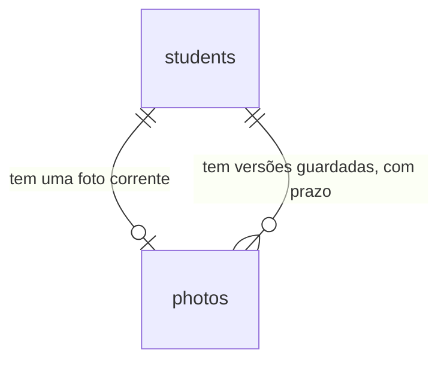

# Captura, recorte e troca da foto do aluno

## Problem

A recepção só consegue pôr a foto de um aluno se já tiver um arquivo pronto. O aluno está na frente
do balcão, o dispositivo tem câmera (PRD §12: "Dispositivos de recepção com câmera (webcam ou
tablet)"), e mesmo assim é preciso fotografar com outro aparelho, passar o arquivo para o computador
e escolhê-lo na ficha. O arquivo que chega vai inteiro ao servidor, que recorta do centro: numa foto
de celular na horizontal o rosto sai cortado ou pequeno, e quem enviou só descobre depois de salvo
(§11, "Fotos de baixa qualidade", impacto médio, com a mitigação "recorte 3:4 obrigatório"). E, para
trocar uma foto, hoje é preciso removê-la antes: a anterior some na hora, sem volta, o contrário do
que a RF-16 promete. Quem paga é a recepção, em tempo de balcão, e o aluno, que fica com uma foto
ruim ou sem a anterior quando a troca foi um engano.

O PRD não traz número de volume. O que ele fixa: RF-11 ("captura pela câmera (webcam/tablet)"),
RF-12 ("Editor de recorte com proporção fixa 3:4, zoom e rotação antes de enviar"), RF-16
("Substituição de foto mantém histórico de versões por período configurável (padrão 30 dias) e depois
exclui definitivamente"), o §5.1 ("Usuário recorta a imagem 3:4 no navegador") e a tela 5 do §8
("Modal de captura/recorte de foto 3:4").

Quando isto entrar: na ficha, a recepção aciona "Usar câmera", vê a imagem ao vivo, captura, ajusta o
enquadramento num quadro 3:4 com zoom e giro, e salva; o arquivo escolhido ou arrastado passa pelo
mesmo ajuste antes de sair do navegador; o aluno que já tem foto ganha "Trocar foto", sem remover
antes; a foto trocada fica guardada por 30 dias e depois o servidor a apaga sozinho, linha e
arquivos; e a troca e a exclusão da versão antiga aparecem na tela de Auditoria.

## Flow

Reutiliza o pipeline inteiro da `foto-pipeline`: a leitura da parte `file`, a validação por conteúdo,
as três variantes do Sharp, a chave do objeto, o armazenamento, o assinador de URL, a guarda por
perfil, o `ProblemFilter`, `audit.record` e o bloco de foto da ficha. Nenhuma validação, variante ou
URL ganha segunda implementação; o recorte do navegador não substitui nada do servidor, que continua
sem confiar no que chega. O que não existe e esta feature cria: a troca que guarda a anterior, o
expurgo por prazo, e o diálogo de captura e recorte.

**Captura e recorte (navegador)**

1. `/students/<id>` (exists), bloco de foto de `apps/web` (exists) - "Usar câmera" pede o vídeo ao navegador e mostra a imagem ao vivo; ou o arquivo escolhido ou largado é lido no próprio navegador
2. editor de recorte (new, door 6) - quadro fixo 3:4, zoom e giro de 90°; "Salvar foto" desenha a região enquadrada num JPEG de no máximo 1200×1600
3. out: um `multipart/form-data` com a parte `file` -> repasse `/api/*` do web (exists): `POST` se o aluno não tem foto, `PUT` se tem

**Troca (`PUT /api/students/:id/photo`)**

1. checagem de origem (exists) -> `AccessGuard` (exists), perfis `admin` e `reception`
2. módulo `photos` de `apps/api` (exists) - a mesma leitura, validação e geração de variantes do `POST`
3. `photos` -> armazenamento de objetos (exists) - grava as três variantes da foto nova
4. `photos` - abre a transação, trava a linha do aluno em `students`, tira `is_current` da foto corrente e grava nela `expires_at` (door 1), insere a nova com a versão seguinte e chama `audit.record(tx, ...)` (exists) com a ação da door 3
5. out: `201`; se a transação falha, os objetos do passo 3 são apagados e a foto corrente continua a mesma

**Expurgo**

1. temporizador dentro do processo da API (new, door 4) - dispara na subida e a cada 60 minutos
2. módulo `photos` (exists) - lê as linhas não correntes com `expires_at` vencido (door 1)
3. `photos` -> armazenamento (exists) - apaga os três objetos da versão; só com os três fora, a transação apaga a linha e chama `audit.record(tx, ...)` sem autor (door 3)
4. out: nenhuma resposta; uma linha de log por execução que apagou algo ou falhou

**Telas**

1. `/students/<id>` (exists) - "Usar câmera" e "Trocar foto" no bloco de foto, e o diálogo de captura e recorte; `/audit` (exists) - nomeia as duas ações novas

## Impact

| Front | What changes |
| --- | --- |
| domain | termo que ganha corpo: `version` de `photos` - até hoje sempre `1`, porque trocar era remover e enviar; agora cresce a cada troca, e existe linha com `is_current` falso. Ramificam em "a foto do aluno": `currentId`, `currentIds` e `fileOf` de `photos.service.ts`; os dois primeiros já filtram por `is_current`, o terceiro entrega qualquer linha pelo `photoId` |
| domain | novo termo: versão guardada - foto que deixou de ser a corrente e tem prazo para ser apagada (door 1). Vão ramificar nela: `privacidade` (exportar e excluir um titular alcança as versões) e `funcionarios` |
| domain | termo do PRD que muda: "período configurável" (RF-16) é uma variável de ambiente (door 5), não uma tela; a tela de retenção é da `privacidade` (RF-30) |
| contrato | rota nova `PUT /api/students/:id/photo`; `POST` e `DELETE` não mudam de assinatura. O `POST` com foto corrente continua `409 photo_exists` (C12 da `foto-pipeline`) |
| contrato | `AUDIT_ACTIONS` ganha dois valores (door 3); `ACTION_LABELS` de `apps/web/src/lib/audit.ts` é um `Record<AuditAction, string>` e o typecheck falha até ter os dois rótulos. É a primeira ação gravada sem autor fora do login: `/audit` já mostra "—" em "Usuário", "IP" e "Navegador" de linha sem autor |
| checks de outra feature | a C64 e a C65 da `foto-pipeline` (AC 54 e AC 55 de lá) deixam de valer como escritas: escolher ou largar um arquivo abre o editor em vez de enviar o arquivo como veio, e o que sai tem outro nome e outro tamanho. Os testes `upload_area_button_accept_and_both_ways_send_multipart_file_part`, `upload_button_disabled_with_enviando_while_waiting`, `successful_upload_shows_the_new_photo` e `six_upload_errors_show_their_messages_and_keep_the_form` de `apps/web/e2e/photos.spec.ts` são reescritos para passar pelo editor, e os checks daqui que os substituem são registrados em `checks.md`, como a `auth-rbac` fez com a C22 a C25 da `fundacao` |
| checks de outra feature | a C67 e a C68 da `foto-pipeline` continuam valendo; a ficha com foto ganha botões ao lado de "Remover foto", e os perfis de leitura continuam sem nenhum |
| comportamento existente | `DELETE /api/students/:id/photo` já apaga toda linha do aluno e os objetos de cada uma; passa a haver mais de uma linha para apagar. A URL assinada de uma foto trocada continua entregando o arquivo até o `exp` dela (no máximo 300 s), porque a linha ainda existe |
| ambiente | variável nova e opcional `PHOTO_VERSION_RETENTION_DAYS` (door 5); entra em `.env.example` comentada, com o padrão. Nenhum `.env` existente deixa de subir |
| ambiente | a API passa a ter trabalho em segundo plano: o temporizador da door 4 roda em todo processo da API, inclusive nos que os testes de integração sobem |
| dependência | `react-easy-crop` entra em `apps/web` (door 6); `npm view` mostra a 6.2.3 com `react >= 16.4.0` como par, e o web usa React 19.3 |
| dependência | a câmera só existe em contexto seguro: `localhost` ou HTTPS. Aberta por IP da rede em HTTP, a ficha mostra "Nenhuma câmera disponível" e o envio por arquivo continua. Quando a `operacao` definir `Permissions-Policy` ou CSP, precisa manter `camera=(self)` |
| portão | o Playwright do web passa a rodar com a câmera falsa do Chromium e a permissão concedida; o teste de permissão negada usa um contexto sem ela |
| stored data | nothing to migrate - a migração `0006` acrescenta uma coluna anulável e um `CHECK` que toda linha existente já cumpre: hoje toda linha de `photos` é corrente, porque trocar era remover |
| `.specs` | aprovado o plano, as doors 1 a 6 viram decisões em `STATE.md`. As doors da `foto-pipeline` (previstas como AD-040 em diante) não estão na tabela de `STATE.md`, que termina na AD-039: a numeração daqui depende de registrá-las antes |

## Relations

One-way constraints: uma foto tem prazo de expiração se e somente se não é a corrente, garantido por
`CHECK` (door 1); o índice parcial único de uma corrente por aluno e a versão única por aluno já
existem e não mudam. Nenhuma entidade nova. Nomes de coluna, tipos comuns e índices ficam para o diff.

## Surface

Só a rota nova. Também pode responder com a linha de erro comum da `auth-rbac`.

| Route | In | Out | Status |
| --- | --- | --- | --- |
| `PUT /api/students/:id/photo` | `multipart/form-data` com uma parte de arquivo chamada `file` | `id` · `version` · `createdAt` | `201`, `401`, `403`, `404`, `413`, `415`, `422`, `503` |

## Landing

| One-way door | Literal shape | Alternative rejected |
| --- | --- | --- |
| 1. prazo da versão guardada | migração `0006` (AD-008): `ALTER TABLE photos ADD COLUMN expires_at timestamptz` (anulável) e `CONSTRAINT photos_expiry_matches_current CHECK (is_current = (expires_at IS NULL))`; na troca, a foto que deixa de ser corrente recebe `expires_at = now() + <dias de retenção>`, do relógio do banco | `replaced_at` com o prazo calculado na hora do expurgo - mudar a configuração encurtaria ou esticaria o prazo de versões já guardadas, e o PRD §6 já nomeia `expires_at`. Sem o `CHECK` - uma corrente com prazo seria apagada pelo expurgo, e uma guardada sem prazo ficaria para sempre. Fecha: mudar a retenção vale só para as trocas seguintes; `funcionarios` herda a coluna |
| 2. a troca é `PUT` | `PUT /api/students/:id/photo`, mesmo corpo e mesma resposta `201` do `POST`: com foto corrente, guarda a anterior e põe a nova; sem foto corrente, cria a primeira. O `POST` continua recusando com `409 photo_exists` | o `POST` passar a trocar - a C12 da `foto-pipeline` está aprovada, e o `409` é o que avisa duas recepcionistas que enviam a primeira foto ao mesmo tempo. `POST .../photo/replace` - verbo no caminho, que nenhuma rota do repositório tem. Fecha: `funcionarios` copia o par `POST` e `PUT` |
| 3. ações de auditoria | em `AUDIT_ACTIONS` (AD-025), depois das dezoito existentes: `student.photo_replaced` e `student.photo_version_purged`; `entity` igual a `student`, `entity_id` igual ao id do aluno, `diff` nulo (AD-026). A linha do expurgo usa `NO_ACTOR`: `user_id`, `ip` e `user_agent` nulos | a troca como `student.photo_uploaded` - RF-24 lista upload e exclusão, e a trilha não diria que uma foto anterior foi posta de lado. O expurgo só em log - é exclusão definitiva de dado pessoal, e o log não é a trilha que o Administrador consulta (PRD §14). `entity` igual a `photo` - recusado na door 6 da `foto-pipeline` pelo mesmo motivo |
| 4. expurgo dentro do processo da API | um temporizador do Node no processo da API: executa na subida e a cada 60 minutos; por versão vencida, apaga os três objetos e só então, numa transação, a linha e a auditoria; duas execuções ao mesmo tempo apagam a linha uma vez só, e quem a apagou grava a auditoria | `apps/worker` com Redis (PRD §5) - a door 7 da `foto-pipeline` já recusou processo e dependência novos para o que cabe na API. Comando agendado por cron do servidor ou serviço único no Compose - a hospedagem não está decidida (ROADMAP), e um agendamento esquecido deixa de apagar sem que nada acuse. Apagar só quando o aluno recebe outra troca - a versão de quem nunca mais troca ficaria para sempre. Fecha: a retenção da `privacidade` e qualquer tarefa periódica futura copiam o temporizador; com duas instâncias da API as duas executam, e a exclusão é idempotente |
| 5. configuração da retenção | `PHOTO_VERSION_RETENTION_DAYS` em `apps/api/src/env.ts` (AD-015): inteiro de `1` a `365`, opcional, padrão `30` | tabela de configuração com tela - é a RF-30, da `privacidade`; quando ela entrar, lê o valor de lá e a variável some. Valor fixo no código - a RF-16 diz "configurável" |
| 6. editor de recorte | dependência `react-easy-crop` `^6.2` em `apps/web`, com `aspect` fixo em `3 / 4`, `zoom` de `1` a `3` e `rotation` em múltiplos de `90` | `react-image-crop` - deixa zoom e rotação por conta de quem usa. Editor próprio em canvas - arrastar, pinça, roda do mouse e teclado para escrever e provar, sem nada do produto nisso. Fecha: a foto de `funcionarios` usa o mesmo diálogo |

- Nothing else in this change is hard to reverse

## Criteria

### S1: Trocar a foto guardando a anterior (P1)

A recepção põe uma foto nova num aluno que já tem uma, e a anterior fica guardada com prazo.

**Acceptance Criteria**

1. WHEN um usuário de perfil `admin` ou `reception` chama `PUT /api/students/:id/photo` com a parte `file` de um JPEG de 800×1000 para um aluno com foto corrente de `version` igual a `1` THEN the system SHALL responder `201` com o `id` da foto nova, `version` igual a `2` e `createdAt`
2. WHEN a troca responde `201` THEN the system SHALL manter a linha da foto anterior, não corrente e com `expires_at` 30 dias depois do instante da troca, e ter a foto nova como a única corrente do aluno
3. WHEN a troca responde `201` THEN the system SHALL manter no bucket os três objetos da foto anterior e gravar os três da nova sob o `photoId` novo
4. WHEN a troca responde `201` THEN the system SHALL devolver, em `GET /api/students/:id/photo` e em `photoUrl` de `GET /api/students/:id` e `GET /api/students`, a URL assinada com o `photoId` da foto nova
5. WHEN `PUT /api/students/:id/photo` é chamado para um aluno sem foto corrente THEN the system SHALL responder `201` com `version` igual a `1`, como o `POST`
6. IF o arquivo enviado ao `PUT` é um dos que o `POST` recusa pelas AC 9 a 15 da `foto-pipeline` THEN the system SHALL responder com o mesmo status e o mesmo `code` do `POST` (`415`, `413` ou `422`), mantendo a foto corrente, as linhas de `photos` e o bucket como estavam
7. WHEN o `PUT` aceita um arquivo THEN the system SHALL gravar as variantes pelas AC 16 a 21 da `foto-pipeline`: três objetos WebP de 96×128, 240×320 e 600×800, sem EXIF, sem o original e sem nada do cliente na chave
8. IF `:id` do `PUT` não é um `uuid` ou não pertence a aluno nenhum THEN the system SHALL responder `404` com `code` igual a `not_found`, sem gravar objeto nem linha
9. IF um usuário de perfil `hr_finance` ou `instructor` chama `PUT /api/students/:id/photo` THEN the system SHALL responder `403` com `code` igual a `forbidden`, sem gravar nada
10. IF `PUT /api/students/:id/photo` é chamado sem sessão THEN the system SHALL responder `401` com `code` igual a `unauthorized`
11. IF o armazenamento falha ao gravar uma variante da foto nova THEN the system SHALL responder `503` com `code` igual a `storage_unavailable`, manter a foto anterior corrente e sem `expires_at`, e não deixar objeto da tentativa no bucket
12. IF a transação da troca falha depois de as variantes estarem gravadas THEN the system SHALL responder `500`, deixar `photos` e `audit_logs` como estavam e remover do bucket os três objetos da tentativa
13. IF dois `PUT /api/students/:id/photo` do mesmo aluno chegam ao mesmo tempo THEN the system SHALL responder `201` aos dois, com `version` diferentes, e deixar exatamente uma foto corrente, a de maior `version`, e todas as outras com `expires_at`
14. WHEN o aluno tem `status` igual a `inactive` ou `suspended` THEN the system SHALL aceitar a troca como para um aluno `active`
15. WHEN `DELETE /api/students/:id/photo` é chamado para um aluno com foto corrente e uma versão guardada THEN the system SHALL responder `204`, remover as duas linhas de `photos` e os seis objetos, e gravar uma única linha `student.photo_removed`

**Independent test:** entrar como recepção, enviar uma foto por `POST`, trocá-la por `PUT`, ler `version` `2`, conferir no banco a linha anterior com `expires_at` e listar seis objetos no prefixo do aluno.

### S2: A versão guardada some sozinha no prazo (P1)

O servidor apaga a versão vencida, linha e arquivos, sem ninguém pedir (RF-16).

**Acceptance Criteria**

16. WHEN o expurgo executa e existe uma versão não corrente com `expires_at` no passado THEN the system SHALL remover os três objetos dela do bucket e a linha de `photos`
17. WHEN o expurgo executa THEN the system SHALL manter a versão não corrente cujo `expires_at` está no futuro e toda foto corrente, qualquer que seja a idade dela
18. WHEN a API sobe com uma versão vencida no banco THEN the system SHALL removê-la sem que nenhuma requisição chegue
19. WHILE a API está no ar the system SHALL executar o expurgo de novo a cada 60 minutos
20. IF o armazenamento falha ao apagar um objeto de uma versão vencida THEN the system SHALL manter a linha de `photos` dela e `audit_logs` como estavam, e a execução seguinte SHALL removê-la
21. IF duas execuções do expurgo encontram a mesma versão vencida THEN the system SHALL remover a linha uma vez e gravar uma única linha de auditoria dela
22. IF o expurgo falha, por banco ou armazenamento fora, THEN the system SHALL continuar atendendo requisições e gravar uma linha de log de nível `error` com `msg` igual a `photo purge failed`
23. WHEN uma execução do expurgo remove uma ou mais versões THEN the system SHALL gravar uma linha de log com `msg` igual a `photo versions purged` e `count` igual ao número de versões removidas
24. WHEN `PHOTO_VERSION_RETENTION_DAYS` é `7` THEN the system SHALL gravar na foto trocada `expires_at` 7 dias depois do instante da troca
25. IF `PHOTO_VERSION_RETENTION_DAYS` não é um inteiro de `1` a `365`, como `0`, `366`, `1.5` ou `abc`, THEN the system SHALL encerrar a API com código 1 imprimindo o nome da variável e nenhum valor

**Independent test:** trocar uma foto, pôr o `expires_at` da anterior no passado pelo banco, reiniciar a API e ver a linha e os três objetos sumirem, com a foto corrente intacta.

### S3: A troca e o expurgo deixam rastro (P1)

Uma linha por ação, na mesma transação, sem arquivo nem chave na trilha (AD-025 a AD-027).

**Acceptance Criteria**

26. WHEN `PUT /api/students/:id/photo` responde `201` para um aluno que tinha foto corrente THEN the system SHALL ter gravado exatamente uma linha em `audit_logs` com `action` igual a `student.photo_replaced`, `user_id` igual ao id do autor, `entity` igual a `student`, `entity_id` igual ao id do aluno e `diff` nulo
27. WHEN `PUT /api/students/:id/photo` responde `201` para um aluno sem foto corrente THEN the system SHALL ter gravado exatamente uma linha com `action` igual a `student.photo_uploaded`
28. WHEN o expurgo remove uma versão THEN the system SHALL ter gravado, na transação que apaga a linha, exatamente uma linha com `action` igual a `student.photo_version_purged`, `entity` igual a `student`, `entity_id` igual ao id do aluno, `diff` nulo e `user_id`, `ip` e `user_agent` nulos
29. IF um `PUT /api/students/:id/photo` termina com `401`, `403`, `404`, `413`, `415`, `422`, `500` ou `503` THEN the system SHALL deixar `audit_logs` com o mesmo número de linhas de antes
30. The system SHALL manter fora de toda coluna de `audit_logs` e de toda linha de log da troca e do expurgo o nome do arquivo enviado, a chave do objeto e o conteúdo da imagem
31. The system SHALL exibir em `/audit` as ações novas por extenso, "Foto do aluno trocada" e "Versão anterior da foto excluída", e oferecê-las no filtro "Ação" depois das dezoito existentes

**Independent test:** trocar uma foto como recepção, vencer a anterior e rodar o expurgo; ler em `audit_logs` uma linha de troca com o id da recepcionista e uma de expurgo sem autor.

### S4: Ajustar o enquadramento antes de enviar (P1)

Todo arquivo passa por um quadro 3:4 com zoom e giro, e o que sai do navegador é o que foi enquadrado (RF-12).

**Acceptance Criteria**

32. WHEN um usuário de perfil `admin` ou `reception` escolhe ou larga um arquivo de imagem na ficha THEN the system SHALL abrir o diálogo "Ajustar foto" com a imagem dentro de um quadro de proporção 3:4, sem enviar nenhuma requisição de foto à API
33. The system SHALL oferecer no diálogo o controle "Zoom", de 1× a 3×, e os botões "Girar à esquerda" e "Girar à direita", que giram a imagem 90° por acionamento, mantendo o quadro em 3:4
34. WHEN o usuário aciona "Salvar foto" THEN the system SHALL enviar uma única requisição `multipart/form-data` com uma única parte `file`, um JPEG cuja largura e altura estão na razão 3:4, de modo que uma imagem de 800×800 com a metade esquerda vermelha e a direita azul, salva sem mexer em nada, sai com 600×800 pixels, vermelha a 25% da largura e azul a 75%
35. WHEN o usuário aciona "Girar à direita" uma vez na imagem da AC 34 e salva THEN the system SHALL enviar um JPEG de 600×800 vermelho a 25% da altura e azul a 75%
36. WHEN a região enquadrada tem mais de 1200 pixels de largura na imagem de origem THEN the system SHALL enviar um JPEG de 1200×1600; e, com 1200 ou menos, SHALL enviar a região no tamanho em que está na origem, sem ampliar
37. WHEN o zoom reduziria a região enquadrada a menos de 300×400 pixels da imagem de origem THEN the system SHALL limitar o zoom ao ponto em que ela tem 300×400
38. IF a imagem escolhida, em qualquer giro, não comporta uma região 3:4 de 300×400 pixels THEN the system SHALL exibir "A foto precisa ter pelo menos 300×400 pixels." sem o botão "Salvar foto"
39. IF o navegador não consegue ler o arquivo escolhido ou largado como imagem THEN the system SHALL exibir "Use um arquivo JPEG, PNG ou WebP." sem abrir o quadro de recorte
40. WHEN o aluno não tem foto THEN the system SHALL enviar o recorte por `POST /api/students/<id>/photo`; e, quando tem, por `PUT /api/students/<id>/photo`
41. WHILE o envio aguarda a resposta the system SHALL manter "Salvar foto" desabilitado com o texto "Enviando…"
42. WHEN o envio responde `201` THEN the system SHALL fechar o diálogo e exibir a ficha com a foto nova
43. IF o envio termina com `413`, `415`, `422`, `409`, `503` ou outro erro THEN the system SHALL exibir dentro do diálogo a mensagem da AC 56 da `foto-pipeline` para aquele status, manter o enquadramento como estava e reabilitar "Salvar foto"
44. WHEN o usuário aciona "Cancelar" ou fecha o diálogo THEN the system SHALL fechá-lo sem enviar nenhuma requisição de foto e deixar a ficha como estava
45. WHEN um usuário de perfil `admin` ou `reception` abre a ficha de um aluno com foto THEN the system SHALL exibir o botão "Trocar foto", que abre a escolha de arquivo com os mesmos três tipos aceitos, ao lado de "Remover foto"

**Independent test:** subir a stack, entrar como recepção, escolher uma foto na horizontal, girar e aproximar, salvar e ver a ficha com o rosto enquadrado; acionar "Trocar foto" e repetir sem remover antes.

### S5: Capturar pela câmera (P1)

A recepção fotografa o aluno no balcão, sem arquivo intermediário (RF-11).

**Acceptance Criteria**

46. WHEN um usuário de perfil `admin` ou `reception` abre a ficha de um aluno, com ou sem foto, THEN the system SHALL exibir o botão "Usar câmera"
47. WHEN o usuário aciona "Usar câmera" THEN the system SHALL pedir ao navegador só vídeo, sem áudio, e exibir no diálogo a imagem ao vivo, o texto "Enquadre o rosto e os ombros" e o botão "Capturar"
48. WHILE o navegador ainda não entregou o vídeo the system SHALL exibir "Abrindo câmera…" sem o botão "Capturar"
49. WHEN o usuário aciona "Capturar" THEN the system SHALL levar o quadro capturado ao ajuste da S4, com o botão "Tirar outra", que volta à imagem ao vivo sem enviar nada
50. IF o uso da câmera é negado THEN the system SHALL exibir "Permita o uso da câmera no navegador ou envie um arquivo." sem o botão "Capturar"
51. IF o dispositivo não tem câmera, ou a página não está em contexto seguro e o navegador não oferece a câmera, THEN the system SHALL exibir "Nenhuma câmera disponível neste dispositivo. Envie um arquivo." sem o botão "Capturar"
52. WHERE o dispositivo tem mais de uma câmera the system SHALL exibir o botão "Trocar câmera", que passa a imagem ao vivo para a câmera seguinte
53. WHEN o diálogo sai da imagem ao vivo, por captura, cancelamento ou fechamento, THEN the system SHALL encerrar todas as trilhas de vídeo abertas, de modo que nenhuma fica com `readyState` igual a `live`
54. WHEN um usuário de perfil `hr_finance` ou `instructor` abre a ficha THEN the system SHALL exibir a foto ou as iniciais, sem "Usar câmera", sem "Trocar foto" e sem a área de envio

**Independent test:** abrir a ficha num computador com webcam, acionar "Usar câmera", capturar, ajustar e salvar; negar a permissão no navegador e ver a mensagem com o envio por arquivo ainda disponível.

## Out of scope

| Excluded | Why |
| --- | --- |
| Ver as versões guardadas na ficha e restaurar uma delas | a RF-16 pede guardar e excluir no prazo, não uma tela; é capacidade nova, pergunta 1 abaixo |
| Tela para configurar o prazo de retenção | RF-30, da `privacidade`; aqui é variável de ambiente (door 5) |
| Foto de funcionário pela câmera ou com troca | não existe `staff` até a `funcionarios`, que herda o diálogo e o par `POST` e `PUT` |
| Giro em ângulo livre e endireitar a imagem | a RF-12 diz "rotação"; 90° resolve a foto deitada, que é o caso do balcão |
| Detecção de rosto, aviso de foto escura ou desfocada, moldura oval sobre a imagem | o §11 pede "guia de enquadramento", atendido pelo texto da AC 47; análise de imagem não é RF |
| Reter o arquivo original | RF-15 e AC 20 da `foto-pipeline`: o padrão é não guardar |
| HTTPS na rede da academia, `Permissions-Policy` e CSP | `operacao`; sem HTTPS a câmera não abre fora de `localhost`, pergunta 3 abaixo |
| Exportar ou excluir as versões guardadas a pedido do titular | `privacidade` (RF-28, RF-29); a chave do objeto já traz o `studentId` para isso |
| Avisar alguém antes de uma versão expirar | nenhuma RF pede |

## Assumptions

| Assumption | Chosen default | Rationale | Confirmed? |
| --- | --- | --- | --- |
| Arquivo escolhido ou arrastado também passa pelo editor | sim, sempre; nenhum arquivo sai do navegador sem o ajuste | §11 escreve "recorte 3:4 obrigatório" e o §5.1 começa por "Usuário recorta a imagem 3:4 no navegador". Custo: a C64 e a C65 da `foto-pipeline` são substituídas | n |
| O que o navegador envia | JPEG, qualidade 0,9, até 1200×1600, com o nome `foto.jpg` | o servidor reprocessa tudo em WebP de até 600×800; 1200×1600 dá folga de nitidez e fica longe dos 5 MiB | n |
| Passo do giro | 90° por acionamento | cobre a foto deitada; ângulo livre pede outro controle e outra prova | n |
| Faixa do zoom | 1× a 3×, limitado pela AC 37 | 3× numa foto de celular ainda deixa mais de 300×400 | n |
| Câmera inicial | a que o navegador entrega por padrão, sem pedir frontal ou traseira; "Trocar câmera" alterna | webcam de balcão é uma só; em tablet a recepção escolhe uma vez | n |
| Quem troca | `admin` e `reception` | o mesmo conjunto que envia e remove (§2) | n |
| `PUT` sem foto corrente | cria a primeira, com `student.photo_uploaded` | entre a ficha abrir e o envio alguém pode ter removido a foto; a intenção de quem salva é o aluno ficar com esta | n |
| Confirmação antes de trocar | nenhuma além de "Salvar foto" | a anterior fica guardada 30 dias, e o diálogo já é um passo deliberado | n |
| "Remover foto" com versões guardadas | apaga tudo, a corrente e as guardadas | é o que o `DELETE` já faz e o que o diálogo diz ("será apagada do servidor"); guardar o que a pessoa mandou apagar contraria o pedido | n |
| URL assinada da foto trocada | continua entregando até o `exp` dela, no máximo 300 s | a linha existe até o expurgo, e a RF-17 já aceita que a URL vale até expirar | n |
| Mudança de `PHOTO_VERSION_RETENTION_DAYS` | vale só para as trocas feitas depois | o prazo é gravado na troca (door 1) | n |
| Intervalo do expurgo | 60 minutos, fixo | o prazo é em dias; uma hora de atraso não muda nada e não pede outra variável | n |
| Expurgo na trilha | uma linha por versão, sem autor | exclusão definitiva de dado pessoal é o que a LGPD manda poder demonstrar | n |
| Largar arquivo com o aluno já com foto | não há área de arrastar; só "Trocar foto" e "Usar câmera" | a área de hoje só existe sem foto, e a foto ocupa o lugar dela | n |

**Open questions:** três, nenhuma bloqueia o Build.

| # | Kind | Question | Until answered |
| --- | --- | --- | --- |
| 1 | open | As versões guardadas ficam invisíveis até expirar (recomendado, é o que a RF-16 pede) ou a ficha as lista com "Restaurar" para `admin` e `reception`? | vale: ninguém as vê pela aplicação; restaurar seria uma rota e uma tela a mais, numa feature seguinte ou num slice novo deste plano |
| 2 | open | O expurgo roda num temporizador dentro da API (recomendado) ou num comando agendado pela hospedagem? | vale a door 4; se for comando, mudam o `Flow` do expurgo, a door 4 e as AC 18 e 19 |
| 3 | blocks go-live | A academia vai abrir o sistema por HTTPS nos dispositivos da recepção? | sem HTTPS a câmera só abre em `localhost`; a captura fica indisponível no tablet e resta o envio por arquivo. É da `operacao` |

## Observable

| Surface | Decision | Landing |
| --- | --- | --- |
| screen `/students/<id>`, bloco de foto | empty state | AC 46 e a área de envio que já existe (AC 54 da `foto-pipeline`), agora abrindo o editor (AC 32) |
| screen `/students/<id>`, bloco de foto | unauthorised state | AC 54 |
| screen `/students/<id>`, bloco de foto | density and ordering | n/a - uma foto por aluno; as versões guardadas não são listadas (Out of scope) |
| screen diálogo "Ajustar foto" | empty state | n/a - o diálogo só abre com uma imagem ou com a câmera |
| screen diálogo "Ajustar foto" | loading state | AC 41, AC 48 |
| screen diálogo "Ajustar foto" | error state | AC 38, AC 39, AC 43, AC 50, AC 51 |
| screen diálogo "Ajustar foto" | unauthorised state | AC 54 - quem não escreve não tem como abri-lo; a API responde pela AC 9 |
| screen diálogo "Ajustar foto" | destructive action confirms | n/a - a troca guarda a anterior por 30 dias (AC 2); "Salvar foto" é o passo deliberado |
| screen diálogo "Ajustar foto" | density and ordering | AC 33, AC 47 - um quadro, os controles e duas ações |
| screen `/audit` | naming of the new actions | AC 31 |
| screen `/audit` | row without author | existing - a tela já exibe "—" em "Usuário", "IP" e "Navegador" nulos |
| API `PUT /api/students/:id/photo` | response shape | AC 1, AC 5 |
| API `PUT /api/students/:id/photo` | error shape and codes | AC 6, AC 8, AC 9, AC 10, AC 11, AC 12 |
| API `PUT /api/students/:id/photo` | who may call it | AC 9, AC 10 |
| API `PUT /api/students/:id/photo` | what happens at the size limit | AC 6 - o mesmo `413` do `POST` |
| API `PUT /api/students/:id/photo` | versioning | n/a - o único consumidor é `apps/web`, versionado e implantado junto |
| API `PUT /api/students/:id/photo` | rate limit | n/a - só usuário autenticado; limite por IP fica no proxy, em `operacao` |
| scheduled task expurgo | output and verbosity | AC 23 - uma linha por execução que removeu algo; execução sem nada a remover não escreve |
| scheduled task expurgo | flags and defaults | AC 24, AC 25 - `PHOTO_VERSION_RETENTION_DAYS`, padrão 30; o intervalo é fixo (AC 19) |
| scheduled task expurgo | exit codes | n/a - não é processo próprio; a falha não derruba a API (AC 22) |
| scheduled task expurgo | what it prints when it fails halfway | AC 20, AC 22 |
| document `.env.example` | structure, what the reader does next | existing - o teste de `tests/repo` cobra só as chaves obrigatórias (AD-015); a variável nova entra comentada, com o padrão |
| collection versões de `photos` | grouping criterion | n/a - cada versão pertence a um aluno |
| collection versões de `photos` | naming | existing - a chave do objeto é a da door 2 da `foto-pipeline` |
| collection versões de `photos` | ordering | AC 1, AC 13 - `version` crescente por aluno |
| collection versões de `photos` | duplicates | AC 13, AC 21 |
| collection versões de `photos` | the exception that does not fit | AC 15, AC 17 - remover apaga também as guardadas, e a corrente nunca expira |

## Sources

- `PRD — Sistema de Gestão de Academia.md` §3.4 (RF-11, RF-12, RF-16), §5.1, §6 (`photos.expires_at`), §8 tela 5, §11, §12 - câmera, recorte 3:4 com zoom e rotação, versões por 30 dias e exclusão definitiva
- `.specs/features/foto-pipeline/plan.md` (doors 1, 6 e 7; Out of scope) e `checks.md` (C12, C64, C65) - a tabela pronta para versões, o que este plano herda e os dois checks que ele substitui
- `.specs/STATE.md` AD-008, AD-015, AD-019, AD-024 a AD-027 - migração versionada, variável de ambiente, origem única e as regras da trilha
