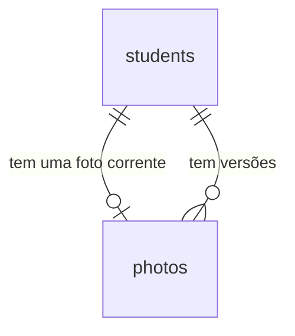

# Pipeline de foto do aluno

## Problem

O sistema cadastra o aluno e não sabe mostrar o rosto dele. A recepção de uma academia de bairro
confere quem entra olhando uma foto, e hoje essa foto não tem onde viver: o PRD fixa que ela é dado
pessoal sensível ("Vazamento de fotos", impacto alto, §11), que nenhuma foto pode ser "acessível por
URL pública permanente" (§14) e que o arquivo que chega do navegador não é de confiança ("Upload
malicioso", impacto alto, §11). Sem o pipeline, qualquer feature que mostre a foto (captura, check-in,
funcionários) teria de decidir sozinha onde guardar, como validar e como servir, e a primeira que
decidisse errado criaria o precedente que as outras copiariam. Quem paga é a academia, que responde
pelo vazamento, e o aluno, dono da imagem.

O PRD não traz número de volume de hoje. O que ele fixa: RF-13 (tipo por magic bytes, 5 MB, mínimo
300×400), RF-14 (sem EXIF/GPS, orientação corrigida, WebP, `thumb` 96×128, `medium` 240×320, `large`
600×800), RF-15 (original não é mantido por padrão), RF-17 (URL assinada de curta duração, "ex.: 5
min", emitida após checagem de permissão, bucket privado), RF-18 (placeholder com iniciais), o §5.1
(`photos/{tenant}/{studentId}/{versionId}/{variant}.webp`), a matriz do §2 (Recepção "envia fotos";
Instrutor consulta "nome, foto, status") e o alvo "upload + processamento < 5 s" do §4.

Quando isto entrar: a recepção escolhe ou arrasta um arquivo na ficha do aluno e vê a foto em
seguida; a ficha e a lista mostram a foto (ou as iniciais) para os quatro perfis; o arquivo original
não fica em lugar nenhum; nenhum endereço devolvido pela API serve a foto depois de cinco minutos nem
sem a assinatura; e cada envio e remoção aparece na tela de Auditoria.

## Flow

Reutiliza o repasse `/api/*` do web (AD-019), a guarda por perfil, o `ValidationInterceptor`, o
`ProblemFilter`, o gravador `audit.record` com `@Actor`, o módulo de alunos e a página de ficha e de
lista do web: nenhuma rota nova ganha guarda, erro, auditoria ou layout próprio. O que não existe e
esta feature cria é o armazenamento de objetos, o processamento de imagem e o assinador de URL.

**Envio (`POST /api/students/:id/photo`)**

1. navegador -> `apps/web` (exists), `app/api/[...path]/route.ts` lê o corpo inteiro e o repassa, com o prazo de 10 s -> checagem de origem (exists) -> `AccessGuard` (exists), perfis `admin` e `reception`
2. módulo `photos` em `apps/api` (new, no door - placement per conventions) - lê a parte `file` do multipart com teto de 5 MiB, confere o tipo pelos primeiros bytes, decodifica com Sharp dentro do processo da requisição (door 7), recusa o que não passa e gera as três variantes
3. `photos` -> armazenamento de objetos privado (door 3) - grava as três variantes nas chaves da door 2
4. `photos` - abre a transação, insere a linha em `photos` (door 1) e chama `audit.record(tx, ...)` (exists) com a ação da door 6; o índice parcial único decide a corrida entre dois envios
5. out: `201`, ou o status de erro da door 5; se a transação falha, os objetos do passo 3 são apagados

**Leitura (`GET /api/students/:id/photo`, `photoUrl` na ficha e na lista)**

1. `GET /api/students/:id/photo`, `GET /api/students/:id` e `GET /api/students` -> `AccessGuard` (exists), quatro perfis -> módulo `photos` lê a linha corrente do aluno (door 1)
2. assinador de URL (new, door 4) - monta `/api/photo-files/<photoId>/<variant>?exp=<n>&sig=<s>`, válido por 300 s, sem consultar o armazenamento
3. out: `{ url, expiresAt }`, ou `photoUrl` dentro do aluno (`thumb` na lista, `medium` na ficha), ou `null`

**Entrega do arquivo (`GET /api/photo-files/:photoId/:variant`)**

1. navegador (``) -> `apps/web` (exists) repassa -> rota declarada `@Public()` (door 4, AD-022) -> assinador confere `sig` e `exp`
2. módulo `photos` -> armazenamento (door 3) - lê o objeto da variante e o devolve como `image/webp`, sem cache
3. out: `200` com os bytes, `403` ou `404`

**Telas**

1. `/students/<id>` (exists) - bloco de foto: imagem ou iniciais, envio por arquivo ou arrastar e soltar, remoção; `/students` (exists) - miniatura na célula "Nome"; `/audit` (exists) - nomeia as duas ações novas

## Impact

| Front | What changes |
| --- | --- |
| domain | novo termo: `photo` - a imagem 3:4 de um aluno, em três variantes WebP; existe no máximo uma corrente por aluno (door 1). Vão ramificar nele: `foto-captura`, `funcionarios`, `check-in`, `privacidade` |
| domain | novo termo: `variant` - um de `thumb`, `medium`, `large`; entra no caminho, na query e no nome da chave |
| domain | termo do PRD que muda: `photos.owner_type` e `owner_id` (§6) não entram - a tabela aponta só para `students` por chave estrangeira; `funcionarios` acrescenta a sua (door 1) |
| domain | termo do PRD que muda: "URL assinada" (RF-17) é uma URL assinada pela aplicação, não uma URL pré-assinada do armazenamento (door 4) |
| contrato | `GET /api/students` e `GET /api/students/:id` ganham a chave `photoUrl` (texto ou `null`), para os quatro perfis; é a primeira chave que o AD-033 não corta por perfil, e `null` aqui significa "sem foto", não "oculto". Todo consumidor de `studentSchema` e `studentsResponseSchema` (web, testes de `alunos` e `consentimento`) vê o campo novo |
| contrato | statuses novos de erro de aplicação: `413`, `415` e `503`, com `payload_too_large`, `unsupported_media_type` e `storage_unavailable` (door 5); códigos novos `photo_exists` (`409`) e `invalid_signature` (`403`) |
| contrato | `AUDIT_ACTIONS` ganha dois valores (door 6). `ACTION_LABELS` de `apps/web/src/lib/audit.ts` é um `Record<AuditAction, string>`: o typecheck falha até a tela ter o rótulo de cada um |
| contrato | primeira rota de corpo `multipart/form-data`: não há schema Zod de corpo para `@Input`, e o portão compara rotas com o OpenAPI; como o OpenAPI descreve o upload é decidido no diff, e o schema de resposta continua em `packages/contracts` (AD-011) |
| ambiente | variáveis obrigatórias novas (AD-015): `S3_ENDPOINT`, `S3_BUCKET`, `S3_ACCESS_KEY_ID`, `S3_SECRET_ACCESS_KEY` e `PHOTO_URL_SECRET` (32 caracteres ou mais, separada de `AUTH_SECRET`). Todo `.env` existente, o `compose.yaml` e os suportes de teste (`apps/api/test/support/app.ts`, `tests/stack`) precisam delas, ou a API não sobe |
| ambiente | serviço novo no `compose.yaml`: o armazenamento de objetos (door 3), mais uma execução única que cria o bucket privado antes de a API subir, no padrão do `migrate`. O armazenamento não publica porta além de `127.0.0.1` |
| ambiente | `GET /health` (AD-010) ganha a chave `storage`; o teste de `tests/stack` que lista as chaves de `checks` passa a esperar mais uma |
| dependência | `sharp` e o cliente S3 entram em `apps/api`; o `Dockerfile` roda em `node:24-alpine`, e a instalação do `sharp` em musl e o `allowBuilds` do `pnpm-workspace.yaml` precisam ser confirmados no Build (não consta no repositório) |
| dependência | o repasse do web (`app/api/[...path]/route.ts`) lê o corpo em memória e fecha em 10 s: cabe um arquivo de 5 MiB e o processamento do PRD (< 5 s). Se o Next recusa corpo acima de algum teto antes de chegar à rota, é achado do Build, e não consta no código |
| web | `/audit` passa a nomear duas ações; o "Alvo" de `student` já leva à ficha (AC 55 da `alunos`) |
| portão | as rotas novas entram na regra de `paths` do OpenAPI e nos 70% de cobertura de `apps/api/src`; os testes de integração passam a subir também o armazenamento real (AD-012), e não uma simulação |
| stored data | nothing to migrate - a migração `0005` só cria `photos`. Os alunos que já existem ficam sem foto, e `photoUrl` é `null` |
| `.specs` | aprovado o plano, as doors 1 a 7 viram AD-040 em diante em `STATE.md`; a door 4 reinterpreta a AD-005 ("URL assinada") e diz como |

## Relations

One-way constraints: cada foto pertence a um aluno por chave estrangeira, sem exclusão em cascata (a
exclusão definitiva é da `privacidade`, que remove as fotos antes); no máximo uma foto corrente por
aluno, garantida por índice parcial único (door 1); a versão é única por aluno; o id é gerado pelo
banco e é o `photoId` que entra na chave do objeto (door 2). Nomes de coluna, tipos comuns e outros
índices ficam para o diff.

## Surface

Só rotas novas, e as duas existentes cuja resposta muda. Toda rota também pode responder com a linha
de erro comum da `auth-rbac`.

| Route | In | Out | Status |
| --- | --- | --- | --- |
| `POST /api/students/:id/photo` | `multipart/form-data` com uma parte de arquivo chamada `file` | `id` · `version` · `createdAt` | `201`, `401`, `403`, `404`, `409`, `413`, `415`, `422`, `503` |
| `GET /api/students/:id/photo` | query opcional: `variant` (`thumb`, `medium` ou `large`; padrão `medium`) | `url` · `expiresAt` | `200`, `401`, `404`, `422` |
| `DELETE /api/students/:id/photo` | nada | nada | `204`, `401`, `403`, `404` |
| `GET /api/photo-files/:photoId/:variant` | query: `exp` e `sig`; sem sessão | os bytes da variante, `image/webp` | `200`, `403`, `404` |
| `GET /api/students/:id` (existente) | nada | o aluno de hoje mais `photoUrl` (`medium`, ou `null`) | `200`, `401`, `403`, `404` |
| `GET /api/students` (existente) | query de hoje | `items[]` de hoje, cada um com `photoUrl` (`thumb`, ou `null`) | `200`, `401`, `403`, `422` |

## Landing

| One-way door | Literal shape | Alternative rejected |
| --- | --- | --- |
| 1. tabela `photos` | migração `0005` (AD-008); `id uuid DEFAULT uuidv7()`; `student_id uuid NOT NULL REFERENCES students(id)`, sem `ON DELETE CASCADE`; `version integer NOT NULL CHECK (version >= 1)` com `UNIQUE (student_id, version)`; `is_current boolean NOT NULL`; índice `photos_one_current_idx` único sobre `(student_id) WHERE is_current`; sem `tenant_id` (AD-016). `funcionarios` acrescenta `staff_id` anulável e `CHECK (num_nonnulls(student_id, staff_id) = 1)` | `owner_type` e `owner_id` do PRD §6 - sem chave estrangeira, a foto de um aluno apagado sobra apontando para nada, e a AD-038 já recusou o polimórfico pelo mesmo motivo. Só `UNIQUE (student_id)` - a `foto-captura` (RF-16) precisa guardar a anterior por 30 dias e teria de trocar a restrição numa tabela com dados. Fecha: ao trocar a foto, a corrente passa a `is_current = false` e a nova entra com `version + 1`; apagar o aluno definitivamente exige remover as fotos antes |
| 2. chave do objeto | `photos/main/{studentId}/{photoId}/{variant}.webp`, `variant` em `thumb`, `medium`, `large`; `main` é o valor fixo do segmento `{tenant}` (AD-016); nenhum segmento vem do cliente | chave com o nome do arquivo enviado - nome e caminho do cliente é o que o PRD §4 proíbe. Chave sem `studentId` - para apagar ou exportar as fotos de um titular (`privacidade`) seria preciso ler a tabela inteira. Fecha: mudar o formato depois exige copiar todo objeto e reescrever `storage_key` |
| 3. armazenamento de objetos privado | MinIO (compatível com S3) no `compose.yaml`, um bucket sem acesso anônimo, cliente `@aws-sdk/client-s3`, variáveis `S3_ENDPOINT`, `S3_BUCKET`, `S3_ACCESS_KEY_ID` e `S3_SECRET_ACCESS_KEY`; a API é a única que lê e grava; chave `storage` em `/health` (AD-010) | a foto como coluna no próprio Postgres - resolveria a atomicidade da gravação sem serviço novo, mas a AD-005 fixa "bucket privado" e o PRD §5 e §4 (backup) pedem bucket com versionamento; trocar depois é mover todo arquivo. Disco do container da API - não sobrevive à troca do container e não há como o `operacao` versionar ou restaurar. Fecha: toda feature que guarda arquivo (documentos, exportações) copia o bucket e o cliente |
| 4. URL assinada pela aplicação | `/api/photo-files/<photoId>/<variant>?exp=<segundos Unix>&sig=<HMAC-SHA256 em base64url>`, com `sig` sobre `<photoId>.<variant>.<exp>` e a chave em `PHOTO_URL_SECRET`; validade de 300 s; comparação em tempo constante; a rota é `@Public()` e é a única `@Public()` que entrega dado pessoal, porque a assinatura é a credencial; a API lê o objeto e o devolve com `Cache-Control: no-store` | URL pré-assinada do armazenamento (S3 `GetObject`) - o navegador teria de alcançar o endereço do bucket, uma segunda origem que a AD-019 existe para evitar (cookie, CSP, porta pública, rota no proxy), e a URL assinada para o nome interno do container (`minio:9000`) não abre fora dele. Rota por sessão, sem assinatura - a foto deixaria de ser entregue por "URL assinada de curta duração" (RF-17, AD-005) e o `` dependeria de cookie. Fecha: toda URL de arquivo futura (exportações, `check-in`) copia este formato e esta chave; uma URL assinada vale para quem a tiver até `exp`, o que a RF-17 já pede |
| 5. erro do upload | `413` com `payload_too_large` (arquivo acima de 5 MiB), `415` com `unsupported_media_type` (corpo não multipart ou primeiros bytes que não são de JPEG, PNG ou WebP), `503` com `storage_unavailable` (armazenamento fora); dimensão, resolução e arquivo ilegível são `422` com `validation_failed` e um item em `errors` cujo `path` é `file` (AD-021) | `400` para tudo - mistura defeito do cliente com arquivo que o servidor recusa, e a AD-021 existe para não fazer isso. `422` também para tipo e tamanho - o proxy e as métricas deixariam de separar "arquivo grande demais" de "arquivo que não é foto". `500` para armazenamento fora - parece defeito da aplicação num alerta, e é dependência. Fecha: `funcionarios` e qualquer upload futuro respondem assim |
| 6. ações de auditoria | em `AUDIT_ACTIONS` (AD-025), depois das dezesseis existentes: `student.photo_uploaded` e `student.photo_removed`; `entity` igual a `student` e `entity_id` igual ao id do aluno; nenhum campo registrável (AD-026), `diff` nulo | `entity` igual a `photo` - esconderia o histórico do aluno do filtro e do link "Ver aluno". Registrar `photoId` ou o tamanho no `diff` - o id da foto não serve a ninguém na tela e nada dela é campo do aluno. Uma ação só (`student.photo_changed`) - RF-24 lista upload e exclusão e o filtro não distinguiria enviar de remover |
| 7. processamento síncrono no processo da requisição | o Sharp roda dentro de `POST /api/students/:id/photo`; a resposta `201` só sai com as três variantes gravadas e a linha inserida; sem fila, sem worker, sem Redis | fila com Redis e `apps/worker` (PRD §5) - o PRD só a torna necessária "se o processamento de imagem for assíncrono"; ela traria dois processos e uma dependência nova para esperar o que cabe em menos de 5 s, e a tela precisaria de um estado "processando" que nenhuma RF descreve. Fecha: se um dia o processamento passar a fila, `POST` muda de `201` para `202` e a tela ganha o estado novo - é a pergunta 1 em aberto abaixo |

- Nothing else in this change is hard to reverse

## Criteria

### S1: Enviar a foto de um aluno (P1)

A recepção anexa um arquivo ao aluno, uma foto corrente por aluno, e ninguém mais escreve.

**Acceptance Criteria**

1. WHEN um usuário de perfil `admin` ou `reception` chama `POST /api/students/:id/photo` com a parte `file` de um JPEG de 800×1000 THEN the system SHALL responder `201` com `id`, `version` igual a `1` e `createdAt`
2. IF o aluno já tem foto corrente THEN the system SHALL responder `409` com `code` igual a `photo_exists`, sem gravar linha em `photos` e sem deixar objeto do envio recusado no bucket
3. IF dois `POST /api/students/:id/photo` do mesmo aluno sem foto chegam ao mesmo tempo THEN the system SHALL responder `201` a exatamente um e `409` com `photo_exists` ao outro, e o bucket SHALL ter só os três objetos da foto que venceu
4. IF `:id` não é um `uuid` ou não pertence a aluno nenhum THEN the system SHALL responder `404` com `code` igual a `not_found`, sem gravar objeto nem linha
5. IF um usuário de perfil `hr_finance` ou `instructor` chama `POST /api/students/:id/photo` ou `DELETE /api/students/:id/photo` THEN the system SHALL responder `403` com `code` igual a `forbidden`, sem gravar nem remover nada
6. IF `POST`, `GET` ou `DELETE /api/students/:id/photo` é chamado sem sessão THEN the system SHALL responder `401` com `code` igual a `unauthorized`
7. WHEN o aluno tem `status` igual a `inactive` ou `suspended` THEN the system SHALL aceitar o envio e a remoção da foto como para um aluno `active`

**Independent test:** entrar como recepção, enviar um JPEG por `curl` ao aluno, repetir e receber `409`, entrar como instrutor e receber `403` no envio.

### S2: Só entra arquivo que prova ser foto (P1)

O servidor decide pelo conteúdo, nunca pelo nome nem pelo tipo que o cliente declarou (RF-13, §4).

**Acceptance Criteria**

8. WHEN a parte `file` começa pelos bytes de um JPEG, de um PNG ou de um WebP THEN the system SHALL aceitá-la qualquer que seja o nome do arquivo e o `Content-Type` da parte, de modo que um PNG enviado como `foto.jpg` com `image/jpeg` responde `201`
9. IF a parte `file` não começa pelos bytes de um JPEG, de um PNG nem de um WebP, qualquer que seja o nome e o `Content-Type` da parte, como um texto enviado como `image/jpeg`, um GIF, um PDF ou um SVG THEN the system SHALL responder `415` com `code` igual a `unsupported_media_type`, sem gravar nada
10. IF o corpo da requisição não é `multipart/form-data` THEN the system SHALL responder `415` com `code` igual a `unsupported_media_type`
11. IF a parte `file` passa de 5 242 880 bytes (5 MiB) THEN the system SHALL responder `413` com `code` igual a `payload_too_large`, sem gravar nada; e a de exatamente 5 242 880 bytes SHALL ser aceita
12. IF a requisição não traz a parte `file`, ou traz mais de uma parte de arquivo THEN the system SHALL responder `422` com `code` igual a `validation_failed` e um item em `errors` cujo `path` é `file`
13. IF a imagem, depois da correção de orientação, tem menos de 300 px de largura ou menos de 400 px de altura THEN the system SHALL responder `422` com um item em `errors` cujo `path` é `file`, de modo que 299×400 e 300×399 são recusadas e 300×400 é aceita
14. IF a imagem tem mais de 40 000 000 de pixels THEN the system SHALL responder `422` com um item em `errors` cujo `path` é `file`
15. IF os primeiros bytes são de JPEG, PNG ou WebP e o resto do arquivo não decodifica, como um JPEG truncado, THEN the system SHALL responder `422` com um item em `errors` cujo `path` é `file`, sem gravar nada

**Independent test:** enviar um `.txt` com `Content-Type: image/jpeg`, um PNG de 299×400 e um arquivo de 5 MiB mais um byte, e ler `415`, `422` e `413`.

### S3: O arquivo vira três variantes WebP sem metadado, e o original não fica (P1)

O que o servidor guarda é o que ele fabricou, nunca o que o cliente mandou (RF-14, RF-15).

**Acceptance Criteria**

16. WHEN um envio é aceito THEN the system SHALL gravar no bucket exatamente três objetos, em `photos/main/<studentId>/<photoId>/thumb.webp`, `medium.webp` e `large.webp`, todos WebP, com 96×128, 240×320 e 600×800 pixels
17. WHEN a imagem enviada não tem proporção 3:4 THEN the system SHALL preencher o quadro inteiro de cada variante por recorte centralizado, sem distorcer, de modo que um PNG de 800×800 com a metade esquerda vermelha e a direita azul gera uma variante `large` cujo pixel a 25% da largura é vermelho e o a 75% é azul
18. WHEN o JPEG enviado tem orientação EXIF 6 THEN the system SHALL gerar as variantes com a imagem girada para a posição em que se lê em pé
19. WHEN a imagem enviada tem EXIF, inclusive coordenadas GPS, THEN the system SHALL gerar variantes sem nenhum bloco EXIF
20. The system SHALL NOT guardar o arquivo original: sob o prefixo da foto existem só os três objetos, e nenhuma chave do bucket contém o nome enviado
21. The system SHALL compor toda chave de objeto só de `studentId`, `photoId` e variante, sem nome, caminho nem `Content-Type` vindos do cliente
22. IF o armazenamento falha ao gravar uma variante THEN the system SHALL responder `503` com `code` igual a `storage_unavailable`, sem linha em `photos`, sem linha em `audit_logs` e sem objeto do envio no bucket
23. IF a transação que insere `photos` e `audit_logs` falha depois de as variantes estarem gravadas THEN the system SHALL responder `500`, deixar `photos` e `audit_logs` como estavam e remover do bucket os três objetos do envio

**Independent test:** enviar um JPEG com GPS e orientação, ler os três objetos pelo cliente do bucket e conferir tipo, tamanho em pixels e ausência de EXIF; listar o prefixo e achar só três chaves.

### S4: A foto só sai por URL assinada de cinco minutos (P1)

Nenhum endereço devolvido serve a foto sem a assinatura nem depois de `exp` (RF-17, AD-005, PRD §14).

**Acceptance Criteria**

24. WHEN um usuário de qualquer um dos quatro perfis chama `GET /api/students/:id/photo?variant=thumb` THEN the system SHALL responder `200` com `url` igual a `/api/photo-files/<photoId>/thumb?exp=<n>&sig=<s>` e `expiresAt` igual ao instante `exp`, 300 segundos depois do instante da resposta
25. WHEN `variant` é omitido THEN the system SHALL devolver a URL da variante `medium`
26. IF `variant` não é um de `thumb`, `medium` e `large` THEN the system SHALL responder `422` com `code` igual a `validation_failed` e um item em `errors` cujo `path` é `variant`
27. IF o aluno não existe, ou existe e não tem foto THEN the system SHALL responder `404` com `code` igual a `not_found` a `GET /api/students/:id/photo`
28. WHEN `GET /api/photo-files/:photoId/:variant` recebe um `sig` válido para aquele `photoId`, aquela variante e aquele `exp`, e `exp` ainda não passou, THEN the system SHALL responder `200` sem exigir sessão, com `Content-Type` igual a `image/webp`, `Cache-Control` igual a `no-store` e o corpo igual ao objeto da variante
29. IF `exp` já passou THEN the system SHALL responder `403` com `code` igual a `invalid_signature`, sem corpo de imagem
30. IF `sig` falta, ou `sig`, `exp`, `photoId` ou a variante foi alterado depois da assinatura THEN the system SHALL responder `403` com `code` igual a `invalid_signature`, sem corpo de imagem
31. IF a assinatura é válida e a foto não existe mais THEN the system SHALL responder `404` com `code` igual a `not_found`
32. The system SHALL NOT incluir em nenhum corpo ou cabeçalho de resposta da API o endereço do armazenamento, a chave de objeto nem a credencial do bucket
33. IF alguém pede ao bucket, sem credencial, o objeto de uma variante de foto já enviada THEN the system SHALL ter o armazenamento recusando o pedido com `403`
34. The system SHALL manter fora de toda linha de log o valor de `sig`, `PHOTO_URL_SECRET` e as credenciais do bucket
35. WHEN `GET /api/students/:id` responde `200` THEN the system SHALL incluir `photoUrl` igual à URL assinada da variante `medium` da foto corrente, para os quatro perfis, e `null` quando o aluno não tem foto
36. WHEN `GET /api/students` responde `200` THEN the system SHALL incluir em cada item `photoUrl` igual à URL assinada da variante `thumb` da foto corrente, para os quatro perfis, e `null` para o aluno sem foto

**Independent test:** pedir a URL como instrutor, abri-la sem cookie e receber a imagem, alterar um caractere de `sig` e receber `403`, pedir ao bucket o mesmo objeto sem credencial e receber `403`.

### S5: Remover a foto (P1)

A foto some do servidor inteira, linha e arquivos, e o aluno pode receber outra.

**Acceptance Criteria**

37. WHEN um usuário de perfil `admin` ou `reception` chama `DELETE /api/students/:id/photo` num aluno com foto THEN the system SHALL responder `204`, remover a linha de `photos` e os três objetos, de modo que `GET /api/students/:id/photo` responde `404`, `photoUrl` do aluno é `null` e a URL assinada de antes responde `404`
38. IF o aluno existe e não tem foto THEN the system SHALL responder `204` sem alterar nada
39. IF `:id` do `DELETE` não é um `uuid` ou não pertence a aluno nenhum THEN the system SHALL responder `404` com `code` igual a `not_found`
40. IF a remoção dos objetos falha depois de a linha ter saído THEN the system SHALL responder `204`, registrar em log o `photoId` do aluno sem foto servida e deixar de entregar a foto
41. WHEN a foto foi removida THEN the system SHALL aceitar um novo `POST /api/students/:id/photo` do aluno, com `version` igual a `1`

**Independent test:** enviar, remover, conferir `404` na URL antiga e o prefixo vazio no bucket, e enviar de novo.

### S6: Cada envio e remoção deixam rastro, na mesma transação (P1)

Uma linha por ação, sem arquivo nem chave na trilha (AD-025 a AD-027).

**Acceptance Criteria**

42. WHEN `POST /api/students/:id/photo` responde `201` THEN the system SHALL ter gravado exatamente uma linha em `audit_logs` com `action` igual a `student.photo_uploaded`, `user_id` igual ao id do autor, `entity` igual a `student`, `entity_id` igual ao id do aluno e `diff` nulo
43. WHEN `DELETE /api/students/:id/photo` remove uma foto THEN the system SHALL ter gravado exatamente uma linha com `action` igual a `student.photo_removed`, `user_id` do autor, `entity` igual a `student`, `entity_id` igual ao id do aluno e `diff` nulo
44. IF uma requisição a `/api/students/:id/photo` termina com `401`, `403`, `404`, `409`, `413`, `415`, `422`, `500` ou `503`, ou é o `DELETE` da AC 38 THEN the system SHALL deixar `audit_logs` com o mesmo número de linhas de antes
45. IF o insert em `audit_logs` falha durante `DELETE /api/students/:id/photo` THEN the system SHALL responder `500` e manter a linha de `photos` e os três objetos como estavam
46. The system SHALL manter fora de toda coluna de `audit_logs` e de toda linha de log o nome do arquivo enviado, a chave do objeto e o conteúdo da imagem
47. WHEN uma ação de foto é gravada THEN the system SHALL preencher `ip` e `user_agent` da linha pelas mesmas regras das AC 29 a 32 da `auditoria`

**Independent test:** enviar e remover uma foto como recepção; ler `audit_logs` e achar duas linhas com o id da recepcionista, procurando o nome do arquivo e a chave do objeto no texto delas.

### S7: O armazenamento é dependência da stack (P1)

Sobe com a stack, aparece no `/health` e não deixa a API subir mal configurada (AD-010, AD-015).

**Acceptance Criteria**

48. WHEN `GET /health` é chamado THEN the system SHALL incluir em `checks` a chave `storage`, `up` com o bucket alcançável e `down` sem ele, e responder `503` quando ela é `down`
49. IF `S3_ENDPOINT`, `S3_BUCKET`, `S3_ACCESS_KEY_ID`, `S3_SECRET_ACCESS_KEY` ou `PHOTO_URL_SECRET` está ausente, ou `PHOTO_URL_SECRET` tem menos de 32 caracteres THEN the system SHALL encerrar a API com código 1 imprimindo o nome da variável e nenhum valor
50. WHEN `docker compose up --build --wait` termina THEN the system SHALL ter o bucket criado, sem acesso anônimo, e o serviço de armazenamento sem porta publicada fora de `127.0.0.1`

**Independent test:** subir a stack, ler `/health` com a chave `storage`, parar o armazenamento e ver `503`.

### S8: A foto na ficha, na lista e na trilha (P2)

Imagem ou iniciais para os quatro perfis; envio e remoção para quem escreve.

**Acceptance Criteria**

51. WHEN o aluno tem foto THEN the system SHALL exibir na ficha `/students/<id>` a imagem de `photoUrl` com o texto alternativo "Foto de <nome do aluno>"
52. WHEN o aluno não tem foto THEN the system SHALL exibir no lugar da imagem um círculo com as iniciais - a primeira letra do primeiro nome e a do último, em maiúsculas, de modo que "João da Silva" mostra "JS" e "Maria" mostra "M" - com o rótulo acessível "Sem foto"
53. IF a imagem de `photoUrl` não carrega THEN the system SHALL exibir o círculo das iniciais no lugar dela
54. WHEN um usuário de perfil `admin` ou `reception` abre a ficha de um aluno sem foto THEN the system SHALL exibir a área "Arraste uma foto aqui ou escolha um arquivo" e o botão "Enviar foto", que aceita só `image/jpeg`, `image/png` e `image/webp`, e aceitar um arquivo largado na área
55. WHEN o usuário escolhe ou larga um arquivo THEN the system SHALL enviá-lo, manter o botão desabilitado com o texto "Enviando…" enquanto aguarda e, na resposta `201`, exibir a ficha com a foto nova
56. IF o envio termina com `413` THEN the system SHALL exibir "A foto deve ter no máximo 5 MB."; com `415` "Use um arquivo JPEG, PNG ou WebP."; com `422` a mensagem do item `file` de `errors`; com `409` "Este aluno já tem foto."; com `503` ou qualquer outro erro "Não foi possível enviar a foto. Tente novamente."
57. WHEN um usuário de perfil `admin` ou `reception` abre a ficha de um aluno com foto THEN the system SHALL exibir o botão "Remover foto", que pede confirmação num diálogo que nomeia o aluno antes de enviar a requisição, e exibir a ficha sem foto quando a resposta é `204`
58. WHEN um usuário de perfil `hr_finance` ou `instructor` abre a ficha THEN the system SHALL exibir a foto ou as iniciais, sem a área de envio e sem o botão "Remover foto"
59. WHEN `/students` exibe uma linha THEN the system SHALL exibir, na célula "Nome", a miniatura de `photoUrl` ou o círculo das iniciais antes do nome, para os quatro perfis, sem alterar as colunas da AC 58 e da AC 59 da `alunos`
60. The system SHALL exibir em `/audit` as ações novas por extenso, "Foto do aluno enviada" e "Foto do aluno removida", e oferecê-las no filtro "Ação" depois das dezesseis existentes

**Independent test:** subir a stack, entrar como recepção, arrastar um JPEG na ficha, ver a foto, abrir `/students` e ver a miniatura, remover a foto; entrar como instrutor e ver a foto sem botões.

## Out of scope

| Excluded | Why |
| --- | --- |
| Captura pela câmera, recorte 3:4 e rotação no navegador | RF-11 (câmera) e RF-12 são a `foto-captura`; aqui o arquivo chega pronto e o servidor só recorta do centro (AC 17) |
| Trocar a foto mantendo versões por 30 dias e expurgá-las | RF-16 é a `foto-captura`; a door 1 deixa a tabela pronta, e hoje trocar é remover e enviar |
| Reter o original por prazo curto como opção configurável | RF-15 diz "por padrão"; o padrão é não guardar (AC 20), e a opção é configuração que nenhuma feature pede |
| `POST` e `DELETE /api/staff/:id/photo` | não existe tabela `staff` até a `funcionarios`; o pipeline é feito para ela herdar (door 1), com perfil e auditoria de visualização próprios dela |
| Exigir consentimento `image_use` ativo antes de aceitar a foto | decisão de produto aberta, pergunta 2 abaixo; hoje o envio não consulta `consents` |
| Registrar na trilha quem viu a foto | RF-24 lista visualização só para dados de funcionários; ver Assumptions |
| Varredura antivírus (ClamAV) | o PRD a marca como opcional (§4) e o reprocessamento pelo Sharp já descarta o que não decodifica |
| Limite de taxa de envio, limite de corpo no proxy de borda, HTTPS e CSP | `operacao`; a API limita o arquivo a 5 MiB (AC 11) |
| Backup e versionamento do bucket | `operacao` (PRD §4, backup) |
| Fila e worker de imagem | door 7; só se a pergunta 1 mudar |
| Foto no cartão do check-in | feature `check-in`, que lê `GET /api/students/:id/photo` com a variante `large` |

## Assumptions

| Assumption | Chosen default | Rationale | Confirmed? |
| --- | --- | --- | --- |
| Quem encaminha o upload (RF-11, §5.1) | o repasse `/api/*` do web que já existe; o corpo é lido em memória e passa à API | AD-019 fixa origem única; um corpo de 5 MiB cabe, e um segundo caminho (proxy de borda direto à API) pede `operacao` e abre uma segunda origem | n |
| Imagem síncrona ou em fila (§5) | síncrona, no processo da API (door 7) | nada de Redis nem de worker existe; o PRD só pede fila se o processamento for assíncrono, e o alvo é 5 s | n |
| Mesmas regras para `/staff/:id/photo` | o pipeline vale para os dois (tipos, limites, variantes, URL assinada, sem original); a rota de funcionário, quem pode enviar e ver, e a auditoria de visualização (RF-24) são da `funcionarios` | a tabela `staff` não existe; "Recepção sem acesso a dados de funcionários" (§2) pede permissão própria | n |
| Quem vê a foto | os quatro perfis | §2: o Instrutor consulta "nome, foto, status"; `hr_finance` já vê o cadastro do aluno, e a foto não é dado de saúde | n |
| Quem envia e remove | `admin` e `reception` | §2: Recepção "envia fotos"; é o mesmo conjunto que escreve o cadastro | n |
| Uma foto corrente já existente | `POST` recusa com `409 photo_exists`; para trocar, remover e enviar | trocar mantendo versões é RF-16, da `foto-captura`; aceitar o `POST` por cima apagaria a anterior sem o histórico que a RF-16 promete | n |
| Remover sem foto | `204`, como `DELETE` de aluno já inativo (AC 40 da `alunos`) | uma repetição depois de um timeout não vira `404` | n |
| Aluno inativo ou suspenso | aceita e mostra foto (AC 7) | RF-08 preserva o histórico; quem volta é reativado, com a foto de antes | n |
| Megabyte do RF-13 | 5 MiB, 5 242 880 bytes | o PRD escreve "5 MB" sem dizer qual; é o limite que o navegador mostra como 5 MB | n |
| Origem que não é 3:4 | recorte centralizado, sem distorcer (AC 17); o 3:4 de verdade é o recorte do navegador da `foto-captura` | o servidor precisa de um resultado exato mesmo para quem enviou uma foto de celular na horizontal | n |
| Variante maior que a origem | aumentada até o tamanho exato | o `large` de 600×800 sempre existe, e a tela não precisa conhecer o tamanho da origem | n |
| Teto de resolução | 40 000 000 de pixels | uma imagem comprimida pequena que se expande em gigabytes de memória é o ataque que o PRD chama de "upload malicioso"; 40 MP passa de qualquer câmera de celular comum | n |
| `Cache-Control` do arquivo | `no-store` | o endereço vale 300 s e a foto é dado pessoal; guardar em cache do navegador ou de proxy desfaz o curto prazo. Custo: a lista recarrega as miniaturas a cada visita | n |
| Visualização da foto na trilha | não grava linha | RF-24 enumera visualização só para funcionários, e a recepção abre fichas o dia inteiro | n |
| Quem guarda a URL assinada | quem a tem a usa até `exp`; ela não amarra o usuário | é o que "URL assinada de curta duração" (RF-17) diz; amarrar à sessão tiraria o sentido de assinar | n |
| Tela de erro de imagem que não carrega | iniciais (AC 53) | a URL de 5 minutos expira com a página aberta; recarregar assina de novo | n |

**Open questions:** três, nenhuma bloqueia o Build.

| # | Kind | Question | Until answered |
| --- | --- | --- | --- |
| 1 | open | Imagem síncrona na API (recomendado) ou em fila no worker, com Redis? | vale a door 7: síncrono, `201` com a foto pronta; se for fila, mudam o `Flow`, a door 7, a AC 1 e o estado da tela |
| 2 | open | Quem encaminha o upload: o repasse `/api/*` do web que já existe (recomendado) ou o proxy de borda direto à API? | vale o repasse do web; o proxy de borda, se escolhido, é configuração de `operacao` e não muda estes critérios |
| 3 | open | Foto de funcionário segue as mesmas regras, ficando a rota e as permissões na `funcionarios`? E o envio da foto exige `image_use` ativo (decisão que a `consentimento` deixou para esta feature)? | vale: mesmas regras para o pipeline, rota de funcionário fora desta feature e envio sem consultar `consents` |
| 4 | blocks go-live | Quem guarda as credenciais do bucket e a cópia de `PHOTO_URL_SECRET` fora do servidor, e o bucket entra no backup versionado? | sem as credenciais o servidor não entrega foto; é da `operacao` |

## Observable

| Surface | Decision | Landing |
| --- | --- | --- |
| screen `/students/<id>`, bloco de foto | empty state | AC 52, AC 54 |
| screen `/students/<id>`, bloco de foto | loading state | AC 55 - botão desabilitado com "Enviando…"; a leitura é renderizada no servidor, como o resto da ficha |
| screen `/students/<id>`, bloco de foto | error state | AC 53, AC 56 |
| screen `/students/<id>`, bloco de foto | unauthorised state | AC 58 |
| screen `/students/<id>`, bloco de foto | destructive action confirms | AC 57 |
| screen `/students/<id>`, bloco de foto | density and ordering | n/a - uma foto por aluno, sem lista |
| screen `/students` | empty state | existing - AC 64 e AC 65 da `alunos`; sem foto, o círculo das iniciais (AC 52, AC 59) |
| screen `/students` | loading state | n/a - página renderizada no servidor |
| screen `/students` | error state | AC 53 para a miniatura; a lista segue o AC 66 da `alunos` |
| screen `/students` | unauthorised state | AC 59 - todo perfil vê a miniatura |
| screen `/students` | destructive action confirms | n/a - a lista não tem ação sobre a linha |
| screen `/audit` | naming of the new actions | AC 60 |
| API `POST /api/students/:id/photo` | error shape and codes | AC 2, AC 4, AC 9, AC 10, AC 11, AC 12, AC 13, AC 14, AC 15, AC 22 |
| API `GET /api/students/:id/photo` | error shape and codes | AC 6, AC 26, AC 27 |
| API `DELETE /api/students/:id/photo` | error shape and codes | AC 39, AC 6 |
| API `GET /api/photo-files/:photoId/:variant` | error shape and codes | AC 29, AC 30, AC 31 |
| API, todas as novas `/api/students/:id/photo` | response shape | AC 1, AC 24, AC 25, AC 35, AC 36 |
| API `/api/students/:id/photo` e `/api/photo-files/*` | who may call it | AC 5, AC 6, AC 24, AC 28 |
| API, todas as novas | versioning | n/a - o único consumidor é `apps/web`, versionado e implantado junto |
| API, todas as novas | rate limit | n/a - envio só de usuário autenticado; limite por IP fica no proxy, em `operacao` |
| API `/api/students/:id/photo` | what happens at the size limit | AC 11 |
| command `docker compose up` | output, flags and exit code | AC 49, AC 50 |
| document `.env.example` | structure, what the reader does next | existing - o teste de `tests/repo` falha se uma chave do schema faltar (AD-015); entram as cinco variáveis, com o comando que gera `PHOTO_URL_SECRET` |
| collection `photos` | grouping criterion | n/a - cada foto pertence a um aluno, e o aluno tem uma corrente |
| collection `photos` | naming | AC 16, AC 21 - a chave é gerada |
| collection `photos` | ordering | n/a - não há lista de fotos; a lista é a de alunos |
| collection `photos` | duplicates | AC 2, AC 3 - o índice parcial decide |
| collection `photos` | the exception that does not fit | AC 7, AC 41 - aluno inativo mantém a foto, e a foto removida deixa enviar outra |

## Sources

- `PRD — Sistema de Gestão de Academia.md` §2, §3.4 (RF-11 a RF-18), §4 (upload seguro, desempenho), §5.1, §6 (`photos`), §7, §11, §14 - os limites, as variantes, a chave, a URL de 5 minutos e o "nenhuma foto por URL pública permanente"
- `.specs/STATE.md` AD-005, AD-010, AD-016, AD-019 a AD-022, AD-031 a AD-033 e o Handoff - bucket privado, origem única, a chave `{tenant}`, o `422` e a guarda, a cifra e o corte por perfil que esta feature copia ou ajusta
- `.specs/features/consentimento/plan.md` (Open question 1) - deixa para esta feature decidir se `image_use` ativo é exigido antes do envio
