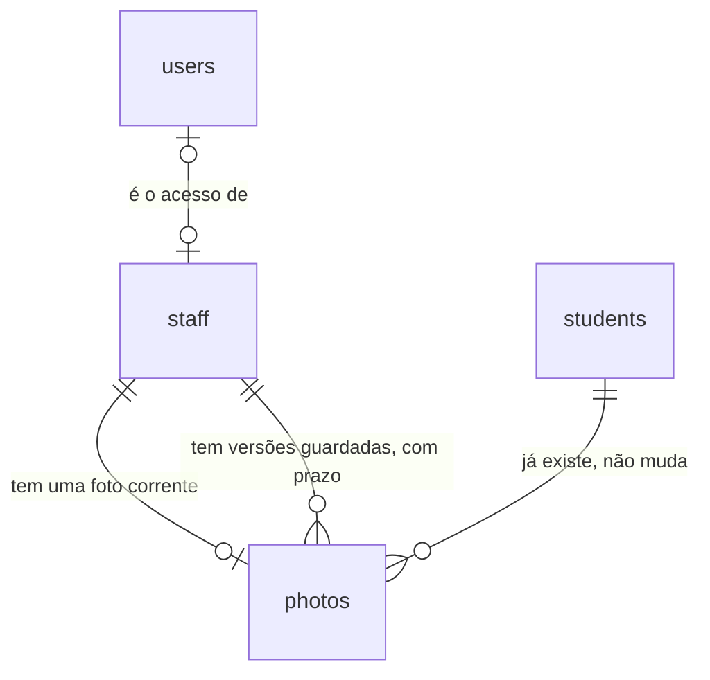

# Cadastro de funcionários

## Problem

O sistema sabe quem tem login e não sabe quem trabalha na academia. CPF, cargo, setor, data de
admissão e contato de cada funcionário continuam onde o PRD os encontrou - "cadastros em planilhas
ou sistemas legados (...) sem controle de quem acessa dados pessoais e sem rastreabilidade" (§1.2) -,
ao alcance de quem abrir o arquivo, inclusive da recepção e dos instrutores, que o §2 deixa "sem
acesso a dados de funcionários". A trilha de auditoria registra quem mexeu em aluno e em usuário, e
não tem o que registrar quando alguém olha os dados de um colega: é a única visualização que a
RF-24 manda registrar, e ela não acontece dentro do sistema. E `users` diz que um e-mail tem perfil
`reception`, mas não diz de que pessoa da equipe é aquele acesso: quando alguém sai da academia,
nada liga a saída ao login. Quem paga é a academia, que responde pelos dados de quem emprega, e o
funcionário, dono do dado. A `privacidade` (#13) depende de existir um funcionário para exportar ou
excluir.

O PRD não traz número de volume. O que ele fixa: RF-09 ("nome, CPF, cargo, setor, data de admissão,
contato, status, perfil de acesso ao sistema (vínculo opcional com usuário)"), RF-10 ("Dados de
funcionários visíveis apenas para Administrador e RH"), RF-24 ("visualização de dados de
funcionários" entre o que a trilha registra), a matriz do §2 (RH/Financeiro: "Cadastro de
funcionários"), `staff` no §6 (`id, name, cpf, position, department, hired_at, status, user_id`),
as rotas `/staff`, `/staff/:id` e `/staff/:id/photo` do §7 e a tela 6 do §8 ("Lista e ficha de
funcionários").

Quando isto entrar: o RH cadastra um funcionário, corrige os dados, inativa e reativa, e põe a foto
dele pelo mesmo diálogo de câmera e recorte do aluno; o Administrador liga a ficha ao usuário que
aquela pessoa usa, e a ficha passa a mostrar o perfil de acesso; recepção e instrutor não alcançam
nenhuma rota nem tela de funcionário; e cada vez que alguém abre a lista ou uma ficha, a tela de
Auditoria mostra quem abriu, de onde e quando.

## Flow

Reutiliza a guarda por perfil (`apps/api/src/access.ts`), o `ValidationInterceptor`, o
`ProblemFilter`, o gravador `audit.record` com `diffOf` e `@Actor`, o módulo `photos` inteiro
(leitura da parte `file`, validação por conteúdo, variantes do Sharp, armazenamento, assinador de
URL, troca com prazo e expurgo), as regras de CPF, telefone e nome de `packages/contracts`, a dobra
de nome `students_fold` e, no web, o `Shell`, o `fetchApi`, o `proxy.ts`, o padrão de página
renderizada no servidor de `/students` e o bloco de foto com o diálogo de captura e recorte
(AD-052): nenhuma rota nova ganha guarda, erro, validação, pipeline de imagem ou diálogo próprio. O
que não existe e esta feature cria: a tabela de funcionários, o segundo dono de uma foto e a leitura
que grava na trilha.

**Escrita (criar, editar, inativar, vincular usuário)**

1. `POST /api/staff`, `PATCH|DELETE /api/staff/:id`, `PUT|DELETE /api/staff/:id/user` -> `apps/web` (exists) repassa -> checagem de origem (exists) -> `AccessGuard` (exists), perfis `admin` e `hr_finance`; nas duas rotas de vínculo, só `admin`
2. `ValidationInterceptor` (exists) - valida o corpo pelo schema de `packages/contracts` (exists) e normaliza CPF e telefone para só dígitos
3. módulo de funcionários em `apps/api` (new, no door - placement per conventions) - abre a transação, trava a linha do funcionário e grava em `staff` (door 1); o índice único do CPF e o do usuário vinculado decidem as corridas
4. `audit.record(tx, ...)` (exists) - grava a linha com a ação da door 4 na mesma transação; se o insert falha, a transação desfaz
5. out: `201`/`200`/`204`, ou `409` com `cpf_taken` ou `user_already_linked`, ou `500` sem nada gravado

**Leitura auditada (lista e ficha)**

1. `GET /api/staff` e `GET /api/staff/:id` -> `AccessGuard` (exists), perfis `admin` e `hr_finance`
2. módulo de funcionários (new, no door - placement per conventions) - abre a transação, lê `staff` (door 1) e o usuário vinculado em `users` (exists), e chama `audit.record(tx, ...)` (exists) com a ação de visualização (door 5)
3. módulo `photos` (exists) - devolve `photoUrl` da foto corrente pelo assinador de URL (exists), `thumb` na lista e `medium` na ficha
4. out: `200` só depois de a linha de auditoria entrar; se ela não entra, `500` sem nenhum dado de funcionário no corpo

**Foto (`POST|PUT|DELETE /api/staff/:id/photo`)**

1. checagem de origem (exists) -> `AccessGuard` (exists), perfis `admin` e `hr_finance` -> módulo `photos` (exists): a mesma leitura, validação e geração de variantes das rotas de aluno
2. `photos` -> armazenamento de objetos (exists) - grava as três variantes na chave da door 3
3. `photos` - abre a transação, trava a linha do funcionário em `staff` (door 1), grava em `photos` com o funcionário como dono (door 2) e chama `audit.record(tx, ...)` (exists) com a ação da door 4
4. out: `201` ou `204`, ou o status de erro da AD-044; se a transação falha, os objetos do passo 2 são apagados
5. expurgo no temporizador da API (exists, AD-050) - passa a apagar também a versão vencida de funcionário, com a ação de `staff` (door 4)
6. `GET /api/photo-files/:photoId/:variant` (exists) - entrega o arquivo pela chave do dono da linha, aluno ou funcionário (door 3)

**Telas**

1. navegador `GET /staff*` -> `proxy.ts` (exists) exige sessão -> página renderizada no servidor chama a API por `fetchApi` (exists) e monta dentro do `Shell` (exists); cada renderização da lista ou da ficha é uma leitura auditada
2. formulários, botões de situação e vínculo -> `POST|PATCH|PUT|DELETE /api/staff*` pelo repasse de `/api/*` (exists), e voltam ao caminho de escrita acima
3. bloco de foto e diálogo de captura e recorte de `apps/web` (exists, AD-052) - apontados para `/api/staff/<id>/photo`
4. `/audit` (exists) - passa a nomear as onze ações novas e a levar do "Alvo" à ficha do funcionário

## Impact

| Front | What changes |
| --- | --- |
| domain | novo termo: `staff` - a pessoa que trabalha na academia; nome da tabela e das rotas (PRD §6 e §7) e `entity` da trilha. Vai ramificar nele: `privacidade` |
| domain | novo termo: `status` do funcionário - só `active` e `inactive`; não existe `suspended`, que é de aluno |
| domain | termo que muda: "a foto" pertencia sempre a um aluno; passa a pertencer a um aluno ou a um funcionário (door 2). Ramificam hoje em `photos.studentId` como sempre preenchido: `findStudent`, `store`, `remove`, `purgeExpired` (a chave, o `entityId` e a ação fixa `student.photo_version_purged`), `currentId`, `currentIds` e `fileOf` de `apps/api/src/photos/photos.service.ts`, `photoKey` de `photo-keys.ts` e `packages/database/test/photos.test.ts`. Com a coluna anulável o tipo vira `string \| null` e o typecheck aponta cada um |
| domain | termo que muda: "visualização" passa a ser ação da trilha. É o primeiro `GET` que grava (door 5); os `GET` de aluno continuam sem gravar (AC 22 da `alunos`) |
| domain | termo do PRD que muda: "perfil de acesso ao sistema" (RF-09) não é coluna de `staff` - é o `role` do usuário vinculado, lido na hora (door 1) |
| contrato | `AUDIT_ACTIONS` ganha onze valores (door 4). `ACTION_LABELS` de `apps/web/src/lib/audit.ts` é um `Record<AuditAction, string>`: o typecheck falha até a tela ter o rótulo de cada um |
| checks de outra feature | quatro testes de `apps/web/e2e/audit.spec.ts` fixam 20 opções no filtro "Ação" (linhas 208, 460, 521 e 544); passam a 31. A ordem e o texto das vinte primeiras não mudam, e o número é atualizado como cada feature anterior fez |
| contrato | código de erro novo: `user_already_linked` (`409`). `cpf_taken` passa a valer também para `POST` e `PATCH` de funcionário |
| contrato | `cpfSchema` e `phoneSchema` de `packages/contracts/src/students.ts` não são exportados; funcionário usa as mesmas regras, uma definição só (AD-011). Onde elas passam a morar é do diff |
| comportamento existente | o expurgo de versões (AD-050) passa a encontrar linhas de funcionário. As rotas `/api/students/:id/photo` e `/api/photo-files/*` não mudam de assinatura nem de resposta; as suítes da `foto-pipeline` e da `foto-captura` são a prova de que continuam como estavam |
| comportamento existente | `GET /api/photo-files/:photoId/:variant` é `@Public()` (AD-043): a foto de um funcionário sai para quem tiver a URL até o `exp`. A RF-10 fica de pé porque a URL só é emitida nas respostas de `/api/staff*`, que só `admin` e `hr_finance` alcançam |
| web | o menu do `Shell` ganha "Funcionários" para `admin` e `hr_finance`; `apps/web/e2e/shell.spec.ts` confere o menu por perfil |
| web | `PhotoBlock`, `PhotoEditor`, `PhotoCamera` e `StudentPhoto` vivem em `app/students/` e recebem `studentId`; a ficha do funcionário usa os mesmos componentes, com outra rota e outra mensagem de `409`. Para onde eles vão é do diff (Build, batch C: `apps/web/src/components/photo/`, com `PersonPhoto` no lugar de `StudentPhoto`; `PhotoBlock` e `PhotoEditor` recebem a rota de foto do dono e o texto do `409` em vez de `studentId`) |
| web | um `<Link>` que pré-carrega a ficha gravaria `staff.viewed` sem ninguém ter aberto. A lista de alunos e `/audit` já usam `prefetch={false}`; se o Next pré-carrega uma página dinâmica sem isso não consta no repositório, e a AC 73 é quem prova |
| web | `/audit` resolve o "Alvo" para `user` e `student`; passa a resolver `staff`. `diffDetails` passa a receber os usuários para nomear o `userId` de um vínculo |
| `auditoria` | a parte "visualização de dados de funcionários" da linha de Out of scope de lá é paga aqui; exportações seguem com a `privacidade` |
| portão | as dez rotas novas entram na regra de `paths` do OpenAPI e nos 70% de cobertura de `apps/api/src`, sem mudança no portão |
| ambiente | nenhuma variável nova: a foto usa as do bucket e `PHOTO_VERSION_RETENTION_DAYS` que já existem |
| stored data | nothing to migrate - a migração `0007` cria `staff` vazia e altera `photos` sem tocar em linha: `student_id` deixa de ser obrigatória, e o `CHECK` de dono único vale para toda linha existente, que tem aluno e não tem funcionário. A academia começa com zero funcionários |
| stored data | `audit_logs` passa a crescer por leitura, não só por escrita: uma linha por abertura da lista e uma por abertura de ficha. A tabela não apaga (AD-024); o volume é o de uma equipe de academia de bairro, e a retenção da trilha é da `privacidade` |
| stored data | um usuário vinculado a um funcionário deixa de poder ser apagado por SQL enquanto o vínculo existir (door 1). Nenhuma rota apaga usuário hoje |
| `.specs` | aprovado o plano, as doors 1 a 5 viram AD-053 a AD-057 em `STATE.md`, e as lacunas "vínculo com funcionário" e "`/staff/:id/photo` - mesmas regras?" de `ROADMAP.md` fecham aqui |

## Relations

One-way constraints: o CPF é único entre funcionários de qualquer situação, e independente do CPF
de alunos (door 1); a situação só aceita os dois valores da door 1; um usuário é o acesso de no
máximo um funcionário, e um funcionário tem no máximo um usuário (door 1); toda foto tem exatamente
um dono, aluno ou funcionário (door 2); no máximo uma foto corrente por funcionário e versão única
por funcionário, por índices próprios (door 2); a regra de prazo da AD-047 vale para as duas. O
autor e o leitor de cada ação estão em `audit_logs`, que aponta para o funcionário por `entity_id`,
sem chave estrangeira. Nomes de coluna, tipos comuns e outros índices ficam para o diff.

## Surface

Só rotas novas. Toda rota também pode responder com a linha de erro comum da `auth-rbac`. Nenhuma
rota existente muda de assinatura.

| Route | In | Out | Status |
| --- | --- | --- | --- |
| `GET /api/staff` | nada | `items[]`: `id` · `name` · `position` · `department` · `status` · `photoUrl` | `200`, `401`, `403` |
| `POST /api/staff` | `name`, `cpf`, `position`, `hiredAt`, `phone`; opcionais: `department`, `email` | o funcionário, como em `GET /api/staff/:id` | `201`, `401`, `403`, `409`, `422` |
| `GET /api/staff/:id` | nada | `id` · `name` · `status` · `cpf` · `position` · `department` · `hiredAt` · `phone` · `email` · `user` (`id` · `name` · `email` · `role` · `active`, ou `null`) · `photoUrl` | `200`, `401`, `403`, `404` |
| `PATCH /api/staff/:id` | os campos do `POST`, todos opcionais, mais `status` (só `active`); `null` limpa `department` e `email` | o funcionário | `200`, `401`, `403`, `404`, `409`, `422` |
| `DELETE /api/staff/:id` | nada | nada | `204`, `401`, `403`, `404` |
| `PUT /api/staff/:id/user` | `userId` | nada | `204`, `401`, `403`, `404`, `409`, `422` |
| `DELETE /api/staff/:id/user` | nada | nada | `204`, `401`, `403`, `404` |
| `POST /api/staff/:id/photo` | `multipart/form-data` com uma parte de arquivo chamada `file` | `id` · `version` · `createdAt` | `201`, `401`, `403`, `404`, `409`, `413`, `415`, `422`, `503` |
| `PUT /api/staff/:id/photo` | o mesmo corpo do `POST` | `id` · `version` · `createdAt` | `201`, `401`, `403`, `404`, `413`, `415`, `422`, `503` |
| `DELETE /api/staff/:id/photo` | nada | nada | `204`, `401`, `403`, `404` |

## Landing

| One-way door | Literal shape | Alternative rejected |
| --- | --- | --- |
| 1. tabela `staff` | migração `0007` (AD-008); `id uuid DEFAULT uuidv7()`; `cpf` guardado como 11 dígitos, com `UNIQUE` sobre a tabela inteira; `status` com `CHECK (status in ('active', 'inactive'))` e padrão `active`; `user_id uuid REFERENCES users(id)`, anulável, sem `ON DELETE`, com `UNIQUE`; sem coluna de perfil, sem `deleted_at`, sem `tenant_id` (AD-016) | coluna `role` em `staff` - duas fontes para o perfil, que discordam na primeira edição em `/users` (AD-018 põe o perfil no usuário). `staff_id` em `users` - `users` é a tabela que o Better Auth lê e escreve (AD-017). Tabela de vínculo N:N - um funcionário com dois usuários teria dois perfis de acesso, o que a AD-018 recusa. Índice único parcial do CPF só entre ativos - quem é recontratado viraria uma segunda ficha (o motivo da AD-030). `ON DELETE SET NULL` - o vínculo sumiria sem linha na trilha. Fecha: recontratado é reativado, nunca recadastrado; a mesma pessoa pode ser aluno e funcionário, em duas fichas sem ligação; um usuário vinculado não é apagado por SQL sem desvincular antes |
| 2. o segundo dono de `photos` | na migração `0007`: `ALTER TABLE photos ALTER COLUMN student_id DROP NOT NULL`; `ADD COLUMN staff_id uuid REFERENCES staff(id)`, sem `ON DELETE CASCADE`; `CONSTRAINT photos_one_owner CHECK (num_nonnulls(student_id, staff_id) = 1)`; `CONSTRAINT photos_staff_id_version_unique UNIQUE (staff_id, version)`; `CREATE UNIQUE INDEX photos_one_current_staff_idx ON photos (staff_id) WHERE is_current`. `photos_expiry_matches_current` (AD-047) não muda e vale para os dois donos | forçada pela AD-040, que já fixou `staff_id` e o `CHECK`; o que se decide aqui são os dois índices de funcionário. Sem `photos_one_current_staff_idx` - dois envios simultâneos da primeira foto passariam os dois, porque o índice de aluno não enxerga linha com `student_id` nulo. Tabela `staff_photos` à parte - o expurgo e `GET /api/photo-files/<photoId>` passariam a procurar em duas tabelas, e a AD-040 a descartou. Fecha: apagar um funcionário definitivamente exige remover as fotos antes; um terceiro dono é outra coluna e o `CHECK` reescrito |
| 3. chave do objeto da foto de funcionário | `photos/main/{staffId}/{photoId}/{variant}.webp`: o formato da AD-041, com o id do dono no segmento que hoje leva `{studentId}`; nenhum segmento vem do cliente | `photos/main/staff/{staffId}/{photoId}/{variant}.webp` - passam a existir duas formas de chave, e o tipo do dono fica em dois lugares (a chave e a chave estrangeira da linha) sem árbitro quando discordam; pôr `students/` nas chaves de aluno para igualar é copiar todo objeto (AD-041). Fecha: pelo prefixo não se sabe se o dono é aluno ou funcionário, quem diz é a linha de `photos`; os dois ids são `uuidv7()` do mesmo banco, e o `photoId` no segmento seguinte impede duas chaves iguais |
| 4. ações e campos registráveis de `staff` | em `AUDIT_ACTIONS` (AD-025), depois das vinte existentes, nesta ordem: `staff.created`, `staff.updated`, `staff.inactivated`, `staff.viewed`, `staff.list_viewed`, `staff.user_linked`, `staff.user_unlinked`, `staff.photo_uploaded`, `staff.photo_removed`, `staff.photo_replaced`, `staff.photo_version_purged`; `entity` igual a `staff` e `entity_id` igual ao id do funcionário, nulo só em `staff.list_viewed`. Campos registráveis (AD-026): `status` e `userId`. De `name`, `cpf`, `position`, `department`, `hiredAt`, `phone` e `email` a trilha guarda só o nome do campo. As quatro de foto e as duas de visualização gravam `diff` nulo; a do expurgo usa `NO_ACTOR` (AD-049) | `from` e `to` de cargo e setor - são dados de uma pessoa numa tabela que não apaga, fora do alcance da anonimização (RF-29, AD-024). `staff.updated` também para o vínculo - o filtro "Ação" não acharia quem ganhou acesso. A abertura da lista como `staff.viewed` sem alvo - o filtro não separaria ver a lista de abrir uma ficha. `entity` igual a `photo` nas de foto - a AD-045 já recusou |
| 5. leitura que grava na trilha | `GET /api/staff/:id` e `GET /api/staff` leem e chamam `audit.record(tx, { actor, action, entity: 'staff', entityId })` dentro da mesma transação; o `200` só sai depois do commit, e se o insert falha a resposta é `500` sem dado nenhum. Uma linha por resposta `200`: `staff.viewed` com o id na ficha, `staff.list_viewed` com `entityId` nulo na lista, mesmo vazia. `401`, `403` e `404` não gravam. Sem janela de deduplicação | interceptor que grava depois do handler - o dado sai mesmo quando a linha não entra, e a AD-027 já o recusou para escrita. Uma linha `staff.viewed` por funcionário listado - uma requisição gravaria uma linha por pessoa da equipe a cada abertura da lista. Deduplicar por janela de tempo - pede ler a trilha antes de cada leitura e esconde a segunda consulta, que é o que a RF-24 manda mostrar. Só linha de log - não é a trilha que o Administrador consulta (PRD §14). Fecha: toda visualização auditada futura (exportações da `privacidade`) copia; uma página que pré-carrega a ficha grava uma visualização que não houve |

- Nothing else in this change is hard to reverse

## Criteria

### S1: Cadastrar um funcionário (P1)

O RH cria um funcionário com os campos da RF-09, e um CPF nunca vira duas fichas.

**Acceptance Criteria**

1. WHEN um usuário de perfil `admin` ou `hr_finance` chama `POST /api/staff` com `name`, `cpf`, `position`, `hiredAt` e `phone` válidos THEN the system SHALL responder `201` com `id`, os campos enviados, `status` igual a `active`, `null` em `department`, `email`, `user` e `photoUrl`
2. WHEN `POST /api/staff` recebe `cpf` igual a `529.982.247-25` e `phone` igual a `(11) 91234-5678` THEN the system SHALL guardar e devolver `cpf` igual a `52998224725` e `phone` igual a `11912345678`
3. IF `cpf`, retirados pontos e hífen, não tem 11 dígitos, tem os 11 dígitos iguais ou tem dígito verificador errado THEN the system SHALL responder `422` com um item em `errors` cujo `path` é `cpf`
4. IF `POST /api/staff` recebe um CPF que já pertence a um funcionário de qualquer situação THEN the system SHALL responder `409` com `code` igual a `cpf_taken` sem criar funcionário
5. IF dois `POST /api/staff` com o mesmo CPF chegam ao mesmo tempo THEN the system SHALL responder `201` a exatamente um e `409` com `cpf_taken` ao outro
6. WHEN `POST /api/staff` recebe um CPF que pertence a um aluno e a funcionário nenhum THEN the system SHALL responder `201`
7. IF `hiredAt` não é uma data real no formato `aaaa-mm-dd`, é posterior ao dia corrente em `America/Sao_Paulo` ou é anterior a `1900-01-01` THEN the system SHALL responder `422` com um item em `errors` cujo `path` é `hiredAt`
8. IF `name` ou `position` falta ou fica vazio depois de aparado, `name` passa de 120 caracteres, `position` ou `department` passa de 80, `email` não é um e-mail ou passa de 254, `phone`, retirados espaços, parênteses e hífen, não tem 10 ou 11 dígitos, ou um campo de texto contém o caractere U+0000 THEN the system SHALL responder `422` com um item em `errors` cujo `path` é aquele campo

**Independent test:** entrar como RH, criar um funcionário por `curl` com CPF mascarado, repetir o mesmo CPF e receber `409`.

### S2: Só Administrador e RH alcançam (P1)

Nenhuma rota de funcionário responde a quem a RF-10 deixa de fora, exista ou não o funcionário.

**Acceptance Criteria**

9. IF um usuário de perfil `reception` ou `instructor` chama `GET` ou `POST /api/staff`, `GET`, `PATCH` ou `DELETE /api/staff/:id`, `PUT` ou `DELETE /api/staff/:id/user`, ou `POST`, `PUT` ou `DELETE /api/staff/:id/photo`, com `:id` de um funcionário que existe ou não THEN the system SHALL responder `403` com `code` igual a `forbidden`, sem nenhum campo de funcionário no corpo e sem criar, alterar nem gravar nada
10. IF qualquer uma das dez rotas `/api/staff*` é chamada sem sessão THEN the system SHALL responder `401` com `code` igual a `unauthorized`
11. IF um usuário de perfil `hr_finance` chama `PUT` ou `DELETE /api/staff/:id/user` THEN the system SHALL responder `403` com `code` igual a `forbidden` sem alterar o vínculo

**Independent test:** chamar `GET /api/staff` e `GET /api/staff/<id>` com o cookie da recepção e o do instrutor e receber `403` nos quatro.

### S3: Ler a lista e a ficha, e cada leitura deixa rastro (P1)

Os dois perfis veem a mesma ficha, e a trilha diz quem a abriu (RF-10, RF-24).

**Acceptance Criteria**

12. WHEN um usuário de perfil `admin` ou `hr_finance` chama `GET /api/staff/:id` THEN the system SHALL responder `200` com as chaves `id`, `name`, `status`, `cpf`, `position`, `department`, `hiredAt`, `phone`, `email`, `user` e `photoUrl`, as mesmas para os dois perfis
13. WHEN o funcionário tem usuário vinculado THEN the system SHALL devolver em `user` o `id`, o `name`, o `email`, o `role` e o `active` que aquele usuário tem no momento da leitura, e `null` quando não há vínculo
14. WHEN o funcionário tem foto corrente THEN the system SHALL devolver em `photoUrl` a URL assinada da variante `medium`, no formato `/api/photo-files/<photoId>/medium?exp=<n>&sig=<s>`, e `null` quando não tem foto
15. WHEN `GET /api/staff/:id` responde `200` THEN the system SHALL ter gravado exatamente uma linha em `audit_logs` com `action` igual a `staff.viewed`, `user_id` igual ao id de quem leu, `entity` igual a `staff`, `entity_id` igual a `:id` e `diff` nulo
16. WHEN um usuário de perfil `admin` ou `hr_finance` chama `GET /api/staff` THEN the system SHALL responder `200` com todos os funcionários de qualquer situação em `items`, em ordem de `name` sem diferenciar maiúsculas nem acentos e, no empate, de `id`, cada um só com as chaves `id`, `name`, `position`, `department`, `status` e `photoUrl` (variante `thumb`, ou `null`)
17. WHEN `GET /api/staff` responde `200`, inclusive com `items` vazio THEN the system SHALL ter gravado exatamente uma linha com `action` igual a `staff.list_viewed`, `user_id` igual ao id de quem leu, `entity` igual a `staff`, `entity_id` nulo e `diff` nulo
18. IF o insert em `audit_logs` falha durante `GET /api/staff` ou `GET /api/staff/:id` THEN the system SHALL responder `500` sem nenhum campo de funcionário no corpo
19. IF `:id` de `GET /api/staff/:id` não é um `uuid` ou não pertence a funcionário nenhum THEN the system SHALL responder `404` com `code` igual a `not_found`
20. IF `GET /api/staff` ou `GET /api/staff/:id` termina com `401`, `403` ou `404` THEN the system SHALL deixar `audit_logs` com o mesmo número de linhas de antes

**Independent test:** abrir a mesma ficha duas vezes como RH e uma como administrador; ler `audit_logs` e encontrar três linhas `staff.viewed`, duas com o id do RH.

### S4: Editar, inativar e reativar (P1)

Corrigir qualquer campo e mudar a situação sem nunca apagar a linha.

**Acceptance Criteria**

21. WHEN um usuário de perfil `admin` ou `hr_finance` chama `PATCH /api/staff/:id` com um ou mais de `name`, `cpf`, `position`, `department`, `hiredAt`, `phone` e `email` válidos THEN the system SHALL responder `200` com o funcionário atualizado, mantendo como estavam os campos não enviados
22. WHEN `PATCH /api/staff/:id` recebe `null` em `department` ou em `email` THEN the system SHALL limpar aquele campo e devolvê-lo como `null`
23. IF `PATCH /api/staff/:id` recebe `null` em `name`, `cpf`, `position`, `hiredAt`, `phone` ou `status`, ou um valor que as AC 3, 7 e 8 reprovam THEN the system SHALL responder `422` com um item em `errors` cujo `path` é aquele campo, sem alterar o funcionário
24. IF `PATCH /api/staff/:id` recebe um CPF que pertence a outro funcionário THEN the system SHALL responder `409` com `code` igual a `cpf_taken` sem alterar o funcionário
25. WHEN `PATCH /api/staff/:id` recebe `status` igual a `active` para um funcionário inativo THEN the system SHALL gravar `status` igual a `active`
26. IF `PATCH /api/staff/:id` recebe `status` igual a `inactive` ou a qualquer valor que não seja `active` THEN the system SHALL responder `422` com um item em `errors` cujo `path` é `status`
27. WHEN um usuário de perfil `admin` ou `hr_finance` chama `DELETE /api/staff/:id` THEN the system SHALL responder `204`, passar `status` para `inactive` e manter a linha, o vínculo com o usuário e as fotos, de modo que `GET /api/staff/:id` continua devolvendo todos os outros campos como estavam
28. WHEN `DELETE /api/staff/:id` inativa um funcionário com usuário vinculado THEN the system SHALL manter `active` e as sessões daquele usuário como estavam
29. IF `DELETE /api/staff/:id` atinge um funcionário já inativo THEN the system SHALL responder `204` sem alterar nada
30. IF dois `PATCH /api/staff/:id` simultâneos mudam campos diferentes do mesmo funcionário THEN the system SHALL responder `200` aos dois e deixar o funcionário com as duas mudanças
31. IF `:id` de `PATCH` ou `DELETE /api/staff/:id` não é um `uuid` ou não pertence a funcionário nenhum THEN the system SHALL responder `404` com `code` igual a `not_found`

**Independent test:** corrigir o cargo de um funcionário, inativá-lo, conferir pelo `psql` que a linha continua lá e reativá-lo.

### S5: Ligar a ficha ao usuário (P1)

O Administrador diz de quem é cada login, e a ficha passa a mostrar o perfil de acesso (RF-09).

**Acceptance Criteria**

32. WHEN um usuário de perfil `admin` chama `PUT /api/staff/:id/user` com o `userId` de um usuário que existe, ativo ou inativo THEN the system SHALL responder `204`, e `GET /api/staff/:id` SHALL devolver `user` com o `id`, o `name`, o `email`, o `role` e o `active` daquele usuário
33. WHEN `PUT /api/staff/:id/user` é chamado para um funcionário já vinculado a outro usuário THEN the system SHALL responder `204` e trocar o vínculo pelo usuário enviado
34. IF `userId` falta, não é um `uuid` ou não pertence a usuário nenhum THEN the system SHALL responder `422` com um item em `errors` cujo `path` é `userId`, sem alterar o vínculo
35. IF `userId` é de um usuário já vinculado a outro funcionário THEN the system SHALL responder `409` com `code` igual a `user_already_linked`, sem alterar nenhum dos dois funcionários
36. IF dois `PUT /api/staff/:id/user` vinculam o mesmo usuário a dois funcionários diferentes ao mesmo tempo THEN the system SHALL responder `204` a exatamente um e `409` com `user_already_linked` ao outro
37. WHEN um usuário de perfil `admin` chama `DELETE /api/staff/:id/user` THEN the system SHALL responder `204` e deixar `user` igual a `null`; e, sem vínculo, SHALL responder `204` sem alterar nada
38. IF `:id` de `PUT` ou `DELETE /api/staff/:id/user` não é um `uuid` ou não pertence a funcionário nenhum THEN the system SHALL responder `404` com `code` igual a `not_found`

**Independent test:** como administrador, vincular um usuário de recepção a um funcionário, ler a ficha como RH e ver o perfil; tentar vincular o mesmo usuário a outro funcionário e receber `409`.

### S6: Cada escrita deixa rastro, na mesma transação (P1)

Uma linha por ação que mudou algo, sem dado pessoal na trilha (AD-025 a AD-027).

**Acceptance Criteria**

39. WHEN `POST /api/staff` responde `201` THEN the system SHALL ter gravado exatamente uma linha em `audit_logs` com `action` igual a `staff.created`, `user_id` igual ao id do autor, `entity` igual a `staff` e `entity_id` igual ao id do funcionário criado
40. WHEN `POST /api/staff` cria um funcionário só com `name`, `cpf`, `position`, `hiredAt` e `phone` THEN the system SHALL gravar `diff` igual a `{"fields":["name","cpf","position","hiredAt","phone","status"],"values":{"status":{"from":null,"to":"active"}}}`
41. WHEN `PATCH /api/staff/:id` responde `200` tendo mudado `position` e `phone` THEN the system SHALL ter gravado exatamente uma linha com `action` igual a `staff.updated`, `user_id` do autor, `entity` igual a `staff`, `entity_id` igual a `:id` e `diff` igual a `{"fields":["position","phone"],"values":{}}`
42. WHEN `PATCH /api/staff/:id` reativa um funcionário inativo THEN the system SHALL gravar uma linha `staff.updated` com `diff` igual a `{"fields":["status"],"values":{"status":{"from":"inactive","to":"active"}}}`
43. IF `PATCH /api/staff/:id` recebe só valores iguais aos atuais, ou corpo vazio THEN the system SHALL responder `200` sem gravar linha em `audit_logs`
44. WHEN `DELETE /api/staff/:id` inativa um funcionário de situação `active` THEN the system SHALL ter gravado exatamente uma linha com `action` igual a `staff.inactivated`, `user_id` do autor, `entity` igual a `staff`, `entity_id` igual a `:id` e `diff` igual a `{"fields":["status"],"values":{"status":{"from":"active","to":"inactive"}}}`
45. WHEN `PUT /api/staff/:id/user` muda o vínculo THEN the system SHALL ter gravado exatamente uma linha com `action` igual a `staff.user_linked`, `user_id` do autor, `entity_id` igual a `:id` e `diff` igual a `{"fields":["userId"],"values":{"userId":{"from":<id anterior ou null>,"to":"<userId>"}}}`; e, com o `userId` já vinculado àquele funcionário, SHALL não gravar linha
46. WHEN `DELETE /api/staff/:id/user` desfaz um vínculo THEN the system SHALL ter gravado exatamente uma linha com `action` igual a `staff.user_unlinked` e `diff` igual a `{"fields":["userId"],"values":{"userId":{"from":"<userId>","to":null}}}`; e, sem vínculo, SHALL não gravar linha
47. IF `POST /api/staff`, `PATCH` ou `DELETE /api/staff/:id`, ou `PUT` ou `DELETE /api/staff/:id/user` termina com `401`, `403`, `404`, `409` ou `422`, ou é o `DELETE` da AC 29 THEN the system SHALL deixar `audit_logs` com o mesmo número de linhas de antes
48. IF o insert em `audit_logs` falha durante `POST /api/staff`, `PATCH` ou `DELETE /api/staff/:id`, ou `PUT` ou `DELETE /api/staff/:id/user` THEN the system SHALL responder `500` e deixar `staff` como estava antes da requisição
49. The system SHALL manter fora de toda coluna de `audit_logs` o nome, o CPF, o cargo, o setor, a data de admissão, o telefone e o e-mail de qualquer funcionário
50. WHEN uma ação de funcionário é gravada, de escrita ou de leitura THEN the system SHALL preencher `ip` e `user_agent` da linha pelas mesmas regras das AC 29 a 32 da `auditoria`
51. The system SHALL manter fora de toda linha de log o CPF, o telefone e o e-mail de qualquer funcionário

**Independent test:** criar, editar, vincular e inativar um funcionário; ler `audit_logs` e encontrar quatro linhas com o id do autor, procurando o CPF e o nome do funcionário no texto delas.

### S7: Foto do funcionário (P1)

O mesmo pipeline do aluno, com o funcionário como dono e as ações dele na trilha.

**Acceptance Criteria**

52. WHEN um usuário de perfil `admin` ou `hr_finance` chama `POST /api/staff/:id/photo` com a parte `file` de um JPEG de 800×1000 para um funcionário sem foto THEN the system SHALL responder `201` com `id`, `version` igual a `1` e `createdAt`, e gravar no bucket exatamente três objetos, em `photos/main/<staffId>/<photoId>/thumb.webp`, `medium.webp` e `large.webp`
53. IF o funcionário já tem foto corrente THEN the system SHALL responder `409` com `code` igual a `photo_exists` ao `POST`, sem gravar linha em `photos` e sem deixar objeto do envio no bucket
54. IF dois `POST /api/staff/:id/photo` do mesmo funcionário sem foto chegam ao mesmo tempo THEN the system SHALL responder `201` a exatamente um e `409` com `photo_exists` ao outro, e o bucket SHALL ter só os três objetos da foto que venceu
55. WHEN `PUT /api/staff/:id/photo` é chamado para um funcionário com foto corrente de `version` igual a `1` THEN the system SHALL responder `201` com `version` igual a `2`, manter a anterior não corrente com `expires_at` igual ao instante da troca mais os dias de `PHOTO_VERSION_RETENTION_DAYS`, e ter a nova como a única corrente
56. WHEN `PUT /api/staff/:id/photo` é chamado para um funcionário sem foto corrente THEN the system SHALL responder `201` com `version` igual a `1`
57. IF o arquivo enviado a `POST` ou `PUT /api/staff/:id/photo` é um dos que as AC 9 a 15 da `foto-pipeline` recusam THEN the system SHALL responder com o mesmo status e o mesmo `code` das rotas de aluno (`415`, `413` ou `422`), sem gravar nada
58. WHEN `POST` ou `PUT /api/staff/:id/photo` aceita um arquivo THEN the system SHALL gravar as variantes pelas AC 16 a 21 da `foto-pipeline`: três objetos WebP de 96×128, 240×320 e 600×800, sem EXIF, sem o original e sem nada do cliente na chave
59. WHEN `DELETE /api/staff/:id/photo` é chamado para um funcionário com foto THEN the system SHALL responder `204` e remover toda linha de `photos` dele e os objetos de cada uma, de modo que `photoUrl` passa a `null`; e, sem foto, SHALL responder `204` sem alterar nada
60. IF `:id` de `POST`, `PUT` ou `DELETE /api/staff/:id/photo` não é um `uuid`, não pertence a funcionário nenhum ou é o id de um aluno THEN the system SHALL responder `404` com `code` igual a `not_found`, sem gravar objeto nem linha; e `/api/students/:id/photo` com o id de um funcionário SHALL responder `404`
61. WHEN `POST` envia, `PUT` troca ou `DELETE` remove a foto de um funcionário THEN the system SHALL ter gravado exatamente uma linha com `action` igual a `staff.photo_uploaded`, `staff.photo_replaced` ou `staff.photo_removed`, `user_id` do autor, `entity` igual a `staff`, `entity_id` igual ao id do funcionário e `diff` nulo; e o `PUT` sem foto corrente SHALL gravar `staff.photo_uploaded`
62. IF o armazenamento falha ao gravar uma variante THEN the system SHALL responder `503` com `code` igual a `storage_unavailable`; e IF a transação falha depois de as variantes estarem gravadas THEN the system SHALL responder `500`; nos dois casos sem linha nova em `photos`, sem linha em `audit_logs`, sem objeto da tentativa no bucket e com a foto corrente como estava
63. IF uma requisição a `/api/staff/:id/photo` termina com `401`, `403`, `404`, `409`, `413`, `415`, `422`, `500` ou `503`, ou é um `DELETE` sem foto THEN the system SHALL deixar `audit_logs` com o mesmo número de linhas de antes
64. WHEN o expurgo executa e existe uma versão não corrente de funcionário com `expires_at` no passado THEN the system SHALL remover os três objetos dela e a linha de `photos`, e gravar na mesma transação uma linha com `action` igual a `staff.photo_version_purged`, `entity` igual a `staff`, `entity_id` igual ao id do funcionário, `diff` nulo e `user_id`, `ip` e `user_agent` nulos
65. WHEN `GET /api/photo-files/:photoId/:variant` recebe um `sig` válido para a foto de um funcionário e `exp` ainda não passou THEN the system SHALL responder `200` com `Content-Type` igual a `image/webp`, `Cache-Control` igual a `no-store` e o corpo igual ao objeto da variante
66. IF um `INSERT` em `photos` traz `student_id` e `staff_id` preenchidos, ou os dois nulos THEN the system SHALL falhar a instrução sem gravar a linha
67. WHEN o funcionário tem `status` igual a `inactive` THEN the system SHALL aceitar o envio, a troca e a remoção da foto como para um funcionário `active`

**Independent test:** entrar como RH, enviar um JPEG por `curl` ao funcionário, trocá-lo por `PUT`, listar seis objetos no prefixo dele, abrir a `photoUrl` sem cookie e receber a imagem; entrar como recepção e receber `403` no envio.

### S8: Telas de funcionários (P1)

Lista, ficha e formulário em pt-BR, só para quem pode ver, com a foto pelo mesmo diálogo do aluno.

**Acceptance Criteria**

68. The system SHALL exibir o link "Funcionários" no menu apenas para os perfis `admin` e `hr_finance`
69. WHEN alguém sem sessão abre `/staff`, `/staff/new`, `/staff/<id>` ou `/staff/<id>/edit` THEN the system SHALL redirecionar para `/login`
70. IF um usuário de perfil `reception` ou `instructor` abre `/staff`, `/staff/new`, `/staff/<id>` ou `/staff/<id>/edit` THEN the system SHALL exibir "Você não tem permissão para acessar esta página." sem nenhum dado de funcionário
71. WHEN um usuário de perfil `admin` ou `hr_finance` abre `/staff` THEN the system SHALL exibir o título "Funcionários", o botão "Novo funcionário" e uma tabela com as colunas "Nome", "Cargo", "Setor" e "Situação", na ordem que a API devolve, com a miniatura da foto ou o círculo das iniciais antes do nome e o nome de cada linha levando à ficha
72. IF não existe funcionário nenhum THEN the system SHALL exibir "Nenhum funcionário cadastrado." no lugar da tabela
73. WHEN `/staff` é exibida com um ou mais funcionários THEN the system SHALL ter gravado uma linha `staff.list_viewed` e nenhuma linha `staff.viewed`, de modo que uma ficha só conta como vista quando alguém a abre
74. IF a lista ou a ficha não carrega THEN the system SHALL exibir "Não foi possível carregar os funcionários." e o botão "Tentar novamente"
75. The system SHALL exibir no formulário de `/staff/new` e de `/staff/<id>/edit` os campos "Nome completo", "CPF", "Cargo", "Setor", "Data de admissão", "Telefone" e "E-mail", e o botão "Salvar"
76. WHEN o formulário é salvo THEN the system SHALL navegar para a ficha do funcionário criado ou editado
77. IF a API responde `409` com `cpf_taken` THEN the system SHALL exibir "Já existe um funcionário com este CPF." junto do campo "CPF", mantendo os demais campos preenchidos
78. WHEN um usuário de perfil `admin` ou `hr_finance` abre `/staff/<id>` THEN the system SHALL exibir o nome, "Situação" como "Ativo" ou "Inativo", "CPF" como `000.000.000-00`, "Cargo", "Setor", "Data de admissão" como `dd/MM/aaaa`, "Telefone" como `(00) 00000-0000` ou `(00) 0000-0000` e "E-mail", com "—" no campo `null`
79. WHEN a ficha é exibida THEN the system SHALL exibir em "Acesso ao sistema" o texto "Sem usuário vinculado" quando `user` é `null`, e o e-mail, o perfil por extenso e "Ativo" ou "Inativo" do usuário quando há vínculo
80. The system SHALL exibir na ficha o botão "Editar", e "Inativar" para o funcionário ativo ou "Reativar" para o inativo
81. WHEN o usuário aciona "Inativar" THEN the system SHALL pedir confirmação num diálogo que nomeia o funcionário antes de enviar a requisição, e exibir a ficha com a situação nova quando a mudança termina
82. IF o funcionário está inativo e o usuário vinculado tem `active` igual a `true` THEN the system SHALL exibir na ficha o aviso "Este funcionário está inativo e o usuário vinculado continua ativo."
83. WHERE o usuário é de perfil `admin` the system SHALL exibir na ficha o campo "Usuário vinculado", com a opção "Nenhum" e uma opção "<nome> (<e-mail>)" por usuário, em ordem de nome, e o botão "Salvar vínculo", que envia `PUT /api/staff/<id>/user` com o usuário escolhido ou `DELETE /api/staff/<id>/user` com "Nenhum" e exibe a ficha com o "Acesso ao sistema" novo
84. WHEN um usuário de perfil `hr_finance` abre a ficha THEN the system SHALL exibir "Acesso ao sistema" sem o campo "Usuário vinculado" e sem o botão "Salvar vínculo"
85. IF a API responde `409` com `user_already_linked` THEN the system SHALL exibir "Este usuário já está vinculado a outro funcionário."; e IF a lista de usuários não carrega THEN the system SHALL exibir a ficha com "Não foi possível carregar os usuários." no lugar do campo "Usuário vinculado"
86. IF `/staff/<id>` ou `/staff/<id>/edit` aponta para um funcionário que não existe THEN the system SHALL exibir "Funcionário não encontrado."
87. WHEN a ficha é exibida THEN the system SHALL exibir a imagem de `photoUrl` com o texto alternativo "Foto de <nome do funcionário>", ou o círculo das iniciais com o rótulo acessível "Sem foto"; e, sem foto, a área "Arraste uma foto aqui ou escolha um arquivo" com "Enviar foto" e "Usar câmera"; e, com foto, os botões "Trocar foto", "Usar câmera" e "Remover foto"
88. WHEN o usuário escolhe ou larga um arquivo, ou captura pela câmera THEN the system SHALL abrir o diálogo "Ajustar foto" da `foto-captura`, sem enviar requisição de foto, e "Salvar foto" SHALL enviar uma única requisição `multipart/form-data` com uma única parte `file`, um JPEG de razão 3:4, por `POST /api/staff/<id>/photo` quando o funcionário não tem foto e por `PUT /api/staff/<id>/photo` quando tem
89. IF o envio termina com `413`, `415`, `422`, `503` ou outro erro THEN the system SHALL exibir dentro do diálogo a mensagem da AC 56 da `foto-pipeline` para aquele status; e, com `409`, "Este funcionário já tem foto."
90. WHEN o usuário aciona "Remover foto" THEN the system SHALL pedir confirmação num diálogo que nomeia o funcionário antes de enviar a requisição, e exibir a ficha sem foto quando a resposta é `204`

**Independent test:** subir a stack, entrar como RH, cadastrar um funcionário, tirar a foto dele pela câmera, inativar e reativar; entrar como recepção, não ver "Funcionários" no menu e abrir `/staff` pelo endereço.

### S9: A trilha de funcionário na tela de Auditoria (P2)

O Administrador lê as ações novas por extenso e chega à ficha.

**Acceptance Criteria**

91. The system SHALL exibir em `/audit` as ações novas por extenso - "Funcionário criado", "Funcionário editado", "Funcionário inativado", "Ficha de funcionário visualizada", "Lista de funcionários visualizada", "Usuário vinculado ao funcionário", "Usuário desvinculado do funcionário", "Foto do funcionário enviada", "Foto do funcionário removida", "Foto do funcionário trocada" e "Versão anterior da foto do funcionário excluída" - e oferecê-las no filtro "Ação", nessa ordem, depois das vinte existentes
92. WHEN a linha tem `entity` igual a `staff` e `entityId` não nulo THEN the system SHALL exibir em "Alvo" o link "Ver funcionário", que leva a `/staff/<entityId>`
93. WHEN a linha tem `diff` com `status` de `active` para `inactive` e `position` em `fields` THEN the system SHALL exibir em "Detalhes" o texto "Situação: Ativo → Inativo" e o texto "Cargo alterado"
94. WHEN a linha tem `diff` com `userId` de `null` para o id de um usuário que existe THEN the system SHALL exibir em "Detalhes" o texto "Usuário vinculado: — → <nome atual do usuário>"

**Independent test:** abrir uma ficha como RH, entrar como administrador, abrir "Auditoria", filtrar por "Ficha de funcionário visualizada" e seguir o link "Ver funcionário".

## Out of scope

| Excluded | Why |
| --- | --- |
| Busca, filtro e paginação na lista de funcionários | a RF-07 é de alunos; a equipe de uma academia de bairro cabe numa página, como `/users`. Acrescentar depois é uma chave a mais na resposta |
| `GET /api/staff/:id/photo` (URL assinada por variante) | o PRD §7 só lista `POST` e `DELETE` para a foto de funcionário; a ficha e a lista já trazem `photoUrl`, e ninguém consome a variante `large` |
| Exclusão definitiva, anonimização e exportação dos dados de um funcionário | RF-28 e RF-29, feature `privacidade`, que depende desta |
| Criar o usuário a partir da ficha do funcionário | gestão de usuários é do Administrador em `/users` (`auth-rbac`); aqui só se liga um usuário que já existe |
| Desativar o usuário quando o funcionário é inativado | pergunta 2 abaixo; hoje a ficha avisa (AC 82) e quem desativa é o Administrador |
| O funcionário ver ou corrigir os próprios dados | não há portal de funcionário no PRD; o do aluno é fase 2 (§2) |
| Situações além de ativo e inativo (afastado, férias) | a RF-09 só diz "status"; um valor novo é uma migração que amplia o `CHECK` |
| Salário, jornada, documentos, endereço, data de nascimento | a RF-09 enumera os campos, e nenhum desses está nela |
| Consentimento de uso de imagem do funcionário | a RF-27 e a tabela `consents` são do aluno |
| Registrar na trilha a entrega do arquivo da foto | `GET /api/photo-files/*` não tem sessão (AD-043); a leitura que emitiu a URL já foi registrada |
| Ver as versões guardadas da foto e restaurar uma | fora da `foto-captura` pelo mesmo motivo: a RF-16 pede guardar e excluir no prazo |
| Importar funcionários de planilha | o PRD não pede; a academia começa do zero |

## Assumptions

| Assumption | Chosen default | Rationale | Confirmed? |
| --- | --- | --- | --- |
| Quem cadastra, edita, inativa, reativa e cuida da foto | `admin` e `hr_finance` | PRD §2: RH/Financeiro "Cadastro de funcionários", Administrador "acesso total" | y |
| O que cada perfil vê (AD-033) | `admin` e `hr_finance` veem todos os campos; `reception` e `instructor`, nenhuma rota. Não há campo a cortar por perfil: `null` em `user`, `photoUrl`, `department` e `email` é "não tem", nunca "oculto" | RF-10 e §2 ("sem acesso a dados de funcionários"); a AD-033 continua valendo como uma rota só por recurso | y |
| O que é "visualização" (RF-24) | toda resposta `200` da ficha e da lista grava uma linha, sem deduplicar; abrir o formulário de edição e recarregar a ficha depois de salvar ou de enviar foto também contam | a RF-24 não distingue, e cada uma dessas respostas leva dados do funcionário a uma tela. Custo: a trilha de quem trabalha no cadastro tem várias linhas por funcionário no mesmo minuto | y |
| O que a lista mostra | nome, cargo, setor, situação e miniatura; CPF, telefone, e-mail e admissão só na ficha | quem quer ver o CPF de alguém abre a ficha, e a trilha passa a dizer de quem (`staff.viewed` tem alvo; `staff.list_viewed` não) | y |
| Campos obrigatórios | `name`, `cpf`, `position`, `hiredAt`, `phone`; `department` e `email` opcionais | a RF-09 lista os campos sem marcar nenhum; "contato" vira telefone obrigatório e e-mail opcional, como no aluno. Academia pequena pode não ter setores | y |
| Cargo e setor | texto livre de até 80 caracteres | o PRD não traz catálogo de cargos; um enum pediria uma lista que ninguém definiu. Custo: "Recepcionista" e "recepcionista" são dois cargos | y |
| Data de admissão | data real, de `1900-01-01` até o dia corrente (AC 7) | a mesma regra da data de nascimento do aluno, que pega o ano digitado errado. Custo: quem começa na semana que vem só é cadastrado no primeiro dia | y |
| Situação | `active` e `inactive` | a RF-09 diz "status" sem valores; `suspended` do aluno é sobre frequentar a academia | y |
| Inativar é só pelo `DELETE` | `PATCH` recusa `status: inactive` (AC 26) e aceita `active` para reativar | copia a `alunos` (AC 38 de lá): um caminho só, uma ação só na trilha (`staff.inactivated`) | y |
| CPF | obrigatório, único entre funcionários de qualquer situação, sem relação com o CPF de alunos | RF-09 e §6; o instrutor que também treina na academia tem as duas fichas. Recontratado é reativado (door 1) | y |
| "Perfil de acesso ao sistema" | o `role` do usuário vinculado, lido na hora; sem vínculo, a ficha diz "Sem usuário vinculado" | AD-018: o perfil é do usuário. Uma cópia em `staff` discordaria na primeira mudança em `/users` | y |
| Quem vincula | só `admin`, em rotas próprias (AC 11); o RH vê o vínculo e não o altera | o RH não lista usuários (`GET /api/users` é do Administrador) e dizer de quem é um login é gestão de acesso. Pergunta 1 abaixo | y |
| Usuário inativo | pode ser vinculado | a ficha mostra o `active` dele; recusar obrigaria a desvincular antes de desativar um usuário | y |
| Inativar o funcionário | não mexe no usuário vinculado; a ficha avisa (AC 28, AC 82) | o RH não gerencia usuários, e desativar por tabela esbarraria no `last_admin` da `auth-rbac`. Pergunta 2 abaixo | y |
| `userId` na trilha | registrável: a linha do vínculo guarda o id do usuário, de e para | o id de usuário já está em toda linha da trilha (`user_id`); sem ele a linha não diria quem ganhou acesso | y |
| Regras da foto | as do aluno: tipos, 5 MiB, 300×400, três variantes, sem original, `409` no `POST` com foto, troca por `PUT` com retenção de `PHOTO_VERSION_RETENTION_DAYS`, expurgo no mesmo temporizador | AD-040, AD-044, AD-047, AD-048, AD-050 e AD-052 já previam a herança; fecha a lacuna do `ROADMAP.md` | y |
| Quem tem a URL assinada da foto | usa até o `exp`, no máximo 300 s, sem sessão | AD-043; a URL só sai em respostas de `/api/staff*` | y |
| Remover a foto com versões guardadas | apaga tudo, a corrente e as guardadas, com uma linha `staff.photo_removed` | é o que o `DELETE` de aluno faz (AC 15 da `foto-captura`) | y |
| Ordem da lista | por nome sem caixa nem acento, com a dobra de `alunos` (AD-035), todas as situações juntas | o inativo aparece para ser reativado antes de alguém bater no `409` de CPF | y |
| Meta de desempenho (PRD §4) | não é critério | um percentil não se prova numa execução; a lista é de dezenas de linhas | y |
| Pendências sem dono do Handoff | nenhuma entra aqui | as lacunas 1 a 5 da `foto-captura` e as da `fundacao` são sobre provas de outras features | y |

**Open questions:** três, respondidas no padrão recomendado em 2026-10-06 (a 1, a 2 e a 3 valem como estão na coluna "Until answered"); nenhuma bloqueia o Build.

| # | Kind | Question | Until answered |
| --- | --- | --- | --- |
| 1 | open | Quem liga a ficha a um usuário: só o Administrador (recomendado) ou o RH também? | vale só `admin` (AC 11, AC 83, AC 84). Se o RH também, ele precisa escolher o usuário: ou passa a ver a lista de usuários, ou informa o e-mail e a API procura - mudam a AC 11, a AC 84 e a `Surface` do `PUT` |
| 2 | open | Inativar um funcionário desativa o usuário vinculado, ou só avisa (recomendado)? | vale: o usuário fica como está e a ficha avisa (AC 28, AC 82). Se desativar, o `DELETE` passa a mexer em `users` e nas sessões, grava `user.updated` e precisa responder ao caso do último administrador |
| 3 | open | Abrir a lista grava uma linha por abertura (recomendado), nenhuma, ou uma por funcionário listado? | vale a door 5: uma linha `staff.list_viewed` sem alvo (AC 17). Mudar troca a door 5, a AC 17 e a AC 73 |

## Observable

| Surface | Decision | Landing |
| --- | --- | --- |
| screen `/staff` | empty state | AC 72 |
| screen `/staff` | loading state | n/a - página renderizada no servidor, como `/students`: só sai com os dados ou com a AC 74 |
| screen `/staff` | error state | AC 74 |
| screen `/staff` | unauthorised state | AC 69, AC 70 |
| screen `/staff` | density and ordering | AC 71 - todos numa página, por nome (AC 16) |
| screen `/staff` | destructive action confirms | n/a - a lista não tem ação sobre a linha; inativar é na ficha |
| screen `/staff/<id>` | empty state | AC 78, AC 79 - campo sem valor aparece como "—" e a falta de vínculo como "Sem usuário vinculado" |
| screen `/staff/<id>` | loading state | n/a - página renderizada no servidor |
| screen `/staff/<id>` | error state | AC 74, AC 85, AC 86 |
| screen `/staff/<id>` | unauthorised state | AC 69, AC 70, AC 84 |
| screen `/staff/<id>` | destructive action confirms | AC 81; desvincular não confirma - n/a para ele, o vínculo se refaz no mesmo campo |
| screen `/staff/new` e `/staff/<id>/edit` | empty state | n/a - formulário, não lista coleção |
| screen `/staff/new` e `/staff/<id>/edit` | loading state | existing - o botão de envio desabilitado enquanto aguarda, AC 56 da `auth-rbac`, pelo padrão de `apps/web/src/components` |
| screen `/staff/new` e `/staff/<id>/edit` | error state | AC 77, AC 86; `422` por campo e `5xx` são existing - AC 54 e AC 55 da `auth-rbac` |
| screen `/staff/new` e `/staff/<id>/edit` | unauthorised state | AC 69, AC 70 |
| screen `/staff/new` e `/staff/<id>/edit` | destructive action confirms | n/a - salvar não destrói; os campos são corrigíveis por outra edição |
| screen `/staff/<id>`, bloco de foto | empty state | AC 87 |
| screen `/staff/<id>`, bloco de foto | loading state | existing - "Enviando…" no diálogo, AC 41 da `foto-captura` |
| screen `/staff/<id>`, bloco de foto | error state | AC 89; imagem que não carrega é existing - iniciais, AC 53 da `foto-pipeline` |
| screen `/staff/<id>`, bloco de foto | unauthorised state | AC 70 - quem vê a ficha também escreve a foto; não há perfil só de leitura |
| screen `/staff/<id>`, bloco de foto | destructive action confirms | AC 90; a troca é existing - guarda a anterior, AC 2 da `foto-captura` |
| screen `/audit` | naming of the new actions, target | AC 91, AC 92, AC 93, AC 94 |
| screen `/audit` | row without target or author | existing - "—" em "Alvo" nulo (AC 66 da `auditoria`) e em "Usuário" nulo (AC 57 de lá), para `staff.list_viewed` e para o expurgo |
| screen `/` e demais, menu | unauthorised state | AC 68 |
| API, todas as novas `/api/staff*` | response shape | AC 1, AC 12, AC 13, AC 14, AC 16, AC 52 |
| API, todas as novas `/api/staff*` | error shape and codes | AC 3, AC 4, AC 9, AC 10, AC 19, AC 24, AC 26, AC 34, AC 35, AC 53, AC 57, AC 60, AC 62 |
| API, todas as novas `/api/staff*` | who may call it | AC 9, AC 10, AC 11 |
| API `POST` e `PUT /api/staff/:id/photo` | what happens at the size limit | AC 57 - o mesmo `413` das rotas de aluno |
| API, todas as novas `/api/staff*` | versioning | n/a - o único consumidor é `apps/web`, versionado e implantado junto |
| API, todas as novas `/api/staff*` | rate limit | n/a - rotas só de usuário autenticado; limite por IP fica no proxy, em `operacao` |
| scheduled task expurgo | output, flags, exit codes, failure halfway | existing - AC 20 a AC 25 da `foto-captura` valem para a versão de qualquer dono; o que muda é a ação gravada (AC 64) |
| document `.env.example` | structure, what the reader does next | n/a - nenhuma variável nova |
| collection `staff` | grouping criterion | n/a - a lista não é agrupada nem filtrada |
| collection `staff` | naming | AC 78 - situação e formatos em pt-BR; AC 91 para as ações |
| collection `staff` | ordering | AC 16 |
| collection `staff` | duplicates | AC 4, AC 5, AC 24 - o CPF decide; homônimos são permitidos e desempatam por `id`. No vínculo, AC 35 e AC 36 |
| collection `staff` | the exception that does not fit | AC 6, AC 27, AC 82 - quem é aluno e funcionário tem duas fichas; o inativo continua na lista, com o vínculo e a foto |

## Sources

- `PRD — Sistema de Gestão de Academia.md` §2, §3.3 (RF-09, RF-10), §3.7 (RF-24), §6 (`staff`, `photos`), §7 (`/staff`, `/staff/:id`, `/staff/:id/photo`), §8 tela 6 - os campos, quem vê, a visualização auditada e as rotas
- `.specs/STATE.md` AD-018, AD-024 a AD-027, AD-033, AD-040, AD-041, AD-043, AD-044, AD-047 a AD-050, AD-052 e o Handoff - o que a feature herda: perfil no usuário, regras da trilha, campo por perfil, dono da foto, chave, URL assinada, erros de upload, prazo, par `POST` e `PUT`, expurgo e diálogo de recorte
- `.specs/features/alunos/plan.md`, `foto-pipeline/plan.md` e `foto-captura/plan.md` (Landing e Surface) - as formas que este plano copia e os critérios de lá que ele cita por número
