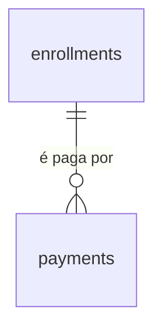

# Pagamentos

## Problem

O sistema sabe quem é aluno e por qual período ele está matriculado, e não sabe se pagou. A matrícula guarda o valor do período (`price_cents`, AD-059) e nada diz se esse valor entrou no caixa. Quem responde "este aluno está em dia?" ou "quem deve este mês?" é o Financeiro, abrindo outro arquivo - a mesma planilha que o PRD §1.2 aponta como o problema. Quem paga é a academia, que não vê o atraso até alguém lembrar de procurá-lo, e o aluno, cobrado de memória: sem um registro, a conversa no balcão é "eu paguei" contra "não achei".

O PRD não traz número de alunos em atraso, ticket médio nem a taxa de inadimplência. O que ele fixa: RF-21 ("Registro manual de pagamentos e status (pago, pendente, atrasado). *Integração com gateway: fase 2.*"), a matriz do §2 (RH/Financeiro: "matrículas, pagamentos"), `payments` (`id, enrollment_id, amount, due_date, paid_at, status, method`) no §6, `GET/POST /payments` no §7, a tela 4 (ficha do aluno: "pagamentos") do §8 e a decisão do §13.3 de só controle manual no MVP. Ele não diz como se registra um pagamento, se pode ser parcial, de quando é o vencimento, nem quem pode ver o que um aluno deve.

Quando isto entrar: o Financeiro abre a ficha de um aluno, vê para cada período se está pago, pendente ou atrasado e, recebido o dinheiro, aciona "Confirmar pagamento" naquele período e confirma num diálogo; um engano se desfaz com a mesma confirmação. Numa tela `Pagamentos` ele vê, de todos os alunos, o que está pendente ou atrasado, do mais antigo para o mais novo. A situação é sempre a do dia em que alguém olha, e cada confirmação ou desfazimento aparece na tela de Auditoria com quem fez. A recepção não vê o que o aluno deve.

Esta versão é a simples, por decisão do usuário em 2026-10-09: pagar é uma ação com confirmação de um funcionário com permissão, sobre o período inteiro, sem valor digitado, sem parcial e sem forma de pagamento. A versão anterior deste plano (valor, data e forma, pagamento parcial, saldo e anulação) está guardada em `v1-parcial/` e não vale.

## Flow

Reutiliza a guarda por perfil (`apps/api/src/access.ts`), o `ValidationInterceptor` com `@Input` e `@Output`, o `ProblemFilter`, `audit.record` com `diffOf` e `@Actor`, a trava de linha com `FOR UPDATE` que `StudentEnrollmentsService` e `consents` já usam, `saoPauloToday` de `packages/contracts`, o par `enrollmentStatus`/`enrollmentEndsAt` de `plans.ts` como molde da conta calculada e, no web, o `Shell`, o `fetchApi`, o `proxy.ts`, a página renderizada no servidor de `/plans`, o bloco da ficha no molde de `EnrollmentsBlock`, `formatPrice` de `apps/web/src/lib/plans.ts`: nenhuma rota nova ganha guarda, erro, validação, auditoria ou layout próprio. O que não existe e esta feature cria: a tabela `payments` e a conta da situação de pagamento.

**Confirmar e desfazer (`POST` e `DELETE` em `/api/students/:id/payments`)**

1. `POST /api/students/:id/payments`, `DELETE /api/students/:id/payments/:paymentId` -> `apps/web` (exists) repassa -> checagem de origem (exists) -> `AccessGuard` (exists): `admin` e `hr_finance`
2. `ValidationInterceptor` (exists) - valida `enrollmentId` pelo schema de `packages/contracts` (exists)
3. módulo de pagamentos em `apps/api` (new, no door - placement per conventions) - abre a transação, trava a linha do período em `enrollments` (exists) com `FOR UPDATE` no `POST`, e insere em `payments` (door 1) ou preenche `voided_at`; a unicidade de uma confirmação viva por período é do índice da door 1
4. `audit.record(tx, ...)` (exists) - grava a linha com a ação da door 3 na mesma transação; se o insert falha, a transação desfaz
5. out: `201` ou `204`; `409` com `enrollment_cancelled` ou `payment_already_confirmed`; `500` sem nada gravado

**Ler a situação (`GET /api/students/:id/payments` e `GET /api/payments`)**

1. `GET /api/students/:id/payments` e `GET /api/payments` -> repasse, checagem de origem e `AccessGuard` (exists): `admin` e `hr_finance`
2. módulo de pagamentos (new, no door) - lê `enrollments` (exists) com `payments` (door 1) e `plans` (exists) para o nome atual, e chama a conta única de `packages/contracts` (door 2) com o dia de hoje: nem o filtro por situação da lista geral nem a ficha refazem a conta em SQL
3. out: `200`; a leitura não grava na trilha

**Telas**

1. navegador `GET /payments` -> `proxy.ts` (exists) exige sessão -> página renderizada no servidor chama `GET /api/payments` por `fetchApi` (exists) e monta dentro do `Shell` (exists), que ganha o link "Pagamentos" para `admin` e `hr_finance`
2. ficha `/students/<id>` (exists) - para `admin` e `hr_finance`, passa a chamar `GET /api/students/:id/payments` por `fetchApi` (exists) e monta o bloco "Pagamentos" abaixo do de matrículas
3. diálogos de confirmar e de desfazer -> `POST|DELETE` pelo repasse de `/api/*` (exists)
4. `/audit` (exists) - passa a nomear as duas ações novas

## Impact

| Front | What changes |
| --- | --- |
| domain | novo termo: `payment` (pagamento) - a confirmação, feita à mão por um funcionário, de que o valor de um período entrou no caixa. Não carrega valor, dia nem forma: o valor é o `priceCents` do período. Nome da tabela, das rotas (PRD §6 e §7) e das ações da trilha. Vão ramificar nele: `dashboard`, `privacidade` (trata `payments` antes de `enrollments`, e `enrollments` antes do aluno) |
| domain | novo termo: situação de pagamento do período - `paid`, `pending`, `overdue`, `cancelled`, calculada na leitura (door 2). É o quinto "status" do sistema, ao lado do de aluno, funcionário, plano e matrícula, e como o da matrícula não é coluna |
| domain | `vencimento` passa a ter dois sentidos: em `planos-matriculas` é `endsAt`, o último dia coberto (AC 73 de lá); aqui o dia até o qual se paga é `dueDate`, igual a `startsAt`, e a tela o chama de "Pagar até". Quem ramifica em "vencimento" hoje: a coluna "Vencimento" do bloco "Matrículas" e, depois, o `dashboard` ("vencimentos próximos", §8 tela 2), que lê `endsAt` e não `dueDate` |
| domain | termos do PRD que mudam: `payments.amount`, `payments.method`, `payments.paid_at`, `payments.status` e `payments.due_date` não são criados (o valor é o do período, a data é a de `created_at` e a situação é a door 2); `payments` não tem `student_id` (AD-060) |
| contrato | dois códigos de erro `409` novos: `enrollment_cancelled` e `payment_already_confirmed` |
| contrato | `AUDIT_ACTIONS` ganha dois valores (door 3), de 36 para 38. `ACTION_LABELS` de `apps/web/src/lib/audit.ts` é um `Record<AuditAction, string>`: o typecheck falha até a tela ter o rótulo de cada um; `FIELD_LABELS` e `valueLabel` não ganham nada, porque `startsAt` e `priceCents` já têm rótulo e formato |
| checks de outra feature | `apps/web/e2e/audit.spec.ts` fixa 36 ações em sete pontos e a lista `LABELS`; passam a 38, com os dois `slice(31)` da linha 755 e 756 em `slice(31, 36)`. Já foi feito no batch A da versão anterior, com os rótulos `Pagamento registrado` e `Pagamento anulado`, que esta versão troca por `Pagamento confirmado` e `Pagamento desfeito` |
| comportamento existente | `DELETE /api/students/:id/enrollments/:enrollmentId` continua mexendo só em `enrollments`: cancelar um período não apaga nem desfaz a confirmação dele. Nenhuma rota existente muda de assinatura; `GET /api/students/:id/enrollments` e `enrollmentSchema` não ganham chave |
| web | o menu do `Shell` ganha "Pagamentos" para `admin` e `hr_finance`; `apps/web/e2e/shell.spec.ts` confere o menu por perfil |
| web | a ficha do aluno faz mais uma chamada por renderização para dois perfis (`admin` e `hr_finance`); recepção e Instrutor continuam sem nenhuma além das de hoje |
| web | `/audit` mostra as duas ações novas pelo `Alvo` que já resolve (`student`); nenhuma resolução nova de entidade |
| portão | as quatro rotas novas entram na regra de `paths` do OpenAPI e nos 70% de cobertura de `apps/api/src`, sem mudança no portão |
| ambiente | nenhuma variável nova e nenhuma extensão: a migração `0009` cria só `payments` |
| stored data | a migração `0009` cria `payments` vazia e não toca tabela existente. Todo período que já existe quando ela entra nasce sem confirmação: um período vencido aparece como `overdue`. O sistema não importa o histórico de quem pagou antes dele; o Financeiro confirma pela ficha |
| stored data | a `0009` da versão anterior (commit `0e44fde`, com valor, data e forma) nunca foi enviada nem aplicada fora dos bancos de teste: é reescrita no lugar, sem uma `0010` que a desfaça |
| stored data | `payments` tem chave estrangeira para `enrollments`, sem `ON DELETE`: a exclusão definitiva da `privacidade` terá de tratar `payments` antes de `enrollments`, e um pagamento nunca é apagado pela API, só desfeito |
| stored data | a situação muda sozinha à meia-noite de `America/Sao_Paulo` sem que nenhuma linha mude: quem guardar a situação em outro lugar (um cache, uma coluna do `dashboard`) guarda um valor que envelhece |
| código do batch A | os commits `0e44fde`, `f00f602` e `c66f77d` (tabela, contrato, conta e as quatro rotas da versão anterior) são adaptados a este plano: saem o valor, o saldo, a data, a forma, o teto da soma, `payment_exceeds_balance` e a trava de soma; ficam a tabela, a trava do período, a trilha e as rotas |
| `.specs` | aprovado o plano, as doors 1 a 3 viram AD-067 a AD-069 em `STATE.md` e as AD-064 a AD-066 passam a `superseded by`; a linha 10 do `ROADMAP.md` registra o estado; `checks.md` é reescrito |

## Relations

One-way constraints: cada pagamento aponta para exatamente um período, sem exclusão em cascata e sem apontar para o aluno (door 1); um período tem no máximo um pagamento vivo, isto é, não desfeito (door 1); desfazer é a única coisa que muda num pagamento, uma vez (door 1); nem a situação de pagamento nem o vencimento da cobrança são guardados (door 2). O aluno chega ao pagamento pelo período. O autor de cada mudança está em `audit_logs`, que aponta para o aluno por `entity_id`, sem chave estrangeira. Nomes das demais colunas e índices de leitura ficam para o diff.

## Surface

Só rotas novas. Toda rota também pode responder com a linha de erro comum da `auth-rbac`. Nenhuma rota existente muda de assinatura.

| Route | In | Out | Status |
| --- | --- | --- | --- |
| `GET /api/students/:id/payments` | nada | `items[]`, um por período do aluno: `enrollmentId` · `plan` (`id` · `name` · `period`) · `startsAt` · `endsAt` · `dueDate` · `priceCents` · `status` · `payment` (`id` · `createdAt`, ou `null` sem confirmação viva) | `200`, `401`, `403`, `404` |
| `POST /api/students/:id/payments` | `enrollmentId` | o pagamento: `id` · `enrollmentId` · `createdAt` | `201`, `401`, `403`, `404`, `409`, `422` |
| `DELETE /api/students/:id/payments/:paymentId` | nada | nada | `204`, `401`, `403`, `404` |
| `GET /api/payments` | query opcional: `status` (`pending` ou `overdue`) | `items[]`, um por período não cancelado e sem confirmação viva: `enrollmentId` · `student` (`id` · `name`) · `plan` (`id` · `name` · `period`) · `startsAt` · `endsAt` · `dueDate` · `priceCents` · `status` | `200`, `401`, `403`, `422` |

## Landing

| One-way door | Literal shape | Alternative rejected |
| --- | --- | --- |
| 1. tabela `payments`: a confirmação de que um período foi pago, uma linha por confirmação | migração `0009` (AD-008); `id uuid DEFAULT uuidv7()`; `enrollment_id uuid NOT NULL REFERENCES enrollments(id)` sem `ON DELETE`; `created_at timestamptz DEFAULT now() NOT NULL`, o instante da confirmação; `voided_at timestamptz` anulável, a única coluna que muda, de nula para um instante, uma vez; `CREATE UNIQUE INDEX payments_one_alive_idx ON payments (enrollment_id) WHERE voided_at IS NULL`; sem valor, sem forma, sem data de pagamento, sem `status`, sem `due_date`, sem `student_id` e sem `tenant_id` (AD-016); nenhuma rota edita ou apaga uma linha: desfazer preenche `voided_at` e confirmar de novo insere outra linha. Fecha: pagamento parcial, parcelas e forma de pagamento ficam fora; entrar com eles é coluna nova por migração, com o valor do período como preenchimento de quem já foi confirmado (Out of scope) | coluna `paid_at` em `enrollments` - a AD-060 faz de `cancelled_at` a única coluna que muda, e desfazer perderia a linha e o instante da confirmação desfeita. `UNIQUE (enrollment_id)` simples - proibiria confirmar de novo depois de desfazer. Tabela com `amount_cents`, `paid_at` e `method` e saldo calculado (a versão anterior deste plano, `v1-parcial/`) - o usuário pediu o pagamento simples; o valor de um período pago já está em `enrollments.price_cents`. `status` guardado (PRD §6) - "atrasado" precisaria de algo que o virasse à meia-noite, o motivo da AD-061 |
| 2. situação de pagamento calculada | `dueDate = startsAt`; `status`: `cancelled` se `cancelled_at` do período está preenchido; senão `paid` se há uma linha de `payments` do período com `voided_at` nulo; senão `overdue` se hoje > `dueDate`; senão `pending`; hoje é o dia em `America/Sao_Paulo` (`saoPauloToday`), sem dias de carência. Uma definição só, em `packages/contracts`, ao lado de `enrollmentStatus`; a lista e a ficha a chamam, nenhuma refaz a conta em SQL. Fecha: `dashboard` e `check-in` ramificam nos quatro valores; `check-in` que bloqueie por atraso lê `status`, não recalcula | coluna `status` ou `due_date` guardadas - duas fontes para a mesma pergunta (AD-030, AD-061). `overdue` por fim do período (`endsAt`) - o aluno que não pagou o mês estaria "pendente" durante todo o mês que já usa. Período de valor zero `paid` sozinho - um caminho a mais na conta para um caso que a confirmação de um clique já resolve |
| 3. ações e campos registráveis de pagamento | em `AUDIT_ACTIONS` (AD-025), depois das trinta e seis existentes, nesta ordem: `student.payment_confirmed`, `student.payment_undone`; `entity` igual a `student` e `entity_id` igual ao id do aluno; campos registráveis (AD-026): `startsAt` e `priceCents` do período, com `from: null` na confirmação e `to: null` no desfazimento, a forma da AD-063; nome e CPF do aluno não entram na linha | `entity` igual a `payment` - esconderia o pagamento do histórico do aluno e do link "Ver aluno", o que as AD-039, AD-045 e AD-063 já recusaram. Uma ação só para confirmar e desfazer - o filtro "Ação" não distinguiria um do outro. `enrollmentId` no `diff` - exigiria um rótulo novo e mostraria um uuid em "Detalhes"; os períodos não cancelados de um aluno não se sobrepõem (AD-062), então o início identifica o período |

- Nothing else in this change is hard to reverse

## Criteria

### S1: Confirmar o pagamento de um período (P1)

O Financeiro confirma que o aluno pagou um período, sem digitar valor.

**Acceptance Criteria**

1. WHEN um usuário de perfil `admin` ou `hr_finance` chama `POST /api/students/:id/payments` com o `enrollmentId` de um período não cancelado desse aluno e sem confirmação viva THEN the system SHALL responder `201` com `id`, `enrollmentId` e `createdAt` do banco, e o período passar a ter uma linha em `payments` com `voided_at` nulo
2. IF `enrollmentId` falta, não é um `uuid` ou não pertence a nenhum período do aluno de `:id` THEN the system SHALL responder `422` com um item em `errors` cujo `path` é `enrollmentId`, sem gravar pagamento
3. IF o período de `enrollmentId` está cancelado THEN the system SHALL responder `409` com `code` igual a `enrollment_cancelled`, sem gravar pagamento
4. IF o período de `enrollmentId` já tem uma confirmação viva THEN the system SHALL responder `409` com `code` igual a `payment_already_confirmed`, sem gravar pagamento
5. WHEN o período está agendado, ativo ou vencido THEN the system SHALL aceitar a confirmação do mesmo modo nos três casos
6. WHEN o aluno tem `status` igual a `inactive` ou `suspended` THEN the system SHALL aceitar a confirmação como para um aluno `active`
7. IF dois `POST /api/students/:id/payments` do mesmo período chegam ao mesmo tempo THEN the system SHALL responder `201` a exatamente um e `409` com `payment_already_confirmed` ao outro
8. IF um `INSERT` em `payments` traz um `enrollment_id` que não existe THEN the system SHALL falhar a instrução sem gravar a linha
9. IF um `INSERT` em `payments` traz um `enrollment_id` que já tem uma linha com `voided_at` nulo THEN the system SHALL falhar a instrução sem gravar a linha
10. IF `:id` de qualquer uma das três rotas `/api/students/:id/payments*` não é um `uuid` ou não pertence a aluno nenhum THEN the system SHALL responder `404` com `code` igual a `not_found`
11. IF um usuário de perfil `reception` ou `instructor` chama qualquer uma das quatro rotas novas, com ids que existem ou não THEN the system SHALL responder `403` com `code` igual a `forbidden`, sem nenhum campo de pagamento no corpo e sem gravar nada
12. IF qualquer uma das quatro rotas novas é chamada sem sessão THEN the system SHALL responder `401` com `code` igual a `unauthorized`

**Independent test:** como RH/Financeiro, confirmar o pagamento de um período de R$ 99,90, ver o período pago, tentar confirmar de novo e receber `409`.

### S2: Desfazer a confirmação (P1)

Corrigir um engano: a linha fica, o período volta a dever.

**Acceptance Criteria**

13. WHEN um usuário de perfil `admin` ou `hr_finance` chama `DELETE /api/students/:id/payments/:paymentId` de um pagamento vivo THEN the system SHALL responder `204`, preencher `voidedAt` com o instante do banco, manter a linha e não mudar nenhuma outra coluna dela
14. IF `DELETE /api/students/:id/payments/:paymentId` atinge um pagamento já desfeito THEN the system SHALL responder `204` sem alterar `voidedAt`
15. WHEN uma confirmação é desfeita THEN the system SHALL aceitar um novo `POST` para o mesmo período
16. WHEN o período do pagamento está cancelado THEN the system SHALL aceitar o desfazimento do mesmo modo
17. IF `:paymentId` não é um `uuid` ou não pertence àquele aluno THEN the system SHALL responder `404` com `code` igual a `not_found`
18. IF dois `DELETE` do mesmo pagamento chegam ao mesmo tempo THEN the system SHALL responder `204` aos dois e gravar um `voidedAt` e uma linha de trilha só

**Independent test:** desfazer a confirmação do S1, conferir pelo `psql` que a linha continua lá com `voided_at` e confirmar o mesmo período de novo.

### S3: Ver a situação de um aluno (P1)

Para cada período do aluno: quanto vale e se está pago, pendente ou atrasado.

**Acceptance Criteria**

19. WHEN um usuário de perfil `admin` ou `hr_finance` chama `GET /api/students/:id/payments` THEN the system SHALL responder `200` com um item em `items` para cada período do aluno, cancelados inclusive, em ordem de `startsAt` da mais recente para a mais antiga e, no empate, de `enrollmentId` decrescente, cada um com as chaves da Surface
20. The system SHALL calcular `dueDate` igual a `startsAt` e devolver em `status` o valor `cancelled` quando o período está cancelado e, nos demais casos, `paid` quando há uma confirmação viva, `overdue` quando o dia corrente em `America/Sao_Paulo` é posterior a `dueDate` e `pending` quando é o próprio `dueDate` ou anterior
21. The system SHALL devolver em `payment` o `id` e o `createdAt` da confirmação viva do período e `null` quando não há: uma confirmação desfeita não aparece
22. WHEN o aluno não tem período THEN the system SHALL responder `200` com `items` igual a `[]`
23. WHEN o plano de um período foi renomeado depois dele THEN the system SHALL devolver em `plan.name` o nome atual do plano e `priceCents` como foi gravado no período
24. WHEN um período com confirmação é cancelado THEN the system SHALL continuar a devolver `payment` e `status` igual a `cancelled`

**Independent test:** com um período pago, um pendente de hoje, um atrasado e um cancelado, ler a lista e conferir o `status` de cada um.

### S4: Ver o que está pendente ou atrasado (P1)

A lista do Financeiro: de todos os alunos, o que ainda falta pagar.

**Acceptance Criteria**

25. WHEN um usuário de perfil `admin` ou `hr_finance` chama `GET /api/payments` THEN the system SHALL responder `200` com um item em `items` para cada período não cancelado e sem confirmação viva, de aluno de qualquer `status`, em ordem de `dueDate` crescente e, no empate, de `enrollmentId` crescente, cada um com as chaves da Surface e `status` igual a `pending` ou `overdue`
26. WHEN `GET /api/payments` recebe `status` igual a `pending` ou a `overdue` THEN the system SHALL devolver só os itens daquela situação
27. IF `status` tem qualquer outro valor, vazio ou repetido THEN the system SHALL responder `422` com `code` igual a `validation_failed` e um item em `errors` cujo `path` é `status`
28. The system SHALL deixar fora de `GET /api/payments` o período cancelado e o de confirmação viva
29. WHEN nenhum período falta pagar THEN the system SHALL responder `200` com `items` igual a `[]`
30. The system SHALL devolver, para o mesmo período no mesmo instante, o mesmo `status` em `GET /api/payments` e em `GET /api/students/:id/payments`
31. WHEN `GET /api/payments` ou `GET /api/students/:id/payments` responde `200` THEN the system SHALL não gravar linha em `audit_logs`

**Independent test:** com dois alunos devendo, um atrasado há dez dias e outro com vencimento hoje, ler a lista e ver o atrasado primeiro; filtrar por `overdue` e ver só ele.

### S5: Cada escrita deixa rastro, na mesma transação (P1)

Uma linha por pagamento confirmado ou desfeito, com o início e o valor do período e sem dado pessoal (AD-025 a AD-027).

**Acceptance Criteria**

32. WHEN `POST /api/students/:id/payments` responde `201` THEN the system SHALL ter gravado exatamente uma linha em `audit_logs` com `action` igual a `student.payment_confirmed`, `user_id` igual ao id do autor, `entity` igual a `student` e `entity_id` igual ao id do aluno
33. WHEN o período confirmado começa em `2026-10-07` e vale `9990` THEN the system SHALL gravar `diff` igual a `{"fields":["startsAt","priceCents"],"values":{"startsAt":{"from":null,"to":"2026-10-07"},"priceCents":{"from":null,"to":9990}}}`
34. WHEN `DELETE /api/students/:id/payments/:paymentId` desfaz um pagamento THEN the system SHALL ter gravado exatamente uma linha com `action` igual a `student.payment_undone`, `user_id` do autor, `entity` igual a `student`, `entity_id` igual ao id do aluno e `diff` com os mesmos dois campos, cada um com o valor do período em `from` e `null` em `to`
35. IF uma requisição às rotas novas termina com `401`, `403`, `404`, `409` ou `422`, ou é o `DELETE` da AC 14 THEN the system SHALL deixar `audit_logs` com o mesmo número de linhas de antes
36. IF o insert em `audit_logs` falha durante `POST` ou `DELETE /api/students/:id/payments*` THEN the system SHALL responder `500` e deixar `payments` como estava antes da requisição
37. WHEN uma ação de pagamento é gravada THEN the system SHALL preencher `ip` e `user_agent` da linha pelas mesmas regras das AC 29 a 32 da `auditoria`
38. The system SHALL manter fora de toda coluna de `audit_logs` o nome e o CPF do aluno

**Independent test:** confirmar e desfazer um pagamento como RH/Financeiro; ler `audit_logs` e encontrar duas linhas com o id do autor e o id do aluno.

### S6: Telas de pagamentos (P1)

O bloco "Pagamentos" na ficha e a tela `Pagamentos` para quem cuida do financeiro, em pt-BR.

**Acceptance Criteria**

39. The system SHALL exibir o link "Pagamentos" no menu apenas para os perfis `admin` e `hr_finance`
40. WHEN alguém sem sessão abre `/payments` THEN the system SHALL redirecionar para `/login`
41. IF um usuário de perfil `reception` ou `instructor` abre `/payments` THEN the system SHALL exibir "Você não tem permissão para acessar esta página." sem nenhum dado de pagamento
42. WHEN um usuário de perfil `admin` ou `hr_finance` abre `/payments` THEN the system SHALL exibir o título "Pagamentos", o campo "Situação" com as opções "Todas", "Pendente" e "Atrasado" e uma tabela com as colunas "Aluno", "Plano", "Período", "Pagar até", "Valor" e "Situação", na ordem que a API devolve
43. The system SHALL exibir o nome do aluno como link para `/students/<id>`, as datas como `dd/MM/aaaa`, o período como `dd/MM/aaaa a dd/MM/aaaa`, o valor em reais como `R$ 1.234,56`, a situação como "Pendente" ou "Atrasado" e o plano como `<nome> · <periodicidade>`
44. WHEN o usuário escolhe uma opção em "Situação" THEN the system SHALL carregar `/payments?status=pending` ou `/payments?status=overdue` e exibir só aquela situação, e `/payments` sem a query para "Todas"
45. IF não existe período que falte pagar na situação escolhida THEN the system SHALL exibir "Nenhum pagamento pendente ou atrasado." no lugar da tabela
46. IF a lista não carrega THEN the system SHALL exibir "Não foi possível carregar os pagamentos." e o botão "Tentar novamente"
47. WHEN um usuário de perfil `admin` ou `hr_finance` abre `/students/<id>` THEN the system SHALL exibir o bloco "Pagamentos" com uma tabela de colunas "Período", "Pagar até", "Valor" e "Situação", na ordem que a API devolve, com a situação como "Pago", "Pendente", "Atrasado" ou "Matrícula cancelada"
48. IF o aluno não tem período THEN the system SHALL exibir "Nenhum período para cobrar." no lugar da tabela
49. IF o bloco não carrega THEN the system SHALL exibir "Não foi possível carregar os pagamentos." e o botão "Tentar novamente", sem esconder o restante da ficha
50. WHEN um usuário de perfil `reception` ou `instructor` abre `/students/<id>` THEN the system SHALL não exibir o bloco "Pagamentos" nem chamar a API de pagamentos
51. WHERE o período não está cancelado e não tem confirmação viva the system SHALL exibir nele o botão "Confirmar pagamento"
52. WHEN o usuário aciona "Confirmar pagamento" THEN the system SHALL abrir um diálogo que nomeia o aluno, o período `dd/MM/aaaa a dd/MM/aaaa` e o valor, com o botão "Confirmar", e só enviar a requisição depois dele
53. WHEN o pagamento é confirmado THEN the system SHALL fechar o diálogo e exibir o período como "Pago", sem o botão "Confirmar pagamento"
54. IF a API responde `409` com `enrollment_cancelled` ou `payment_already_confirmed` THEN the system SHALL exibir no diálogo "Esta matrícula foi cancelada." ou "Este período já está pago."
55. WHERE o período tem confirmação viva the system SHALL exibir nele o botão "Desfazer pagamento"
56. WHEN o usuário aciona "Desfazer pagamento" THEN the system SHALL pedir confirmação num diálogo que nomeia o aluno, o período e o valor antes de enviar a requisição, e exibir o período como "Pendente" ou "Atrasado" quando a resposta é `204`

**Independent test:** subir a stack, entrar como RH/Financeiro, abrir a ficha de um aluno matriculado, confirmar o pagamento e ver "Pago", abrir `/payments` e não achar o período, desfazer e achá-lo; entrar como recepção e como instrutor e não ver o bloco nem o menu.

### S7: A trilha de pagamento na tela de Auditoria (P2)

O Administrador lê as duas ações novas por extenso e chega ao aluno.

**Acceptance Criteria**

57. The system SHALL exibir em `/audit` as ações novas por extenso - "Pagamento confirmado" e "Pagamento desfeito" - e oferecê-las no filtro "Ação", nessa ordem, depois das trinta e seis existentes
58. WHEN a linha é `student.payment_confirmed` com o `diff` da AC 33 THEN the system SHALL exibir em "Detalhes" os textos "Início: — → 07/10/2026" e "Valor: — → R$ 99,90", e em "Alvo" o link "Ver aluno" que já existe
59. WHEN a linha é `student.payment_undone` com o `diff` da AC 34 THEN the system SHALL exibir em "Detalhes" os textos "Início: 07/10/2026 → —" e "Valor: R$ 99,90 → —"

**Independent test:** confirmar e desfazer um pagamento como RH/Financeiro, abrir "Auditoria" como administrador, filtrar por "Pagamento desfeito", ler o valor e seguir "Ver aluno".

## Out of scope

Product capabilities only. Process and harness rules live in AGENTS.md or as Observable `n/a`.

| Excluded | Why |
| --- | --- |
| Valor digitado, pagamento parcial, parcelas com vencimento próprio e saldo | decisão do usuário em 2026-10-09: pagamento simples, que quita o período inteiro; a versão com saldo está em `v1-parcial/` |
| Forma de pagamento (dinheiro, Pix, cartão) e data do pagamento informada | idem; a data é a de `created_at`, e entrar com a forma é coluna nova por migração (door 1) |
| Gateway, Pix ou cartão integrados, conciliação com o extrato | RF-21 e PRD §13.3: só registro manual no MVP; integração é fase 2 |
| Desconto, taxa de matrícula, juros, multa e dias de carência | o valor devido é o `priceCents` do período; desconto é um plano de outro preço; carência vira constante ou configuração (RF-30) |
| Reembolso e devolução no cancelamento da matrícula | cancelar não mexe nos pagamentos (AC 24); a devolução do dinheiro acontece fora do sistema, e "desfazer" corrige uma confirmação errada |
| Editar um pagamento | desfazer e confirmar de novo (door 1); uma linha que muda deixaria a trilha com um valor que não existe mais |
| Recibo, comprovante em PDF e e-mail de cobrança | o PRD não pede; notificações são fase 2 (§10) |
| Aviso de atraso por e-mail ou WhatsApp, e bloqueio do check-in por atraso | notificações são fase 2; o bloqueio é do `check-in`, que lerá `status` (door 2) |
| Receita do mês, totais, gráficos e relatórios financeiros | §8 tela 2 e "relatórios avançados" (fase 2); a lista mostra o valor de cada período, sem soma |
| Busca, filtro por aluno, plano ou data e paginação na tela `Pagamentos` | a lista só filtra por situação (AC 26); com dezenas de períodos em aberto, ordenar por vencimento basta (Assumptions) |
| Recepção ou Instrutor verem ou confirmarem o que o aluno deve | PRD §2 dá "pagamentos" ao RH/Financeiro; a situação da matrícula, que a recepção já lê, não traz valores |
| Permissão de pagamento por funcionário (uma chave que o Administrador liga em cada usuário) | seria uma feature de permissões; o corte por perfil da `auth-rbac` já responde "funcionário com permissão" (Assumptions) |
| Cobrança ou lançamento avulso sem período (mensalidade fora de plano, venda de produto) | `payments` aponta para o período (AD-060); o que não é de um plano não tem onde pousar |
| Importar o histórico de pagamentos de planilha | o PRD não pede; o Financeiro confirma pela ficha |
| Exportar, anonimizar ou apagar os pagamentos de um titular | RF-28 e RF-29, feature `privacidade` |

## Assumptions

| Assumption | Chosen default | Rationale | Confirmed? |
| --- | --- | --- | --- |
| Como se paga | uma ação com confirmação sobre o período inteiro, que se desfaz com outra confirmação; sem valor, sem forma e sem parcial | o usuário escolheu "marcar período como pago" em 2026-10-09 | y |
| Quem confirma e desfaz | `admin` e `hr_finance`, os perfis que o PRD §2 já liga a "pagamentos"; `reception` e `instructor` recebem `403` nas quatro rotas | o usuário escolheu manter os perfis de hoje em 2026-10-09; "funcionário com permissão" é o corte por perfil da `auth-rbac`. Custo: a recepção não responde "ele está em dia?" no balcão | y |
| De quando é a cobrança | o início do período: `dueDate = startsAt`; paga-se até esse dia, e no dia seguinte, sem confirmação, é `overdue` (door 2) | o período é pago adiantado, como a mensalidade de academia; sem carência o atraso é o que o balcão vê; respondida no padrão recomendado na revisão de 2026-10-08 | y |
| O que o aluno deve | o `priceCents` do período, o valor copiado do plano no insert (AD-060); nada além | desconto, taxa e juros são fora do escopo; quem paga menos tem plano de outro preço | y |
| Período de valor zero | segue a regra comum: fica `pending` ou `overdue` até alguém confirmar | um caminho a mais na conta (door 2, alternativa rejeitada) para um caso que um clique resolve | y |
| Data do pagamento | o dia de `created_at` da confirmação, que a trilha também guarda; a tela não a mostra | o usuário pediu o simples; quem precisar do dia exato lê a Auditoria | y |
| Período cancelado | recusa confirmação nova (AC 3) e mantém a já lançada (AC 24); sai da lista de pendências e fica na ficha como "Matrícula cancelada" | quem foi cancelado não deve; a devolução é fora do sistema | y |
| Aluno inativo | os períodos dele seguem na lista e aceitam confirmação (AC 6, AC 25) | inativar é o soft delete da RF-08 e não cancela matrícula (AC 44 de `planos-matriculas`); a dívida existe, e esconder o inativo da lista esconderia o inadimplente | y |
| Repetir a mesma requisição | o segundo `POST` do mesmo período é `409` `payment_already_confirmed`, pelo índice da door 1; o diálogo desabilita o botão enquanto aguarda | um pagamento por período é o que o modelo diz; não há como duplicar | y |
| O desfazimento é do pagamento | `DELETE` identifica o pagamento e a trilha identifica o período pelo início e pelo valor; dois períodos do mesmo aluno com o mesmo início só existem se um deles foi cancelado | os períodos não cancelados não se sobrepõem (AD-062); a ambiguidade tem de passar por um cancelamento e a linha ainda aponta para o aluno | y |
| Lista geral | todos os períodos que faltam pagar numa resposta só, sem paginação e sem busca; períodos vencidos e não pagos ficam nela até alguém confirmar ou cancelar a matrícula | a academia é de bairro: dezenas de períodos em aberto; a lista cresce com a dívida que existe, que é o que o Financeiro quer ver | y |
| Leitura na trilha | os `GET` não gravam (AC 31) | a RF-24 só manda registrar visualização de dados de funcionários | y |
| Formato do valor na tela | o que `formatPrice` de `apps/web/src/lib/plans.ts` já emite | PRD §4 Idioma; uma definição de moeda no repositório | y |
| Meta de desempenho (PRD §4) | não é critério | um percentil não se prova numa execução | y |
| Pendências sem dono do Handoff | nenhuma entra aqui | as da `foto-captura`, da `fundacao` e as F3 a F12 de `planos-matriculas` são de outras features | y |

**Open questions:** none - all resolved or logged above.

## Observable

Worksheet, not the review. `n/a` needs its reason. One row may group the same decision across several routes.

| Surface | Decision | Landing |
| --- | --- | --- |
| screen `/payments` | empty state | AC 45 |
| screen `/payments` | loading state | n/a - página renderizada no servidor, como `/plans`: só sai com os dados ou com a AC 46 |
| screen `/payments` | error state | AC 46 |
| screen `/payments` | unauthorised state | AC 40, AC 41 |
| screen `/payments` | density and ordering | AC 42 - todos os períodos que faltam pagar numa página, do vencimento mais antigo ao mais novo (AC 25) |
| screen `/payments` | destructive action confirms | n/a - a tela só lê; confirmar e desfazer são da ficha |
| screen `/students/<id>`, bloco "Pagamentos" | empty state | AC 48 |
| screen `/students/<id>`, bloco "Pagamentos" | loading state | n/a - página renderizada no servidor; no diálogo, existing - o botão desabilitado enquanto aguarda, AC 56 da `auth-rbac` |
| screen `/students/<id>`, bloco "Pagamentos" | error state | AC 49, AC 54 |
| screen `/students/<id>`, bloco "Pagamentos" | unauthorised state | AC 50 |
| screen `/students/<id>`, bloco "Pagamentos" | density and ordering | AC 47 - o histórico inteiro, do período mais recente ao mais antigo (AC 19), sem paginação |
| screen `/students/<id>`, bloco "Pagamentos" | destructive action confirms | AC 52 e AC 56 - confirmar e desfazer passam por diálogo |
| screen `/audit` | naming of the new actions, target | AC 57, AC 58, AC 59 |
| screen `/` e demais, menu | unauthorised state | AC 39 |
| API `GET /api/students/:id/payments` e `GET /api/payments` | response shape | AC 19, AC 20, AC 21, AC 25 |
| API as quatro novas | error shape and codes | AC 2, AC 3, AC 4, AC 10, AC 11, AC 12, AC 17, AC 27 |
| API as quatro novas | who may call it | AC 11, AC 12 |
| API as quatro novas | versioning | n/a - o único consumidor é `apps/web`, versionado e implantado junto |
| API as quatro novas | rate limit | n/a - rotas só de usuário autenticado; limite por IP fica no proxy, em `operacao` |
| scheduled task | output, flags, exit codes, failure halfway | n/a - nenhuma tarefa: a situação é calculada na leitura (door 2), e nada precisa rodar à meia-noite |
| document `.env.example` | structure, what the reader does next | n/a - nenhuma variável nova |
| collection `payments` | grouping criterion | AC 19, AC 21 - agrupados por período; a situação é calculada, não é um grupo |
| collection `payments` | naming | AC 43, AC 47 - situação e formatos em pt-BR; AC 57 para as ações |
| collection `payments` | ordering | AC 19, AC 25 |
| collection `payments` | duplicates | AC 4, AC 7, AC 9 - uma confirmação viva por período, pelo índice; depois de desfeita, outra pode entrar (AC 15) |
| collection `payments` | the exception that does not fit | AC 3, AC 16, AC 24 - o período cancelado recusa confirmação nova e aceita desfazer a que já existe |

## Sources

- `PRD — Sistema de Gestão de Academia.md` §2, §3.5 (RF-21), §6 (`payments`), §7 (`/payments`), §8 tela 4, §13.3 - os campos do pagamento, quem cuida deles e o que o PRD deixa sem definir
- `.specs/STATE.md` AD-027, AD-029, AD-033, AD-059 a AD-063 e o Handoff, e `.specs/ROADMAP.md` (linha 10) - o que a feature herda: dinheiro em centavos, o pagamento aponta para o período, situação calculada, ação e `diff` da trilha, a forma do erro de query; AD-064 a AD-066 são as da versão anterior e passam a `superseded`
- decisão do usuário de 2026-10-09 (conversa): pagamento simples, uma ação com confirmação por funcionário com permissão, `admin` e `hr_finance`, período inteiro
- `.specs/features/planos-matriculas/plan.md` (Landing e Relations) e `apps/api/src/student-enrollments`, `packages/contracts/src/plans.ts` - o molde de rota aninhada no aluno, trava de linha, conta calculada e bloco da ficha que este plano copia
