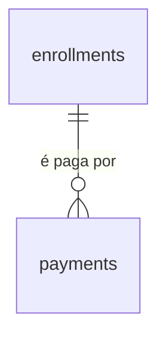

# Pagamentos

## Problem

O sistema sabe quem é aluno e por qual período ele está matriculado, e não sabe se pagou. A matrícula guarda o valor do período (`price_cents`, AD-059) e nada diz se esse valor entrou no caixa. Quem responde "este aluno está em dia?" ou "quem deve este mês?" é o Financeiro, abrindo outro arquivo - a mesma planilha que o PRD §1.2 aponta como o problema. Quem paga é a academia, que não vê o atraso até alguém lembrar de procurá-lo, e o aluno, cobrado de memória: sem um registro, a conversa no balcão é "eu paguei" contra "não achei".

O PRD não traz número de alunos em atraso, ticket médio nem a taxa de inadimplência. O que ele fixa: RF-21 ("Registro manual de pagamentos e status (pago, pendente, atrasado). *Integração com gateway: fase 2.*"), a matriz do §2 (RH/Financeiro: "matrículas, pagamentos"), `payments` (`id, enrollment_id, amount, due_date, paid_at, status, method`) no §6, `GET/POST /payments` no §7, a tela 4 (ficha do aluno: "pagamentos") do §8 e a decisão do §13.3 de só controle manual no MVP. Ele não diz que formas de pagamento existem, se o pagamento pode ser parcial, de quando é o vencimento de uma cobrança, nem quem pode ver o que um aluno deve.

Quando isto entrar: o Financeiro abre a ficha de um aluno, vê para cada período o valor, o que já foi pago, o saldo e se está pago, pendente ou atrasado, e registra o pagamento com valor, dia e forma; um engano se anula e se registra de novo; numa tela `Pagamentos` ele vê, de todos os alunos, o que está pendente ou atrasado, do mais antigo para o mais novo; a situação é sempre a do dia em que alguém olha, e cada pagamento registrado ou anulado aparece na tela de Auditoria. A recepção não vê o que o aluno deve.

## Flow

Reutiliza a guarda por perfil (`apps/api/src/access.ts`), o `ValidationInterceptor` com `@Input` e `@Output`, o `ProblemFilter`, `audit.record` com `diffOf` e `@Actor`, a trava de linha com `FOR UPDATE` que `StudentEnrollmentsService` já usa, `saoPauloToday` e `isRealDay` de `packages/contracts`, o par `enrollmentStatus`/`enrollmentEndsAt` de `plans.ts` como molde da conta calculada e, no web, o `Shell`, o `fetchApi`, o `proxy.ts`, a página renderizada no servidor de `/plans`, o bloco da ficha no molde de `EnrollmentsBlock`, `formatPrice` e `priceInputOf` de `apps/web/src/lib/plans.ts`: nenhuma rota nova ganha guarda, erro, validação, auditoria ou layout próprio. O que não existe e esta feature cria: a tabela `payments`, a conta do saldo e da situação de pagamento e o teto da soma de pagamentos de um período.

**Registrar e anular (`POST` e `DELETE` em `/api/students/:id/payments`)**

1. `POST /api/students/:id/payments`, `DELETE /api/students/:id/payments/:paymentId` -> `apps/web` (exists) repassa -> checagem de origem (exists) -> `AccessGuard` (exists): `admin` e `hr_finance`
2. `ValidationInterceptor` (exists) - valida `enrollmentId`, `amountCents`, `paidAt` e `method` pelo schema de `packages/contracts` (exists); o limite superior de `paidAt` é o dia de hoje em `America/Sao_Paulo`
3. módulo de pagamentos em `apps/api` (new, no door - placement per conventions) - abre a transação, trava a linha do período em `enrollments` (exists) com `FOR UPDATE` - a mesma trava serve ao registro e à anulação -, lê o que já foi pago em `payments` (door 1), confere o teto pela conta da door 2 e insere em `payments` (door 1) ou preenche `voided_at`
4. `audit.record(tx, ...)` (exists) - grava a linha com a ação da door 3 na mesma transação; se o insert falha, a transação desfaz
5. out: `201` ou `204`; `409` com `enrollment_cancelled` ou `payment_exceeds_balance`; `500` sem nada gravado

**Ler a situação (`GET /api/students/:id/payments` e `GET /api/payments`)**

1. `GET /api/students/:id/payments` e `GET /api/payments` -> repasse, checagem de origem e `AccessGuard` (exists): `admin` e `hr_finance`
2. módulo de pagamentos (new, no door) - lê `enrollments` (exists) com `payments` (door 1) e `plans` (exists) para o nome atual, e chama a conta única de `packages/contracts` (door 2) com o dia de hoje: nem o filtro por situação da lista geral nem a ficha refazem a conta em SQL
3. out: `200`; a leitura não grava na trilha

**Telas**

1. navegador `GET /payments` -> `proxy.ts` (exists) exige sessão -> página renderizada no servidor chama `GET /api/payments` por `fetchApi` (exists) e monta dentro do `Shell` (exists), que ganha o link "Pagamentos" para `admin` e `hr_finance`
2. ficha `/students/<id>` (exists) - para `admin` e `hr_finance`, passa a chamar `GET /api/students/:id/payments` por `fetchApi` (exists) e monta o bloco "Pagamentos" abaixo do de matrículas
3. diálogos de registrar e de anular -> `POST|DELETE` pelo repasse de `/api/*` (exists)
4. `/audit` (exists) - passa a nomear as duas ações novas

## Impact

| Front | What changes |
| --- | --- |
| domain | novo termo: `payment` (pagamento) - um valor **recebido**, registrado à mão, de um período: valor, dia e forma. Não é uma cobrança nem uma parcela: quem deve não tem linha nenhuma. Nome da tabela, das rotas (PRD §6 e §7) e da ação da trilha. Vão ramificar nele: `dashboard`, `privacidade` (trata `payments` antes de `enrollments`, e `enrollments` antes do aluno) |
| domain | novo termo: saldo (`balance`) e situação de pagamento do período - `paid`, `pending`, `overdue`, `cancelled`, calculados na leitura (door 2). É o quinto "status" do sistema, ao lado do de aluno, funcionário, plano e matrícula, e como o da matrícula não é coluna |
| domain | `vencimento` passa a ter dois sentidos: em `planos-matriculas` é `endsAt`, o último dia coberto (AC 73 de lá); aqui o dia até o qual se paga é `dueDate`, igual a `startsAt`, e a tela o chama de "Pagar até". Quem ramifica em "vencimento" hoje: a coluna "Vencimento" do bloco "Matrículas" e, depois, o `dashboard` ("vencimentos próximos", §8 tela 2), que lê `endsAt` e não `dueDate` |
| domain | termos do PRD que mudam: `payments.amount` vira `amount_cents` (o valor carrega a unidade, como `price_cents`, AD-059); `payments.status` e `payments.due_date` não são criados (door 2); `payments` não tem `student_id` (AD-060) |
| contrato | dois códigos de erro `409` novos: `enrollment_cancelled` e `payment_exceeds_balance` |
| contrato | `AUDIT_ACTIONS` ganha dois valores (door 3), de 36 para 38. `ACTION_LABELS` de `apps/web/src/lib/audit.ts` é um `Record<AuditAction, string>`: o typecheck falha até a tela ter o rótulo de cada um; `FIELD_LABELS` e `valueLabel` ganham `amountCents`, `paidAt` e `method` |
| checks de outra feature | `apps/web/e2e/audit.spec.ts` fixa 36 ações em sete pontos (linhas 142, 245, 497, 558, 581, 650 e 750); passam a 38. Na linha 750 o teste compara `slice(31)` com as cinco ações de plano e matrícula: passa a `slice(31, 36)`, e as duas novas ocupam as posições 37 e 38 |
| comportamento existente | `DELETE /api/students/:id/enrollments/:enrollmentId` continua mexendo só em `enrollments`: cancelar um período não apaga nem anula os pagamentos dele. Nenhuma rota existente muda de assinatura; `GET /api/students/:id/enrollments` e `enrollmentSchema` não ganham chave |
| web | o menu do `Shell` ganha "Pagamentos" para `admin` e `hr_finance`; `apps/web/e2e/shell.spec.ts` confere o menu por perfil |
| web | a ficha do aluno faz mais uma chamada por renderização para dois perfis (`admin` e `hr_finance`); recepção e Instrutor continuam sem nenhuma além das de hoje |
| web | `/audit` mostra as duas ações novas pelo `Alvo` que já resolve (`student`); nenhuma resolução nova de entidade |
| portão | as quatro rotas novas entram na regra de `paths` do OpenAPI e nos 70% de cobertura de `apps/api/src`, sem mudança no portão |
| ambiente | nenhuma variável nova e nenhuma extensão: a migração `0009` cria só `payments` |
| stored data | a migração `0009` cria `payments` vazia e não toca tabela existente. Todo período que já existe quando ela entra nasce com saldo igual ao valor: um período vencido sem pagamento lançado aparece como `overdue`. O sistema não importa o histórico de quem pagou antes dele; o Financeiro o lança pela ficha, com `paidAt` no passado (AC 3) |
| stored data | `payments` tem chave estrangeira para `enrollments`, sem `ON DELETE`: a exclusão definitiva da `privacidade` terá de tratar `payments` antes de `enrollments`, e um pagamento nunca é apagado pela API, só anulado |
| stored data | a situação muda sozinha à meia-noite de `America/Sao_Paulo` sem que nenhuma linha mude: quem guardar a situação em outro lugar (um cache, uma coluna do `dashboard`) guarda um valor que envelhece |
| `.specs` | aprovado o plano, as doors 1 a 3 viram AD-064 a AD-066 em `STATE.md`, e a linha 10 do `ROADMAP.md` registra o estado |

## Relations

One-way constraints: cada pagamento aponta para exatamente um período, sem exclusão em cascata e sem apontar para o aluno (door 1); um pagamento nunca tem valor zero nem negativo e a forma é uma de cinco (door 1); anular é a única coisa que muda num pagamento, uma vez (door 1); nem a situação de pagamento nem o vencimento da cobrança são guardados (door 2). O aluno chega ao pagamento pelo período. O autor de cada mudança está em `audit_logs`, que aponta para o aluno por `entity_id`, sem chave estrangeira. Nomes das demais colunas e índices de leitura ficam para o diff.

## Surface

Só rotas novas. Toda rota também pode responder com a linha de erro comum da `auth-rbac`. Nenhuma rota existente muda de assinatura.

| Route | In | Out | Status |
| --- | --- | --- | --- |
| `GET /api/students/:id/payments` | nada | `items[]`, um por período do aluno: `enrollmentId` · `plan` (`id` · `name` · `period`) · `startsAt` · `endsAt` · `dueDate` · `priceCents` · `paidCents` · `balanceCents` · `status` · `payments[]` (`id` · `amountCents` · `paidAt` · `method` · `createdAt` · `voidedAt`) | `200`, `401`, `403`, `404` |
| `POST /api/students/:id/payments` | `enrollmentId`, `amountCents`, `paidAt`, `method` | o pagamento, como um item de `payments[]` | `201`, `401`, `403`, `404`, `409`, `422` |
| `DELETE /api/students/:id/payments/:paymentId` | nada | nada | `204`, `401`, `403`, `404` |
| `GET /api/payments` | query opcional: `status` (`pending` ou `overdue`) | `items[]`, um por período com saldo: `enrollmentId` · `student` (`id` · `name`) · `plan` (`id` · `name` · `period`) · `startsAt` · `endsAt` · `dueDate` · `priceCents` · `paidCents` · `balanceCents` · `status` | `200`, `401`, `403`, `422` |

## Landing

| One-way door | Literal shape | Alternative rejected |
| --- | --- | --- |
| 1. tabela `payments`: dinheiro recebido, uma linha por pagamento | migração `0009` (AD-008); `id uuid DEFAULT uuidv7()`; `enrollment_id uuid NOT NULL REFERENCES enrollments(id)` sem `ON DELETE`; `amount_cents integer NOT NULL CHECK (amount_cents > 0)` (AD-059); `paid_at date NOT NULL`, o dia em que o dinheiro entrou; `method text NOT NULL CHECK (method in ('cash', 'pix', 'debit_card', 'credit_card', 'bank_transfer'))`; `created_at timestamptz DEFAULT now()`; `voided_at timestamptz` anulável, a única coluna que muda, de nula para um instante, uma vez; sem `status`, sem `due_date`, sem `student_id`, sem `UNIQUE` além da chave e sem `tenant_id` (AD-016); nenhuma rota edita ou apaga uma linha: corrigir é anular e registrar outra. Forma nova é valor novo no `CHECK`, por migração | `status` guardado (PRD §6) - "atrasado" precisaria de algo que o virasse à meia-noite, o motivo da AD-061. `due_date` e uma linha de cobrança sem `paid_at`, criada por alguém ao matricular - quem esquecer de criá-la deixa o período invisível no "pendente", a falha que a lista existe para evitar, e criá-la sozinho na matrícula obrigaria `planos-matriculas`, verificada, a gravar em `payments`, a cancelar as abertas e a ter backfill dos períodos que já existem. `student_id` ao lado de `enrollment_id` (AD-060) - duas fontes que discordam na primeira linha à mão. `UNIQUE (enrollment_id)` - proibiria o pagamento parcial. `numeric(10,2)` (AD-059). `paid_at` `timestamptz` - o balcão registra o dia, e uma hora às 22h de São Paulo cairia no dia seguinte em UTC. Fecha: parcelas com vencimento próprio (a academia que vende o trimestral em três vezes) ficam fora (Open question 1); desconto é outro plano (Out of scope) |
| 2. saldo e situação de pagamento calculados | `dueDate = startsAt`; `paidCents` = soma de `amount_cents` das linhas de `voided_at` nulo; `balanceCents = priceCents - paidCents`; `status`: `cancelled` se `cancelled_at` do período está preenchido; senão `paid` se `balanceCents = 0`; senão `overdue` se hoje > `dueDate`; senão `pending`; hoje é o dia em `America/Sao_Paulo` (`saoPauloToday`), sem dias de carência (Open question 2). Uma definição só, em `packages/contracts`, ao lado de `enrollmentStatus`; a lista e a ficha a chamam, nenhuma refaz a conta em SQL. A soma dos pagamentos não anulados de um período nunca passa de `priceCents`: o `POST` recusa com `409` `payment_exceeds_balance`, com a linha do período travada | coluna `status` ou `due_date` guardadas - duas fontes para a mesma pergunta (AD-030, AD-061). `overdue` por fim do período (`endsAt`) - o aluno que não pagou o mês estaria "pendente" durante todo o mês que já usa. Teto da soma como `CHECK` ou gatilho no banco - o Postgres não tem restrição declarativa sobre a soma de outras linhas, e um gatilho de contagem é mais maquinaria que a trava da linha do período, que `consents` já usa para o aluno; o custo é que um SQL fora da API não é barrado (Assumptions). Fecha: `dashboard` e `check-in` ramificam nos quatro valores; `check-in` que bloqueie por atraso lê `status`, não recalcula; crédito acima do saldo não existe |
| 3. ações e campos registráveis de pagamento | em `AUDIT_ACTIONS` (AD-025), depois das trinta e seis existentes, nesta ordem: `student.payment_registered`, `student.payment_voided`; `entity` igual a `student` e `entity_id` igual ao id do aluno; campos registráveis (AD-026): `enrollmentId`, `amountCents`, `paidAt` e `method`, com `from: null` no registro e `to: null` na anulação, a forma da AD-063; nome e CPF do aluno não entram na linha | `entity` igual a `payment` - esconderia o pagamento do histórico do aluno e do link "Ver aluno", o que as AD-039, AD-045 e AD-063 já recusaram. Uma ação só para registrar e anular - o filtro "Ação" não distinguiria entrada de estorno. `student.payment_edited` - o pagamento não se edita. Sem o `enrollmentId` no `diff` a linha de anulação só identificaria o pagamento pelo valor |

- Nothing else in this change is hard to reverse

## Criteria

### S1: Registrar um pagamento (P1)

O Financeiro lança o que o aluno pagou de um período: valor, dia e forma, inteiro ou em partes.

**Acceptance Criteria**

1. WHEN um usuário de perfil `admin` ou `hr_finance` chama `POST /api/students/:id/payments` com o `enrollmentId` de um período não cancelado desse aluno, `amountCents` inteiro de `1` até o saldo do período, `paidAt` válido e `method` válido THEN the system SHALL responder `201` com `id`, `enrollmentId`, `amountCents`, `paidAt`, `method`, `createdAt` do banco e `voidedAt` igual a `null`
2. IF `amountCents` falta ou não é um número inteiro de `1` a `9999999` THEN the system SHALL responder `422` com um item em `errors` cujo `path` é `amountCents`, sem gravar pagamento
3. IF `paidAt` falta, não é uma data real no formato `aaaa-mm-dd`, é posterior ao dia corrente em `America/Sao_Paulo` ou é anterior em mais de 365 dias ao `startsAt` do período THEN the system SHALL responder `422` com um item em `errors` cujo `path` é `paidAt`, sem gravar pagamento
4. IF `method` falta ou não é um de `cash`, `pix`, `debit_card`, `credit_card` e `bank_transfer` THEN the system SHALL responder `422` com um item em `errors` cujo `path` é `method`, sem gravar pagamento
5. IF `enrollmentId` falta, não é um `uuid` ou não pertence a nenhum período do aluno de `:id` THEN the system SHALL responder `422` com um item em `errors` cujo `path` é `enrollmentId`, sem gravar pagamento
6. IF o período de `enrollmentId` está cancelado THEN the system SHALL responder `409` com `code` igual a `enrollment_cancelled`, sem gravar pagamento
7. IF `amountCents` é maior que o saldo do período, inclusive quando o saldo é zero THEN the system SHALL responder `409` com `code` igual a `payment_exceeds_balance`, sem gravar pagamento
8. WHEN `amountCents` é menor que o saldo do período THEN the system SHALL responder `201` e deixar o período com saldo igual ao anterior menos `amountCents`, aceitando outro pagamento até o novo saldo
9. WHEN o período está agendado, ativo ou vencido THEN the system SHALL aceitar o pagamento do mesmo modo nos três casos
10. WHEN o aluno tem `status` igual a `inactive` ou `suspended` THEN the system SHALL aceitar o pagamento como para um aluno `active`
11. IF dois `POST /api/students/:id/payments` do mesmo período, cuja soma passa do saldo, chegam ao mesmo tempo THEN the system SHALL responder `201` a exatamente um e `409` com `payment_exceeds_balance` ao outro
12. IF um `INSERT` em `payments` traz `amount_cents` igual a zero ou negativo, `method` fora dos cinco valores ou `enrollment_id` que não existe THEN the system SHALL falhar a instrução sem gravar a linha
13. IF `:id` de qualquer uma das três rotas `/api/students/:id/payments*` não é um `uuid` ou não pertence a aluno nenhum THEN the system SHALL responder `404` com `code` igual a `not_found`
14. IF um usuário de perfil `reception` ou `instructor` chama qualquer uma das quatro rotas novas, com ids que existem ou não THEN the system SHALL responder `403` com `code` igual a `forbidden`, sem nenhum campo de pagamento no corpo e sem gravar nada
15. IF qualquer uma das quatro rotas novas é chamada sem sessão THEN the system SHALL responder `401` com `code` igual a `unauthorized`

**Independent test:** como RH/Financeiro, registrar R$ 50,00 em Pix num período de R$ 99,90, ler o saldo de R$ 49,90, tentar R$ 60,00 e receber `409`.

### S2: Anular um pagamento (P1)

Corrigir é anular e registrar de novo: a linha fica, o saldo volta.

**Acceptance Criteria**

16. WHEN um usuário de perfil `admin` ou `hr_finance` chama `DELETE /api/students/:id/payments/:paymentId` de um pagamento não anulado THEN the system SHALL responder `204`, preencher `voidedAt` com o instante do banco, manter a linha e não mudar nenhuma outra coluna dela
17. IF `DELETE /api/students/:id/payments/:paymentId` atinge um pagamento já anulado THEN the system SHALL responder `204` sem alterar `voidedAt`
18. WHEN um pagamento é anulado THEN the system SHALL devolver o valor dele ao saldo do período e aceitar um `POST` de até esse saldo
19. WHEN o período do pagamento está cancelado THEN the system SHALL aceitar a anulação do mesmo modo
20. IF `:paymentId` não é um `uuid` ou não pertence àquele aluno THEN the system SHALL responder `404` com `code` igual a `not_found`
21. IF dois `DELETE` do mesmo pagamento chegam ao mesmo tempo THEN the system SHALL responder `204` aos dois e gravar um `voidedAt` e uma linha de trilha só

**Independent test:** anular o pagamento do S1, conferir pelo `psql` que a linha continua lá com `voided_at` e registrar R$ 99,90 no mesmo período.

### S3: Ver a situação de um aluno (P1)

Para cada período do aluno: quanto vale, quanto foi pago, quanto falta e em que pé está.

**Acceptance Criteria**

22. WHEN um usuário de perfil `admin` ou `hr_finance` chama `GET /api/students/:id/payments` THEN the system SHALL responder `200` com um item em `items` para cada período do aluno, cancelados inclusive, em ordem de `startsAt` da mais recente para a mais antiga e, no empate, de `enrollmentId` decrescente, cada um com as chaves da Surface
23. The system SHALL devolver em `payments` de cada período todos os pagamentos dele, anulados inclusive, em ordem de `paidAt` do mais recente para o mais antigo e, no empate, de `id` decrescente
24. The system SHALL calcular `dueDate` igual a `startsAt`, `paidCents` como a soma de `amountCents` dos pagamentos não anulados e `balanceCents` como `priceCents` menos `paidCents`
25. The system SHALL devolver em `status` o valor `cancelled` quando o período está cancelado e, nos demais casos, `paid` quando `balanceCents` é `0`, `overdue` quando o dia corrente em `America/Sao_Paulo` é posterior a `dueDate` e `pending` quando é o próprio `dueDate` ou anterior
26. WHEN `priceCents` do período é `0` THEN the system SHALL devolver `status` igual a `paid` sem pagamento nenhum
27. WHEN o aluno não tem período THEN the system SHALL responder `200` com `items` igual a `[]`
28. WHEN o plano de um período foi renomeado depois dele THEN the system SHALL devolver em `plan.name` o nome atual do plano e `priceCents` como foi gravado no período
29. WHEN um período com pagamentos é cancelado THEN the system SHALL continuar a devolver os pagamentos dele e `status` igual a `cancelled`

**Independent test:** com um período pago, um pendente de hoje, um atrasado, um cancelado e um de R$ 0,00, ler a lista e conferir o `status` de cada um.

### S4: Ver o que está pendente ou atrasado (P1)

A lista do Financeiro: de todos os alunos, o que ainda falta pagar.

**Acceptance Criteria**

30. WHEN um usuário de perfil `admin` ou `hr_finance` chama `GET /api/payments` THEN the system SHALL responder `200` com um item em `items` para cada período não cancelado, de aluno de qualquer `status`, com `balanceCents` maior que zero, em ordem de `dueDate` crescente e, no empate, de `enrollmentId` crescente, cada um com as chaves da Surface e `status` igual a `pending` ou `overdue`
31. WHEN `GET /api/payments` recebe `status` igual a `pending` ou a `overdue` THEN the system SHALL devolver só os itens daquela situação
32. IF `status` tem qualquer outro valor, vazio ou repetido THEN the system SHALL responder `422` com `code` igual a `validation_failed` e um item em `errors` cujo `path` é `status`
33. The system SHALL deixar fora de `GET /api/payments` o período cancelado e o de saldo zero
34. WHEN nenhum período tem saldo THEN the system SHALL responder `200` com `items` igual a `[]`
35. The system SHALL devolver, para o mesmo período no mesmo instante, os mesmos `paidCents`, `balanceCents` e `status` em `GET /api/payments` e em `GET /api/students/:id/payments`
36. WHEN `GET /api/payments` ou `GET /api/students/:id/payments` responde `200` THEN the system SHALL não gravar linha em `audit_logs`

**Independent test:** com dois alunos devendo, um atrasado há dez dias e outro com vencimento hoje, ler a lista e ver o atrasado primeiro; filtrar por `overdue` e ver só ele.

### S5: Cada escrita deixa rastro, na mesma transação (P1)

Uma linha por pagamento registrado ou anulado, com valor, dia e forma e sem dado pessoal (AD-025 a AD-027).

**Acceptance Criteria**

37. WHEN `POST /api/students/:id/payments` responde `201` THEN the system SHALL ter gravado exatamente uma linha em `audit_logs` com `action` igual a `student.payment_registered`, `user_id` igual ao id do autor, `entity` igual a `student` e `entity_id` igual ao id do aluno
38. WHEN o pagamento registrado tem `amountCents` igual a `5000`, `paidAt` igual a `2026-10-07` e `method` igual a `pix` THEN the system SHALL gravar `diff` igual a `{"fields":["enrollmentId","amountCents","paidAt","method"],"values":{"enrollmentId":{"from":null,"to":"<enrollmentId>"},"amountCents":{"from":null,"to":5000},"paidAt":{"from":null,"to":"2026-10-07"},"method":{"from":null,"to":"pix"}}}`
39. WHEN `DELETE /api/students/:id/payments/:paymentId` anula um pagamento THEN the system SHALL ter gravado exatamente uma linha com `action` igual a `student.payment_voided`, `user_id` do autor, `entity` igual a `student`, `entity_id` igual ao id do aluno e `diff` com os mesmos quatro campos, cada um com o valor do pagamento em `from` e `null` em `to`
40. IF uma requisição às rotas novas termina com `401`, `403`, `404`, `409` ou `422`, ou é o `DELETE` da AC 17 THEN the system SHALL deixar `audit_logs` com o mesmo número de linhas de antes
41. IF o insert em `audit_logs` falha durante `POST` ou `DELETE /api/students/:id/payments*` THEN the system SHALL responder `500` e deixar `payments` como estava antes da requisição
42. WHEN uma ação de pagamento é gravada THEN the system SHALL preencher `ip` e `user_agent` da linha pelas mesmas regras das AC 29 a 32 da `auditoria`
43. The system SHALL manter fora de toda coluna de `audit_logs` o nome e o CPF do aluno

**Independent test:** registrar e anular um pagamento como RH/Financeiro; ler `audit_logs` e encontrar duas linhas com o id do autor e o id do aluno.

### S6: Telas de pagamentos (P1)

O bloco "Pagamentos" na ficha e a tela `Pagamentos` para quem cuida do financeiro, em pt-BR.

**Acceptance Criteria**

44. The system SHALL exibir o link "Pagamentos" no menu apenas para os perfis `admin` e `hr_finance`
45. WHEN alguém sem sessão abre `/payments` THEN the system SHALL redirecionar para `/login`
46. IF um usuário de perfil `reception` ou `instructor` abre `/payments` THEN the system SHALL exibir "Você não tem permissão para acessar esta página." sem nenhum dado de pagamento
47. WHEN um usuário de perfil `admin` ou `hr_finance` abre `/payments` THEN the system SHALL exibir o título "Pagamentos", o campo "Situação" com as opções "Todas", "Pendente" e "Atrasado" e uma tabela com as colunas "Aluno", "Plano", "Período", "Pagar até", "Valor", "Pago", "Saldo" e "Situação", na ordem que a API devolve
48. The system SHALL exibir o nome do aluno como link para `/students/<id>`, as datas como `dd/MM/aaaa`, o período como `dd/MM/aaaa a dd/MM/aaaa`, os valores em reais como `R$ 1.234,56`, a situação como "Pendente" ou "Atrasado" e o plano como `<nome> · <periodicidade>`
49. WHEN o usuário escolhe uma opção em "Situação" THEN the system SHALL carregar `/payments?status=pending` ou `/payments?status=overdue` e exibir só aquela situação, e `/payments` sem a query para "Todas"
50. IF não existe período com saldo na situação escolhida THEN the system SHALL exibir "Nenhum pagamento pendente ou atrasado." no lugar da tabela
51. IF a lista não carrega THEN the system SHALL exibir "Não foi possível carregar os pagamentos." e o botão "Tentar novamente"
52. WHEN um usuário de perfil `admin` ou `hr_finance` abre `/students/<id>` THEN the system SHALL exibir o bloco "Pagamentos" com uma tabela de colunas "Período", "Pagar até", "Valor", "Pago", "Saldo" e "Situação", na ordem que a API devolve, com a situação como "Pago", "Pendente", "Atrasado" ou "Matrícula cancelada"
53. The system SHALL exibir, sob cada período que tem pagamento, uma linha por pagamento com `dd/MM/aaaa`, o valor, a forma ("Dinheiro", "Pix", "Cartão de débito", "Cartão de crédito" ou "Transferência") e, nos anulados, o texto "Anulado"
54. IF o aluno não tem período THEN the system SHALL exibir "Nenhum período para cobrar." no lugar da tabela
55. IF o bloco não carrega THEN the system SHALL exibir "Não foi possível carregar os pagamentos." e o botão "Tentar novamente", sem esconder o restante da ficha
56. WHEN um usuário de perfil `reception` ou `instructor` abre `/students/<id>` THEN the system SHALL não exibir o bloco "Pagamentos" nem chamar a API de pagamentos
57. WHERE o período não está cancelado e tem saldo maior que zero the system SHALL exibir nele o botão "Registrar pagamento"
58. WHEN o usuário aciona "Registrar pagamento" THEN the system SHALL abrir um diálogo com o campo "Valor (R$)" preenchido com o saldo, o campo "Data do pagamento" preenchido com o dia corrente em `America/Sao_Paulo`, o campo "Forma de pagamento" com as cinco opções da AC 53 e o botão "Confirmar", e só enviar a requisição depois dele
59. IF o campo "Valor (R$)" não é um valor em reais com no máximo duas casas decimais THEN the system SHALL exibir "Informe um valor em reais, como 99,90." junto do campo, sem enviar a requisição
60. WHEN o pagamento é registrado THEN the system SHALL fechar o diálogo e exibir o bloco com o pagamento novo e o saldo atualizado
61. IF a API responde `409` com `enrollment_cancelled` ou `payment_exceeds_balance` THEN the system SHALL exibir no diálogo "Esta matrícula foi cancelada." ou "O valor é maior que o saldo do período.", mantendo os campos preenchidos; e IF responde `422` SHALL exibir a mensagem da API junto do campo do `path`
62. WHERE o pagamento não está anulado the system SHALL exibir nele o botão "Anular"
63. WHEN o usuário aciona "Anular" THEN the system SHALL pedir confirmação num diálogo que nomeia o aluno, o valor e a data antes de enviar a requisição, e exibir o pagamento como "Anulado" quando a resposta é `204`

**Independent test:** subir a stack, entrar como RH/Financeiro, abrir a ficha de um aluno matriculado, registrar o pagamento parcial, ver o saldo e a linha, abrir `/payments` e achar o aluno, anular o pagamento; entrar como recepção e como instrutor e não ver o bloco nem o menu.

### S7: A trilha de pagamento na tela de Auditoria (P2)

O Administrador lê as duas ações novas por extenso e chega ao aluno.

**Acceptance Criteria**

64. The system SHALL exibir em `/audit` as ações novas por extenso - "Pagamento registrado" e "Pagamento anulado" - e oferecê-las no filtro "Ação", nessa ordem, depois das trinta e seis existentes
65. WHEN a linha é `student.payment_registered` com o `diff` da AC 38 THEN the system SHALL exibir em "Detalhes" os textos "Valor: — → R$ 50,00", "Data do pagamento: — → 07/10/2026" e "Forma de pagamento: — → Pix", e em "Alvo" o link "Ver aluno" que já existe
66. WHEN a linha é `student.payment_voided` com o `diff` da AC 39 THEN the system SHALL exibir em "Detalhes" os textos "Valor: R$ 50,00 → —", "Data do pagamento: 07/10/2026 → —" e "Forma de pagamento: Pix → —"

**Independent test:** registrar e anular um pagamento como RH/Financeiro, abrir "Auditoria" como administrador, filtrar por "Pagamento anulado", ler o valor e seguir "Ver aluno".

## Out of scope

Product capabilities only. Process and harness rules live in AGENTS.md or as Observable `n/a`.

| Excluded | Why |
| --- | --- |
| Gateway, Pix ou cartão integrados, conciliação com o extrato | RF-21 e PRD §13.3: só registro manual no MVP; integração é fase 2 |
| Parcelas com vencimento próprio (o trimestral em três vezes) | o pagamento parcial existe, mas a cobrança tem um vencimento só, o início do período (door 2); parcela com data é tabela ou coluna nova - Open question 1 |
| Desconto, taxa de matrícula, juros, multa e dias de carência | o valor devido é o `priceCents` do período; desconto é um plano de outro preço (planos têm nome repetido e valor zero); carência vira constante ou configuração (RF-30) - Open question 2 |
| Pagamento acima do saldo, crédito e adiantamento de períodos futuros que ainda não existem | o teto da soma é o valor do período (door 2); quem paga adiantado paga o período agendado (AC 9) |
| Reembolso e devolução no cancelamento da matrícula | cancelar não mexe nos pagamentos (AC 29); a devolução do dinheiro acontece fora do sistema, e "anular" corrige um lançamento errado, não devolve valor |
| Editar um pagamento (valor, dia ou forma) | corrigir é anular e registrar outro (door 1); uma linha que muda deixaria a trilha com um valor que não existe mais |
| Recibo, comprovante em PDF e e-mail de cobrança | o PRD não pede; notificações são fase 2 (§10) |
| Aviso de atraso por e-mail ou WhatsApp, e bloqueio do check-in por atraso | notificações são fase 2; o bloqueio é do `check-in`, que lerá `status` (door 2) |
| Receita do mês, totais, gráficos e relatórios financeiros | §8 tela 2 e "relatórios avançados" (fase 2); a lista mostra o saldo de cada período, sem soma |
| Busca, filtro por aluno, plano ou data e paginação na tela `Pagamentos` | a lista só filtra por situação (AC 31); com dezenas de períodos em aberto, ordenar por vencimento basta (Assumptions) |
| Recepção ou Instrutor verem o que o aluno deve | PRD §2 dá "pagamentos" ao RH/Financeiro; a situação da matrícula, que a recepção já lê, não traz valores |
| Cobrança ou lançamento avulso sem período (mensalidade fora de plano, venda de produto) | `payments` aponta para o período (AD-060); o que não é de um plano não tem onde pousar |
| Importar o histórico de pagamentos de planilha | o PRD não pede; o Financeiro lança pela ficha, com `paidAt` no passado (AC 3) |
| Exportar, anonimizar ou apagar os pagamentos de um titular | RF-28 e RF-29, feature `privacidade` |

## Assumptions

| Assumption | Chosen default | Rationale | Confirmed? |
| --- | --- | --- | --- |
| Quem registra e anula | `admin` e `hr_finance` | PRD §2: RH/Financeiro cuida de "matrículas, pagamentos"; Administrador tem "acesso total" | n |
| Quem lê pagamentos e saldos | `admin` e `hr_finance`; `reception` e `instructor` recebem `403` nas quatro rotas | a Recepção do §2 não lista pagamentos, e o que o aluno deve é dado financeiro. Custo: a recepção não responde "ele está em dia?" no balcão; a situação da matrícula (que ela lê) segue como hoje, e o `check-in` poderá decidir sobre ela | n |
| De quando é a cobrança | o início do período: `dueDate = startsAt`; paga-se até esse dia, e no dia seguinte, com saldo, é `overdue` (door 2). Open question 2 | o período é pago adiantado, como a mensalidade de academia; sem carência o atraso é o que o balcão vê | n |
| O que o aluno deve | o `priceCents` do período, o valor copiado do plano no insert (AD-060); nada além | desconto, taxa e juros são fora do escopo; quem paga menos tem plano de outro preço | n |
| Pagamento parcial | vários pagamentos por período, cada um de `1` centavo até o saldo; o período só fica `paid` com saldo zero | a RF-21 diz "pagamentos" no plural e o AD-059 fala em "parcelas"; sem `UNIQUE` em `enrollment_id` (door 1) | n |
| Forma de pagamento | obrigatória, uma de cinco: dinheiro, Pix, cartão de débito, cartão de crédito, transferência (door 1) | o PRD §6 tem `method` sem valores; são as formas de uma academia de bairro; cheque ou boleto seria valor novo, por migração | n |
| Data do pagamento | o dia informado, que a tela preenche com hoje; não posterior a hoje, nem anterior em mais de 365 dias ao início do período (AC 3) | quem lança o recibo de ontem precisa poder datá-lo; o limite pega o ano digitado errado, como o de `startsAt` em `planos-matriculas` | n |
| Período cancelado | recusa pagamento novo (AC 6) e mantém os já lançados (AC 29); sai da lista de pendências e fica na ficha como "Matrícula cancelada" | quem foi cancelado não deve; o que já pagou continua registrado, e a devolução é fora do sistema | n |
| Aluno inativo | os períodos dele seguem na lista e aceitam pagamento (AC 10, AC 30) | inativar é o soft delete da RF-08 e não cancela matrícula (AC 44 de `planos-matriculas`); a dívida existe, e esconder o inativo da lista esconderia o inadimplente | n |
| Repetir a mesma requisição | o segundo `POST` é um pagamento novo enquanto couber no saldo; a defesa é o valor que o diálogo preenche com o saldo (o segundo clique é `409`) e o botão desabilitado enquanto aguarda; anular corrige | nada distingue um duplo clique de dois pagamentos parciais iguais, e uma chave de idempotência por cliente seria um contrato novo para um risco que o saldo já limita | n |
| O teto da soma é do código | a trava da linha do período dentro da transação (door 2), em todo registro e em toda anulação; um SQL fora da API (suporte, `privacidade`) não é barrado pelo banco | o Postgres não tem restrição declarativa sobre a soma de outras linhas; a mesma escolha que `consents` fez com a linha do aluno | n |
| Lista geral | todos os períodos com saldo numa resposta só, sem paginação e sem busca; períodos vencidos e não pagos ficam nela até alguém pagar, cancelar a matrícula ou lançar o pagamento | a academia é de bairro: dezenas de períodos em aberto; a lista cresce com a dívida que existe, que é o que o Financeiro quer ver | n |
| Leitura na trilha | os `GET` não gravam (AC 36) | a RF-24 só manda registrar visualização de dados de funcionários | n |
| Formato do valor na tela | o que `formatPrice` de `apps/web/src/lib/plans.ts` já emite; o campo "Valor (R$)" aceita o que `priceInputOf` devolve, como o formulário de plano | PRD §4 Idioma; uma definição de moeda no repositório | n |
| Meta de desempenho (PRD §4) | não é critério | um percentil não se prova numa execução | n |
| Pendências sem dono do Handoff | nenhuma entra aqui | as da `foto-captura`, da `fundacao` e as F3 a F12 de `planos-matriculas` são de outras features | n |

**Open questions:** duas, as duas `open`; nenhuma bloqueia o Build, e as respostas mudam a door 1 ou a door 2.

| # | Kind | Question | Until answered |
| --- | --- | --- | --- |
| 1 | open | A "cobrança" de um período é calculada da matrícula (recomendado: o período vale `priceCents` e vence em `startsAt`, e só o dinheiro recebido vira linha) ou o Financeiro lança cobranças com vencimento próprio (parcelas)? | vale o calculado. Se forem lançadas, a door 1 ganha `due_date` e linhas sem `paid_at`, alguém tem de criá-las (o período sem cobrança some da lista), o teto da door 2 deixa de ser o `priceCents` e S1, S3 e S4 são reescritos |
| 2 | open | O atraso começa no dia seguinte a `startsAt` (recomendado) ou depois de uma carência de N dias? | vale sem carência (door 2). Se houver carência, `overdue` passa a "hoje > `dueDate` + N", com N constante em `packages/contracts` (a configuração só entra com a RF-30), e a AC 25 e os exemplos dela mudam |

## Observable

Worksheet, not the review. `n/a` needs its reason. One row may group the same decision across several routes.

| Surface | Decision | Landing |
| --- | --- | --- |
| screen `/payments` | empty state | AC 50 |
| screen `/payments` | loading state | n/a - página renderizada no servidor, como `/plans`: só sai com os dados ou com a AC 51 |
| screen `/payments` | error state | AC 51 |
| screen `/payments` | unauthorised state | AC 45, AC 46 |
| screen `/payments` | density and ordering | AC 47 - todos os períodos com saldo numa página, do vencimento mais antigo ao mais novo (AC 30) |
| screen `/payments` | destructive action confirms | n/a - a tela só lê; registrar e anular são da ficha |
| screen `/students/<id>`, bloco "Pagamentos" | empty state | AC 54 |
| screen `/students/<id>`, bloco "Pagamentos" | loading state | n/a - página renderizada no servidor; no diálogo, existing - o botão desabilitado enquanto aguarda, AC 56 da `auth-rbac` |
| screen `/students/<id>`, bloco "Pagamentos" | error state | AC 55, AC 59, AC 61 |
| screen `/students/<id>`, bloco "Pagamentos" | unauthorised state | AC 56 |
| screen `/students/<id>`, bloco "Pagamentos" | density and ordering | AC 52, AC 53 - o histórico inteiro, do período mais recente ao mais antigo (AC 22), sem paginação |
| screen `/students/<id>`, bloco "Pagamentos" | destructive action confirms | AC 63; registrar também passa por diálogo (AC 58) |
| screen `/audit` | naming of the new actions, target | AC 64, AC 65, AC 66 |
| screen `/` e demais, menu | unauthorised state | AC 44 |
| API `GET /api/students/:id/payments` e `GET /api/payments` | response shape | AC 22, AC 23, AC 24, AC 30 |
| API as quatro novas | error shape and codes | AC 2, AC 3, AC 4, AC 5, AC 6, AC 7, AC 13, AC 14, AC 15, AC 20, AC 32 |
| API as quatro novas | who may call it | AC 14, AC 15 |
| API as quatro novas | versioning | n/a - o único consumidor é `apps/web`, versionado e implantado junto |
| API as quatro novas | rate limit | n/a - rotas só de usuário autenticado; limite por IP fica no proxy, em `operacao` |
| scheduled task | output, flags, exit codes, failure halfway | n/a - nenhuma tarefa: a situação é calculada na leitura (door 2), e nada precisa rodar à meia-noite |
| document `.env.example` | structure, what the reader does next | n/a - nenhuma variável nova |
| collection `payments` | grouping criterion | AC 22, AC 23 - agrupados por período; a situação é calculada, não é um grupo |
| collection `payments` | naming | AC 48, AC 52, AC 53 - situação, forma e formatos em pt-BR; AC 64 para as ações |
| collection `payments` | ordering | AC 22, AC 23, AC 30 |
| collection `payments` | duplicates | AC 8, AC 11 - vários pagamentos iguais no mesmo período são válidos enquanto couberem no saldo (Assumptions) |
| collection `payments` | the exception that does not fit | AC 6, AC 19, AC 26, AC 29 - o período cancelado, o de valor zero e o pagamento de período cancelado que continua registrado |

## Sources

- `PRD — Sistema de Gestão de Academia.md` §2, §3.5 (RF-21), §6 (`payments`), §7 (`/payments`), §8 tela 4, §13.3 - os campos do pagamento, quem cuida deles e o que o PRD deixa sem definir
- `.specs/STATE.md` AD-027, AD-029, AD-033, AD-059 a AD-063 e o Handoff, e `.specs/ROADMAP.md` (linha 10) - o que a feature herda: dinheiro em centavos, o pagamento aponta para o período, situação calculada, ação e `diff` da trilha, a forma do erro de query
- `.specs/features/planos-matriculas/plan.md` (Landing e Relations; Out of scope: desconto, parcelamento e reembolso) e `apps/api/src/student-enrollments`, `packages/contracts/src/plans.ts` - o molde de rota aninhada no aluno, trava de linha, conta calculada e bloco da ficha que este plano copia
