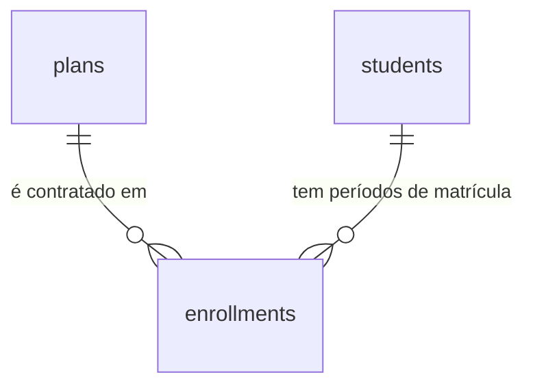

# Planos e matrículas

## Problem

O sistema sabe quem é aluno e não sabe se ele está em dia. A ficha tem dados, foto e consentimentos, e nada nela diz que plano a pessoa contratou, desde quando, até quando vale e por quanto. Isso continua onde o PRD encontrou a academia - "cadastros em planilhas ou sistemas legados" (§1.2) -, e o risco que o mesmo parágrafo nomeia, "fraude (uso de matrícula por terceiros)", fala de uma matrícula que o sistema ainda não tem. Quem paga é a academia, que para responder "este aluno está vigente?" ou "quando ele vence?" abre outro arquivo, e o aluno, cujo vencimento depende de alguém lembrar. Quatro features do roadmap esperam por isto: `pagamentos` aponta para a matrícula (`payments.enrollment_id`, §6), `check-in` mostra a "situação da matrícula (liberado/bloqueado)" (RF-22), `dashboard` lista "vencimentos próximos" (§8) e `privacidade` exporta e apaga o que o titular tem.

O PRD não traz número de alunos matriculados nem quantos planos a academia vende. O que ele fixa: RF-19 ("Cadastro de planos (nome, periodicidade, valor, regras de acesso)"), RF-20 ("Matrícula vinculando aluno a plano, com início, vencimento, status e renovação"), a matriz do §2 (RH/Financeiro: "Cadastro de funcionários, matrículas, pagamentos"), `plans` (`id, name, period, price, rules`) e `enrollments` (`id, student_id, plan_id, starts_at, ends_at, status`) no §6, `GET/POST /plans · /enrollments` no §7, a tela 8 ("Planos e matrículas") e a tela 4 (ficha do aluno: "matrícula") do §8, e "matrículas/planos básicos" no MVP (§10). Ele não diz que periodicidades existem, que valores o status assume, o que é renovar, nem que formato têm as "regras de acesso" (lacuna registrada no `ROADMAP.md`).

Quando isto entrar: o Financeiro cadastra os planos da academia com periodicidade e valor, reajusta o valor e inativa o plano que saiu de linha; na ficha do aluno registra a matrícula num plano a partir de um dia, e o sistema calcula o vencimento e copia o valor; a situação da matrícula (agendada, ativa, vencida, cancelada) é sempre a do dia em que alguém olha; renovar é registrar o período seguinte, colado ao anterior, e o banco recusa dois períodos sobrepostos do mesmo aluno, inclusive de dois cliques ao mesmo tempo; a recepção vê planos e matrículas e não os altera; e cada plano criado ou alterado e cada matrícula registrada ou cancelada aparece na tela de Auditoria.

## Flow

Reutiliza a guarda por perfil (`apps/api/src/access.ts`), o `ValidationInterceptor` com `@Input` e `@Output`, o `ProblemFilter`, o gravador `audit.record` com `diffOf` e `@Actor`, a trava da linha do aluno que `consents` já usa para serializar quem escreve sobre ele, `saoPauloToday` e `isRealDay` de `packages/contracts/src/person.ts`, a dobra `students_fold` para a ordem por nome e, no web, o `Shell`, o `fetchApi`, o `proxy.ts`, a página renderizada no servidor de `/staff`, o bloco da ficha no molde de `ConsentsBlock` e o diálogo de confirmação de `StatusActions`: nenhuma rota nova ganha guarda, erro, validação, auditoria ou layout próprio. O que não existe e esta feature cria: duas tabelas, dinheiro, a conta do vencimento e a primeira restrição de exclusão do banco.

**Planos (listar, criar, editar, inativar)**

1. `GET|POST /api/plans`, `PATCH|DELETE /api/plans/:id` -> `apps/web` (exists) repassa -> checagem de origem (exists) -> `AccessGuard` (exists): leitura para `admin`, `hr_finance` e `reception`; escrita para `admin` e `hr_finance`
2. `ValidationInterceptor` (exists) - valida o corpo pelo schema de `packages/contracts` (exists), com o valor em centavos inteiros (door 2)
3. módulo de planos em `apps/api` (new, no door - placement per conventions) - abre a transação, trava a linha do plano na edição e grava em `plans` (door 1)
4. `audit.record(tx, ...)` (exists) - grava a linha com a ação da door 6 na mesma transação; se o insert falha, a transação desfaz
5. out: `200`/`201`/`204`, ou `500` sem nada gravado; a leitura não grava na trilha

**Matrícula (registrar, renovar, cancelar, ler)**

1. `GET|POST /api/students/:id/enrollments`, `DELETE /api/students/:id/enrollments/:enrollmentId` -> repasse e checagem de origem (exists) -> `AccessGuard` (exists): leitura para `admin`, `hr_finance` e `reception`; escrita para `admin` e `hr_finance`
2. `ValidationInterceptor` (exists) - valida `planId` e `startsAt` pelo schema de `packages/contracts` (exists)
3. módulo de matrículas em `apps/api` (new, no door - placement per conventions) - abre a transação, trava a linha do aluno em `students` (exists), lê o plano em `plans` (door 1), calcula o vencimento pela conta da door 4, copia o valor do plano (door 2) e insere em `enrollments` (door 3); a restrição de exclusão (door 5) é quem decide entre dois períodos sobrepostos, venham de onde vierem
4. `audit.record(tx, ...)` (exists) - `student.enrollment_created` ou `student.enrollment_cancelled` (door 6), na mesma transação
5. out: `201` ou `204`; `409` com `enrollment_overlap`, `plan_inactive` ou `student_inactive`; `500` sem nada gravado
6. leitura - o mesmo módulo (new, no door) lê `enrollments` (door 3) com o nome atual do plano e devolve a situação calculada para o dia corrente (door 4); nenhuma tarefa periódica muda linha

**Telas**

1. navegador `GET /plans*` -> `proxy.ts` (exists) exige sessão -> página renderizada no servidor chama `GET /api/plans` por `fetchApi` (exists) e monta dentro do `Shell` (exists), que ganha o link "Planos"
2. ficha `/students/<id>` (exists) - passa a chamar `GET /api/students/:id/enrollments` por `fetchApi` (exists) e monta o bloco "Matrículas" abaixo do de consentimentos, para `admin`, `hr_finance` e `reception`; quem escreve também recebe os planos
3. formulário de plano, diálogo de matrícula e botões -> `POST|PATCH|DELETE` pelo repasse de `/api/*` (exists), e voltam aos caminhos de escrita acima; a prévia do vencimento no diálogo usa a mesma conta da door 4, de `packages/contracts` (exists)
4. `/audit` (exists) - passa a nomear as cinco ações novas, a levar do "Alvo" ao plano e a nomear o plano de uma matrícula

## Impact

| Front | What changes |
| --- | --- |
| domain | novo termo: `plan` - o que a academia vende: um nome, uma periodicidade, um valor e um texto de regras de acesso; nome da tabela e das rotas (PRD §6 e §7) e `entity` da trilha. Vão ramificar nele: `pagamentos`, `check-in` (exibir as regras), `dashboard` |
| domain | novo termo: `enrollment` - **um período** de um aluno num plano, com início, vencimento e valor; não é o vínculo inteiro do aluno com a academia. Renovar cria outro `enrollment` (door 3). Vão ramificar nele: `pagamentos` (`payments.enrollment_id` passa a apontar para um período), `check-in`, `dashboard`, `privacidade` |
| domain | termo já em uso com outro sentido: `enrollment` hoje é o cadastro de 2FA do Administrador - `duringEnrollment` e `twoFactorEnrollmentRequired` em `apps/api/src/access.ts`, o `code` `two_factor_enrollment_required` e `apps/api/test/enrollment.test.ts`. Nada disso muda; os arquivos novos de matrícula não podem se chamar só `enrollment` |
| domain | novo termo: situação da matrícula - `scheduled`, `active`, `expired`, `cancelled`, calculada na leitura (door 4). É o quarto "status" do sistema, ao lado do de aluno, do de funcionário e do de plano, e o único que não é coluna |
| domain | termo do PRD que muda: `enrollments.status` (§6) não é criado - o que se guarda é `cancelled_at` (door 3). `plans.price` vira `price_cents` e `plans.rules` é texto livre (doors 1 e 2) |
| contrato | códigos de erro novos, os três `409`: `enrollment_overlap`, `plan_inactive` e `student_inactive` |
| contrato | `AUDIT_ACTIONS` ganha cinco valores (door 6). `ACTION_LABELS` de `apps/web/src/lib/audit.ts` é um `Record<AuditAction, string>`: o typecheck falha até a tela ter o rótulo de cada um; `FIELD_LABELS` e `valueLabel` ganham `period`, `priceCents`, `rules`, `planId`, `startsAt` e `endsAt` |
| checks de outra feature | `apps/web/e2e/audit.spec.ts` fixa 31 ações em seis pontos (linhas 137, 230, 482, 543, 566 e 635); passam a 36. A ordem e o texto das trinta e uma primeiras não mudam, e o número é atualizado como cada feature anterior fez; na linha 635 (C99 da `funcionarios`) as onze de funcionário seguem nas posições 21 a 31, e os dois `slice(20)` que as leem "até o fim" passam a parar na 31 |
| comportamento existente | `DELETE /api/students/:id` continua mexendo só em `students`: inativar o aluno não cancela matrícula (AC 44). Nenhuma rota existente muda de assinatura; `GET /api/students*` não ganha chave |
| web | o menu do `Shell` ganha "Planos" para `admin`, `hr_finance` e `reception`; `apps/web/e2e/shell.spec.ts` confere o menu por perfil |
| web | a ficha do aluno faz mais uma chamada por renderização para três perfis (duas para quem escreve: matrículas e planos); o Instrutor continua sem nenhuma além da de hoje |
| web | `/audit` resolve o "Alvo" para `user`, `student` e `staff`; passa a resolver `plan`. `diffDetails` recebe os usuários para nomear `userId`; passa a receber também os planos para nomear `planId`, e a página chama `GET /api/plans` |
| web | primeira tela com dinheiro: não existe formatador de moeda no repositório (PRD §4 Idioma: "moeda" formatada para o Brasil). Onde ele mora é do diff |
| portão | as sete rotas novas entram na regra de `paths` do OpenAPI e nos 70% de cobertura de `apps/api/src`, sem mudança no portão |
| ambiente | nenhuma variável nova. A migração `0008` cria a extensão `btree_gist` (door 5): o papel que migra precisa poder criar extensão, como já precisou para `pg_trgm` na `0000`; as duas vêm na imagem `postgres:18-alpine` do `compose.yaml` |
| stored data | nothing to migrate - a migração `0008` cria `plans` e `enrollments` vazias e não toca tabela existente. Não há plano de fábrica: a academia começa sem nenhum, e ninguém é matriculado antes de alguém cadastrar o primeiro (Open question 4) |
| stored data | `enrollments` tem chave estrangeira para `students` e para `plans`, as duas sem `ON DELETE`: a exclusão definitiva da `privacidade` terá de tratar `enrollments` antes da linha do aluno, e um plano com matrícula nunca é apagado, só inativado |
| stored data | a situação muda sozinha à meia-noite de `America/Sao_Paulo` sem que nenhuma linha mude: quem guardar a situação em outro lugar (um cache, uma coluna em `pagamentos`) guarda um valor que envelhece |
| `.specs` | aprovado o plano, as doors 1 a 6 viram AD-058 a AD-063 em `STATE.md`, e a lacuna "'Regras de acesso' de um plano (RF-19) não têm formato definido" de `ROADMAP.md` fecha com a door 1 |

## Relations

One-way constraints: a periodicidade de um plano é um de quatro valores e não muda depois de criada (door 1); a situação do plano só aceita dois valores (door 1); todo valor em dinheiro é um inteiro de centavos, nunca negativo (door 2); cada matrícula aponta para exatamente um aluno e um plano, sem exclusão em cascata (door 3); o vencimento nunca é anterior ao início, e o cancelamento é a única coisa que muda numa matrícula, uma vez (door 3); a situação da matrícula não é guardada (door 4); dois períodos não cancelados do mesmo aluno nunca têm um dia em comum (door 5). O autor de cada mudança está em `audit_logs`, que aponta para o plano ou para o aluno por `entity_id`, sem chave estrangeira. Nomes das demais colunas e índices de leitura ficam para o diff.

## Surface

Só rotas novas. Toda rota também pode responder com a linha de erro comum da `auth-rbac`. Nenhuma rota existente muda de assinatura.

| Route | In | Out | Status |
| --- | --- | --- | --- |
| `GET /api/plans` | nada | `items[]`: `id` · `name` · `period` · `priceCents` · `rules` · `status` | `200`, `401`, `403` |
| `POST /api/plans` | `name`, `period`, `priceCents`; opcional: `rules` | o plano, como um item de `GET /api/plans` | `201`, `401`, `403`, `422` |
| `PATCH /api/plans/:id` | `name`, `priceCents`, `rules` (`null` limpa) e `status` (só `active`), todos opcionais; `period` não é aceito | o plano | `200`, `401`, `403`, `404`, `422` |
| `DELETE /api/plans/:id` | nada | nada | `204`, `401`, `403`, `404` |
| `GET /api/students/:id/enrollments` | nada | `items[]`: `id` · `plan` (`id` · `name` · `period`) · `startsAt` · `endsAt` · `priceCents` · `status` · `createdAt` · `cancelledAt` | `200`, `401`, `403`, `404` |
| `POST /api/students/:id/enrollments` | `planId`, `startsAt` | a matrícula criada, como um item de `GET /api/students/:id/enrollments` | `201`, `401`, `403`, `404`, `409`, `422` |
| `DELETE /api/students/:id/enrollments/:enrollmentId` | nada | nada | `204`, `401`, `403`, `404` |

## Landing

| One-way door | Literal shape | Alternative rejected |
| --- | --- | --- |
| 1. tabela `plans`, periodicidade e regras de acesso | migração `0008` (AD-008); `id uuid DEFAULT uuidv7()`; `period` com `CHECK (period in ('monthly', 'quarterly', 'semiannual', 'annual'))`, 1, 3, 6 e 12 meses, e nenhuma rota o altera depois do `POST`; `status` com `CHECK (status in ('active', 'inactive'))` e padrão `active`; `rules` anulável, texto livre de até 500 caracteres, exibido como texto puro; `name` sem `UNIQUE`; sem `deleted_at` e sem `tenant_id` (AD-016) | duração em dias (`30`) - o vencimento sairia do dia do mês em que o aluno entrou, e "mensal" numa academia é o mesmo dia do mês seguinte. Número de meses livre - aceitaria 7 meses, que nenhum rótulo da tela nomeia. `rules` estruturado em `jsonb` (dias da semana, horário, limite semanal) - o PRD não define o formato e o `check-in`, que seria quem o aplica, ainda não existe para dizer o que bloquear; um formato inventado agora vira contrato com backfill. `period` editável - a matrícula antiga mostraria uma periodicidade que não bate com as datas dela. Fecha: plano de um dia ou de uma semana é um valor novo no `CHECK`, por migração; regra que o sistema aplique sozinho é coluna nova ao lado do texto; mudar de periodicidade é criar outro plano e inativar o antigo |
| 2. dinheiro em centavos inteiros | `price_cents integer NOT NULL CHECK (price_cents >= 0)` em `plans` e em `enrollments`; na API `priceCents`, número inteiro de `0` a `9999999` (R$ 99.999,99), nunca decimal nem texto; a tela formata `R$ 1.234,56` e converte o que o usuário digita | `numeric(10,2)` (o `price` do PRD §6) - o driver `pg` devolve `numeric` como texto, e o JSON teria de escolher entre `"99.90"` e `99.9` em ponto flutuante, em que somar parcelas não fecha. Fecha: `pagamentos` copia a forma para `payments.amount`; valor com fração de centavo não existe |
| 3. tabela `enrollments`: um período por linha | migração `0008`; `id uuid DEFAULT uuidv7()`; `student_id uuid NOT NULL REFERENCES students(id)` e `plan_id uuid NOT NULL REFERENCES plans(id)`, os dois sem `ON DELETE`; `starts_at date NOT NULL`, `ends_at date NOT NULL`, `CHECK (ends_at >= starts_at)`; `price_cents` copiado do plano no insert (door 2); `created_at timestamptz DEFAULT now()`; `cancelled_at timestamptz` anulável, a única coluna que muda, de nula para um instante, uma vez; sem coluna `status`. Renovar insere a linha do período seguinte, e nenhuma rota edita plano, datas ou valor de uma linha | uma linha por aluno com `ends_at` empurrado a cada renovação - o valor e o plano de cada período ficariam só na trilha, trocar de plano na renovação reescreveria `plan_id`, e `payments.enrollment_id` (PRD §6) não diria que período foi pago. Ler o valor do plano na hora - um reajuste reescreveria o que os períodos passados custaram. Fecha: "matrícula" no código e na tela é um período; corrigir uma é cancelar e registrar outra; `pagamentos` aponta para o período; `privacidade` trata `enrollments` antes do aluno |
| 4. vencimento e situação calculados | `endsAt = startsAt + N meses - 1 dia`, com N da door 1; a soma é de meses do calendário e, quando o mês de destino não tem o dia, vale o último dia dele (`2026-01-31` + 1 mês = `2026-02-28`, vencimento `2026-02-27`), a mesma conta de `date + interval` do Postgres; `endsAt` é o último dia coberto. `status` só existe na resposta: `cancelled` se `cancelled_at` está preenchido; senão `scheduled` se hoje < `startsAt`, `expired` se hoje > `endsAt` e `active` nos demais casos, com hoje igual ao dia em `America/Sao_Paulo` (`saoPauloToday`). Uma definição só, em `packages/contracts` | coluna `status` guardada com `expired` (PRD §6) - algo teria de virá-la à meia-noite; o temporizador da AD-050 executa na subida e a cada 60 minutos, a linha diria `active` depois de vencida até a execução seguinte, e para sempre se ela falhasse, e o `check-in` liberaria; seriam duas fontes para a mesma pergunta, o motivo da AD-030. Vencimento no mesmo dia do mês seguinte, incluído (07/10 a 07/11) - a renovação teria de começar em 08/11 e o dia andaria um por período, ou os dois períodos dividiriam um dia e a door 5 os recusaria. Fecha: `check-in`, `dashboard` e `pagamentos` ramificam nesses quatro valores; matrícula "trancada" seria coluna nova; quem começa no dia 29, 30 ou 31 passa a renovar no dia 28 depois do primeiro fevereiro |
| 5. dois períodos do mesmo aluno nunca se sobrepõem | na migração `0008`: `CREATE EXTENSION IF NOT EXISTS btree_gist` e `CONSTRAINT enrollments_no_overlap EXCLUDE USING gist (student_id WITH =, daterange(starts_at, ends_at, '[]') WITH &&) WHERE (cancelled_at IS NULL)`; a violação (SQLSTATE `23P01`) vira `409` com `enrollment_overlap`. O `POST` exige `startsAt`: o servidor nunca escolhe o início | índice parcial único `(student_id) WHERE cancelled_at IS NULL`, o padrão das AD-038 e AD-040 - recusaria a renovação antecipada e todo período vencido, que também não é cancelado. Só conferir antes do insert, com a linha do aluno travada - vale para quem passa por esse caminho, e `pagamentos`, `privacidade` ou um SQL de suporte não passam. `startsAt` opcional, com "o dia seguinte ao último vencimento" calculado no servidor - dois cliques em "Renovar" virariam dois períodos seguidos, os dois válidos, e nada os recusaria. Fecha: um aluno não tem dois planos ao mesmo tempo (musculação e natação seriam um plano só); é a primeira restrição de exclusão e a segunda extensão do repositório; um período cancelado libera as datas dele |
| 6. ações e campos registráveis de plano e de matrícula | em `AUDIT_ACTIONS` (AD-025), depois das trinta e uma existentes, nesta ordem: `plan.created`, `plan.updated`, `plan.inactivated`, `student.enrollment_created`, `student.enrollment_cancelled`. Nas três de plano, `entity` igual a `plan` e `entity_id` igual ao id do plano; campos registráveis (AD-026): `name`, `period`, `priceCents` e `status`; de `rules` a trilha guarda só o nome do campo. Nas duas de matrícula, `entity` igual a `student` e `entity_id` igual ao id do aluno; registráveis: `planId`, `startsAt`, `endsAt` e `priceCents`, com `from: null` no registro e `to: null` no cancelamento, a forma da AD-039 | `entity` igual a `enrollment` - esconderia a matrícula do histórico do aluno e do link "Ver aluno", o que as AD-039 e AD-045 já recusaram. `student.enrollment_renewed` como ação própria - o servidor teria de adivinhar o que é renovação (colada à anterior? no mesmo plano?), e quem volta depois de um intervalo não seria nem uma coisa nem outra; o `diff` já traz o início e o vencimento. `from` e `to` de `rules` - um texto de até 500 caracteres na coluna "Detalhes" de cada edição. Fecha: nome e CPF do aluno não entram na linha, só o id dele; o plano entra pelo id, e a tela mostra o nome de agora |

- Nothing else in this change is hard to reverse

## Criteria

### S1: Cadastrar e listar planos (P1)

O Financeiro cria um plano com os campos da RF-19, e quem atende vê a tabela de preços.

**Acceptance Criteria**

1. WHEN um usuário de perfil `admin` ou `hr_finance` chama `POST /api/plans` com `name`, `period` e `priceCents` válidos THEN the system SHALL responder `201` com `id`, os campos enviados, `status` igual a `active` e `rules` igual a `null` quando não enviado
2. IF `name` falta, fica vazio depois de aparado ou passa de 80 caracteres, `period` não é um de `monthly`, `quarterly`, `semiannual` e `annual`, `priceCents` não é um número inteiro de `0` a `9999999`, `rules` fica vazio depois de aparado ou passa de 500 caracteres, ou um campo de texto contém o caractere U+0000 THEN the system SHALL responder `422` com um item em `errors` cujo `path` é aquele campo, sem criar plano
3. WHEN `POST /api/plans` recebe um `name` igual ao de um plano que já existe THEN the system SHALL responder `201` e criar outro plano
4. WHEN um usuário de perfil `admin`, `hr_finance` ou `reception` chama `GET /api/plans` THEN the system SHALL responder `200` com todos os planos de qualquer situação em `items`, em ordem de `name` sem diferenciar maiúsculas nem acentos e, no empate, de `id`, cada um com as chaves `id`, `name`, `period`, `priceCents`, `rules` e `status`, as mesmas para os três perfis
5. IF um usuário de perfil `reception` chama `POST /api/plans`, `PATCH /api/plans/:id` ou `DELETE /api/plans/:id`, ou um usuário de perfil `instructor` chama qualquer uma das quatro rotas `/api/plans*`, com `:id` de um plano que existe ou não THEN the system SHALL responder `403` com `code` igual a `forbidden`, sem criar nem alterar plano
6. IF qualquer uma das quatro rotas `/api/plans*` é chamada sem sessão THEN the system SHALL responder `401` com `code` igual a `unauthorized`

**Independent test:** entrar como RH/Financeiro, criar "Mensal" por `curl` com `priceCents` igual a `9990`, listar como recepção e receber `403` ao tentar criar outro.

### S2: Editar, inativar e reativar um plano (P1)

Reajustar o valor e tirar um plano de linha sem tocar nas matrículas que já existem.

**Acceptance Criteria**

7. WHEN um usuário de perfil `admin` ou `hr_finance` chama `PATCH /api/plans/:id` com um ou mais de `name`, `priceCents` e `rules` válidos THEN the system SHALL responder `200` com o plano atualizado, mantendo como estavam os campos não enviados
8. WHEN `PATCH /api/plans/:id` recebe `null` em `rules` THEN the system SHALL limpar o campo e devolvê-lo como `null`
9. IF `PATCH /api/plans/:id` recebe `period` com qualquer valor, `null` em `name`, `priceCents` ou `status`, ou um valor que a AC 2 reprova THEN the system SHALL responder `422` com um item em `errors` cujo `path` é aquele campo, sem alterar o plano
10. WHEN um usuário de perfil `admin` ou `hr_finance` chama `DELETE /api/plans/:id` THEN the system SHALL responder `204`, passar `status` para `inactive` e manter a linha do plano e cada matrícula daquele plano como estavam
11. IF `DELETE /api/plans/:id` atinge um plano já inativo THEN the system SHALL responder `204` sem alterar nada
12. WHEN `PATCH /api/plans/:id` recebe `status` igual a `active` para um plano inativo THEN the system SHALL gravar `status` igual a `active`
13. IF `PATCH /api/plans/:id` recebe `status` igual a `inactive` ou a qualquer valor que não seja `active` THEN the system SHALL responder `422` com um item em `errors` cujo `path` é `status`
14. WHEN `PATCH /api/plans/:id` muda `priceCents` de um plano que tem matrículas THEN the system SHALL manter o `priceCents` de cada matrícula já registrada como estava
15. IF dois `PATCH /api/plans/:id` simultâneos mudam campos diferentes do mesmo plano THEN the system SHALL responder `200` aos dois e deixar o plano com as duas mudanças
16. IF `:id` de `PATCH` ou `DELETE /api/plans/:id` não é um `uuid` ou não pertence a plano nenhum THEN the system SHALL responder `404` com `code` igual a `not_found`

**Independent test:** reajustar o valor de um plano que já tem matrícula, ler a matrícula e ver o valor antigo; inativar o plano, conferir pelo `psql` que a linha continua lá e reativá-lo.

### S3: Matricular um aluno num plano (P1)

Um período com início escolhido, vencimento calculado e o valor do dia, e nunca dois períodos sobrepostos (RF-20).

**Acceptance Criteria**

17. WHEN um usuário de perfil `admin` ou `hr_finance` chama `POST /api/students/:id/enrollments` com o `planId` de um plano ativo e um `startsAt` válido THEN the system SHALL responder `201` com `id`, `plan` (`id`, `name` e `period`), `startsAt`, `endsAt`, `priceCents` igual ao do plano naquele instante, `status`, `createdAt` do banco e `cancelledAt` igual a `null`
18. The system SHALL calcular `endsAt` como `startsAt` mais 1, 3, 6 ou 12 meses de calendário (`monthly`, `quarterly`, `semiannual`, `annual`) menos um dia, de modo que `startsAt` igual a `2026-10-07` dá `2026-11-06`, `2027-01-06`, `2027-04-06` e `2027-10-06`
19. WHEN o mês de destino não tem o dia de `startsAt` THEN the system SHALL usar o último dia daquele mês antes de subtrair um dia, de modo que `2026-01-31` mensal dá `2026-02-27`, `2028-01-31` mensal dá `2028-02-28` e `2028-02-29` anual dá `2029-02-27`
20. The system SHALL devolver em `status` o valor `cancelled` quando `cancelledAt` não é nulo e, nos demais casos, `scheduled` quando o dia corrente em `America/Sao_Paulo` é anterior a `startsAt`, `expired` quando é posterior a `endsAt` e `active` quando está entre os dois, incluídos os dois extremos
21. IF `planId` falta, não é um `uuid` ou não pertence a plano nenhum THEN the system SHALL responder `422` com um item em `errors` cujo `path` é `planId`, sem gravar matrícula
22. IF `startsAt` falta, não é uma data real no formato `aaaa-mm-dd`, é posterior ao dia corrente em `America/Sao_Paulo` mais 365 dias, ou dá um `endsAt` anterior ao dia corrente THEN the system SHALL responder `422` com um item em `errors` cujo `path` é `startsAt`, sem gravar matrícula
23. WHEN `startsAt` é anterior ao dia corrente e o `endsAt` calculado não é THEN the system SHALL responder `201` com `status` igual a `active`
24. IF o plano de `planId` tem `status` igual a `inactive` THEN the system SHALL responder `409` com `code` igual a `plan_inactive`, sem gravar matrícula
25. IF o aluno tem `status` igual a `inactive` THEN the system SHALL responder `409` com `code` igual a `student_inactive`, sem gravar matrícula
26. WHEN o aluno tem `status` igual a `suspended` THEN the system SHALL aceitar a matrícula como para um aluno `active`
27. IF o período de `startsAt` a `endsAt` tem ao menos um dia em comum com outra matrícula não cancelada do mesmo aluno THEN the system SHALL responder `409` com `code` igual a `enrollment_overlap`, sem gravar matrícula
28. IF dois `POST /api/students/:id/enrollments` do mesmo aluno com períodos que têm um dia em comum chegam ao mesmo tempo THEN the system SHALL responder `201` a exatamente um e `409` com `enrollment_overlap` ao outro
29. IF um `INSERT` em `enrollments` traz um período com um dia em comum com outra linha não cancelada do mesmo aluno, ou `ends_at` anterior a `starts_at`, ou valor negativo THEN the system SHALL falhar a instrução sem gravar a linha
30. IF `:id` de qualquer uma das três rotas `/api/students/:id/enrollments*` não é um `uuid` ou não pertence a aluno nenhum THEN the system SHALL responder `404` com `code` igual a `not_found`
31. IF um usuário de perfil `reception` chama `POST /api/students/:id/enrollments` ou `DELETE /api/students/:id/enrollments/:enrollmentId`, ou um usuário de perfil `instructor` chama qualquer uma das três rotas, com ids que existem ou não THEN the system SHALL responder `403` com `code` igual a `forbidden`, sem nenhum campo de matrícula no corpo e sem gravar nada
32. IF qualquer uma das três rotas `/api/students/:id/enrollments*` é chamada sem sessão THEN the system SHALL responder `401` com `code` igual a `unauthorized`

**Independent test:** como RH/Financeiro, matricular um aluno no plano mensal a partir de `2026-10-07`, ler `endsAt` igual a `2026-11-06`, repetir o mesmo `POST` e receber `409`.

### S4: Renovar (P1)

Renovar é registrar o período seguinte, colado ao anterior ou depois de um intervalo, no mesmo plano ou em outro; a corrida entre duas renovações iguais é a da AC 28.

**Acceptance Criteria**

33. WHEN o aluno tem uma matrícula não cancelada com `endsAt` igual a `2026-11-06` e `POST /api/students/:id/enrollments` recebe `startsAt` igual a `2026-11-07` THEN the system SHALL responder `201` e manter a matrícula anterior sem mudança em nenhuma coluna
34. WHEN a matrícula seguinte é registrada antes de a atual vencer THEN the system SHALL devolver em `GET /api/students/:id/enrollments` a nova com `status` igual a `scheduled` e a atual com `status` igual a `active`
35. WHEN a matrícula seguinte usa um `planId` diferente do da anterior THEN the system SHALL aceitar, com o `endsAt` e o `priceCents` do plano novo
36. WHEN `startsAt` é posterior ao dia seguinte ao `endsAt` da matrícula anterior THEN the system SHALL aceitar, deixando os dias do intervalo sem matrícula

**Independent test:** renovar o aluno do S3 com `startsAt` igual a `2026-11-07` num plano trimestral, listar e ver duas matrículas, a nova até `2027-02-06`.

### S5: Cancelar uma matrícula (P1)

Cancelar não apaga: marca o instante e libera as datas.

**Acceptance Criteria**

37. WHEN um usuário de perfil `admin` ou `hr_finance` chama `DELETE /api/students/:id/enrollments/:enrollmentId` de uma matrícula não cancelada, agendada, ativa ou vencida THEN the system SHALL responder `204`, preencher `cancelledAt` com o instante do banco, manter a linha e não mudar nenhuma outra coluna dela
38. IF `DELETE /api/students/:id/enrollments/:enrollmentId` atinge uma matrícula já cancelada THEN the system SHALL responder `204` sem alterar `cancelledAt`
39. WHEN uma matrícula é cancelada THEN the system SHALL aceitar um `POST /api/students/:id/enrollments` do mesmo aluno com um período que tem dias em comum com o dela
40. IF `:enrollmentId` não é um `uuid` ou não pertence àquele aluno THEN the system SHALL responder `404` com `code` igual a `not_found`

**Independent test:** cancelar a matrícula do S3, conferir pelo `psql` que a linha continua lá com `cancelled_at`, e registrar outra no mesmo período.

### S6: Ler as matrículas de um aluno (P1)

O histórico inteiro numa chamada, com a situação do dia.

**Acceptance Criteria**

41. WHEN um usuário de perfil `admin`, `hr_finance` ou `reception` chama `GET /api/students/:id/enrollments` THEN the system SHALL responder `200` com todas as matrículas do aluno em `items`, canceladas inclusive, em ordem de `startsAt` da mais recente para a mais antiga e, no empate, de `id` decrescente, cada uma com as chaves da AC 17, as mesmas para os três perfis
42. WHEN o aluno não tem matrícula THEN the system SHALL responder `200` com `items` igual a `[]`
43. WHEN o plano de uma matrícula foi renomeado ou inativado depois dela THEN the system SHALL devolver em `plan.name` o nome atual do plano e manter `startsAt`, `endsAt` e `priceCents` da matrícula como foram gravados
44. WHEN `DELETE /api/students/:id` inativa um aluno que tem matrículas THEN the system SHALL manter cada matrícula dele como estava, e `GET /api/students/:id/enrollments` SHALL continuar a devolvê-las
45. WHEN `GET /api/plans` ou `GET /api/students/:id/enrollments` responde `200` THEN the system SHALL não gravar linha em `audit_logs`

**Independent test:** com uma matrícula ativa, uma agendada e uma cancelada, ler a lista com o cookie da recepção e o do RH/Financeiro e comparar as chaves e a ordem.

### S7: Cada escrita deixa rastro, na mesma transação (P1)

Uma linha por ação que mudou algo, com o plano e as datas e sem dado pessoal (AD-025 a AD-027).

**Acceptance Criteria**

46. WHEN `POST /api/plans` responde `201` THEN the system SHALL ter gravado exatamente uma linha em `audit_logs` com `action` igual a `plan.created`, `user_id` igual ao id do autor, `entity` igual a `plan` e `entity_id` igual ao id do plano criado
47. WHEN `POST /api/plans` cria um plano com `name` igual a `Mensal`, `period` igual a `monthly` e `priceCents` igual a `9990`, sem `rules` THEN the system SHALL gravar `diff` igual a `{"fields":["name","period","priceCents","status"],"values":{"name":{"from":null,"to":"Mensal"},"period":{"from":null,"to":"monthly"},"priceCents":{"from":null,"to":9990},"status":{"from":null,"to":"active"}}}`
48. WHEN `PATCH /api/plans/:id` responde `200` tendo mudado `priceCents` de `9990` para `10990` e mudado `rules` THEN the system SHALL ter gravado exatamente uma linha com `action` igual a `plan.updated`, `user_id` do autor, `entity` igual a `plan`, `entity_id` igual a `:id` e `diff` igual a `{"fields":["priceCents","rules"],"values":{"priceCents":{"from":9990,"to":10990}}}`
49. WHEN `PATCH /api/plans/:id` reativa um plano inativo THEN the system SHALL gravar uma linha `plan.updated` com `diff` igual a `{"fields":["status"],"values":{"status":{"from":"inactive","to":"active"}}}`
50. IF `PATCH /api/plans/:id` recebe só valores iguais aos atuais, ou corpo vazio THEN the system SHALL responder `200` sem gravar linha em `audit_logs`
51. WHEN `DELETE /api/plans/:id` inativa um plano de situação `active` THEN the system SHALL ter gravado exatamente uma linha com `action` igual a `plan.inactivated`, `user_id` do autor, `entity` igual a `plan`, `entity_id` igual a `:id` e `diff` igual a `{"fields":["status"],"values":{"status":{"from":"active","to":"inactive"}}}`
52. WHEN `POST /api/students/:id/enrollments` responde `201` THEN the system SHALL ter gravado exatamente uma linha com `action` igual a `student.enrollment_created`, `user_id` do autor, `entity` igual a `student`, `entity_id` igual ao id do aluno e `diff` igual a `{"fields":["planId","startsAt","endsAt","priceCents"],"values":{"planId":{"from":null,"to":"<planId>"},"startsAt":{"from":null,"to":"<startsAt>"},"endsAt":{"from":null,"to":"<endsAt>"},"priceCents":{"from":null,"to":<priceCents>}}}`, com os valores da matrícula criada
53. WHEN `DELETE /api/students/:id/enrollments/:enrollmentId` cancela uma matrícula THEN the system SHALL ter gravado exatamente uma linha com `action` igual a `student.enrollment_cancelled`, `user_id` do autor, `entity` igual a `student`, `entity_id` igual ao id do aluno e `diff` com os mesmos quatro campos, cada um com o valor da matrícula em `from` e `null` em `to`
54. IF uma requisição a `/api/plans*` ou a `/api/students/:id/enrollments*` termina com `401`, `403`, `404`, `409` ou `422`, ou é o `DELETE` da AC 11 ou da AC 38 THEN the system SHALL deixar `audit_logs` com o mesmo número de linhas de antes
55. IF o insert em `audit_logs` falha durante `POST /api/plans`, `PATCH` ou `DELETE /api/plans/:id`, `POST /api/students/:id/enrollments` ou `DELETE /api/students/:id/enrollments/:enrollmentId` THEN the system SHALL responder `500` e deixar `plans` e `enrollments` como estavam antes da requisição
56. WHEN uma ação de plano ou de matrícula é gravada THEN the system SHALL preencher `ip` e `user_agent` da linha pelas mesmas regras das AC 29 a 32 da `auditoria`
57. The system SHALL manter fora de toda coluna de `audit_logs` o nome e o CPF do aluno matriculado e o texto de `rules` de qualquer plano

**Independent test:** criar um plano, reajustá-lo, matricular um aluno e cancelar; ler `audit_logs` e encontrar quatro linhas com o id do autor, duas com `entity` igual a `plan` e duas com o id do aluno.

### S8: Tela de planos (P1)

A tabela de preços para quem atende, e o cadastro para quem cuida do financeiro, em pt-BR.

**Acceptance Criteria**

58. The system SHALL exibir o link "Planos" no menu apenas para os perfis `admin`, `hr_finance` e `reception`
59. WHEN alguém sem sessão abre `/plans`, `/plans/new` ou `/plans/<id>/edit` THEN the system SHALL redirecionar para `/login`
60. IF um usuário de perfil `instructor` abre `/plans`, `/plans/new` ou `/plans/<id>/edit`, ou um usuário de perfil `reception` abre `/plans/new` ou `/plans/<id>/edit` THEN the system SHALL exibir "Você não tem permissão para acessar esta página." sem formulário e sem nenhum dado de plano
61. WHEN um usuário de perfil `admin`, `hr_finance` ou `reception` abre `/plans` THEN the system SHALL exibir o título "Planos" e uma tabela com as colunas "Nome", "Periodicidade", "Valor", "Regras de acesso" e "Situação", com todos os planos na ordem que a API devolve
62. The system SHALL exibir a periodicidade como "Mensal", "Trimestral", "Semestral" ou "Anual", o valor em reais com separador de milhar e duas casas, de modo que `9990` é `R$ 99,90`, `0` é `R$ 0,00` e `123456` é `R$ 1.234,56`, a situação do plano como "Ativo" ou "Inativo" e "—" no lugar de `rules` igual a `null`
63. WHERE o usuário é de perfil `admin` ou `hr_finance` the system SHALL exibir em `/plans` o botão "Novo plano" e o nome de cada plano como link para `/plans/<id>/edit`; para `reception` SHALL exibir a tabela sem o botão e sem link no nome
64. IF não existe plano nenhum THEN the system SHALL exibir "Nenhum plano cadastrado." no lugar da tabela
65. IF a lista de planos não carrega THEN the system SHALL exibir "Não foi possível carregar os planos." e o botão "Tentar novamente"
66. The system SHALL exibir no formulário de `/plans/new` e de `/plans/<id>/edit` os campos "Nome", "Periodicidade", "Valor (R$)" e "Regras de acesso" e o botão "Salvar", com "Periodicidade" desabilitado em `/plans/<id>/edit`
67. WHEN o campo "Valor (R$)" recebe `99,90` e o formulário é salvo THEN the system SHALL enviar `priceCents` igual a `9990`
68. IF o campo "Valor (R$)" não é um valor em reais com no máximo duas casas decimais THEN the system SHALL exibir "Informe um valor em reais, como 99,90." junto do campo, sem enviar a requisição
69. WHEN o formulário de plano é salvo THEN the system SHALL navegar para `/plans`
70. The system SHALL exibir em `/plans/<id>/edit` o botão "Inativar" para o plano ativo ou "Reativar" para o inativo
71. WHEN o usuário aciona "Inativar" THEN the system SHALL pedir confirmação num diálogo que nomeia o plano antes de enviar a requisição, e navegar para `/plans` quando a mudança termina
72. IF `/plans/<id>/edit` aponta para um plano que não existe THEN the system SHALL exibir "Plano não encontrado."

**Independent test:** subir a stack, entrar como RH/Financeiro, cadastrar "Mensal" a `99,90` e "Anual" a `999,00`, reajustar o primeiro e inativar o segundo; entrar como recepção e ver a tabela sem botão; entrar como instrutor e não ver "Planos" no menu.

### S9: Matrículas na ficha do aluno (P1)

O bloco "Matrículas" mostra o histórico a quem atende, e o Financeiro matricula, renova e cancela dali.

**Acceptance Criteria**

73. WHEN um usuário de perfil `admin`, `hr_finance` ou `reception` abre `/students/<id>` THEN the system SHALL exibir o bloco "Matrículas" com uma tabela de colunas "Plano", "Início", "Vencimento", "Valor" e "Situação", na ordem que a API devolve, com as datas como `dd/MM/aaaa`, o valor como na AC 62 e a situação como "Agendada", "Ativa", "Vencida" ou "Cancelada"
74. IF o aluno não tem matrícula THEN the system SHALL exibir "Nenhuma matrícula registrada." no lugar da tabela
75. IF o bloco não carrega THEN the system SHALL exibir "Não foi possível carregar as matrículas." e o botão "Tentar novamente", sem esconder o restante da ficha
76. WHEN um usuário de perfil `instructor` abre `/students/<id>` THEN the system SHALL não exibir o bloco "Matrículas" nem chamar a API de matrículas ou a de planos
77. WHERE o usuário é de perfil `admin` ou `hr_finance` the system SHALL exibir no bloco o botão "Matricular" quando nenhuma matrícula do aluno está ativa ou agendada, o botão "Renovar" quando alguma está, e o botão "Cancelar" em cada linha não cancelada; para `reception` SHALL exibir a tabela sem nenhum botão
78. WHILE o aluno tem `status` igual a `inactive` the system SHALL exibir "Aluno inativo: reative o aluno para matricular." no lugar de "Matricular" e de "Renovar"
79. WHEN o usuário aciona "Matricular" ou "Renovar" THEN the system SHALL abrir um diálogo com o campo "Plano", que lista só os planos ativos como "<nome> · <periodicidade> · <valor>", o campo "Início", o texto "Vencimento: dd/MM/aaaa" calculado para o plano e o início escolhidos, e o botão "Confirmar", e só enviar a requisição depois dele
80. WHEN o diálogo abre por "Matricular" THEN the system SHALL preencher "Início" com o dia corrente em `America/Sao_Paulo`; e por "Renovar" SHALL preencher "Início" com o dia seguinte ao maior `endsAt` entre as matrículas ativas e agendadas, e "Plano" com o plano daquela matrícula quando ele está ativo
81. IF não existe plano ativo THEN the system SHALL exibir no diálogo "Nenhum plano ativo. Cadastre um plano em Planos." com "Confirmar" desabilitado
82. IF a lista de planos não carrega THEN the system SHALL exibir a ficha e a tabela de matrículas com "Não foi possível carregar os planos." no lugar de "Matricular" e de "Renovar"
83. WHEN a matrícula é registrada THEN the system SHALL fechar o diálogo e exibir o bloco com a matrícula nova
84. IF a API responde `409` com `enrollment_overlap`, `plan_inactive` ou `student_inactive` THEN the system SHALL exibir no diálogo "Já existe uma matrícula neste período.", "Este plano foi inativado. Escolha outro." ou "Reative o aluno antes de matricular.", mantendo o plano e o início escolhidos
85. IF a API responde `422` com `path` igual a `startsAt` THEN the system SHALL exibir a mensagem da API junto do campo "Início"
86. WHEN o usuário aciona "Cancelar" THEN the system SHALL pedir confirmação num diálogo que nomeia o aluno, o plano e o período antes de enviar a requisição, e exibir o bloco com a matrícula como "Cancelada" quando a resposta é `204`

**Independent test:** subir a stack, entrar como RH/Financeiro, abrir a ficha de um aluno, matricular no "Mensal" a partir de hoje, renovar e ver a segunda linha como "Agendada", cancelar a primeira; entrar como recepção e ver a tabela sem botões; entrar como instrutor e não ver o bloco.

### S10: A trilha de plano e de matrícula na tela de Auditoria (P2)

O Administrador lê as ações novas por extenso e chega ao plano ou ao aluno.

**Acceptance Criteria**

87. The system SHALL exibir em `/audit` as ações novas por extenso - "Plano criado", "Plano editado", "Plano inativado", "Matrícula registrada" e "Matrícula cancelada" - e oferecê-las no filtro "Ação", nessa ordem, depois das trinta e uma existentes
88. WHEN a linha tem `entity` igual a `plan` THEN the system SHALL exibir em "Alvo" o link "Ver plano", que leva a `/plans/<entityId>/edit`
89. WHEN a linha é `plan.updated` com `diff` de `priceCents` de `9990` para `10990` e `rules` em `fields` THEN the system SHALL exibir em "Detalhes" o texto "Valor: R$ 99,90 → R$ 109,90" e o texto "Regras de acesso alterado"
90. WHEN a linha é `plan.created` com o `diff` da AC 47 THEN the system SHALL exibir em "Detalhes" os textos "Nome: Mensal", "Periodicidade: Mensal", "Valor: R$ 99,90" e "Situação: Ativo"
91. WHEN a linha é `student.enrollment_created` com `planId` de um plano que existe, `startsAt` igual a `2026-10-07`, `endsAt` igual a `2026-11-06` e `priceCents` igual a `9990` THEN the system SHALL exibir em "Detalhes" os textos "Plano: — → <nome atual do plano>", "Início: — → 07/10/2026", "Vencimento: — → 06/11/2026" e "Valor: — → R$ 99,90", e em "Alvo" o link "Ver aluno" que já existe

**Independent test:** matricular um aluno como RH/Financeiro, abrir "Auditoria" como administrador, filtrar por "Matrícula registrada", ler o plano e o período em "Detalhes" e seguir "Ver aluno".

## Out of scope

| Excluded | Why |
| --- | --- |
| Pagamentos, parcelas e a situação pago, pendente ou atrasado | RF-21, feature `pagamentos`; aqui a matrícula só guarda o valor do período |
| Liberar ou bloquear a entrada pela situação da matrícula | RF-22, feature `check-in`; esta entrega a situação pronta (door 4) |
| Lista de matrículas de todos os alunos, "vencimentos próximos" e filtro por situação | §8 tela 2, feature `dashboard`; com um período por linha, uma lista de períodos não responde "quem está sem matrícula", que é a pergunta de lá |
| Situação da matrícula na lista de alunos e busca por ela | a RF-07 lista nome, CPF, telefone e situação do aluno |
| Renovação automática ou recorrente | a RF-20 pede renovação, não cobrança recorrente; gateway é fase 2 (RF-21) |
| Aviso de vencimento por e-mail ou WhatsApp | notificações são fase 2 (PRD §10) |
| Trancar ou pausar uma matrícula | a RF-20 só diz "status"; seria coluna nova (door 4) |
| Regras de acesso que o sistema aplica sozinho (dias, horários, limite semanal) | o PRD não define o formato; Open question 2 |
| Desconto, taxa de matrícula, valor por aluno diferente do plano, pro rata e reembolso no cancelamento | a RF-19 diz "valor" do plano; o que se cobra e o que se devolve é da `pagamentos` |
| Editar uma matrícula (plano, datas ou valor) | corrigir é cancelar e registrar outra (door 3); uma linha que muda deixaria o pagamento apontando para um período que não existe mais |
| Dois planos ao mesmo tempo para o mesmo aluno | a RF-20 vincula "aluno a plano", no singular; a door 5 recusa |
| Excluir um plano definitivamente | a matrícula aponta para ele; o plano sai de linha por inativação |
| Exportar, anonimizar ou apagar as matrículas de um titular | RF-28 e RF-29, feature `privacidade` |
| Importar matrículas de planilha e planos de fábrica | o PRD não pede; quem já é aluno entra com `startsAt` no passado (AC 23), e os planos são cadastrados na tela (Open question 4) |

## Assumptions

| Assumption | Chosen default | Rationale | Confirmed? |
| --- | --- | --- | --- |
| Quem cadastra, edita e inativa planos | `admin` e `hr_finance` | PRD §2: RH/Financeiro cuida de "matrículas, pagamentos", e o preço é assunto dele; Administrador tem "acesso total" | y |
| Quem matricula, renova e cancela | `admin` e `hr_finance`; a recepção só lê | PRD §2 dá "matrículas" ao RH/Financeiro e não as lista para a Recepção. Custo: o aluno novo cadastrado no balcão à noite só é matriculado quando o Financeiro estiver. Open question 1 | y |
| Quem lê planos e matrículas | `admin`, `hr_finance` e `reception`, com as mesmas chaves (AD-033: nenhum campo a cortar); `instructor` recebe `403` | a recepção informa preço e responde "até quando vale"; o Instrutor consulta "nome, foto, status" do aluno (§2), e matrícula não é nenhum dos três | y |
| "Periodicidade" (RF-19) | quatro valores: mensal, trimestral, semestral e anual (door 1) | são os que uma academia de bairro vende; diária e semanal seriam valores novos, por migração | y |
| "Valor" (RF-19) | o preço de um período inteiro do plano, em centavos, de `0` a `9999999`; `0` é aceito | plano de cortesia ou de bolsista existe; como o valor é cobrado (à vista, parcelado) é da `pagamentos` | y |
| "Regras de acesso" (RF-19) | texto livre opcional de até 500 caracteres, que as pessoas leem; o sistema não o interpreta (door 1) | o PRD não define formato e pede "planos básicos" (§10); fecha a lacuna do `ROADMAP.md`. Open question 2 | y |
| "Vencimento" (RF-20) | o último dia coberto: início mais os meses do plano, menos um dia (door 4); o cliente não o envia | de 07/10 a 06/11, com a renovação em 07/11: o dia do mês não anda. Custo: quem começa em 29, 30 ou 31 passa a renovar no dia 28 depois de fevereiro | y |
| "Status" (RF-20) | agendada, ativa, vencida e cancelada, calculadas no dia da leitura (door 4) | os três primeiros saem das datas; guardar "vencida" pediria algo que a virasse à meia-noite | y |
| "Renovação" (RF-20) | registrar o período seguinte, por quem matricula; o início vem preenchido com o dia seguinte ao vencimento e pode ser trocado, e o plano pode ser outro | uma linha por período (door 3); renovação automática está fora | y |
| Início no passado e no futuro | aceito no passado enquanto o vencimento calculado não for anterior a hoje; no futuro até 365 dias | quem já é aluno entra no sistema no meio do período; o limite de 365 dias pega o ano digitado errado | y |
| Intervalo entre matrículas | permitido (AC 36) | quem volta depois de dois meses não deve os dois meses | y |
| Aluno inativo | não pode ser matriculado (`409`, AC 25); o suspenso pode (AC 26) | inativo é o soft delete da RF-08: reativa-se antes. `suspended` é marca manual cujo efeito é do `check-in` (plano da `alunos`) | y |
| Inativar o aluno | não cancela a matrícula (AC 44) | copia a `funcionarios` (inativar o funcionário não mexe no usuário): uma ação não dispara outra por tabela, e quem reativa encontra a matrícula como deixou | y |
| Plano inativo | não aceita matrícula nova (`409`, AC 24); as existentes seguem até o vencimento | tirar um plano de linha não pode cancelar quem já pagou por ele | y |
| Reajuste de valor | vale para as matrículas seguintes; as registradas guardam o valor do dia (AC 14) | door 3; o período já contratado não muda de preço | y |
| Nome de plano repetido | permitido (AC 3); a lista e o diálogo mostram periodicidade e valor ao lado do nome | o PRD não pede unicidade, e "Mensal" pode existir em duas faixas de preço | y |
| Cancelar | qualquer matrícula não cancelada, inclusive vencida; sem motivo, sem data retroativa e sem desfazer | uma matrícula lançada errado no mês passado precisa sair do histórico de vigentes; o instante é o do banco, como na revogação de consentimento | y |
| Consentimento | matricular não consulta `consents` | é a resposta desta feature à Open question 1 da `consentimento`, a mesma da `foto-pipeline`. Open question 3 | y |
| Leitura na trilha | `GET` de planos e de matrículas não grava (AC 45) | a RF-24 só manda registrar visualização de dados de funcionários | y |
| Formato do valor na tela | o que o `Intl` de `pt-BR` emite para `BRL` | PRD §4 Idioma; o espaço entre `R$` e o número é o que a biblioteca escreve | y |
| Meta de desempenho (PRD §4) | não é critério | um percentil não se prova numa execução; planos são dezenas e as matrículas de um aluno, dezenas por ano | y |
| Pendências sem dono do Handoff | nenhuma entra aqui | as da `foto-captura` e da `fundacao` são sobre provas de outras features | y |

**Open questions:** quatro; a 1, a 2 e a 3 foram respondidas no padrão recomendado em 2026-10-08 (valem como estão na coluna "Until answered"); a 4 segue aberta e só trava o go-live; nenhuma bloqueia o Build.

| # | Kind | Question | Until answered |
| --- | --- | --- | --- |
| 1 | open | Quem matricula, renova e cancela: só o Administrador e o RH/Financeiro (recomendado, é o que o PRD §2 diz) ou a Recepção também? | vale `admin` e `hr_finance` (AC 31, AC 77). Se a Recepção também, muda a guarda de duas rotas, a AC 31 e a AC 77; ampliar depois é acrescentar um perfil, estreitar depois é tirar de alguém o que ele já fazia |
| 2 | open | "Regras de acesso": texto livre que a recepção lê (recomendado) ou regra estruturada (dias da semana, horário, limite por semana) que o `check-in` aplica? | vale o texto livre (door 1, AC 2). Se estruturada, a door 1 ganha colunas ou um `jsonb` com formato fixo, o formulário ganha os campos e o `check-in` passa a bloquear por ela |
| 3 | open | Matricular exige consentimento `data_processing` ativo, do responsável quando o aluno é menor? | vale: não consulta `consents`, como o envio de foto. Se exigir, o `POST` ganha um `409` novo e o bloco precisa mandar a recepção registrar o consentimento antes |
| 4 | blocks go-live | Quem cadastra os planos reais da academia (nomes, periodicidades e valores) antes do primeiro dia? | nenhuma migração traz plano: até alguém cadastrar o primeiro em `/plans`, ninguém é matriculado (AC 81). Não bloqueia o Build nem os checks |

## Observable

| Surface | Decision | Landing |
| --- | --- | --- |
| screen `/plans` | empty state | AC 64 |
| screen `/plans` | loading state | n/a - página renderizada no servidor, como `/staff`: só sai com os dados ou com a AC 65 |
| screen `/plans` | error state | AC 65 |
| screen `/plans` | unauthorised state | AC 59, AC 60, AC 63 - a recepção entra e não escreve |
| screen `/plans` | density and ordering | AC 61 - todos numa página, por nome (AC 4), ativos e inativos juntos |
| screen `/plans` | destructive action confirms | n/a - a lista não tem ação sobre a linha; inativar é na edição |
| screen `/plans/new` e `/plans/<id>/edit` | empty state | n/a - formulário, não lista coleção |
| screen `/plans/new` e `/plans/<id>/edit` | loading state | existing - o botão de envio desabilitado enquanto aguarda, AC 56 da `auth-rbac`, pelo padrão de `apps/web/src/components` |
| screen `/plans/new` e `/plans/<id>/edit` | error state | AC 68, AC 72; `422` por campo e `5xx` são existing - AC 54 e AC 55 da `auth-rbac` |
| screen `/plans/new` e `/plans/<id>/edit` | unauthorised state | AC 59, AC 60 |
| screen `/plans/new` e `/plans/<id>/edit` | destructive action confirms | AC 71; salvar e reativar não confirmam - n/a para eles, são corrigíveis por outra edição |
| screen `/students/<id>`, bloco "Matrículas" | empty state | AC 74, AC 81 |
| screen `/students/<id>`, bloco "Matrículas" | loading state | n/a - página renderizada no servidor; no diálogo, existing - o botão desabilitado enquanto aguarda, AC 56 da `auth-rbac` |
| screen `/students/<id>`, bloco "Matrículas" | error state | AC 75, AC 82, AC 84, AC 85 |
| screen `/students/<id>`, bloco "Matrículas" | unauthorised state | AC 76, AC 77 |
| screen `/students/<id>`, bloco "Matrículas" | density and ordering | AC 73 - o histórico inteiro, da mais recente para a mais antiga (AC 41), sem paginação: são dezenas de linhas por aluno |
| screen `/students/<id>`, bloco "Matrículas" | destructive action confirms | AC 86; registrar também passa por diálogo (AC 79) |
| screen `/audit` | naming of the new actions, target | AC 87, AC 88, AC 89, AC 90, AC 91 |
| screen `/` e demais, menu | unauthorised state | AC 58 |
| API, as quatro `/api/plans*` | response shape | AC 1, AC 4, AC 7 |
| API, as quatro `/api/plans*` | error shape and codes | AC 2, AC 5, AC 6, AC 9, AC 13, AC 16 |
| API, as três `/api/students/:id/enrollments*` | response shape | AC 17, AC 20, AC 41, AC 42 |
| API, as três `/api/students/:id/enrollments*` | error shape and codes | AC 21, AC 22, AC 24, AC 25, AC 27, AC 30, AC 31, AC 32, AC 40 |
| API, as sete novas | who may call it | AC 5, AC 6, AC 31, AC 32 |
| API, as sete novas | versioning | n/a - o único consumidor é `apps/web`, versionado e implantado junto |
| API, as sete novas | rate limit | n/a - rotas só de usuário autenticado; limite por IP fica no proxy, em `operacao` |
| scheduled task | output, flags, exit codes, failure halfway | n/a - nenhuma tarefa: a situação é calculada na leitura (door 4), e nada precisa rodar à meia-noite |
| document `.env.example` | structure, what the reader does next | n/a - nenhuma variável nova |
| collection `plans` | grouping criterion | n/a - a lista não é agrupada; a situação é uma coluna |
| collection `plans` | naming | AC 62 - periodicidade, valor e situação em pt-BR; AC 87 para as ações |
| collection `plans` | ordering | AC 4 |
| collection `plans` | duplicates | AC 3 - homônimos são permitidos e desempatam por `id`; periodicidade e valor aparecem ao lado do nome (AC 61, AC 79) |
| collection `plans` | the exception that does not fit | AC 10, AC 43 - o plano inativo continua na lista e nas matrículas que já o usam, e some só do diálogo (AC 79) |
| collection `enrollments` | grouping criterion | n/a - uma tabela só por aluno; a situação é uma coluna, não um grupo |
| collection `enrollments` | naming | AC 73 - situação e formatos em pt-BR |
| collection `enrollments` | ordering | AC 41 |
| collection `enrollments` | duplicates | AC 27, AC 28, AC 29 - a restrição de exclusão decide; a cancelada não conta (AC 39) |
| collection `enrollments` | the exception that does not fit | AC 23, AC 36, AC 44 - o período que começou antes de hoje, o intervalo sem matrícula e a matrícula de um aluno inativado |

## Sources

- `PRD — Sistema de Gestão de Academia.md` §1.2, §2, §3.5 (RF-19, RF-20), §6 (`plans`, `enrollments`, `payments`), §7 (`/plans`, `/enrollments`), §8 telas 4 e 8, §10 - os campos do plano e da matrícula, quem cuida delas e o que o PRD deixa sem definir
- `.specs/STATE.md` AD-008, AD-016, AD-021, AD-022, AD-025 a AD-027, AD-030, AD-033, AD-038 a AD-040, AD-050 e o Handoff, e `.specs/ROADMAP.md` (linha 9 e a lacuna "Regras de acesso") - o que a feature herda: migração, erros, guarda, forma de `action` e `diff`, situação com uma fonte só, campo por perfil, e o temporizador que ela decide não usar
- `.specs/features/alunos/plan.md`, `consentimento/plan.md` e `funcionarios/plan.md` (Flow, Surface e Landing) - o formato de rota, auditoria e perfis que este plano copia, a rota aninhada no aluno e os critérios de lá citados por número; a Open question 1 da `consentimento` é respondida aqui
