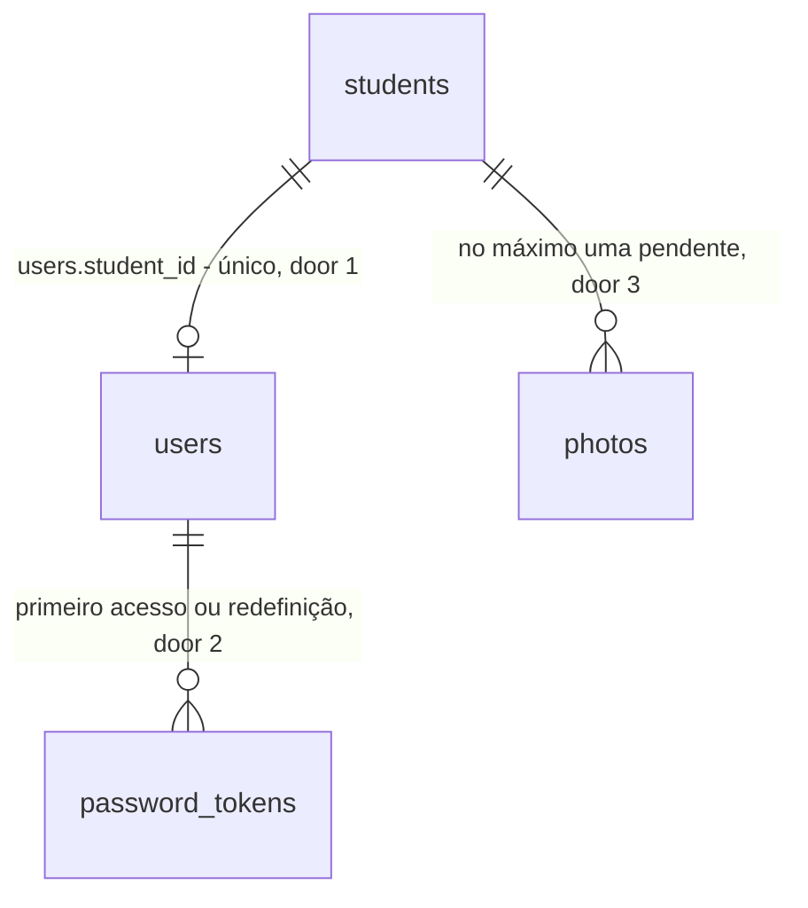

# Portal do aluno

## Problem

O aluno não tem acesso nenhum ao sistema. Para saber se o período está pago, quando vence ou o que está na ficha, ele pergunta na recepção; para trocar telefone, endereço ou contato de emergência, ele pede, e alguém de `admin` ou `reception` digita (`PATCH /api/students/:id`). Foto nova só existe se ele estiver no balcão na hora da captura. Quem paga é a recepção, que gasta o atendimento com consulta e digitação, e o aluno, que depende do horário da academia para algo que é dele. `users` só conhece os quatro perfis da equipe (AD-018, `users_role_valid`), o Better Auth roda sem cadastro aberto (AD-017) e o PRD v1.0 deixa o perfil Aluno para a fase 2 (§2). A fonte (pedido do usuário em 2026-10-28) não traz volume de atendimentos.

Quando isto entrar: o aluno maior de idade, com ficha e e-mail cadastrados pela recepção, abre `/primeiro-acesso`, informa CPF e e-mail e, se os dois batem com a ficha, recebe no e-mail da ficha um link para criar a senha; ninguém da equipe precisa agir. Ele entra pela mesma tela `/login` e cai em `/minha-conta`, onde vê o próprio perfil e os períodos das matrículas com a situação de cada um (pago, pendente, atrasado), altera telefone, endereço e contato de emergência (e-mail e CPF nunca mudam pelo portal) e envia uma foto nova, que só substitui a da ficha quando a recepção aprovar. Esqueceu a senha, pede um link em `/esqueci-senha`. Inativar ou anonimizar o aluno corta o acesso; a suspensão não.

## Flow

Reutiliza a guarda por perfil (`apps/api/src/access.ts`, com `@Public()`), o `ValidationInterceptor`, o `ProblemFilter`, `audit.record` com `actorOf` (IP pela AD-028), o hash e a regra de senha de `apps/api/src/password.ts` e do Better Auth (12 a `PASSWORD_MAX_LENGTH`), a revogação de sessões de `UsersService.resetPassword`, o token de 32 bytes com hash SHA-256 de `leads.service.ts`, a contagem por janela de `attemptLead` (`lead-throttle.ts`), o `MailService` (pre-cadastro, door 5), `cpfSchema` e `emailSchema` de `packages/contracts`, o pipeline de foto de `PhotosService.store` (tipos, 5 MiB, 300×400, três variantes) e o expurgo de `PhotoPurge` (AD-050), a listagem de períodos de `StudentPaymentsService.list`, `isMinor` de `packages/contracts/src/students.ts` e, no web, `fetchApi`, `readSession`, `AuthFrame` e o recorte 3:4 de `components/photo`. O que não existe e esta feature cria: o perfil `student` com o vínculo à ficha (door 1), os tokens de senha (door 2), a foto pendente (door 3), a contagem dos pedidos públicos (door 4), o tratamento do usuário do aluno na anonimização (door 5), as páginas públicas e a área do aluno (door 6) e as ações da trilha (door 7).

**Primeiro acesso**

1. navegador `/primeiro-acesso` (door 6) -> `POST /api/portal/first-access` `@Public()` -> `ValidationInterceptor` (exists) com `cpf` e `email` -> conta a tentativa por IP e por CPF (door 4)
2. módulo de portal em `apps/api` (new, no door - placement per conventions) - na transação, acha a ficha pelo CPF e trava `FOR UPDATE`; só segue se o e-mail informado é igual ao da ficha, o aluno é `active` ou `suspended`, não anonimizado, maior de idade, sem responsável, e não tem usuário com senha e ativo; cria o usuário `student` com `student_id` (door 1) ou reusa o existente; marca como usados os tokens `first_access` abertos dele e grava um novo em `password_tokens` (door 2); grava `student.portal_access_requested` (door 7)
3. depois do commit, `MailService` (exists) envia ao e-mail da ficha o link `/definir-senha?token=...`; falha vira linha de log
4. out: `202` com o mesmo corpo em todos os casos aceitos, elegível ou não; `422`; `429`

**Definir a senha (primeiro acesso ou redefinição)**

1. navegador abre `/definir-senha?token=...` (door 6) - página com o formulário de senha, sem efeito ao abrir
2. `POST /api/password-tokens/consume` `@Public()` -> módulo de portal - acha o dono do token pelo hash sem travar (door 2), trava o usuário e depois o token, confere validade, uso e ficha, grava o hash da senha em `accounts` (`provider_id = 'credential'`, criando a linha no primeiro acesso), liga o usuário (`active = true`), marca o uso, apaga as sessões do usuário e os desafios pendentes de 2FA dele em `verifications` e grava `student.portal_password_set` (door 7), tudo na transação. `POST /api/auth/login`, `POST /api/auth/two-factor/verify`, `disable` e `confirm`, que criam sessão ou desafio fora de transação pelo Better Auth, leem o hash da senha antes e o comparam depois com o usuário travado: se mudou, sessões e desafios caem e a resposta é `401`
3. out: `204`, ou `422` com `path` igual a `token` ou `password`; o navegador segue para `/login`

**Esqueci a senha**

1. `/esqueci-senha` (door 6) -> `POST /api/password-reset` `@Public()` -> conta a tentativa por IP e por e-mail (door 4)
2. só se o e-mail é de um usuário `student` ativo com senha definida, grava um token `reset` (door 2) e `student.portal_reset_requested` (door 7) e, depois do commit, envia o e-mail
3. out: `202` com o mesmo corpo em todos os casos aceitos; `422`; `429`

**Entrar e usar o portal**

1. `POST /api/auth/login` (exists) - o usuário `student` entra como qualquer outro; `GET /api/auth/session` (exists) devolve `role: 'student'`
2. `proxy.ts` (exists) manda `student` para `/minha-conta` e o recusa em qualquer tela da equipe (door 6); a equipe é recusada em `/minha-conta`
3. `GET|PATCH /api/me/profile`, `GET /api/me/payments`, `GET|POST /api/me/photo` -> `@Roles('student')` -> módulo de portal resolve a ficha só por `users.student_id` da sessão (door 1); pagamentos por `StudentPaymentsService.list` (exists); edição de contato por `StudentsService.update` (exists) com o diff de `student.updated` e o aluno como autor; foto por `PhotosService` (exists) como pendente (door 3)

**Aprovar a foto**

1. ficha `/students/[id]` (exists) mostra o estado do acesso e a foto pendente ao lado da corrente -> `POST /api/students/:id/photo/pending/approve|reject` `@Roles('admin','reception')`
2. `PhotosService` (exists) - aprovar faz da pendente a corrente e dá prazo à anterior, como a troca da foto-captura; rejeitar dá prazo `now()` à pendente; `PhotoPurge` (exists) remove objetos e linha no próximo ciclo; grava `student.photo_approved` ou `student.photo_rejected` (door 7)

**Corte de acesso**

1. `StudentsService.inactivate` (exists) - na mesma transação que deixa a ficha `inactive`, desativa o usuário vinculado, apaga as sessões dele e marca como usados os tokens abertos; o `PATCH` continua sem chegar a `inactive` (`## Intent` de `checks.md`), e `suspended` não mexe no usuário
2. `PrivacyService.anonymizeStudent` (exists) - na mesma transação, limpa o usuário vinculado (door 5)

## Impact

| Front | What changes |
| --- | --- |
| domain | novo termo: `student` como perfil (`role`) - o aluno que tem login. Quem ramifica em `Role` hoje: `ROLE_LABELS` (`Record<Role,string>` em `apps/web/src/lib/roles.ts`, o typecheck obriga o rótulo), o menu da `Shell`, os `const ALL` de `students.controller.ts` e `photos.controller.ts`, `twoFactorEnrollmentRequired`, o select de perfil de `/users` e `createUserRequestSchema` |
| domain | novo termo: "portal" ("Minha conta" na tela) - a área do aluno; nome do módulo, das rotas `/api/portal/*` e `/api/me/*` e das ações `student.portal_*` |
| domain | termo já em uso: `users.email_verified` (Better Auth) não muda; definir a senha pelo link não o liga |
| contrato | `USER_ROLES` ganha `student`, e `STAFF_ROLES` (os quatro de hoje) nasce em `packages/contracts/src/auth.ts`; os `ALL` locais passam a `STAFF_ROLES`, e nenhuma rota de equipe muda de lista |
| contrato | `GET /api/users` não lista `student`; `POST /api/users` e `PATCH /api/users/:id` recusam `role: 'student'` com `422` (o vínculo só nasce pelo primeiro acesso) |
| contrato | `GET /api/students/:id` (exists) ganha `portal` (`none` · `pending` · `active` · `disabled`) e `pendingPhoto` (presente ou nulo), para a ficha mostrar o estado e a aprovação |
| contrato | `AUDIT_ACTIONS` passa de 47 para 52 (door 7). `ACTION_LABELS` de `apps/web/src/lib/audit.ts` obriga o rótulo; `apps/web/e2e/audit.spec.ts` fixa a contagem e passa a 52 |
| contrato | códigos de erro novos: `404` `no_pending_photo`, `409` `pending_photo_exists`, `409` `email_in_use`; o `429` reusa `too_many_attempts` |
| comportamento existente | `PATCH /api/students/:id` com e-mail diferente, quando o aluno tem usuário, passa a trocar também `users.email` na mesma transação (a equipe continua sendo a única que muda o e-mail) |
| comportamento existente | inativar a ficha (`DELETE /api/students/:id`, a única via até `inactive`) passa a desligar o login vinculado; reativar não o religa; suspender não mexe nele |
| comportamento existente | `PhotosService.store` e as listagens de versão passam a ignorar a linha pendente; `currentId`/`urlFor` (check-in, lista, ficha) não mudam, porque a pendente nunca é `is_current` |
| comportamento existente | a anonimização de aluno passa a mexer em `users`, `accounts`, `sessions`, `two_factors` e `password_tokens` (door 5); a de funcionário não muda (segue recusando `user_linked`) |
| comportamento existente | `PUT /api/auth/password` passa a conferir a senha atual com o usuário travado, na transação, e `PUT /api/users/:id/password` passa a travar os administradores ativos e o alvo e a responder `422` em `password` quando a senha mudou enquanto o pedido esperava: nenhum dos dois sobrescreve a senha do link |
| web | `proxy.ts` ganha os ramos públicos `/primeiro-acesso`, `/definir-senha` e `/esqueci-senha` e o desvio por perfil (door 6); `/login` com sessão de `student` vai a `/minha-conta`, não a `/dashboard`, e ganha os links "Primeiro acesso" e "Esqueci minha senha" |
| web | `/minha-conta` é segmento novo com `loading.tsx`: o guard de `tests/repo/motion.test.ts` que conta os segmentos com `app-loading` passa a contar mais um; a área não usa a `Shell` da equipe, então o baseline de ARIA das telas da equipe na C39 da `motion` não muda, mas `/login` ganha dois links e a C39 confere essa tela de novo |
| stored data | nada a migrar: nenhum usuário existente vira `student`; as colunas novas nascem nulas ou com padrão compatível com as linhas de hoje |

## Relations

One-way constraints: `users.student_id` único e presente se e somente se `role = 'student'` (door 1); `password_tokens.token_hash` único e `purpose` em `first_access` · `reset` (door 2); no máximo uma foto pendente por aluno, pendente nunca é corrente e só existe com dono aluno (door 3). No columns and no types here.

## Surface

| Route | In | Out | Status |
| --- | --- | --- | --- |
| `POST /api/portal/first-access` | `cpf`, `email` | - | `202`, `422`, `429` |
| `POST /api/password-tokens/consume` | `token`, `password` | - | `204`, `422` |
| `POST /api/password-reset` | `email` | - | `202`, `422`, `429` |
| `GET /api/me/profile` | - | `name` · `cpf` · `birthDate` · `email` · `phone` · `address` · `emergencyContactName` · `emergencyContactPhone` · `status` · `photoUrl` · `pendingPhoto` | `200`, `401`, `403` |
| `PATCH /api/me/profile` | `phone`, `address`, `emergencyContactName`, `emergencyContactPhone` (todos opcionais) | o perfil | `200`, `401`, `403`, `422` |
| `GET /api/me/payments` | - | lista de períodos (`StudentPayment` de hoje) | `200`, `401`, `403` |
| `POST /api/me/photo` | arquivo `multipart` | `pendingPhoto` | `201`, `401`, `403`, `409`, `413`, `422` |
| `GET /api/me/photo` | `variant` | URL assinada da corrente e da pendente | `200`, `401`, `403`, `404` |
| `POST /api/students/:id/photo/pending/approve` | - | foto corrente | `200`, `401`, `403`, `404` |
| `POST /api/students/:id/photo/pending/reject` | - | - | `204`, `401`, `403`, `404` |

Acrescentado no Build, sem mudar as linhas acima: `POST /api/me/photo` também responde `415`, como o envio da equipe, e `GET /api/me/photo` também responde `422` com `variant` inválido.

## Landing

| One-way door | Literal shape | Alternative rejected |
| --- | --- | --- |
| 1. perfil e vínculo do aluno | `USER_ROLES = ['admin','reception','hr_finance','instructor','student']`; `users.student_id uuid null unique references students(id)` sem cascata; `CHECK users_student_link: (role = 'student') = (student_id is not null)`; `STAFF_ROLES` = os quatro de hoje, em `packages/contracts/src/auth.ts` | tabela `student_accounts` à parte do Better Auth: exigiria um segundo login e uma segunda sessão; perfil por flag em `students`: o Better Auth autentica `users`, e o aluno precisa de sessão |
| 2. tokens de senha | tabela `password_tokens (id, user_id references users on delete cascade, purpose text check in ('first_access','reset'), token_hash text unique, created_at, expires_at, used_at)`; primeiro acesso vale 24 h, redefinição 1 h; emitir um novo marca `used_at` nos abertos do mesmo usuário e propósito; o token vai no corpo do `POST`, nunca no caminho | `verifications` do Better Auth com `requestPasswordReset`: o Better Auth não monta handler HTTP aqui (AD-017) e não tem primeiro acesso; reaproveitar `lead_verifications`: a chave estrangeira é para `leads` |
| 3. foto pendente | `photos.pending boolean not null default false`; `CHECK photos_pending_not_current: not (pending and is_current)`; `CHECK photos_pending_student: not pending or student_id is not null`; índice único parcial `photos_one_pending_idx on (student_id) where pending`; a pendente nasce com `expires_at = now() + 30 days` (o `PhotoPurge` leva a abandonada); aprovar: `pending = false, is_current = true, expires_at = null` e a anterior ganha o prazo da AD-047; rejeitar: `pending = false, expires_at = now()` | tabela `photo_submissions` com objetos próprios: duplicaria variantes, chaves no bucket, URL assinada e expurgo; foto direto como corrente: decisão do usuário (a recepção confere a foto no check-in) |
| 4. limite dos pedidos públicos | `attemptLead` generalizado sobre `lead_throttles`, com as chaves `access-ip:<ip>` (10 por hora), `access-cpf:<cpf>` (3 por hora), `reset-ip:<ip>` (10 por hora) e `reset-email:<e-mail>` (3 por hora) | tabela nova de contagem: a forma é idêntica à de `lead_throttles`; usar `login_throttles`: bloquearia o login do próprio aluno |
| 5. usuário do aluno na anonimização | na transação de `anonymizeStudent`: `users.name = 'Titular anonimizado'`, `users.email = 'anonimizado+<user_id>@invalid'`, `active = false`, `student_id` mantido; apaga `accounts`, `sessions`, `two_factors` e `password_tokens` do usuário | apagar o usuário: `audit_logs.user_id` não tem `ON DELETE` e o aluno é autor de linhas; recusar como `user_linked` (o caminho do funcionário): travaria o pedido de exclusão do titular por um login que ele nem usa |
| 6. áreas do web | `proxy.ts`: `/primeiro-acesso`, `/definir-senha` e `/esqueci-senha` públicas por ramo nomeado (molde da AD-117); sessão `student` só alcança `/minha-conta*`, `/two-factor/*` e as públicas, o resto vai a `/minha-conta`; sessão de equipe em `/minha-conta*` vai a `/dashboard` | prefixo `/aluno/*` para tudo: as páginas de senha servem a qualquer usuário no futuro; deixar a guarda só na API: o aluno veria telas vazias da equipe |
| 7. trilha | `AUDIT_ACTIONS` + `student.portal_access_requested`, `student.portal_password_set`, `student.portal_reset_requested`, `student.photo_approved`, `student.photo_rejected`; os pedidos públicos não têm autor e levam o IP; a foto enviada pelo aluno é `student.photo_uploaded` com ele como autor, e a edição de contato é `student.updated` | uma ação `student.portal` com `values.event`: a tela de auditoria filtra por ação |

- Nothing else in this change is hard to reverse

## Criteria

### S1: o perfil `student` não alcança nada da equipe (P1)

O novo perfil existe e nenhuma rota ou tela de hoje passa a aceitá-lo.

**Acceptance Criteria**

1. The system SHALL accept `student` in `users.role` only with `users.student_id` filled, and SHALL reject a `student_id` on any other role (`CHECK` da door 1).
2. The system SHALL keep the role list of every route that exists before this feature unchanged, so that a `student` session receives `403` on each of them except `GET /api/auth/session`, `POST /api/auth/logout`, `PUT /api/auth/password` and the `two-factor` routes.
3. WHEN `GET /api/users` is called THEN the system SHALL omit users with role `student`.
4. IF `POST /api/users` or `PATCH /api/users/:id` carries `role: 'student'` THEN the system SHALL answer `422` with `path` equal to `role`.
5. WHILE the session role is `student` the web SHALL redirect any path other than `/minha-conta*`, `/two-factor/*`, `/`, `/matricula*`, `/primeiro-acesso`, `/definir-senha` and `/esqueci-senha` to `/minha-conta`.
6. WHILE the session role is one of `STAFF_ROLES` the web SHALL redirect `/minha-conta*` to `/dashboard`.
7. WHEN a `student` session opens `/login` THEN the web SHALL redirect to `/minha-conta`.

**Independent test:** criar no banco um usuário `student` vinculado e varrer as rotas de `listRoutes`; abrir `/students` com a sessão dele.

### S2: primeiro acesso pelo próprio aluno (P1)

O aluno pede o acesso sozinho e recebe o link no e-mail da ficha.

**Acceptance Criteria**

8. WHEN `POST /api/portal/first-access` receives a CPF and an e-mail that match, after trimming and lowercasing the e-mail, a student that is `active` or `suspended`, non-anonymized, aged 18 or more by `isMinor` on the São Paulo day, with no guardian, and whose e-mail is in no other user THEN the system SHALL create the `student` user with that e-mail and the student's name (or reuse the existing one), store one `first_access` token valid for 24 hours, record `student.portal_access_requested` with the IP and no author, and answer `202`.
9. WHEN the token is stored THEN the system SHALL send one e-mail to the e-mail of the file containing `/definir-senha?token=<token>` with the 43-character token, after the transaction commits.
10. IF the mail transport fails or times out THEN the system SHALL still answer `202` and SHALL write one log line without the recipient.
11. WHEN the same student asks again THEN the system SHALL reuse the same user, mark every open `first_access` token of that user as used, and store a new one, so only the newest link works.
12. IF the CPF matches no student, the e-mail differs from the file, the student is a minor, has a guardian, is `inactive` or anonymized, the e-mail belongs to another user, or the student's user is already active with a password THEN the system SHALL answer `202` with the same body as AC 8, and SHALL store no user and no token and send no e-mail.
13. IF the CPF fails `cpfSchema` or the e-mail fails `emailSchema` THEN the system SHALL answer `422` with `path` equal to `cpf` or `email`.
14. IF the same CPF asks a 4th time, or the same IP an 11th time, within one hour THEN the system SHALL answer `429` with `Retry-After` and SHALL store no token.
15. WHEN `GET /api/students/:id` is called THEN the system SHALL return `portal` as `none` (no user), `pending` (user without password), `active` (user active with password) or `disabled` (user inactive).
16. WHEN the student file `/students/[id]` loads THEN the web SHALL show the access state as "Sem acesso ao portal", "Primeiro acesso pedido", "Acesso ativo" or "Acesso desligado", with no button that sends e-mail.
17. WHEN `/primeiro-acesso` is sent THEN the web SHALL show "Se o CPF e o e-mail forem de um aluno com cadastro, enviamos um link para o e-mail da ficha. Ele vale por 24 horas. Se você já tem senha, use Esqueci minha senha." whatever the API decided among the accepted cases.

**Independent test:** com `LogTransport`, pedir o primeiro acesso de um aluno adulto e ler o link no log; pedir com o e-mail errado e ver a mesma resposta sem link; pedir de novo e ver o primeiro link recusado.

### S3: definir a senha pelo link (P1)

O aluno cria a senha e entra.

**Acceptance Criteria**

18. WHEN `POST /api/password-tokens/consume` receives an unused, unexpired token and a password of 12 to `PASSWORD_MAX_LENGTH` characters THEN the system SHALL store the password hash in the user's `credential` account, set the user `active = true`, mark the token used, delete every session of that user, record `student.portal_password_set`, and answer `204`.
19. IF the token is unknown, used or expired THEN the system SHALL answer `422` with `path` equal to `token` and SHALL change no password.
20. IF the password has 11 characters or `PASSWORD_MAX_LENGTH + 1` THEN the system SHALL answer `422` with `path` equal to `password` and SHALL leave the token unused.
21. WHEN two requests consume the same token at once THEN the system SHALL accept exactly one and answer `422` to the other.
22. IF the token's student became `inactive` or anonymized after the token was issued THEN the system SHALL answer `422` with `path` equal to `token` and SHALL change no password.
23. WHEN the password was set THEN `POST /api/auth/login` with that e-mail and password SHALL succeed and `GET /api/auth/session` SHALL return `role: 'student'` with `twoFactorEnrollmentRequired: false`.
24. WHEN `/definir-senha?token=<token>` is opened THEN the web SHALL show the password form and SHALL NOT consume the token until the form is sent.
25. WHEN the form succeeds THEN the web SHALL go to `/login` with the message "Senha definida. Entre com seu e-mail e a nova senha."; IF it answers `422` on `token` THEN the web SHALL show "Este link não vale mais. Peça outro em Primeiro acesso ou em Esqueci minha senha."

**Independent test:** pelo link do S2, definir a senha e entrar; reusar o link e ver o `422`.

### S4: esqueci minha senha (P2)

O aluno pede um link novo sem passar pela recepção.

**Acceptance Criteria**

26. WHEN `POST /api/password-reset` receives the e-mail of an active `student` user that has a password THEN the system SHALL store one `reset` token valid for 1 hour, mark open `reset` tokens of that user as used, record `student.portal_reset_requested`, send the e-mail with `/definir-senha?token=<token>` after commit, and answer `202`.
27. WHEN the e-mail belongs to no user, to a staff user, to an inactive user or to a user without password THEN the system SHALL answer `202` with the same body and SHALL store no token and send no e-mail.
28. IF the same e-mail asks a 4th time, or the same IP an 11th time, within one hour THEN the system SHALL answer `429` with `Retry-After` and SHALL store no token.
29. IF the e-mail is not a valid e-mail THEN the system SHALL answer `422` with `path` equal to `email`.
30. WHEN `/login` renders THEN the web SHALL show the links "Primeiro acesso" to `/primeiro-acesso` and "Esqueci minha senha" to `/esqueci-senha`, and `/esqueci-senha` SHALL show, after sending, "Se o e-mail for de um aluno com acesso, enviamos um link. Ele vale por 1 hora." whatever the API decided among the accepted cases.

**Independent test:** pedir a redefinição para um aluno ativo e para um e-mail inexistente; comparar as respostas; a quarta tentativa no mesmo e-mail dá `429`.

### S5: o aluno vê o próprio perfil e os pagamentos (P1)

**Acceptance Criteria**

31. WHEN a `student` session calls `GET /api/me/profile` THEN the system SHALL return the fields of the linked file only, without `healthNotes`, and with `photoUrl` as the signed URL of the current photo or `null`.
32. The system SHALL resolve every `/api/me/*` request by `users.student_id` of the session and SHALL take no student id from the path, query or body.
33. WHEN a `student` session calls `GET /api/me/payments` THEN the system SHALL return the same periods, values and statuses (`paid`, `pending`, `overdue`) that `GET /api/students/:id/payments` returns for that student.
34. IF a staff session calls any `/api/me/*` route THEN the system SHALL answer `403`.
35. WHEN `/minha-conta` loads THEN the web SHALL show name, photo, contact data and the list of periods with plan, period, due date and status, newest first.
36. WHEN the student has no enrollment THEN `/minha-conta` SHALL show "Você ainda não tem matrícula registrada." in the payments section.
37. IF `/api/me/*` fails with `5xx` THEN `/minha-conta` SHALL show "Não foi possível carregar seus dados agora. Tente de novo em instantes." with a retry button.

**Independent test:** aluno com duas matrículas, uma paga e uma atrasada, entra e vê as duas com a situação certa.

### S6: o aluno altera os dados de contato (P1)

**Acceptance Criteria**

38. WHEN `PATCH /api/me/profile` carries any of `phone`, `address`, `emergencyContactName`, `emergencyContactPhone` valid by the same schemas as `PATCH /api/students/:id` THEN the system SHALL update those fields, record `student.updated` with the student's user as author and the diff of the changed fields, and answer `200` with the profile.
39. IF the body carries any other key (`email`, `cpf`, `name`, `birthDate`, `sex`, `healthNotes`, `status`, `guardian`) THEN the system SHALL answer `422` naming that key and SHALL change nothing.
40. The system SHALL keep `students.email`, `students.cpf` and `users.email` unchanged by any `/api/me/*` request; only staff changes the file e-mail and CPF, through `PATCH /api/students/:id`.
41. WHEN staff changes the e-mail of a student that has a user THEN the system SHALL change `users.email` to the same lowercased value in the same transaction; IF that e-mail belongs to another user THEN the system SHALL answer `409` `email_in_use` and SHALL change nothing.
42. WHEN the form on `/minha-conta` saves THEN the web SHALL show "Dados atualizados." and the new values, and SHALL show e-mail and CPF as read-only text; IF the API answers `422` THEN the web SHALL show the message under each field named in `errors[]`.

**Independent test:** trocar telefone e endereço; enviar `email` ou `cpf` dá `422` e nada muda; a auditoria mostra o aluno como autor.

### S7: foto enviada pelo aluno e aprovada pela recepção (P1)

**Acceptance Criteria**

43. WHEN a `student` session sends `POST /api/me/photo` with a file accepted by the photo pipeline THEN the system SHALL store it as pending with the next version number, `is_current = false` and `expires_at = now() + 30 days`, record `student.photo_uploaded` with the student as author, and answer `201`.
44. IF the student already has a pending photo THEN the system SHALL answer `409` `pending_photo_exists`.
45. IF the file is refused by the pipeline THEN the system SHALL answer the same `413` or `422` that `POST /api/students/:id/photo` answers for that file.
46. WHILE a photo is pending the system SHALL keep serving the previous current photo in the student list, the student file and `/check-in`.
47. WHEN `admin` or `reception` calls `POST /api/students/:id/photo/pending/approve` THEN the system SHALL make the pending photo current with `expires_at = null`, give the previous current the retention deadline of AD-047, record `student.photo_approved`, and answer `200`.
48. WHEN `admin` or `reception` calls `POST /api/students/:id/photo/pending/reject` THEN the system SHALL set the pending photo to not pending with `expires_at = now()`, record `student.photo_rejected`, and answer `204`; the next `PhotoPurge` cycle SHALL remove its objects and row.
49. IF there is no pending photo THEN approve and reject SHALL answer `404` `no_pending_photo`; IF the caller is `hr_finance` or `instructor` THEN they SHALL answer `403`.
50. WHEN a pending photo reaches its `expires_at` unreviewed THEN `PhotoPurge` SHALL remove it like any expired version.
51. WHEN the student file loads with a pending photo for `admin` or `reception` THEN the web SHALL show the pending photo next to the current one with "Aprovar" and "Recusar", and "Recusar" SHALL ask for confirmation before calling the API.
52. WHEN `/minha-conta` has a pending photo THEN the web SHALL show it with "Aguardando aprovação da recepção." and SHALL hide the upload button.

**Independent test:** aluno envia foto; o check-in segue mostrando a antiga; a recepção aprova; o check-in mostra a nova.

### S8: corte de acesso (P1)

**Acceptance Criteria**

53. WHEN a student file changes to `inactive` (by `DELETE` or `PATCH /api/students/:id`) THEN the system SHALL set the linked user `active = false` and delete its sessions in the same transaction.
54. WHEN a student file changes to `suspended` THEN the system SHALL keep the linked user and its sessions unchanged.
55. WHILE the linked user is inactive `POST /api/auth/login` SHALL fail exactly as it fails for an inactive staff user.
56. WHEN the file returns to `active` THEN the system SHALL keep the user inactive, and `portal` SHALL read `disabled` until the student completes a new first access (AC 8 and AC 18).
57. WHEN `anonymizeStudent` succeeds for a student with a user THEN the system SHALL apply door 5 in the same transaction, and no row of `users` SHALL keep the student's name or e-mail.

**Independent test:** inativar um aluno com sessão aberta; a próxima chamada a `/api/me/profile` dá `401`; suspender outro e ver que ele segue entrando; anonimizar e procurar o e-mail em `users`.

## Out of scope

| Excluded | Why |
| --- | --- |
| acesso de menor ou do responsável legal | decisão do usuário em 2026-10-28: só adulto sem responsável |
| convite enviado pela equipe | decisão do usuário em 2026-10-28: o aluno pede o primeiro acesso sozinho |
| cadastro de aluno pelo portal | a ficha continua nascendo pela recepção (com ou sem interessado da `pre-cadastro`); o primeiro acesso só liga um login a uma ficha que já existe |
| histórico de check-ins no portal | decisão do usuário em 2026-10-28 |
| ver e revogar consentimentos pelo portal | decisão do usuário em 2026-10-28 |
| trocar e-mail ou CPF pelo portal | decisão do usuário em 2026-10-28: depois do cadastro o aluno não muda e-mail nem CPF (AC 39, AC 40); o e-mail é o login e o CPF identifica o titular |
| pagar pelo portal | o PRD só prevê registro manual (RF-21) |
| redefinição de senha da equipe por e-mail | a equipe segue com a redefinição pelo Administrador (`PUT /api/users/:id/password`) |

## Assumptions

| Assumption | Chosen default | Rationale | Confirmed? |
| --- | --- | --- | --- |
| validade dos links | primeiro acesso 24 h, redefinição 1 h | os dois são pedidos pelo próprio aluno, na hora em que ele quer entrar | n |
| 2FA do aluno | opcional, pelas mesmas telas da equipe | só `admin` é obrigado (AC 24 e 25 da auth-rbac) | n |
| prazo da foto pendente sem revisão | 30 dias, igual às versões antigas | reaproveita o `PhotoPurge` sem prazo novo | n |
| aluno sem e-mail na ficha | não tem primeiro acesso até a recepção cadastrar o e-mail | o link só vai para o e-mail da ficha, que é o que prova a identidade | n |

**Open questions:**

| # | Kind | Question | Until answered |
| --- | --- | --- | --- |
| 1 | blocks go-live | credenciais de SMTP reais (as mesmas da `pre-cadastro`) | sem elas o link do primeiro acesso só sai no log; nenhum aluno recebe o e-mail |

## Observable

| Surface | Decision | Landing |
| --- | --- | --- |
| screen `/minha-conta` | empty state | AC 36 (sem matrícula); foto ausente mostra o espaço vazio do componente de foto (existing) |
| screen `/minha-conta` | loading state | existing - `loading.tsx` com `app-loading` |
| screen `/minha-conta` | error state | AC 37, AC 42 |
| screen `/minha-conta` | unauthorised | AC 6 (equipe); `proxy.ts` sem sessão vai a `/login` (existing) |
| screen `/minha-conta` | density and ordering | AC 35 (mais novo primeiro), uma coluna em 390 px |
| screen `/minha-conta` | destructive action confirms | n/a - o aluno não tem ação destrutiva; enviar foto é revisto pela recepção |
| screen `/primeiro-acesso` | all states | AC 17 (mesma mensagem em todo caso aceito); `422` por campo e `429` com a mensagem de `too_many_attempts` do login (existing) |
| screen `/definir-senha` | empty, error, unauthorised | AC 24, AC 25; pública por door 6 |
| screen `/definir-senha` | loading, ordering, destructive | n/a - formulário único, sem lista e sem ação destrutiva |
| screen `/esqueci-senha` | all states | AC 30 (mesma mensagem em todo caso aceito); `429` como no primeiro acesso |
| screen `/students/[id]` | portal and pending photo states | AC 16, AC 51 |
| screen `/students/[id]` | destructive action confirms | AC 51 (recusar foto) |
| API `POST /api/portal/first-access` | error shape, rate limit, enumeration | AC 12, AC 13, AC 14 |
| API `POST /api/password-tokens/consume` | error shape and codes | AC 19, AC 20, AC 22 |
| API `POST /api/password-reset` | error shape, rate limit | AC 28, AC 29 |
| API `/api/me/*` | who may call it | AC 32, AC 34 |
| API `photo/pending/*` | error shape and codes | AC 49 |
| all new `/api/*` routes | versioning | n/a - API interna, consumida só pelo web do mesmo repositório |
| document e-mail de primeiro acesso e de redefinição | structure, tone, next step | AC 9, AC 26: assunto, uma frase, o link e o prazo em horas; o texto final é da academia (o mesmo pendente de go-live da `pre-cadastro`) |

## Sources

- pedido do usuário em 2026-10-28 e as respostas da mesma sessão: foto com aprovação, só contato, sem menores, esqueci a senha, e-mail e CPF fixos, primeiro acesso pelo próprio aluno, suspenso mantém o acesso
- AD-017, AD-018, AD-047, AD-050 e as doors da `pre-cadastro` (e-mail e token) em `.specs/STATE.md`
