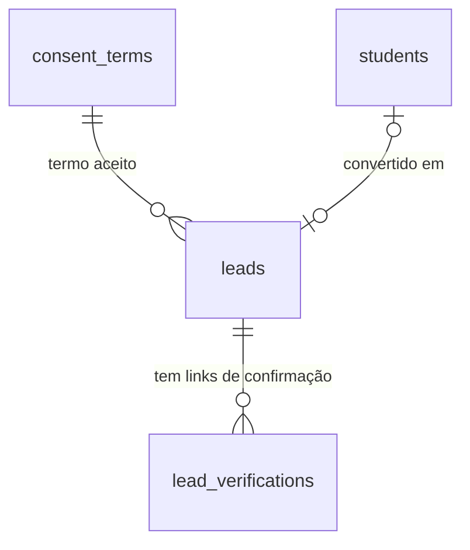

# Pré-cadastro

## Problem

Quem visita a landing e decide treinar não tem como dizer isso ao sistema. O "Matricule-se" do card de planos leva a `#localizacao` (AD-106), e a partir dali a pessoa precisa ir à recepção ou procurar a academia no Instagram; nada fica registrado de quem quis se matricular, e a recepção só sabe dela se ela aparecer. Quem paga é a academia, que perde o interessado que não volta, e o interessado, que repete nome e telefone no balcão. Matricular continua sendo um ato da equipe (`POST /api/students` e `POST /api/students/:id/enrollments`, só `admin` e `hr_finance`), e um aluno exige CPF, nascimento e telefone (AD-030, `students_identified_complete`) - dados que ninguém deveria digitar num formulário público para "quero começar". A fonte não traz número de visitantes nem de interessados perdidos.

Quando isto entrar: o visitante abre `/matricula`, informa nome, e-mail e telefone, declara ter 18 anos ou mais e aceita o termo de tratamento de dados; recebe um e-mail com um link de confirmação, ou, quando a academia ligou o Google, entra com a conta Google e só completa o telefone. A recepção, o RH/Financeiro e o Administrador veem a lista "Interessados", marcam quem já foi contatado ou descartado e, ao matricular, abrem o cadastro de aluno já preenchido com nome, e-mail e telefone; o interessado vira aluno na mesma transação. Interessado que não confirma some em 7 dias, e qualquer interessado some em 90 dias. Nenhum interessado ganha login.

## Flow

Reutiliza a guarda por perfil (`apps/api/src/access.ts`, com `@Public()`), o `ValidationInterceptor`, o `ProblemFilter`, `audit.record` com `actorOf` (IP pela AD-028), a forma da contagem de `LoginThrottle` (`apps/api/src/auth/throttle.ts`), o termo vigente de `consent_terms` (AD-037), `nameSchema`, `phoneSchema` e `emailSchema` de `packages/contracts`, o temporizador no processo da API (molde da AD-050 e da AD-081), o repasse de `/api/*` do web (AD-019, já com `redirect: 'manual'` e `Set-Cookie`) e, no web, `fetchApi`, a `Shell` e o formulário de aluno de `/students/new`: nenhuma rota nova ganha guarda, erro, validação, auditoria ou temporizador próprio. O que não existe e esta feature cria: duas tabelas e uma contagem (doors 1, 2 e 4), o envio de e-mail (door 5), o login social fora do Better Auth (door 7) e a primeira página pública além de `/` e `/login` (door 11).

**Enviar o pré-cadastro**

1. navegador `GET /matricula` -> `proxy.ts` (exists) deixa passar sem sessão (door 11) -> a página renderizada no servidor chama `GET /api/leads/options` por `fetchApi` (exists) e recebe se o Google está ligado e o termo vigente
2. `POST /api/leads` -> repasse e checagem de origem (exists, AD-020) -> `AccessGuard` (exists) com `@Public()` -> `ValidationInterceptor` (exists) com o schema de `packages/contracts`
3. módulo de interessados em `apps/api` (new, no door - placement per conventions) - conta a tentativa por IP e por e-mail em `lead_throttles` (door 4); na transação, cria ou atualiza o interessado aberto daquele e-mail em `leads` (door 1), grava o token em `lead_verifications` (door 2) e a linha `lead.created` (door 8) por `audit.record` (exists)
4. depois do commit, `MailService` (door 5) envia o e-mail com o link `/matricula/confirmar?token=...`, fora do tempo da resposta; falha vira linha de log
5. out: `202` com o mesmo corpo para e-mail novo, repetido ou já confirmado; `422`; `429`

**Confirmar o e-mail**

1. navegador abre `/matricula/confirmar?token=...` (door 11) - página com o botão "Confirmar e-mail", sem efeito ao abrir (door 3)
2. `POST /api/leads/confirm` `@Public()` -> módulo de interessados - acha o token pelo hash em `lead_verifications` (door 2), marca o uso e `email_verified_at` em `leads`, grava `lead.confirmed` (door 8) na mesma transação
3. out: `200`, ou `422` com `path` igual a `token`

**Entrar com Google (só com as variáveis da door 6)**

1. `GET /api/leads/google/start` `@Public()` -> módulo de interessados - grava `state` e o verificador PKCE num cookie assinado (door 7) e responde `302` para o Google
2. Google -> `GET /api/leads/google/callback` `@Public()` - confere o `state`, troca o `code` no endpoint de token do Google por `fetch`, valida o `id_token` (door 7), grava nome e e-mail num segundo cookie assinado e responde `302` para `/matricula?google=ok` (ou `?google=erro`)
3. `/matricula` chama `GET /api/leads/google/profile` repassando o cookie e mostra nome e e-mail fixos; `POST /api/leads` com o cookie cria o interessado já confirmado, sem e-mail

**Interessados no painel e conversão**

1. navegador `GET /leads` -> `proxy.ts` (exists) exige sessão -> página chama `GET /api/leads` por `fetchApi` (exists) dentro da `Shell` (exists), que ganha o link "Interessados"
2. `PATCH /api/leads/:id` -> `AccessGuard` (exists) com `@Roles('admin','reception','hr_finance')` -> módulo de interessados - muda `status` e grava `lead.status_changed` (door 8)
3. "Matricular" leva a `/students/new?lead=<id>` (exists) com nome, e-mail e telefone preenchidos; `POST /api/students` (exists) aceita `leadId` opcional e, na mesma transação do aluno, passa o interessado a `converted` com `student_id` (door 9)

**Retenção**

1. temporizador no processo da API (exists, molde da AD-050) - na subida e a cada 60 minutos apaga de `leads` os não confirmados com mais de 7 dias e todos com mais de 90 dias, com `lead_verifications` em cascata, e grava `lead.purged` por linha (door 10)

## Impact

| Front | What changes |
| --- | --- |
| domain | novo termo: `lead` ("interessado" na tela) - quem pediu matrícula pela página pública e ainda não é aluno; nome da tabela, das rotas `/api/leads*`, da tela `/leads` e da `entity` da trilha. Ninguém ramifica nele hoje |
| domain | termo já em uso com outro sentido: "matrícula" é um período em `enrollments` (AD-060); a página pública `/matricula` não cria matrícula nenhuma, só um `lead`. O código desta feature não usa `enrollment` em nenhum nome |
| domain | termo já em uso: `email_verified` existe em `users` (Better Auth) e não muda; o de `leads` é outra coluna, sem relação |
| contrato | `POST /api/students` ganha o campo opcional `leadId` (door 9); quem não o envia continua com o mesmo comportamento |
| contrato | `AUDIT_ACTIONS` passa de 43 para 47 (door 8). `ACTION_LABELS` de `apps/web/src/lib/audit.ts` é `Record<AuditAction, string>`: o typecheck falha até a tela ter o rótulo de cada uma; `apps/web/e2e/audit.spec.ts` fixa a contagem e passa a 47 |
| contrato | códigos de erro novos: `409` `lead_converted` e `lead_email_open`; o `429` reusa `too_many_attempts` do login |
| comportamento existente | AD-106: o "Matricule-se" do card de planos deixa de levar a `#localizacao` e passa a `/matricula`; a C39 da `motion` ignora `#planos` em `/`, então o baseline não muda, mas o link é conferido de novo |
| comportamento existente | AD-017 continua: o Better Auth segue sem cadastro aberto e sem `socialProviders`; o login da equipe não muda |
| web | `proxy.ts` ganha o terceiro ramo público (door 11); a guarda de `tests/repo/identidade.test.ts` sobre `page.tsx` da landing continua valendo, porque o formulário não mora na landing |
| web | a `Shell` ganha "Interessados" para `admin`, `reception` e `hr_finance`; `apps/web/e2e/shell.spec.ts` confere o menu por perfil |
| ambiente | oito variáveis novas, todas opcionais (door 6): `SMTP_HOST`, `SMTP_PORT`, `SMTP_SECURE`, `SMTP_USER`, `SMTP_PASS`, `MAIL_FROM`, `GOOGLE_CLIENT_ID`, `GOOGLE_CLIENT_SECRET`; entram em `.env.example` vazias, e `SMTP_PASS` e `GOOGLE_CLIENT_SECRET` entram na lista de custódia da AD-089 |
| dependência | `nodemailer` em `apps/api` (door 5); o guard da AD-104 só olha `motion` e não muda |
| `.specs` | aprovado o plano, as doors viram AD-107 em diante em `STATE.md`; a AD-106 ganha a nota do novo destino do "Matricule-se"; o `ROADMAP.md` ganha a linha 15 |
| stored data | nothing to migrate - a migração `0012` cria `leads`, `lead_verifications` e `lead_throttles` vazias e não toca tabela existente |
| stored data | `leads.student_id` aponta para `students` sem `ON DELETE`: a anonimização (AD-075) não apaga aluno, então nada muda nela; o interessado convertido é apagado pela retenção em 90 dias |

## Relations

One-way constraints: no máximo um interessado aberto (`new` ou `contacted`) por e-mail, em minúsculas (door 1); a situação é um de quatro valores e `converted` exige o aluno e só ele o tem (door 1); o termo aceito é sempre `data_processing` numa versão que existe (door 1); o token só existe como hash, vale 24 horas e é usado uma vez (door 2); apagar o interessado apaga os tokens dele (door 2). `lead_throttles` não se relaciona com nada. O autor de cada mudança está em `audit_logs`, que aponta para o interessado por `entity_id`, sem chave estrangeira. Nomes das demais colunas e índices de leitura ficam para o diff.

## Surface

Rotas novas e uma assinatura que muda. Toda rota também pode responder com a linha de erro comum da `auth-rbac` (`403 csrf_rejected` nas de escrita).

| Route | In | Out | Status |
| --- | --- | --- | --- |
| `GET /api/leads/options` | nada | `google` (booleano) · `term` (`version` · `text`) | `200` |
| `POST /api/leads` | `name`, `email`, `phone`, `adult` (`true`), `termVersion`, `website` (armadilha, vazio); com o cookie do Google, `email` é ignorado | `status: "pending"` ou `status: "confirmed"` | `202`, `422`, `429` |
| `POST /api/leads/confirm` | `token` | `status: "confirmed"` | `200`, `422` |
| `GET /api/leads/google/start` | nada | `Location` do Google · cookie de estado | `302`, `404` |
| `GET /api/leads/google/callback` | `code`, `state` (query) · cookie de estado | `Location` `/matricula?google=ok` ou `?google=erro` · cookie de perfil | `302`, `404` |
| `GET /api/leads/google/profile` | cookie de perfil | `name` · `email` | `200`, `404` |
| `GET /api/leads` | `status` opcional (um dos quatro) | `items[]`: `id` · `name` · `email` · `phone` · `source` · `status` · `emailVerified` · `createdAt` · `studentId` | `200`, `401`, `403`, `422` |
| `PATCH /api/leads/:id` | `status` (`new`, `contacted` ou `discarded`) | o interessado, como um item de `GET /api/leads` | `200`, `401`, `403`, `404`, `409`, `422` |
| `POST /api/students` (muda) | os campos de hoje e `leadId` opcional | o aluno, como hoje | os de hoje e `409` com `lead_converted` |

## Landing

| One-way door | Literal shape | Alternative rejected |
| --- | --- | --- |
| 1. tabela `leads` | migração `0012` (AD-008); `id uuid DEFAULT uuidv7()`; `email` guardado em minúsculas e aparado; `CREATE UNIQUE INDEX leads_one_open_email_idx ON leads (email) WHERE status in ('new', 'contacted')`; `status` com `CHECK (status in ('new', 'contacted', 'converted', 'discarded'))` e padrão `new`; `source` com `CHECK (source in ('form', 'google'))`; `phone` `NOT NULL`; `consent_purpose` fixo em `data_processing` por `CHECK` e `(consent_purpose, consent_term_version)` com chave estrangeira para `consent_terms`; `student_id` anulável referenciando `students(id)` sem `ON DELETE`, com `CHECK ((status = 'converted') = (student_id IS NOT NULL))`; `email_verified_at` anulável; sem CPF, sem nascimento e sem `tenant_id` (AD-016) | linha em `students` com `status` novo `lead` - a AD-030 e o `students_identified_complete` exigem CPF, nascimento e telefone, e afrouxar isso tiraria do banco a garantia de que todo aluno está identificado; a lista de alunos, o painel e o check-in passariam a filtrar interessados. Conta de usuário com papel novo - a AD-018 tem quatro papéis de equipe, e o portal do aluno é fase 2 do PRD. `UNIQUE` em `email` na tabela inteira - quem foi descartado ou já virou aluno não poderia pedir de novo. Fecha: interessado não é aluno até alguém da equipe cadastrá-lo; o portal do aluno, quando vier, nasce de `students`, não daqui |
| 2. tokens de confirmação | tabela `lead_verifications`: `lead_id` referenciando `leads(id) ON DELETE CASCADE`, `token_hash` com `UNIQUE` igual ao SHA-256 em hex do token, `expires_at` igual a criação mais 24 horas, `used_at` anulável que muda uma vez; o token é 32 bytes de `crypto.randomBytes` em base64url e só existe no e-mail; reenviar cria outro token e não invalida os anteriores ainda válidos | `verifications` do Better Auth - é dele, e uma mudança de versão dele mudaria o formato sob nós (AD-017). Token cru no banco - quem lê um backup confirma e-mails alheios. Token assinado sem tabela (HMAC com prazo) - não tem como marcar uso único. Fecha: o link vale 24 horas; depois disso a pessoa envia o formulário de novo |
| 3. confirmar exige um clique na página | o link do e-mail é `<WEB_ORIGIN>/matricula/confirmar?token=<token>`; abrir a página não grava nada; o botão "Confirmar e-mail" chama `POST /api/leads/confirm` com `{ token }` | `GET /api/leads/confirm?token=` com efeito - os filtros de e-mail e as prévias de link abrem a URL sozinhos e confirmariam sem a pessoa; um `GET` com efeito também fura a AD-020, que só confere origem fora de `GET`. Fecha: confirmar é sempre dois passos |
| 4. limite do formulário público | tabela `lead_throttles (key text PRIMARY KEY, hits timestamptz[] NOT NULL)` com a mesma instrução única de `LoginThrottle`; chaves `ip:<req.ip>` (5 envios por hora) e `email:<e-mail>` (3 por hora), conferidas antes de validar o termo e de gravar; estouro responde `429` com `too_many_attempts` e `Retry-After`; a armadilha `website` preenchida responde `202` sem gravar nem contar | reusar `login_throttles` - a chave lá é o e-mail da equipe, e um visitante poderia bloquear o login de um funcionário digitando o e-mail dele. Limite só no Caddy - não existe em desenvolvimento nem nos testes e não conhece o e-mail. CAPTCHA - script de terceiro, que o CSP da AD-084 recusa. Fecha: os números são constantes no código; mudar é um commit |
| 5. envio de e-mail | dependência `nodemailer` só em `apps/api` (pelo catálogo do pnpm); `MailService` com um método `send({ to, subject, text, html })` e dois transportes: SMTP quando `SMTP_HOST` existe e, sem ele, um que escreve no log `e-mail não enviado: SMTP não configurado` e, só fora de `NODE_ENV=production`, o link; envio depois do commit, sem esperar pela resposta HTTP, com tempo limite de 10 s; falha vira log `lead_mail_failed` com o id do interessado, nunca com o endereço | cliente SMTP próprio sobre `node:net` - TLS, `STARTTLS` e autenticação são o que o `nodemailer` resolve há anos. API de provedor (SES, Resend) - prende a um fornecedor; quase todo provedor fala SMTP. Enviar dentro da transação - o repasse do web espera 10 s (AD-019) e um SMTP lento derrubaria o formulário. Fila ou worker - recusados nas AD-046 e AD-050. Fecha: um e-mail perdido não é reenviado sozinho; a pessoa envia o formulário de novo |
| 6. SMTP e Google opcionais por ambiente | em `apps/api/src/env.ts`: `SMTP_HOST` opcional; `SMTP_PORT` inteiro de 1 a 65535 com padrão `587`; `SMTP_SECURE` `true`/`false` com padrão `false`; `SMTP_USER` e `SMTP_PASS` opcionais e juntos; `MAIL_FROM` obrigatório quando `SMTP_HOST` existe; `GOOGLE_CLIENT_ID` e `GOOGLE_CLIENT_SECRET` opcionais e juntos; string vazia conta como ausente; todas em `.env.example` sem valor; `SMTP_PASS` e `GOOGLE_CLIENT_SECRET` entram na lista da AD-089 | obrigatórias pela AD-015 - a API não subiria até alguém ter conta de SMTP e projeto no Google, e as credenciais só chegam depois. Configuração na tela do Administrador - segredo no banco entraria no backup, o que a AD-089 recusa. Fecha: sem SMTP o formulário funciona e ninguém confirma por e-mail; o go-live exige as variáveis (Open question 1) |
| 7. Google direto, fora do Better Auth | OpenID Connect com código e PKCE `S256` por `fetch`: autorização em `https://accounts.google.com/o/oauth2/v2/auth` com `scope=openid email profile`, `redirect_uri=<WEB_ORIGIN>/api/leads/google/callback`, `prompt=select_account`; troca em `https://oauth2.googleapis.com/token`; o `id_token` vem direto do endpoint de token por TLS e é aceito se `iss` é `https://accounts.google.com` ou `accounts.google.com`, `aud` é `GOOGLE_CLIENT_ID`, `exp` é futuro e `email_verified` é `true`; cookie `lead_google_state` (`state` e verificador, 10 min, `Path=/api/leads/google`) e cookie `lead_google_profile` (`name` e `email`, 15 min, `Path=/api/leads`), os dois `HttpOnly`, `SameSite=Lax`, `Secure` fora de desenvolvimento e assinados com HMAC-SHA256 de `AUTH_SECRET`; sem as duas variáveis, as três rotas Google respondem `404` | `socialProviders` do Better Auth - criaria uma linha em `users`, com papel obrigatório da AD-018, e montaria o handler que a AD-017 recusa. Google Identity Services (One Tap, botão renderizado pelo Google) - script e iframe de terceiro, que o CSP da AD-084 recusa. Biblioteca `openid-client` ou `arctic` - uma dependência para duas chamadas `fetch` e quatro comparações. Conferir a assinatura do `id_token` por JWKS - a OIDC Core 3.1.3.7 dispensa quando o token vem direto do endpoint de token por TLS. Fecha: só Google; outro provedor é outra rota no mesmo molde |
| 8. ações e campos registráveis de interessado | em `AUDIT_ACTIONS` (AD-025), depois das 43 existentes, nesta ordem: `lead.created`, `lead.confirmed`, `lead.status_changed`, `lead.purged`; `entity` igual a `lead` e `entity_id` igual ao id do interessado; campos registráveis (AD-026): `status` e `source`; nome, e-mail e telefone nunca entram, nem como nome de campo alterado; `lead.created` e `lead.confirmed` têm `user_id` nulo e IP da requisição; `lead.purged` usa `NO_ACTOR` e `diff` nulo; reenvio do formulário para um interessado aberto não grava linha | sem trilha para o público - a AD-025 pede toda ação sensível, e o painel precisa saber de onde veio um interessado. `entity` igual a `student` na conversão - o interessado ainda não é aluno; a conversão grava `student.created` (já existe) e `lead.status_changed`. Fecha: a trilha mostra quantos e quando, nunca quem |
| 9. conversão na transação do aluno | `createStudentRequestSchema` ganha `leadId` opcional (`uuid`); `POST /api/students` com `leadId` trava a linha do interessado `FOR UPDATE`, exige `status` em `new` ou `contacted` (senão `409 lead_converted`; inexistente é `422` com `path` `leadId`) e grava `status = 'converted'` e `student_id` na mesma transação do aluno, com `lead.status_changed` | duas chamadas do web (criar o aluno e depois `PATCH` no interessado) - uma falha no meio deixa um aluno criado e o interessado aberto, e dois cliques convertem duas vezes. `PATCH /api/leads/:id` com `converted` - aceitaria converter sem aluno. Fecha: só quem pode criar aluno (`admin` e `hr_finance`) converte; a recepção marca contatado |
| 10. retenção própria de interessados | temporizador no processo da API (molde AD-050), na subida e a cada 60 minutos: `DELETE FROM leads WHERE (email_verified_at IS NULL AND created_at < now() - interval '7 days') OR created_at < now() - interval '90 days'`, uma linha `lead.purged` por id apagado na mesma transação; prazos são constantes no código, fora de `privacy_settings` | entrar na AD-078 (`privacy_settings`) - aquele prazo é em anos e de titulares que foram alunos; interessado não tem ficha a exportar nem anonimizar. Guardar para sempre - dado pessoal sem finalidade depois que ninguém o procurou (LGPD art. 15). Fecha: a lista de interessados mostra no máximo 90 dias |
| 11. páginas públicas `/matricula*` | `proxy.ts` ganha o ramo `pathname === '/matricula' \|\| pathname.startsWith('/matricula/')`, que segue com ou sem sessão e com nonce, como `/`; as páginas são `force-dynamic`; `SITE.plans.items[0].cta` passa a ter `href: '/matricula'`; os textos das páginas ficam em `SITE.matricula` (AD-097) | o formulário dentro da landing - a guarda de `tests/repo/identidade.test.ts` proíbe `/api/` em `page.tsx`, e a landing é estática fora do nonce. Prefixo `/publico/*` - a URL é o que o visitante lê, e a AD-003 pede português. Fecha: outra página pública é outro ramo nomeado, nunca um prefixo genérico |

- Nothing else in this change is hard to reverse

## Criteria

### S1: Enviar o pré-cadastro (P1)

O visitante deixa nome, e-mail e telefone, e o sistema guarda um interessado e manda o link.

**Acceptance Criteria**

1. WHEN `POST /api/leads` recebe sem sessão `name`, `email`, `phone` válidos, `adult` igual a `true`, `termVersion` igual à maior `version` de `data_processing` e `website` vazio ou ausente THEN the system SHALL responder `202` com `{"status":"pending"}` e gravar em `leads` uma linha com `status` igual a `new`, `source` igual a `form`, o e-mail em minúsculas e `email_verified_at` nulo
2. WHEN a AC 1 responde `202` THEN the system SHALL gravar uma linha em `lead_verifications` com `expires_at` 24 horas depois da criação e chamar o envio de um e-mail para o endereço informado com assunto "Confirme seu pré-cadastro" e um link `<WEB_ORIGIN>/matricula/confirmar?token=<token>` cujo SHA-256 é o `token_hash` gravado
3. IF `name`, `email` ou `phone` falta ou é reprovado por `nameSchema`, `emailSchema` ou `phoneSchema` de `packages/contracts`, ou um campo de texto contém U+0000 THEN the system SHALL responder `422` com um item em `errors` cujo `path` é aquele campo, sem gravar em `leads` nem enviar e-mail
4. IF `adult` não é `true` THEN the system SHALL responder `422` com um item em `errors` de `path` igual a `adult` e `message` igual a "Menores de 18 anos fazem a matrícula na recepção, com o responsável."
5. IF `termVersion` não é a maior `version` de `data_processing` THEN the system SHALL responder `422` com um item em `errors` de `path` igual a `termVersion`
6. WHEN `POST /api/leads` recebe o e-mail de um interessado com `status` `new` ou `contacted` e `email_verified_at` nulo THEN the system SHALL responder `202` com `{"status":"pending"}`, atualizar `name` e `phone` dessa mesma linha, criar outro token e enviar outro e-mail, sem criar outra linha em `leads`
7. WHEN `POST /api/leads` recebe o e-mail de um interessado aberto com `email_verified_at` preenchido THEN the system SHALL responder `202` com `{"status":"pending"}` sem alterar a linha e sem enviar e-mail
8. WHEN `POST /api/leads` recebe o e-mail de um interessado `converted` ou `discarded`, ou de um aluno THEN the system SHALL responder `202` e criar uma linha nova em `leads`
9. IF dois `POST /api/leads` com o mesmo e-mail novo chegam ao mesmo tempo THEN the system SHALL responder `202` aos dois e deixar exatamente uma linha aberta com aquele e-mail
10. IF `website` vem preenchido THEN the system SHALL responder `202` com `{"status":"pending"}` sem gravar em `leads`, `lead_verifications` ou `lead_throttles` e sem enviar e-mail
11. IF o envio do e-mail falha ou passa de 10 s THEN the system SHALL manter o `202` já respondido e a linha gravada, e escrever no log uma linha com `lead_mail_failed` e o id do interessado, sem o endereço de e-mail
12. WHILE `SMTP_HOST` está ausente the system SHALL aceitar o `POST /api/leads` como na AC 1 e escrever no log "e-mail não enviado: SMTP não configurado", com o link só quando `NODE_ENV` não é `production`
13. WHEN `GET /api/leads/options` é chamado sem sessão THEN the system SHALL responder `200` com `google` e `term` contendo `version` e `text` da maior versão de `data_processing`

**Independent test:** sem SMTP, `curl` em `POST /api/leads` com dados válidos, ler o link no log da API e conferir a linha `new` pelo `psql`; repetir o envio e ver a mesma linha.

### S2: Confirmar o e-mail (P1)

O link do e-mail leva a uma página, e o clique confirma.

**Acceptance Criteria**

14. WHEN `POST /api/leads/confirm` recebe um `token` cujo hash existe, sem `used_at` e com `expires_at` futuro THEN the system SHALL responder `200` com `{"status":"confirmed"}`, preencher `used_at` do token e `email_verified_at` do interessado com o instante do banco
15. WHEN `POST /api/leads/confirm` recebe um token já usado de um interessado já confirmado THEN the system SHALL responder `200` com `{"status":"confirmed"}` sem alterar nenhuma linha
16. IF o `token` falta, não tem hash conhecido, está vencido, ou é de um interessado apagado THEN the system SHALL responder `422` com um item em `errors` de `path` igual a `token` e `message` igual a "Link inválido ou expirado. Envie o pré-cadastro de novo."
17. WHEN um interessado com dois tokens válidos confirma por um deles THEN the system SHALL aceitar o outro como na AC 15
18. WHEN alguém abre `/matricula/confirmar?token=<token>` THEN the system SHALL exibir o botão "Confirmar e-mail" sem chamar `POST /api/leads/confirm` antes do clique
19. WHEN o botão "Confirmar e-mail" recebe resposta `200` THEN the system SHALL exibir "E-mail confirmado. A recepção vai entrar em contato para concluir sua matrícula."
20. IF o botão recebe `422` THEN the system SHALL exibir a mensagem da AC 16 e um link "Voltar ao pré-cadastro" para `/matricula`

**Independent test:** pegar o link da S1, abrir a página e ver que `email_verified_at` continua nulo; clicar e ver o campo preenchido; clicar de novo e receber a mesma mensagem.

### S3: Limite e abuso do formulário público (P1)

Um visitante ou um robô não enche a tabela nem a caixa de e-mail de alguém.

**Acceptance Criteria**

21. IF o mesmo `req.ip` já fez 5 `POST /api/leads` contados na última hora THEN the system SHALL responder ao sexto `429` com `code` igual a `too_many_attempts` e `Retry-After` em segundos até a mais antiga sair da janela, sem gravar em `leads` nem enviar e-mail
22. IF o mesmo e-mail já recebeu 3 `POST /api/leads` contados na última hora, de qualquer IP THEN the system SHALL responder ao quarto `429` como na AC 21
23. IF seis `POST /api/leads` do mesmo IP chegam ao mesmo tempo THEN the system SHALL responder `202` a no máximo cinco
24. The system SHALL contar em `lead_throttles` e nunca em `login_throttles`, de modo que 3 envios com o e-mail de um funcionário não mudam o login dele
25. IF `POST /api/leads` ou `POST /api/leads/confirm` chega sem `Origin` igual a `WEB_ORIGIN` e sem `Sec-Fetch-Site: same-origin` THEN the system SHALL responder `403` com `csrf_rejected` (AD-020)
26. The system SHALL dar a mesma resposta `202` e o mesmo corpo nas AC 1, 6, 7, 8 e 10, sem revelar se o e-mail já existe como interessado ou aluno

**Independent test:** seis `curl` seguidos do mesmo IP com e-mails diferentes; o sexto recebe `429` com `Retry-After`; o login do Administrador continua funcionando.

### S4: Entrar com Google (P2)

Quem tem conta Google não digita nome e e-mail nem confirma por link.

**Acceptance Criteria**

27. WHERE `GOOGLE_CLIENT_ID` e `GOOGLE_CLIENT_SECRET` existem the system SHALL responder `GET /api/leads/options` com `google` igual a `true` e `GET /api/leads/google/start` com `302` para `https://accounts.google.com/o/oauth2/v2/auth` com `client_id`, `redirect_uri` igual a `<WEB_ORIGIN>/api/leads/google/callback`, `response_type=code`, `scope=openid email profile`, `state`, `code_challenge` e `code_challenge_method=S256`, e o cookie `lead_google_state`
28. IF uma das duas variáveis falta THEN the system SHALL responder `google` igual a `false` em `GET /api/leads/options` e `404` com `not_found` nas três rotas `/api/leads/google/*`
29. WHEN o callback recebe `state` igual ao do cookie e o Google devolve um `id_token` com `iss`, `aud`, `exp` e `email_verified` válidos pela door 7 THEN the system SHALL responder `302` para `/matricula?google=ok`, apagar `lead_google_state` e gravar `lead_google_profile` com `name` e `email`
30. IF o callback recebe `state` diferente do cookie, sem cookie, com `error` na query, ou o Google responde erro, ou o `id_token` falha em `iss`, `aud`, `exp` ou `email_verified` THEN the system SHALL responder `302` para `/matricula?google=erro` sem gravar `lead_google_profile`
31. WHEN `GET /api/leads/google/profile` recebe um `lead_google_profile` válido e não vencido THEN the system SHALL responder `200` com `name` e `email`; senão SHALL responder `404`
32. WHEN `POST /api/leads` chega com `lead_google_profile` válido THEN the system SHALL usar o `email` do cookie no lugar do enviado, gravar `source` igual a `google` e `email_verified_at` com o instante do banco, responder `202` com `{"status":"confirmed"}`, apagar o cookie e não enviar e-mail
33. IF `lead_google_profile` tem assinatura inválida THEN the system SHALL tratá-lo como ausente

**Independent test:** com as variáveis e um endpoint de token simulado no teste, chamar `start`, devolver o `state` ao callback com um `id_token` de `aud` correto e ver `/matricula?google=ok`; repetir com `aud` errado e ver `?google=erro`.

### S5: Interessados no painel (P1)

A equipe vê quem pediu, marca o andamento e converte em aluno.

**Acceptance Criteria**

34. WHEN um usuário de perfil `admin`, `reception` ou `hr_finance` chama `GET /api/leads` sem `status` THEN the system SHALL responder `200` com os interessados de `status` `new` e `contacted` em `items`, do mais recente para o mais antigo por `createdAt` e, no empate, por `id` decrescente, cada um com as chaves da Surface
35. WHEN `GET /api/leads` recebe `status` igual a um dos quatro valores THEN the system SHALL devolver só os interessados daquele `status`, na mesma ordem
36. IF `status` não é um dos quatro valores THEN the system SHALL responder `422` com `path` igual a `status`
37. WHEN um usuário de perfil `admin`, `reception` ou `hr_finance` chama `PATCH /api/leads/:id` com `status` em `new`, `contacted` ou `discarded` THEN the system SHALL responder `200` com o interessado atualizado
38. IF `PATCH /api/leads/:id` recebe `converted` ou outro valor fora dos três THEN the system SHALL responder `422` com `path` igual a `status`
39. IF `PATCH /api/leads/:id` atinge um interessado `converted` THEN the system SHALL responder `409` com `lead_converted`, sem alterar a linha
40. IF `PATCH /api/leads/:id` com `new` ou `contacted` atinge um `discarded` cujo e-mail já tem outro interessado aberto THEN the system SHALL responder `409` com `lead_email_open`
41. IF um usuário de perfil `instructor` chama `GET /api/leads` ou `PATCH /api/leads/:id` THEN the system SHALL responder `403` com `forbidden`, sem dado de interessado no corpo; e sem sessão SHALL responder `401` com `unauthorized`
42. IF `:id` não é `uuid` ou não pertence a interessado nenhum THEN the system SHALL responder `404` com `not_found`
43. WHEN `POST /api/students` recebe `leadId` de um interessado `new` ou `contacted` e cria o aluno THEN the system SHALL gravar no interessado `status` igual a `converted` e `student_id` igual ao id do aluno, na mesma transação
44. IF `POST /api/students` recebe `leadId` de um interessado `converted` ou `discarded` THEN the system SHALL responder `409` com `lead_converted` sem criar aluno; e de um interessado que não existe SHALL responder `422` com `path` igual a `leadId`
45. IF dois `POST /api/students` com o mesmo `leadId` chegam ao mesmo tempo THEN the system SHALL criar exatamente um aluno e responder `409` com `lead_converted` ao outro
46. WHEN `POST /api/students` não recebe `leadId` THEN the system SHALL responder como antes desta feature

**Independent test:** criar dois interessados pela S1, listar como recepção, marcar um como contatado, converter o outro como RH/Financeiro pelo `POST /api/students` com `leadId` e ver `converted` com o `studentId`.

### S6: Tela "Interessados" (P1)

A lista do painel em pt-BR, com as ações por perfil.

**Acceptance Criteria**

47. The system SHALL exibir o link "Interessados" no menu da `Shell` apenas para `admin`, `reception` e `hr_finance`
48. WHEN um desses perfis abre `/leads` THEN the system SHALL exibir o título "Interessados", o filtro "Situação" com "Em aberto", "Novo", "Contatado", "Matriculado" e "Descartado" (padrão "Em aberto") e uma tabela com as colunas "Nome", "E-mail", "Telefone", "Origem", "E-mail confirmado", "Recebido em" e "Situação"
49. The system SHALL exibir "Origem" como "Formulário" ou "Google", "E-mail confirmado" como "Sim" ou "Não", "Recebido em" como `dd/MM/aaaa HH:mm` em `America/Sao_Paulo` e "Situação" como "Novo", "Contatado", "Matriculado" ou "Descartado"
50. IF não há interessado no filtro escolhido THEN the system SHALL exibir "Nenhum interessado." no lugar da tabela
51. IF a lista não carrega THEN the system SHALL exibir "Não foi possível carregar os interessados." e o botão "Tentar novamente"
52. WHEN alguém sem sessão abre `/leads` THEN the system SHALL redirecionar para `/login`; e IF um `instructor` abre THEN the system SHALL exibir "Você não tem permissão para acessar esta página." sem dado de interessado
53. The system SHALL exibir em cada linha não `converted` os botões "Marcar contatado" (quando `new`), "Descartar" e, para `admin` e `hr_finance`, "Matricular"; e em linha `discarded` o botão "Reabrir"
54. WHEN o usuário aciona "Descartar" THEN the system SHALL pedir confirmação num diálogo que nomeia o interessado antes de enviar o `PATCH`
55. WHEN o usuário aciona "Matricular" THEN the system SHALL navegar para `/students/new?lead=<id>` com "Nome", "E-mail" e "Telefone" preenchidos pelo interessado e enviar `leadId` no `POST /api/students`
56. IF o `PATCH` ou o `POST /api/students` responde `409` com `lead_converted` ou `lead_email_open` THEN the system SHALL exibir "Este interessado já foi matriculado." ou "Já existe um pré-cadastro em aberto com este e-mail."

**Independent test:** subir a stack, enviar dois pré-cadastros, entrar como recepção, marcar um como contatado e descartar o outro; entrar como RH/Financeiro, reabrir e matricular, preencher CPF e nascimento e ver o interessado em "Matriculado".

### S7: Páginas públicas `/matricula` (P1)

O visitante chega pelo "Matricule-se" e envia o formulário sem conta.

**Acceptance Criteria**

57. WHEN alguém abre `/`, com ou sem sessão THEN the system SHALL exibir o "Matricule-se" do card de planos com `href` igual a `/matricula`
58. WHEN alguém abre `/matricula`, `/matricula/confirmar` ou `/matricula/enviado`, com ou sem sessão THEN the system SHALL responder `200` com o cabeçalho `Content-Security-Policy` da AD-084 e sem redirecionar para `/login`
59. The system SHALL exibir em `/matricula` o título "Pré-cadastro", os campos "Nome", "E-mail" e "Telefone", a caixa "Tenho 18 anos ou mais", a caixa "Li e aceito o termo de tratamento de dados" com o texto do termo de `GET /api/leads/options` expansível, e o botão "Enviar"
60. IF um campo é reprovado pelo schema de `packages/contracts` THEN the system SHALL exibir a mensagem junto do campo sem enviar a requisição; e IF a API responde `422` THEN the system SHALL exibir a mensagem da API junto do campo do `path`
61. WHEN a API responde `202` com `pending` THEN the system SHALL navegar para `/matricula/enviado` e exibir "Enviamos um link para o seu e-mail. Abra-o em até 24 horas para confirmar."; e com `confirmed` SHALL exibir a mensagem da AC 19
62. IF a API responde `429` THEN the system SHALL exibir "Muitas tentativas. Tente de novo em alguns minutos." sem limpar os campos
63. WHERE `GET /api/leads/options` responde `google` igual a `true` the system SHALL exibir o link "Continuar com Google" para `/api/leads/google/start`; e WHERE responde `false` SHALL não exibi-lo
64. WHEN `/matricula?google=ok` abre com `GET /api/leads/google/profile` em `200` THEN the system SHALL exibir nome e e-mail do Google sem edição, pedir só "Telefone" e as duas caixas; e com `?google=erro` SHALL exibir "Não foi possível entrar com o Google. Preencha o formulário." com o formulário vazio
65. The system SHALL não carregar script, folha de estilo, fonte ou imagem de origem diferente da do web em nenhuma página `/matricula*`

**Independent test:** abrir a landing sem sessão, clicar "Matricule-se", enviar o formulário e ver a mensagem de link enviado; abrir com Google desligado e não ver o botão.

### S8: Trilha e retenção (P1)

Cada mudança de interessado deixa rastro sem dado pessoal, e o interessado esquecido some.

**Acceptance Criteria**

66. WHEN a AC 1 ou a AC 32 grava um interessado novo THEN the system SHALL gravar na mesma transação uma linha `lead.created` com `user_id` nulo, `entity` igual a `lead`, `entity_id` igual ao id e `diff` igual a `{"fields":["source","status"],"values":{"source":{"from":null,"to":"<source>"},"status":{"from":null,"to":"new"}}}`
67. WHEN a AC 14 confirma THEN the system SHALL gravar `lead.confirmed` com `user_id` nulo, `entity_id` do interessado e `diff` nulo
68. WHEN a AC 37 ou a AC 43 muda `status` THEN the system SHALL gravar `lead.status_changed` com `user_id` do autor e `diff` igual a `{"fields":["status"],"values":{"status":{"from":"<antes>","to":"<depois>"}}}`; e `PATCH` com o mesmo `status` SHALL responder `200` sem gravar linha
69. IF a AC 6, a AC 7, a AC 10, a AC 15 ou qualquer resposta `4xx` acontece THEN the system SHALL deixar `audit_logs` com o mesmo número de linhas
70. The system SHALL manter nome, e-mail e telefone do interessado fora de toda coluna de `audit_logs`, inclusive de `diff.fields`
71. IF o insert em `audit_logs` falha numa escrita desta feature THEN the system SHALL responder `500` e deixar `leads`, `lead_verifications` e `students` como estavam
72. WHEN o temporizador de retenção roda THEN the system SHALL apagar de `leads` cada interessado com `email_verified_at` nulo e `created_at` há mais de 7 dias, e cada interessado com `created_at` há mais de 90 dias de qualquer `status`, com os tokens dele, e gravar uma linha `lead.purged` com `NO_ACTOR` e `diff` nulo por interessado apagado
73. WHEN o temporizador roda THEN the system SHALL manter intactos o interessado não confirmado de 6 dias e o confirmado de 89 dias, e o aluno de um interessado convertido apagado
74. The system SHALL exibir em `/audit` as ações "Pré-cadastro recebido", "E-mail do pré-cadastro confirmado", "Situação do interessado alterada" e "Pré-cadastro expirado", nessa ordem depois das 43 existentes, e no filtro "Ação"

**Independent test:** enviar, confirmar, marcar contatado e converter um interessado; ler quatro linhas em `audit_logs` sem nome nem e-mail; mudar `created_at` de outro para 8 dias atrás pelo `psql`, rodar o temporizador e ver a linha sumir com `lead.purged`.

### S9: Configuração por ambiente (P1)

A API sobe sem credenciais e passa a enviar quando alguém as preenche.

**Acceptance Criteria**

75. WHEN a API sobe sem nenhuma das oito variáveis da door 6, ou com elas vazias THEN the system SHALL subir e responder `/health` como antes
76. IF `SMTP_HOST` existe e `MAIL_FROM` falta, ou só uma de `SMTP_USER` e `SMTP_PASS` existe, ou só uma de `GOOGLE_CLIENT_ID` e `GOOGLE_CLIENT_SECRET` existe, ou `SMTP_PORT` não é inteiro de 1 a 65535 THEN the system SHALL recusar a subida com a mensagem de `EnvError` nomeando as variáveis, sem imprimir valor
77. WHEN `SMTP_HOST` existe THEN the system SHALL enviar pelo SMTP de `SMTP_HOST`, `SMTP_PORT` e `SMTP_SECURE`, autenticando com `SMTP_USER` e `SMTP_PASS` quando existem, com remetente `MAIL_FROM`
78. The system SHALL listar as oito variáveis da door 6 em `.env.example`, sem valor

**Independent test:** subir a API sem as variáveis e ver `/health` em `200`; subir com `SMTP_HOST` e sem `MAIL_FROM` e ver a recusa nomeando `MAIL_FROM`.

## Out of scope

| Excluded | Why |
| --- | --- |
| Login de aluno, portal do aluno e "minha conta" | portal do aluno é fase 2 do PRD (§2, §11); interessado não é usuário (door 1) |
| Pagamento ou escolha de plano no pré-cadastro | a landing mostra um plano sem valor (AD-106); a mensalidade é decidida na matrícula, feature própria ainda não planejada |
| CPF, nascimento, endereço e dados de saúde no formulário público | ficam para o cadastro de aluno feito pela equipe (AD-030); o formulário só pede o que serve para contatar |
| Pré-cadastro de menor com responsável | menor vai à recepção com o responsável (AC 4); consentimento de responsável já existe no cadastro do aluno (AD-036 a AD-038) |
| Avisar a recepção por e-mail ou WhatsApp quando chega um interessado | notificações são fase 2 (PRD §10); a lista "Interessados" é o aviso |
| Outros provedores sociais (Apple, Facebook) | o pedido é Google; outro é outra rota no molde da door 7 |
| Reenviar o e-mail de confirmação por botão | reenviar é enviar o formulário de novo (AC 6) |
| Exportar ou anonimizar um interessado | não tem ficha; a retenção apaga em 90 dias (door 10) |
| Editar nome, e-mail ou telefone do interessado pelo painel | a correção acontece no cadastro do aluno, na conversão |

## Assumptions

| Assumption | Chosen default | Rationale | Confirmed? |
| --- | --- | --- | --- |
| O que o cadastro rápido cria | um interessado em tabela própria, sem login; a equipe converte em aluno | escolha do usuário em 2026-10-22 entre pré-cadastro e conta de aluno | y |
| Botão do Google | opcional, ligado só com `GOOGLE_CLIENT_ID` e `GOOGLE_CLIENT_SECRET`, por redirect no servidor | escolha do usuário em 2026-10-22 | y |
| Onde fica o formulário | rota pública `/matricula`, com o "Matricule-se" da landing apontando para ela | escolha do usuário em 2026-10-22 | y |
| Parâmetros do SMTP | preenchidos pelo usuário depois; até lá a API sobe e o link aparece só no log de desenvolvimento | o usuário disse que adiciona os valores depois | y |
| Termo aceito no pré-cadastro | a maior versão de `data_processing` que já existe, sem termo novo | o texto já cobre "cadastro, matrícula"; um propósito novo seria mudar o `CHECK` da AD-037. O texto final passa pela revisão jurídica que já está pendente (Open question 2) | n |
| Menores | o formulário exige "Tenho 18 anos ou mais"; menor vai à recepção | consentimento de menor exige o responsável (AD-038), que o formulário público não tem como identificar | n |
| Quem vê e marca interessados | `admin`, `reception` e `hr_finance`; só `admin` e `hr_finance` convertem | quem atende é a recepção; converter é criar aluno, e criar aluno já é desses dois | n |
| Prazos de retenção | 7 dias sem confirmação, 90 dias para qualquer interessado | 7 dias cobre quem esquece o link; 90 dias cobre um trimestre de contato | n |
| Limites do formulário | 5 envios por IP e 3 por e-mail por hora | uma família no mesmo Wi-Fi cabe em 5; 3 por e-mail cobre quem errou o telefone | n |
| Resposta a e-mail repetido | sempre `202` com o mesmo corpo (AC 26) | não revelar a terceiros quem já é aluno ou interessado | n |
| Validade do link | 24 horas | prazo comum de link de confirmação; o reenvio é enviar de novo | n |
| Meta de desempenho | não é critério | um percentil não se prova numa execução | y |

**Open questions:** duas; nenhuma bloqueia o Build.

| # | Kind | Question | Until answered |
| --- | --- | --- | --- |
| 1 | blocks go-live | Quais são os parâmetros do SMTP (servidor, porta, TLS, usuário, senha, remetente) e o projeto Google (`client_id`, `client_secret`, com `<WEB_ORIGIN>/api/leads/google/callback` como URI de redirecionamento autorizada)? | sem SMTP ninguém confirma por e-mail (AC 12); sem Google o botão não aparece (AC 28); nada no Build depende disso |
| 2 | blocks go-live | O texto de `data_processing` versão 1 é rascunho; ele cobre o pré-cadastro, ou a revisão jurídica pede um termo próprio? | o pré-cadastro grava a versão vigente (AC 1, AC 5); um termo novo é uma migração que insere a versão seguinte, sem mudar código |

## Observable

| Surface | Decision | Landing |
| --- | --- | --- |
| screen `/matricula` | empty state | n/a - formulário, não lista coleção |
| screen `/matricula` | loading state | existing - o botão de envio desabilitado com `busy` enquanto aguarda (AD-103) |
| screen `/matricula` | error state | AC 60, AC 62, AC 64 |
| screen `/matricula` | unauthorised state | n/a - pública por definição (AC 58) |
| screen `/matricula` | density and ordering | AC 59 |
| screen `/matricula` | destructive action confirms | n/a - enviar não destrói nada e é repetível (AC 6) |
| screen `/matricula/confirmar` | error state | AC 20 |
| screen `/matricula/confirmar` | loading, empty, unauthorised, ordering, destructive | n/a - uma página de um botão, pública, sem lista nem ação destrutiva |
| screen `/matricula/enviado` | all decisions | AC 61; n/a para o resto - página de uma mensagem |
| screen `/leads` | empty state | AC 50 |
| screen `/leads` | loading state | existing - o `loading.tsx` com `PageSkeleton` (AD-101) |
| screen `/leads` | error state | AC 51, AC 56 |
| screen `/leads` | unauthorised state | AC 52, AC 53 |
| screen `/leads` | density and ordering | AC 34, AC 48 - sem paginação: a retenção limita a 90 dias |
| screen `/leads` | destructive action confirms | AC 54; marcar contatado e reabrir não confirmam - corrigíveis por outro clique |
| screen `/students/new?lead=` | error state | AC 56; os demais estados são os do formulário de aluno (existing) |
| screen `/audit` | naming of the new actions | AC 74 |
| screen menu da `Shell` | unauthorised state | AC 47 |
| API `POST /api/leads` | response shape | AC 1, AC 26, AC 32 |
| API `POST /api/leads` | error shape and codes | AC 3, AC 4, AC 5, AC 21, AC 25 |
| API `POST /api/leads` | rate limit | AC 21, AC 22, AC 23 |
| API `POST /api/leads/confirm` | response and error shape | AC 14, AC 16 |
| API `/api/leads/google/*` | response and error shape | AC 27 a AC 31 |
| API `GET /api/leads`, `PATCH /api/leads/:id` | response shape | AC 34, AC 37 |
| API `GET /api/leads`, `PATCH /api/leads/:id` | error shape and codes | AC 36, AC 38 a AC 42 |
| API `GET /api/leads`, `PATCH /api/leads/:id` | rate limit | n/a - rotas de usuário autenticado; o limite por IP é da `operacao` |
| API `POST /api/students` com `leadId` | error shape and codes | AC 44, AC 45 |
| all new `/api/leads*` | who may call it | AC 13, AC 25, AC 41 |
| all new `/api/leads*` | versioning | n/a - o único consumidor é `apps/web`, implantado junto |
| scheduled task retenção | output, failure halfway | AC 72; falha num ciclo vira linha de log e o seguinte tenta de novo (molde AD-050) |
| scheduled task retenção | flags, exit codes | n/a - temporizador no processo, sem linha de comando |
| document e-mail de confirmação | structure, tone, what the reader does next | AC 2 - assunto fixo, um parágrafo em pt-BR com o nome da academia de `SITE.name`, o link e "O link vale por 24 horas. Se você não pediu, ignore este e-mail." |
| document `.env.example` | structure, what the reader does next | AC 78 - um comentário por grupo (SMTP, Google) dizendo que são opcionais e o que liga cada um |
| collection `leads` | grouping criterion | AC 48 - filtro por situação, "Em aberto" por padrão |
| collection `leads` | naming | AC 49 |
| collection `leads` | ordering | AC 34 |
| collection `leads` | duplicates | AC 6, AC 9, AC 40 - um aberto por e-mail, decidido pelo índice da door 1 |
| collection `leads` | the exception that does not fit | AC 8 - quem já é aluno ou foi descartado pode pedir de novo |

## Sources

- Pedido do usuário em 2026-10-22: cadastro rápido para quem quer se matricular, parâmetros de SMTP preenchidos depois, botão do Google opcional; e as três escolhas (pré-cadastro, Google por env, `/matricula`)
- `.specs/STATE.md` AD-015, AD-017, AD-018, AD-019, AD-020, AD-021, AD-022, AD-025 a AD-027, AD-030, AD-037, AD-050, AD-084, AD-089, AD-097 e AD-106 - o que a feature herda e o que ela não pode mudar
- `.specs/features/planos-matriculas/plan.md` - o formato que este plano copia
