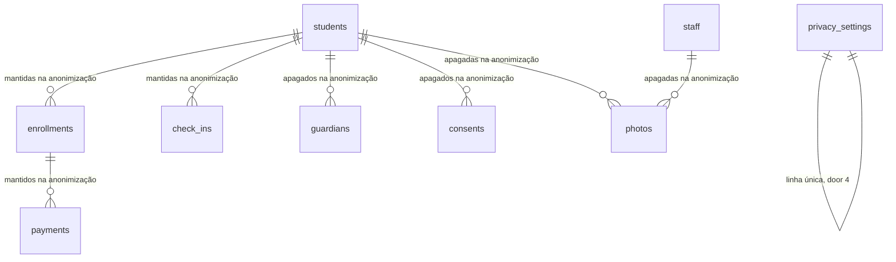

# Privacidade

## Problem

Quando um aluno ou um funcionário pede para ver os próprios dados, ou pede que a academia o esqueça, o sistema não tem resposta. Para atender ao acesso, o Administrador teria de copiar a ficha à mão, bloco a bloco, sem a observação de saúde inteira em lugar nenhum fora da tela e sem as fotos guardadas. Para atender à eliminação, não há caminho: inativar mantém nome, CPF, telefone, saúde, responsáveis e fotos para sempre (AD-030), o CPF continua preso ao cadastro antigo, e nenhuma rota apaga uma foto de um titular junto com o resto. Ex-alunos inativos se acumulam com todos os dados pessoais sem prazo, e o prazo das versões de foto é uma variável de ambiente que só quem implanta muda (AD-051).

O PRD pede, no §3.8: "**RF-28** Exportação dos dados de um titular (portabilidade/acesso) em JSON/PDF", "**RF-29** Anonimização/exclusão a pedido do titular, respeitando prazos legais de retenção (ex.: fiscais)" e "**RF-30** Política de retenção configurável (ex.: exclusão automática de alunos inativos após X anos)"; e, no §3.2, "**RF-08** [...] exclusão definitiva apenas por Administrador, conforme política de retenção". O §9 fixa a meta "Solicitações de titulares atendidas no prazo: 100%"; o §8 descreve a tela 9 como "Auditoria e configurações de privacidade/retenção"; o §13.2 deixa em aberto o "Prazo de retenção de dados de alunos inativos e de fotos antigas". O PRD não dá números de volume de pedidos.

Com isto no ar, o Administrador baixa, da ficha do aluno ou do funcionário, um arquivo JSON com tudo o que o sistema guarda daquela pessoa, ou abre a versão para impressão e a salva em PDF. Anonimiza um titular inativo com um clique confirmado: o que identifica a pessoa some do banco e do bucket, o CPF fica livre, e matrículas, pagamentos e presenças continuam nos relatórios sem nome. Numa tela de privacidade ele liga a anonimização automática de alunos inativos há mais de N anos e escolhe o prazo das versões de foto.

## Flow

Reutiliza a trava da linha do dono e a remoção idempotente dos três objetos de `PhotosService` (`removeObjects`), o temporizador de `PhotoPurge` (AD-050) como molde da tarefa de retenção, `enrollmentStatus` (AD-061) e `paymentStatus` (AD-068) para decidir se há período em aberto, a decifra de `apps/api/src/crypto.ts` (AD-031, AD-034), `audit.record` com `NO_ACTOR` (AD-027, AD-049), a leitura que grava na trilha da AD-057, a guarda por perfil de `apps/api/src/access.ts`, o `ValidationInterceptor` e o `ProblemFilter`. Nenhuma conta de situação é refeita e nenhum segundo caminho de remoção de foto é escrito. O que esta feature cria: a marca de anonimização em `students` e `staff`, o instante da inativação, a configuração de privacidade e as rotas que exportam e anonimizam.

**Exportar (aluno; funcionário igual, sem matrículas, pagamentos, presenças, responsáveis nem consentimentos)**

1. a ficha `/students/<id>` (exists) mostra o bloco "Privacidade" a `admin`; "Exportar dados" chama `GET /api/students/:id/data-export` -> `AccessGuard` (exists): só `admin` -> módulo de privacidade em `apps/api` (new, no door - placement per conventions)
2. o módulo abre uma transação, lê o aluno não anonimizado (door 1) em `students` (exists), decifra `health_notes_enc`, lê `guardians`, `consents` com `consent_terms`, `enrollments` com `plans`, `payments`, `check_ins` e `photos` (todos exist), e lê do bucket a variante `large` de cada foto pelo cliente S3 (exists)
3. grava `student.exported` (door 6) com `audit.record(tx, ...)` na mesma transação; o `200` só sai depois do commit (AD-057)
4. out: o JSON no formato da door 5, como anexo; a versão para impressão (new page, no door - placement per conventions) chama a mesma rota e monta as seções

**Anonimizar a pedido**

1. "Anonimizar" na ficha, confirmado no diálogo, chama `POST /api/students/:id/anonymization` -> `AccessGuard` (exists): só `admin` -> módulo de privacidade
2. numa transação, trava a linha do aluno em `FOR UPDATE` (a trava que a foto, a matrícula e o check-in já usam), confere que não está anonimizado, que está `inactive` e que nenhum período não cancelado está `active` ou `scheduled` pela `enrollmentStatus` nem `pending` ou `overdue` pela `paymentStatus` (exists)
3. remove os três objetos de cada linha de `photos` do aluno pelo `removeObjects` de `PhotosService` (exists); falha do armazenamento desfaz a transação e responde `503` (door 7)
4. apaga as linhas de `photos`, `consents` e `guardians` do aluno, limpa os campos pessoais e grava a marca (door 1), e grava `student.anonymized` (door 6), tudo na mesma transação
5. out: `204`; `enrollments`, `payments` e `check_ins` (exist) continuam apontando para a linha, que agora diz "Titular anonimizado"

**Retenção**

1. a página de privacidade (new page, no door - placement per conventions) chama `GET` e `PUT /api/privacy-settings` -> só `admin` -> módulo de privacidade, que lê e grava a linha única de configuração (door 4) e grava `privacy.settings_updated` (door 6)
2. a troca de foto em `PhotosService` (exists) passa a ler `photoVersionRetentionDays` da configuração (door 4) em vez de `PHOTO_VERSION_RETENTION_DAYS`
3. a tarefa de retenção (new, no door - placement per conventions; temporizador no molde de `PhotoPurge`, door 7) roda na subida e a cada 60 minutos: com `inactiveStudentRetentionYears` nulo não faz nada; senão escolhe os alunos `inactive`, não anonimizados, com instante de inativação (door 3) até agora menos N anos, e anonimiza cada um pelo mesmo caminho do pedido, com `NO_ACTOR`; quem tem período em aberto fica para a próxima execução
4. out: uma linha de log com as contagens

**Quem passa a ignorar o anonimizado**

1. toda rota sob `/api/students/:id` e `/api/staff/:id` (exist) trata a linha anonimizada como inexistente (`404`); `GET /api/students` e `GET /api/staff` (exist) não a listam; `DashboardService` (exists) não a conta
2. `GET /api/check-ins` (exists) e `GET /api/audit-logs` (exists) não mudam: a presença aparece com o nome gravado, "Titular anonimizado", e a trilha não perde linha

## Impact

| Front | What changes |
| --- | --- |
| domain | novo termo: titular - a pessoa a quem os dados se referem; nesta feature, um aluno ou um funcionário. O responsável legal é dado do aluno, não titular à parte (Out of scope) |
| domain | novo termo: anonimizar - limpar de uma ficha tudo o que identifica a pessoa e apagar as linhas e os objetos que só existem por ela, mantendo a linha e o que aponta para ela. É definitivo e é a "exclusão definitiva" da RF-08 e da RF-29. Não se confunde com inativar (AD-030), que guarda tudo |
| domain | novo termo: período em aberto - período não cancelado `active` ou `scheduled` (AD-061), ou `pending` ou `overdue` (AD-068); impede anonimizar um aluno |
| domain | existing term: `status` `inactive` de aluno passa a contar tempo: a retenção ramifica no instante em que o aluno ficou inativo (door 3). Quem ramifica em `status` hoje (`checkInAccess`, `DashboardService`, filtros da lista) não muda |
| domain | existing term: CPF "único" (AD-030, AD-053) passa a ser único entre as fichas identificadas; a anonimizada não tem CPF, e o mesmo CPF pode ser cadastrado de novo, como a AD-030 previa |
| decisões | AD-051 fica `superseded` pela door 4 (a variável sai). AD-036 ("a linha nunca é editada"), AD-038 ("revogar não apaga") e AD-040 ("apagar um aluno definitivamente exige remover as fotos antes") continuam valendo para as rotas que já existem; a anonimização é o único caminho que apaga `guardians`, `consents` e `photos` de um titular de uma vez (door 7) |
| contrato | cinco rotas novas e duas de configuração; códigos novos `subject_not_inactive`, `subject_has_open_periods` e `staff_user_linked`, todos `409`; `storage_unavailable` (AD-044) ganha duas rotas; `AUDIT_ACTIONS` vai de 38 para 43 (door 6). Os schemas de resposta de aluno e funcionário não mudam: a ficha anonimizada nunca é devolvida |
| comportamento existente | toda rota sob `/api/students/:id` (ficha, edição, inativação, responsável, consentimentos, foto, matrículas, pagamentos, situação e presenças de check-in) e sob `/api/staff/:id` (ficha, edição, inativação, vínculo de usuário, foto) responde `404` para a linha anonimizada; as listas a omitem; o card de alunos do painel não a conta; `GET /api/photo-files/...` já responde `404` porque a linha da foto some |
| comportamento existente | o relatório `GET /api/check-ins` mostra "Titular anonimizado" no lugar do nome; o histórico de `/audit` mantém as linhas do titular, e o link "Ver aluno" leva à ficha, que responde não encontrada |
| comportamento existente | o menu do `Shell` ganha "Privacidade" para `admin`; as fichas de aluno e de funcionário ganham o bloco "Privacidade" para `admin`; `apps/web/e2e/shell.spec.ts` confere os itens do menu por perfil e muda junto |
| checks aprovados de outra feature | a `foto-captura` está verificada com checks sobre a variável `PHOTO_VERSION_RETENTION_DAYS`: C4, C28, C29 e C64 deixam de valer, e C6 e C65 deixam de valer na parte que diz "sem a variável" (o padrão 30 passa a vir da configuração). Nenhum deles é editado: os testes deles (`env.test.ts`, `boot.test.ts`, `photos-purge.test.ts`, `tests/repo`, `tests/stack`) mudam no Build desta feature, cada um coberto por um check novo daqui, e `features/foto-captura/checks.md` ganha uma nota apontando para eles, como a `check-in` fez com a `dashboard`. Os checks de `funcionarios` sobre a troca de foto continuam valendo com o padrão 30 |
| stored data | migração `0011`: tira `NOT NULL` de colunas de `students` e `staff` (sempre seguro), acrescenta as marcas e os `CHECK` das doors 1 e 2, que todas as linhas existentes satisfazem (todas identificadas e completas); acrescenta o instante de inativação com backfill a partir de `audit_logs` (door 3) e cria a configuração com a linha única (door 4) |
| ambiente | `PHOTO_VERSION_RETENTION_DAYS` sai de `apps/api/src/env.ts`, de `.env.example` e de `compose.yaml`. Uma instalação que a tenha fixado em outro valor volta a 30 até o Administrador mudar na tela; não há instalação em produção hoje |
| backups | um titular anonimizado continua nos backups até eles girarem (PRD §4: diário, RPO 24 h). A retenção dos backups é de `operacao` (Out of scope) |
| `.specs` | aprovado o plano: as doors 1 a 7 viram AD-075 a AD-081 em `STATE.md`, a AD-051 passa a `superseded by` a da door 4, e a linha 13 do `ROADMAP.md` e a questão de retenção de "Decisões em aberto" registram o que foi decidido |

## Relations

Restrições de mão única: a ficha anonimizada não tem nenhum dado pessoal e está `inactive`, e a identificada tem os obrigatórios, pelo banco (doors 1 e 2); a anonimização não se desfaz, e nenhuma rota limpa a marca (doors 1 e 2); o funcionário anonimizado não tem usuário vinculado (door 2); o aluno tem instante de inativação se e somente se está `inactive` (door 3); a configuração de privacidade é uma linha só, criada pela migração e nunca apagada (door 4). Sem colunas e sem tipos aqui.

## Surface

Rotas novas. Todas também podem responder com a linha de erro comum da `auth-rbac` (`403 csrf_rejected` fora de `GET`, `403 two_factor_enrollment_required`).

| Route | In | Out | Status |
| --- | --- | --- | --- |
| `GET /api/students/:id/data-export` | `id` | anexo JSON da door 5: `formatVersion` · `exportedAt` · `subject` (`student`) · `student` · `guardians[]` · `consents[]` · `enrollments[]` · `payments[]` · `checkIns[]` · `photos[]` | `200`, `401`, `403`, `404`, `503` (`storage_unavailable`) |
| `POST /api/students/:id/anonymization` | `id`, sem corpo | nada | `204`, `401`, `403`, `404`, `409` (`subject_not_inactive`, `subject_has_open_periods`), `503` (`storage_unavailable`) |
| `GET /api/staff/:id/data-export` | `id` | anexo JSON da door 5: `formatVersion` · `exportedAt` · `subject` (`staff`) · `staff` · `user` · `photos[]` | `200`, `401`, `403`, `404`, `503` (`storage_unavailable`) |
| `POST /api/staff/:id/anonymization` | `id`, sem corpo | nada | `204`, `401`, `403`, `404`, `409` (`subject_not_inactive`, `staff_user_linked`), `503` (`storage_unavailable`) |
| `GET /api/privacy-settings` | nada | `inactiveStudentRetentionYears` (inteiro ou `null`) · `photoVersionRetentionDays` | `200`, `401`, `403` |
| `PUT /api/privacy-settings` | `inactiveStudentRetentionYears`, `photoVersionRetentionDays` | os mesmos dois campos | `200`, `401`, `403`, `422` (`validation_failed`) |

## Landing

| One-way door | Literal shape | Alternative rejected |
| --- | --- | --- |
| 1. o aluno é anonimizado no lugar, com marca e `CHECK` pelo banco | migração `0011`: `students.anonymized_at timestamptz` anulável; `cpf`, `birth_date` e `phone` perdem `NOT NULL`; `CONSTRAINT students_anonymized_clean CHECK (anonymized_at IS NULL OR (name = 'Titular anonimizado' AND status = 'inactive' AND cpf IS NULL AND birth_date IS NULL AND sex IS NULL AND email IS NULL AND phone IS NULL AND address IS NULL AND emergency_contact_name IS NULL AND emergency_contact_phone IS NULL AND health_notes_enc IS NULL AND inactivated_at IS NOT NULL))`; `CONSTRAINT students_identified_complete CHECK (anonymized_at IS NOT NULL OR (cpf IS NOT NULL AND birth_date IS NOT NULL AND phone IS NOT NULL))`; `students_cpf_unique` não muda (nulos não colidem). Nenhuma rota limpa `anonymized_at`; toda leitura de aluno por id ou em lista filtra `anonymized_at IS NULL`. Campo pessoal novo em `students` entra nos dois `CHECK` | apagar a linha e tudo o que aponta para ela - o usuário escolheu anonimizar (pergunta 1, 2026-10-17): somem o histórico de presença e de pagamento, e o PRD pede respeitar a retenção fiscal; valores substitutos (`cpf` `anon-<id>`, nascimento `1900-01-01`) - quebram o formato de 11 dígitos e o schema de saída, e um relatório os contaria como dados; valor `anonymized` em `status` - todo consumidor que ramifica em `status` (o enum do contrato, `checkInAccess`, o card do painel, o filtro da lista) teria de aprender um quarto valor; tabela de arquivo para onde a linha se muda - `enrollments`, `check_ins` e `photos` apontam para `students` por chave estrangeira |
| 2. o funcionário é anonimizado da mesma forma | migração `0011`: `staff.anonymized_at timestamptz` anulável; `cpf`, `position`, `hired_at` e `phone` perdem `NOT NULL`; `CONSTRAINT staff_anonymized_clean CHECK (anonymized_at IS NULL OR (name = 'Titular anonimizado' AND status = 'inactive' AND user_id IS NULL AND cpf IS NULL AND position IS NULL AND department IS NULL AND hired_at IS NULL AND phone IS NULL AND email IS NULL))`; `CONSTRAINT staff_identified_complete CHECK (anonymized_at IS NOT NULL OR (cpf IS NOT NULL AND position IS NOT NULL AND hired_at IS NOT NULL AND phone IS NOT NULL))`. Desvincular o usuário continua sendo `DELETE /api/staff/:id/user` (AD-053), antes | desvincular o usuário dentro da anonimização - mexeria no acesso de alguém ao sistema sem a linha `staff.user_unlinked` e sem o Administrador ver; anonimizar também a conta em `users` - a tabela é do Better Auth (AD-017) e `audit_logs.user_id` aponta para ela (Out of scope) |
| 3. o instante da inativação é guardado no aluno | migração `0011`: `students.inactivated_at timestamptz` anulável com `CONSTRAINT students_inactivated_at_matches CHECK ((status = 'inactive') = (inactivated_at IS NOT NULL))`; toda escrita que põe `status` em `inactive` (`DELETE` e `PATCH`) grava `now()`, e a que tira o limpa; reativar e inativar de novo recomeça a contagem. Backfill: para cada aluno `inactive`, o `created_at` da linha mais recente de `audit_logs` com `entity_id` igual ao aluno e `diff->'values'->'status'->>'to' = 'inactive'`; sem linha, `updated_at` | ler a trilha a cada execução da retenção - a regra de negócio passaria a depender de `audit_logs`, e um `UPDATE` de suporte fora da API não deixaria linha; `updated_at` - qualquer edição de telefone recomeçaria o prazo de anos; contar a partir do fim do último período - um inativo sem matrícula nunca venceria |
| 4. a configuração de privacidade é uma linha única no banco, e a variável sai | migração `0011`: `CREATE TABLE privacy_settings (id boolean PRIMARY KEY DEFAULT true CHECK (id), inactive_student_retention_years integer CHECK (inactive_student_retention_years BETWEEN 1 AND 20), photo_version_retention_days integer NOT NULL DEFAULT 30 CHECK (photo_version_retention_days BETWEEN 1 AND 365), updated_at timestamptz NOT NULL DEFAULT now())` e `INSERT INTO privacy_settings DEFAULT VALUES`; nulo em `inactive_student_retention_years` é "desligado" e é o valor inicial (pergunta 2, 2026-10-17). Nenhuma rota insere ou apaga a linha. `PHOTO_VERSION_RETENTION_DAYS` sai de `env.ts`, `.env.example` e `compose.yaml` (supersede a AD-051); a troca de foto lê o valor na hora, e o que já foi guardado mantém o `expires_at` (AD-047). Configuração nova de privacidade é coluna nova nesta linha | tabela chave-valor - cada valor vira texto e o `CHECK` de cada um sai do banco; manter a variável para as fotos - duas fontes para a retenção, e a AD-051 já anunciava a saída; anonimização automática ligada com um padrão (5 anos) - o prazo é decisão jurídica da academia (PRD §13.2), e um padrão ligado apagaria fichas no primeiro dia de uma instalação |
| 5. o formato da exportação é JSON versionado, e a foto vai dentro do arquivo | `Content-Type: application/json`, `Content-Disposition: attachment; filename="aluno-<id>.json"` (ou `funcionario-<id>.json`), `Cache-Control: no-store`; corpo com `formatVersion: 1`, `exportedAt` (instante), `subject` (`student` ou `staff`) e as coleções da `Surface`, todas presentes, `[]` quando vazias; chaves em camelCase como as do resto da API; datas `aaaa-mm-dd`, instantes ISO 8601 em UTC; cada foto com `image` igual a `data:image/webp;base64,<variante large>`. Mudar o formato é `formatVersion: 2`. O PDF é a versão para impressão da mesma resposta no navegador | PDF gerado no servidor - uma dependência nova e uma segunda renderização dos mesmos dados; ZIP com as fotos como arquivos - dependência nova para empacotar; foto como URL assinada - vale 300 s (AD-043), e o arquivo que o titular guarda ficaria com um link morto; sem `formatVersion` - o arquivo sai do sistema e não há como dizer a quem o lê que a forma mudou |
| 6. ações novas na trilha | em `AUDIT_ACTIONS`, depois das 38 existentes, nesta ordem: `student.exported`, `student.anonymized`, `staff.exported`, `staff.anonymized`, `privacy.settings_updated`. Nas de aluno e funcionário, `entity` igual a `student` ou `staff` e `entity_id` igual ao id do titular, `diff` nulo. Em `privacy.settings_updated`, `entity` igual a `privacy_settings`, `entity_id` nulo, campos registráveis (AD-026) `inactiveStudentRetentionYears` e `photoVersionRetentionDays`, só os que mudaram. A anonimização pela retenção grava `student.anonymized` com `NO_ACTOR` (AD-049) | `student.deleted` - a linha não é apagada, e o nome mentiria no filtro "Ação"; `student.retention_anonymized` à parte - o efeito é o mesmo, e o autor nulo já diz que foi o sistema; registrar na trilha o nome ou o CPF de quem foi anonimizado - poria de volta, numa tabela que não apaga (AD-024), o que a anonimização tirou |
| 7. a ordem da anonimização, e a retenção num temporizador | numa transação só: trava a linha do titular em `FOR UPDATE`, confere as condições, remove os três objetos de cada foto (remoção idempotente, a de `removeObjects`), apaga `photos`, `consents` e `guardians`, limpa a ficha, grava a trilha e faz o commit; falha do armazenamento desfaz tudo e responde `503`, e repetir depois termina. A retenção é um temporizador do Node no processo da API que executa na subida e a cada 60 minutos (molde da AD-050), um titular por transação; falha num titular vira linha de log e não impede os seguintes | apagar as linhas primeiro e os objetos depois - uma falha no meio deixaria no bucket a foto de alguém anonimizado, sem linha que aponte para ela, e nada a apagaria; remover os objetos antes de travar e conferir - uma recusa por período em aberto chegaria com as fotos já apagadas; fila ou `apps/worker` - a AD-046 e a AD-050 já recusaram processo e dependência novos |

- Nothing else in this change is hard to reverse

## Criteria

### S1: Exportar os dados de um aluno (P1)

O Administrador baixa um arquivo com tudo o que o sistema guarda de um aluno.

**Acceptance Criteria**

1. WHEN um usuário `admin` chama `GET /api/students/:id/data-export` de um aluno não anonimizado THEN the system SHALL responder `200` com `Content-Type` `application/json`, `Content-Disposition` igual a `attachment; filename="aluno-<id>.json"`, `Cache-Control` igual a `no-store` e um corpo com exatamente as chaves `formatVersion` (igual a `1`), `exportedAt`, `subject` (igual a `student`), `student`, `guardians`, `consents`, `enrollments`, `payments`, `checkIns` e `photos`
2. The system SHALL devolver em `student` todos os campos da RF-05 que a ficha guarda, com `healthNotes` decifrado, mais `status`, `createdAt` e `inactivatedAt`
3. The system SHALL devolver em `guardians` todas as linhas de responsável do aluno, da mais antiga para a mais recente, e em `consents` todas as linhas de consentimento, revogadas inclusive, cada uma com `purpose`, `termVersion`, `termText`, `grantedBy`, `grantedAt` e `revokedAt`
4. The system SHALL devolver em `enrollments` todos os períodos do aluno, cancelados inclusive, com o nome atual do plano, `startsAt`, `endsAt`, `priceCents` e `cancelledAt`; em `payments` todas as confirmações, desfeitas inclusive, com o `startsAt` do período, `createdAt` e `voidedAt`; e em `checkIns` todas as presenças com `day` e `checkedInAt`, sem quem registrou
5. The system SHALL devolver em `photos` uma entrada por linha de `photos` do aluno, a corrente e as guardadas, com `version`, `isCurrent`, `createdAt`, `expiresAt` e `image` igual a `data:image/webp;base64,` seguido dos bytes da variante `large` guardada no bucket
6. WHEN o aluno não tem responsável, consentimento, período, pagamento, presença ou foto THEN the system SHALL devolver a chave correspondente igual a `[]`
7. WHEN a rota responde `200` THEN the system SHALL ter gravado uma linha `student.exported` com o `entity_id` do aluno, o usuário, o IP e o user-agent da requisição e `diff` nulo
8. IF a gravação da linha de trilha falha THEN the system SHALL responder `500` sem nenhum dado do aluno no corpo
9. IF o armazenamento não responde ao ler uma foto THEN the system SHALL responder `503` com `code` igual a `storage_unavailable` e não gravar linha de trilha
10. IF a rota é chamada por `reception`, `hr_finance` ou `instructor` THEN the system SHALL responder `403` com `code` igual a `forbidden` e não gravar linha de trilha; sem sessão, `401` com `unauthorized`; com aluno que não existe, `404` com `not_found`

**Independent test:** criar um aluno com responsável, consentimento, um período pago, uma presença e uma foto trocada uma vez; exportar como `admin` e achar uma entrada em cada coleção e duas fotos, a imagem decodificável como WebP 600×800; contar uma linha `student.exported` a mais.

### S2: Anonimizar um aluno a pedido (P1)

O Administrador apaga o que identifica um aluno inativo e mantém o histórico sem nome.

**Acceptance Criteria**

11. WHEN um usuário `admin` chama `POST /api/students/:id/anonymization` de um aluno `inactive` sem período em aberto THEN the system SHALL responder `204` e deixar a linha com `name` igual a `Titular anonimizado`, `status` `inactive`, `anonymized_at` preenchido e `cpf`, `birth_date`, `sex`, `email`, `phone`, `address`, `emergency_contact_name`, `emergency_contact_phone` e `health_notes_enc` nulos
12. WHEN a anonimização responde `204` THEN the system SHALL ter apagado todas as linhas de `guardians` e de `consents` do aluno
13. WHEN a anonimização responde `204` THEN the system SHALL ter apagado todas as linhas de `photos` do aluno, a corrente e as guardadas, e os três objetos (`thumb`, `medium`, `large`) de cada uma no bucket
14. WHEN a anonimização responde `204` THEN the system SHALL manter as linhas de `enrollments`, `payments` e `check_ins` do aluno com o mesmo número e o mesmo conteúdo de antes
15. WHEN um aluno foi anonimizado THEN the system SHALL aceitar `POST /api/students` com o CPF que ele tinha e responder `201`
16. WHEN a anonimização responde `204` THEN the system SHALL ter gravado uma linha `student.anonymized` com o `entity_id` do aluno, o usuário, o IP e o user-agent da requisição e `diff` nulo, e nenhuma linha de `audit_logs` gravada antes SHALL mudar
17. IF o aluno está `active` ou `suspended` THEN the system SHALL responder `409` com `code` igual a `subject_not_inactive` e não mudar nenhuma linha nem objeto
18. IF o aluno tem um período não cancelado `active` ou `scheduled` em hoje (`America/Sao_Paulo`) THEN the system SHALL responder `409` com `code` igual a `subject_has_open_periods` e não mudar nenhuma linha nem objeto
19. IF o aluno tem um período não cancelado com `paymentStatus` `pending` ou `overdue` THEN the system SHALL responder `409` com `code` igual a `subject_has_open_periods` e não mudar nenhuma linha nem objeto
20. WHEN o único período do aluno tem `endsAt` igual a D e está pago THEN the system SHALL responder `409` `subject_has_open_periods` na chamada das `02:59:59Z` de D+1 e `204` na das `03:00:00Z`
21. IF o armazenamento falha ao remover um objeto THEN the system SHALL responder `503` com `code` igual a `storage_unavailable`, deixar `students`, `guardians`, `consents`, `photos` e `audit_logs` como estavam, e uma nova chamada com o armazenamento de volta SHALL responder `204`
22. WHEN duas anonimizações do mesmo aluno chegam ao mesmo tempo THEN the system SHALL responder `204` a exatamente uma e `404` à outra, com uma linha `student.anonymized` só
23. WHEN uma anonimização e um envio de foto do mesmo aluno chegam ao mesmo tempo THEN the system SHALL terminar sem nenhuma linha de `photos` do aluno e sem nenhum objeto sob `photos/main/<id>/` no bucket
24. IF a rota é chamada por `reception`, `hr_finance` ou `instructor` THEN the system SHALL responder `403` com `code` igual a `forbidden` e não mudar nenhuma linha; sem sessão, `401`; com aluno que não existe ou já anonimizado, `404` com `not_found`

**Independent test:** inativar um aluno com responsável, consentimento, um período pago vencido, uma presença e uma foto; anonimizar e achar `204`, a ficha limpa, nenhum objeto no bucket, o período, o pagamento e a presença intactos; cadastrar outro aluno com o mesmo CPF e achar `201`.

### S3: O aluno anonimizado some do uso diário (P1)

Nenhuma tela de atendimento acha o anonimizado, e os relatórios continuam somando.

**Acceptance Criteria**

25. WHEN o aluno está anonimizado THEN the system SHALL responder `404` com `code` igual a `not_found` em cada rota sob `/api/students/:id`: `GET`, `PATCH` e `DELETE /api/students/:id` (o responsável entra por esse `PATCH`; não há rota própria), `GET`, `POST` e `DELETE` de consentimentos, `GET`, `POST`, `PUT` e `DELETE` da foto, `GET`, `POST` e `DELETE` de matrículas, `GET`, `POST` e `DELETE` de pagamentos, `GET .../check-in-status`, `GET` e `POST .../check-ins`, `GET .../data-export` e `POST .../anonymization`, sem mudar nenhuma linha
26. The system SHALL omitir o aluno anonimizado de `GET /api/students`, com qualquer `q` e qualquer `status`, e do `total` dessa lista
27. The system SHALL omitir o aluno anonimizado das contagens de `students` em `GET /api/dashboard`
28. WHEN o relatório `GET /api/check-ins` inclui uma presença de aluno anonimizado THEN the system SHALL devolvê-la com `student.name` igual a `Titular anonimizado`, e o `total` SHALL ser o mesmo de antes da anonimização
29. WHEN o aluno é anonimizado THEN the system SHALL manter em `GET /api/audit-logs?entityId=<id>` todas as linhas que havia antes, mais a de `student.anonymized`

**Independent test:** anonimizar um aluno com uma presença; buscar pelo CPF e pelo nome antigos e não achar; abrir a ficha pelo id e achar `404`; ler o relatório do dia da presença e achar "Titular anonimizado" com o mesmo total.

### S4: Exportar e anonimizar um funcionário (P2)

As mesmas duas ações sobre a ficha de funcionário.

**Acceptance Criteria**

30. WHEN um usuário `admin` chama `GET /api/staff/:id/data-export` de um funcionário não anonimizado THEN the system SHALL responder `200` com os cabeçalhos da AC 1 e `filename="funcionario-<id>.json"`, e um corpo com exatamente `formatVersion` (`1`), `exportedAt`, `subject` (`staff`), `staff` (todos os campos da RF-09 que a ficha guarda, mais `status`, `createdAt`), `user` (`email` e `role` do usuário vinculado, ou `null`) e `photos` no formato da AC 5
31. WHEN a exportação de funcionário responde `200` THEN the system SHALL ter gravado uma linha `staff.exported` com o `entity_id` do funcionário e `diff` nulo; IF o armazenamento não responde THEN `503` `storage_unavailable` sem linha
32. WHEN um usuário `admin` chama `POST /api/staff/:id/anonymization` de um funcionário `inactive` sem usuário vinculado THEN the system SHALL responder `204`, deixar a linha com `name` igual a `Titular anonimizado`, `anonymized_at` preenchido e `cpf`, `position`, `department`, `hired_at`, `phone` e `email` nulos, apagar todas as linhas de `photos` do funcionário e os três objetos de cada, e gravar `staff.anonymized` com `diff` nulo
33. IF o funcionário está `active` THEN the system SHALL responder `409` com `code` igual a `subject_not_inactive`; IF tem usuário vinculado THEN `409` com `code` igual a `staff_user_linked`; nos dois casos sem mudar linha nem objeto
34. IF o armazenamento falha ao remover um objeto de foto do funcionário THEN the system SHALL responder `503` `storage_unavailable` e deixar `staff`, `photos` e `audit_logs` como estavam
35. WHEN o funcionário está anonimizado THEN the system SHALL responder `404` em cada rota sob `/api/staff/:id` (`GET`, `PATCH`, `DELETE`, `PUT` e `DELETE` de `/user`, `POST`, `PUT` e `DELETE` da foto, `data-export`, `anonymization`) e omiti-lo de `GET /api/staff`, sem gravar `staff.viewed`
36. WHEN um funcionário foi anonimizado THEN the system SHALL aceitar `POST /api/staff` com o CPF que ele tinha e responder `201`
37. IF as rotas de exportação ou anonimização de funcionário são chamadas por `hr_finance`, `reception` ou `instructor` THEN the system SHALL responder `403` com `code` igual a `forbidden` sem gravar linha nem mudar dado; sem sessão, `401`; funcionário que não existe, `404`

**Independent test:** inativar um funcionário sem usuário e com foto; exportar e achar a foto; anonimizar e achar `204`, a ficha fora da lista e o CPF livre para um cadastro novo.

### S5: Configurar a retenção (P1)

O Administrador lê e muda os dois prazos.

**Acceptance Criteria**

38. WHEN um usuário `admin` chama `GET /api/privacy-settings` THEN the system SHALL responder `200` com exatamente `inactiveStudentRetentionYears` e `photoVersionRetentionDays`, iguais a `null` e `30` numa instalação recém-migrada
39. WHEN um usuário `admin` chama `PUT /api/privacy-settings` com valores válidos THEN the system SHALL responder `200` com os valores gravados, e o `GET` seguinte SHALL devolver os mesmos
40. The system SHALL aceitar `inactiveStudentRetentionYears` igual a `null`, `1` e `20`, e recusar `0`, `21`, `1.5`, texto e a chave ausente com `422` `validation_failed` e um item em `errors` de `path` igual a `inactiveStudentRetentionYears`
41. The system SHALL aceitar `photoVersionRetentionDays` igual a `1` e `365`, e recusar `0`, `366`, `1.5`, `null`, texto e a chave ausente com `422` `validation_failed` e um item em `errors` de `path` igual a `photoVersionRetentionDays`
42. WHEN o `PUT` muda um ou os dois valores THEN the system SHALL gravar uma linha `privacy.settings_updated` com `entity_id` nulo e `diff` com `from` e `to` só dos campos que mudaram; WHEN não muda nenhum THEN the system SHALL responder `200` sem gravar linha
43. WHEN `photoVersionRetentionDays` é D THEN the system SHALL gravar na foto trocada, de aluno e de funcionário, `expires_at` entre o instante antes e o depois da troca mais D dias, e as versões guardadas antes da mudança SHALL manter o `expires_at` que tinham
44. The system SHALL subir a API sem `PHOTO_VERSION_RETENTION_DAYS` no ambiente, sem a chave no schema de ambiente, em `.env.example` e em `compose.yaml`
45. IF as rotas são chamadas por `reception`, `hr_finance` ou `instructor` THEN the system SHALL responder `403` com `code` igual a `forbidden` e não mudar a configuração; sem sessão, `401`

**Independent test:** ler a configuração e achar `null` e `30`; gravar `5` anos e `7` dias; trocar uma foto e achar `expires_at` a 7 dias; contar uma linha `privacy.settings_updated`.

### S6: Anonimização automática de inativos (P1)

Com o prazo ligado, o sistema anonimiza sozinho quem está inativo há mais de N anos.

**Acceptance Criteria**

46. WHEN `DELETE /api/students/:id` ou `PATCH` com `status` `inactive` muda um aluno para `inactive` THEN the system SHALL gravar `inactivated_at` igual ao instante da mudança; WHEN o `PATCH` tira o aluno de `inactive` THEN the system SHALL deixar `inactivated_at` nulo; e uma nova inativação SHALL gravar o instante novo
47. WHEN a migração `0011` roda sobre alunos `inactive` existentes THEN the system SHALL gravar em `inactivated_at` o `created_at` da linha mais recente de `audit_logs` daquele aluno cujo `diff` leva `status` a `inactive`, ou `updated_at` quando não há essa linha
48. WHILE `inactiveStudentRetentionYears` é `null` the system SHALL não anonimizar nenhum aluno em nenhuma execução da retenção
49. WHEN `inactiveStudentRetentionYears` é N e um aluno sem período em aberto ficou `inactive` no instante T THEN the system SHALL anonimizá-lo na execução em T mais N anos e não na execução em T mais N anos menos 1 segundo, com o efeito das AC 11 a AC 14
50. WHEN a retenção anonimiza um aluno THEN the system SHALL gravar `student.anonymized` com `user_id`, `ip` e `user_agent` nulos e `diff` nulo
51. IF um aluno vencido pela retenção tem período em aberto THEN the system SHALL não anonimizá-lo nessa execução e anonimizar os demais vencidos
52. The system SHALL nunca anonimizar pela retenção um aluno `active` ou `suspended`, qualquer que seja a idade do cadastro
53. IF o armazenamento falha ao anonimizar um aluno na retenção THEN the system SHALL deixar esse aluno como estava, anonimizar os demais vencidos e continuar de pé
54. The system SHALL executar a retenção na subida da API e a cada 60 minutos
55. WHEN uma execução da retenção anonimiza ou pula alunos THEN the system SHALL escrever uma linha de log JSON com `msg` igual a `retention applied`, `anonymized` e `skipped` com as contagens, e nenhum nome, CPF ou id de aluno; e uma falha SHALL escrever uma linha com `level` `error` sem texto de erro nem chave de objeto

**Independent test:** com o relógio fixado, inativar dois alunos há 3 anos, um deles com período não pago; ligar a retenção em 2 anos e rodar uma execução; achar um anonimizado com a linha de trilha sem autor, o outro intacto, e a linha de log com `anonymized: 1` e `skipped: 1`.

### S7: As telas (P2)

Os botões nas fichas, a versão para impressão e a página de privacidade.

**Acceptance Criteria**

56. The system SHALL exibir na ficha do aluno e na do funcionário, só para `admin`, o bloco "Privacidade" com "Exportar dados", "Versão para impressão" e "Anonimizar"
57. WHEN "Exportar dados" é clicado THEN the system SHALL baixar o arquivo da rota de exportação com o nome que ela dá
58. WHEN "Anonimizar" é clicado THEN the system SHALL abrir um diálogo que diz "Os dados pessoais, as fotos, os responsáveis e os consentimentos serão apagados. Matrículas, pagamentos e presenças ficam sem identificação. Isto não pode ser desfeito." com "Cancelar" e "Anonimizar"; "Cancelar" SHALL fechar o diálogo sem chamar a API
59. WHEN a anonimização responde `204` THEN the system SHALL levar à lista (`/students` ou `/staff`) e exibir "Titular anonimizado."
60. IF a anonimização responde `409` ou `503` THEN the system SHALL exibir no diálogo, por `code`: `subject_not_inactive` "Inative o cadastro antes de anonimizar."; `subject_has_open_periods` "Cancele ou confirme os períodos em aberto antes de anonimizar."; `staff_user_linked` "Desvincule o usuário antes de anonimizar."; `storage_unavailable` "Armazenamento de fotos indisponível. Tente de novo."; e com outro status, "Não foi possível anonimizar."
61. WHEN a versão para impressão abre THEN the system SHALL exibir cada coleção da exportação numa seção com título em pt-BR, datas em `dd/MM/aaaa`, as fotos pela `image` e "Nenhum registro." na seção vazia, e o botão "Imprimir", que chama a impressão do navegador
62. IF a exportação falha na versão para impressão ou no download THEN the system SHALL exibir "Não foi possível exportar os dados." e o botão "Tentar novamente"
63. The system SHALL exibir o item "Privacidade" no menu só para `admin`; WHEN outro perfil abre `/privacy` THEN the system SHALL exibir "Você não tem permissão para acessar esta página." sem chamar a rota de configuração
64. WHEN um `admin` abre `/privacy` THEN the system SHALL exibir "Anonimizar alunos inativos há mais de" com o número de anos ou "Desligado", e "Guardar versões de foto por" com o número de dias, e salvar SHALL exibir "Configurações salvas."; o `422` SHALL exibir a `message` de cada item de `errors` junto do campo
65. The system SHALL exibir nomes, textos de termo e textos livres da exportação com marcação como texto literal, sem criar elemento
66. The system SHALL rotular as cinco ações novas em `/audit` em pt-BR: "Dados de aluno exportados", "Aluno anonimizado", "Dados de funcionário exportados", "Funcionário anonimizado" e "Configuração de privacidade alterada"
67. IF `GET /api/privacy-settings` falha ao abrir `/privacy` THEN the system SHALL exibir "Não foi possível carregar a configuração." e o botão "Tentar novamente", sem o formulário

**Independent test:** subir a stack, entrar como Administrador, exportar a ficha de um aluno e abrir a versão para impressão; inativar e anonimizar o aluno pelo diálogo e voltar à lista com "Titular anonimizado."; ligar a retenção em `/privacy` e ver "Configurações salvas."

## Out of scope

Product capabilities only. Process and harness rules live in AGENTS.md or as Observable `n/a`.

| Excluded | Why |
| --- | --- |
| Apagar a linha do titular e as que apontam para ela | o usuário escolheu anonimizar (pergunta 1); o histórico e a retenção fiscal ficam (door 1) |
| Desfazer uma anonimização | é a eliminação que o titular pediu; o que voltaria são os dados que não existem mais |
| Anonimizar ou exportar a conta de usuário (`users`) de um funcionário | a tabela é do Better Auth (AD-017), `audit_logs.user_id` e `check_ins.checked_in_by` apontam para ela, e desativar o acesso já existe em `/users`; a exportação de funcionário traz só `email` e `role` |
| Responsável legal como titular à parte (exportar ou anonimizar só o responsável) | o responsável é dado do aluno (AD-036); sai com o aluno na anonimização e vem na exportação dele |
| Retenção automática de funcionários inativos | a RF-30 dá o exemplo de alunos; funcionário é anonimizado a pedido |
| Reter o arquivo original da foto por prazo curto (RF-15, "opção configurável") | o original não é guardado hoje (`foto-pipeline`); a opção é capacidade nova de armazenamento, não de privacidade |
| Exportação e pedido feitos pelo próprio titular | "exportações LGPD self-service" são fase 2 (PRD §10) |
| Registro de pedidos de titular com prazo e situação | o PRD mede "atendidas no prazo" (§9), mas não pede o registro; a trilha guarda quando cada exportação e anonimização aconteceu |
| Anonimizar ou expurgar linhas de `audit_logs` | a trilha não guarda dado pessoal no `diff` (AD-026) e é append-only (AD-024); o id do titular que fica nela não identifica ninguém depois da ficha limpa |
| Retenção dos backups | `operacao` (PRD §4, backup) |
| PDF gerado no servidor | a versão para impressão do navegador salva em PDF (door 5) |

## Assumptions

Defaults that are not already a numbered criterion. Drop a row once it is.

| Assumption | Chosen default | Rationale | Confirmed? |
| --- | --- | --- | --- |
| Excluir ou anonimizar | anonimizar no lugar (door 1) | o usuário escolheu "Anonimizar" na pergunta 1, em 2026-10-17 | y |
| Retenção automática | temporizador, desligado até o Administrador escolher N (door 4, door 7) | o usuário escolheu "Temporizador, desligado" na pergunta 2, em 2026-10-17 | y |
| Funcionário é titular desta feature | sim: exportar e anonimizar a pedido (S4) | a linha 13 do `ROADMAP.md` depende da 8 (`funcionarios`), e funcionário é pessoa natural como o aluno || y |
| Quem exporta e anonimiza | só `admin` | o §2 dá as exportações ao Administrador e a RF-08 lhe dá a exclusão definitiva; `hr_finance` lê funcionário, mas não exporta || y |
| PDF | versão para impressão no navegador (door 5) | nenhuma dependência nova; o conteúdo é o mesmo JSON, e "Salvar como PDF" existe em todo navegador da recepção || y |
| Fotos na exportação | todas as linhas do titular, corrente e guardadas, com a variante `large` dentro do arquivo | são dados pessoais que o sistema guarda; a `large` é a maior que existe (o original não é guardado) || y |
| Período não pago impede anonimizar | sim, `409 subject_has_open_periods` (AC 19) | a cobrança é motivo legítimo de guardar (LGPD art. 16); para perdoar a dívida, o Administrador cancela o período antes || y |
| Consentimentos e responsáveis na anonimização | apagados (AC 12) | a prova do consentimento perde o objeto quando o titular deixa de ser identificável, e o responsável é pessoa identificada (nome, CPF, telefone) || y |
| Nome literal do anonimizado | `Titular anonimizado`, o mesmo para aluno e funcionário | a lista do relatório e da trilha mostra um rótulo, não um vazio; um nome único por pessoa (`Titular 3`) seria um pseudônimo, não anonimização || y |
| Limite de anos | de `1` a `20` (door 4) | prazos fiscais e civis do Brasil vão até 10 anos; 20 dá folga sem aceitar um número sem sentido || y |
| Conta dos N anos | `T + N anos` na aritmética de intervalo do Postgres (29/02 mais 1 ano é 28/02), com o relógio da API | é a soma de calendário que a AD-061 já usa para meses || y |
| Busca e lista de check-in, painel | o anonimizado sai por sair de `GET /api/students` (AC 26) | a tela de check-in usa a busca que já existe || y |
| Meta "atendidas no prazo: 100%" (§9) | não é critério | é taxa de operação, não se prova numa execução; a trilha dá o instante de cada atendimento || y |

**Open questions:**

| # | Kind | Question | Until answered |
| --- | --- | --- | --- |
| 1 | blocks go-live | Quantos anos depois da inativação a academia anonimiza um aluno, e qual o prazo das versões de foto (PRD §13.2)? Decisão jurídica da academia, com o DPO (§12) | a retenção automática fica desligada (`null`) e as versões de foto ficam em 30 dias; nada no Build depende da resposta |

## Observable

Worksheet, not the review. `n/a` needs its reason. One row may group the same decision across several routes.

| Surface | Decision | Landing |
| --- | --- | --- |
| screen fichas, bloco "Privacidade" | empty state | n/a - o bloco só tem ações, não lista nada |
| screen fichas, bloco "Privacidade" | loading state | n/a - os botões ficam desabilitados durante a chamada, no molde dos diálogos de `pagamentos`, e isso fica para o diff |
| screen fichas, bloco "Privacidade" | error state | AC 60, AC 62 |
| screen fichas, bloco "Privacidade" | unauthorised state | AC 56 - o bloco não aparece para outro perfil; as rotas respondem `403` (AC 10, AC 24, AC 37) |
| screen fichas, bloco "Privacidade" | destructive action confirms | AC 58 |
| screen versão para impressão | empty, error, ordering | AC 61 ("Nenhum registro."), AC 62, AC 3 e AC 61 (a ordem da exportação) |
| screen versão para impressão | loading state | n/a - página renderizada no servidor, como `/payments` |
| screen versão para impressão | unauthorised state | AC 10 - a rota responde `403`, e a página mostra o estado de sem permissão que as outras já mostram |
| screen `/privacy` | empty, error, unauthorised | AC 64 ("Desligado"), AC 64 (`422`) e AC 67 (falha de carga), AC 63 |
| screen `/privacy` | destructive action confirms | n/a - ligar a retenção não apaga nada na hora do clique; a execução seguinte é que anonimiza, e o rótulo do campo diz o que ela faz |
| API `GET /api/students/:id/data-export` e `GET /api/staff/:id/data-export` | response shape | AC 1 a AC 6, AC 30, door 5 |
| API `POST .../anonymization` | response shape | AC 11, AC 32 - `204` sem corpo |
| API `GET` e `PUT /api/privacy-settings` | response shape | AC 38, AC 39 |
| all new routes | error shape and codes | AC 8 a AC 10, AC 17 a AC 19, AC 21, AC 24, AC 31, AC 33, AC 34, AC 37, AC 40, AC 41, AC 45 - `problem+json` da AD-009; códigos novos só `subject_not_inactive`, `subject_has_open_periods` e `staff_user_linked` |
| all new routes | who may call it | AC 10, AC 24, AC 37, AC 45 - só `admin` |
| all new routes | versioning | o corpo da exportação tem `formatVersion` (door 5), porque sai do sistema; as demais n/a - o único consumidor é `apps/web`, implantado junto |
| all new routes | rate limit | n/a - rotas só de `admin` autenticado; limite por IP fica no proxy, em `operacao` |
| collection `guardians`, `consents`, `enrollments`, `payments`, `checkIns`, `photos` da exportação | ordering | AC 3 para `guardians`; as demais na ordem de criação - fixado como claim no checks a partir desta linha |
| collection da exportação | duplicates | n/a - uma entrada por linha do banco |
| collection da exportação | the exception that does not fit | AC 4 - presença sem quem registrou (dado de outra pessoa) |
| scheduled task retenção | output format | AC 55 |
| scheduled task retenção | flags and defaults | AC 48 (desligada por padrão), AC 54 (subida e 60 minutos) |
| scheduled task retenção | exit codes, failing halfway | AC 53 - não derruba a API; o titular que falhou fica para a próxima |
| document `.env.example` | structure | AC 44 - a chave sai |
| document texto do diálogo de anonimização | what the reader does next | AC 58, AC 60 |

## Sources

- `PRD — Sistema de Gestão de Academia.md` - RF-08, RF-28 a RF-30 (§3.2, §3.8), tela 9 (§8), meta de atendimento (§9), questão de retenção (§13.2)
- `.specs/ROADMAP.md` linha 13 - escopo e dependências (5, 7, 8, 10, 11)
- `.specs/STATE.md` - AD-024, AD-026, AD-030, AD-036 a AD-038, AD-040, AD-047, AD-049 a AD-051, AD-053, AD-057, AD-061, AD-068, AD-071 a AD-074
